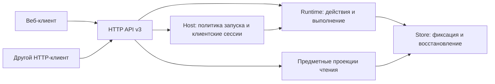

# Дизайн контракта v3

Status: ready-for-agent
Label: ready-for-agent
Date: 2026-10-15

Приложение к [спецификации](spec.md). Это проект будущего контракта, **не действующий API**. Реализация и изменение canonical OpenAPI выполняются только по отдельному поручению. База inventory: HEAD `8617c285eec71d792b2f4e81a021b491a7354a6d`, OpenAPI 1.0.0, 50 операций / 42 пути / 77 component schemas.

В ходе подготовки изменились GLOSSARY и согласованный [план удаления](https://github.com/tgenman/oko/blob/365e2b38f86d6e2bedccbb40b14c615b6f069455/.scratch/remove-aggregate-summaries/spec.md), затем сам контракт: при HEAD `b0db07d870c148177c72e3019ea853158d289873` прочитан OpenAPI 2.0.0 с 49 операциями и 72 схемами. События/обзоры/сжатие истории не входят в целевой API. Реестр ниже сохраняет исходные 50/77 только для учёта снятых элементов ревью. Эта задача принимает результат внешнего удаления, не отменяет его; завершение внешней приёмки не утверждается.

Целевой общий breaking release независимого API и согласованных Telegram-операций — 3.0.0 с префиксом `/api/v3`, поверх 2.0.0. [Telegram-план](../telegram-access/spec.md) задаёт предметную реализацию доступа, профилей и удаления фида; этот документ задаёт их публичный interface. Не требовать промежуточного Telegram-релиза и не выпускать два разных major 3. Перед реализацией сверить фактическую базу; если соседняя версия уже выпущена, оформить единый переход к следующему major.

## 1. Граница приложения

Frontend не задаёт бизнес-правила серверу. Backend не отдаёт имена экранов, DOM, layout, CSS, ключи локального черновика или навигационные команды. Сортировка, snippet, карточки, состав чтения, восстановление и допустимость команд — допустимые предметные проекции, не нарушение независимости.

Вход в доменную implementation и выход из неё имеют типизированные предметные модели. HTTP adapter явно преобразует их в generated DTO; это не сериализация произвольных строк SQLite через Any. Одна typed projection используется несколькими читающими операциями при совпадающем смысле, но разные wire shapes не маскируются одним oversized DTO.

## 2. Общие правила wire types

| Понятие | Представление v3 | Правило |
| --- | --- | --- |
| Идентичности | Именованные строки `MaterialId`, `FeedId`, `FolderId`, `ProblemId`, `CommandId`, `ClientSessionId`, `RevisionId` | Непустые opaque значения. Клиент не разбирает prefix или hash. Проверки допустимых символов/длины у конкретного семейства, а не неверный общий UUID-pattern для старых IDs. SDK кодирует path segments. |
| Время события | `Timestamp`: RFC 3339 string с offset, ответ нормализован в UTC | Не принимать timestamp без timezone. Не смешивать секунды, миллисекунды и строки. Все старые number timestamps переводятся явно; нулевой sentinel не становится датой 1970 года. |
| Неизвестная дата публикации | Обязательный `published_at: Timestamp \| null` | Удаляет пару published/published_known; неизвестная дата не выводится из нуля. Существующий порядок публикаций сохраняется сервером. |
| Календарная дата | `LocalDate`: ISO `YYYY-MM-DD` + отдельный `IanaTimezone` | Статический формат в схеме, существование timezone и правило «не в будущем» на сервере. |
| Длительность | `*_seconds`: конечное положительное число | Явная единица; lease/grace не трактуются как абсолютные timestamps. |
| Ограниченные счётчики | integer, минимум 0, максимум 9007199254740991 | Дробь и boolean запрещены. Для номера версии минимум 1. |
| Точное количество истории | `PositiveDecimal`: string по `^[1-9][0-9]*$`, maxLength 4096 | Единственное представление в request/response, включая малые значения. Это технический лимит размера числа, не лимит количества реально загружаемых публикаций. Нет округления через float/JS Number. |
| Внешние Telegram IDs | Именованные signed/unsigned decimal string | Сохранять точность user/peer/message IDs. Публичного topic_id и выбора темы нет; внутренние read scopes форумов остаются внутри Telegram adapter/ReadSync. |
| Ссылки | Отдельные `SourceUrl` и `MediaUrl` | Внешний источник — валидированный разрешённый URI; медиа — относительный URI того же API origin. Клиент не конструирует путь по внутреннему имени файла. |
| Нет результата | Required nullable только там, где отсутствие — известное состояние | Optional означает непереданное поле, а не синоним null. Для вариантов использовать отдельную ветку, если от наличия зависит набор полей. |
| Дополнительные поля | `additionalProperties: false` для предметных объектов | Typed maps допускаются только при действительном назначении; удалённые OPML choices не являются основанием вводить открытые maps. |
| Произвольный JSON | Только именованный диагностический `JsonValue` | Не используется как тип payload ошибок, состояния работы, настроек, карточки или результата команды. Объём ограничен; секреты исключены. |

**Строгость JSON.** NaN/Infinity, лишние поля, строка вместо JSON boolean/integer и неканоническая PositiveDecimal дают 422 до доменного изменения. Строка `"false"` в JSON не является false. Разрешены только явно описанные преобразования JSON-полей, например PositiveDecimal во внутренний integer и Timestamp во внутреннее время.

**Текстовые HTTP-параметры.** Path/query/header сначала декодируются и разбираются по объявленной лексике, затем проверяются тип и диапазон. `show_hidden=true` и `show_hidden=false` — допустимые query boolean; `1`, `yes`, пустая строка и иные написания отклоняются. Номер версии в path — десятичные цифры, значение >= 1; дробь, знак и пробелы запрещены. Enum сравнивается с опубликованными значениями; opaque IDs остаются строками после однократного URI-декодирования. Отсутствующий optional query получает документированный default; дубли scalar query и неизвестные query keys дают 422, не молча выбирают первое значение. Headers открыты стандартным HTTP-полям, но каждый контрактный header валидируется по своему формату. JSON body от этих транспортных правил не получает coercion.

Границы на prompt, URL и диагностические поля сохраняются из актуальной v2, кроме явно описанного изменения. Проценты квоты имеют границы 0…100 только после подтверждения нормализации текущим adapter; неизвестная квота — null/отсутствующее окно, не выдуманный ноль. Не добавлять повсеместные ограничения «для красоты», не проверив producer.

## 3. Предметные семейства типов

### 3.1 Чтение и содержимое

- `ReadingCard` представляет одну исходную публикацию. Обязательные поля: id, title, folder_id, feed_id, source_url, importance, published_at, snippet и состояние доступности. Не вводить single-value kind или union для удалённых/гипотетических event/digest. Тип source reference различает действительные источники, а состояние доступности — ещё не полученное и сохранённое содержимое.
- `ReadableMaterial` — тип публикации с oneOf вариантов доступности содержимого. Данные карточки и полного материала не имеют общего oversized набора optional-полей. Варианты выделяются по существующему состоянию, а не по удалённому виду групповой карточки.
- `PublicationMaterial` отдельно описывает доступность сохранённого содержания, полноту, состояние текущей загрузки, удаление источником, текущую ревизию и прошлые версии. Pending-публикация имеет явный вариант без выдуманного текста/версии; available-публикация требует text, attachments, previous_versions и completeness. Повторная загрузка не скрывает уже доступную неполную копию. Caption state относится только к YouTube-публикации.
- EventMaterial/DigestMaterial, групповые summaries и recursive sources отсутствуют. Удалённые event/digest-поля отклоняются; бывшие исходники групповых карточек остаются отдельными публикациями после внешней миграции.
- `SourceReference` указывает на исходную публикацию и её feed. Технические Telegram message IDs, если сохраняются как публичная информация, доступны только в Telegram source reference как точные строки. Старые неоднозначные `members: integer[]` заменяются названием с явным смыслом Telegram message IDs. `batch` — внутренняя identity обработки, в карточку v3 не включается. Идентичность исходной публикации и её ссылка от этого не исчезают.
- `source_order` при необходимости сохраняется как явно названная `source_position`, отдельная от даты. Порядок карточек вычисляется сервером; клиент не обязан сортировать их по этому полю.
- `Attachment` сохраняет виды image/video/audio/circle/file, mime и относительный media URL. Изображения и вложения могут быть сведены в один массив только с сохранением порядка и поведения всех видов; перенос не меняет bytes, playback и доступ к прежним версиям.
- `PublicationVersion` имеет собственный обязательный набор содержимого и медиа, положительный version number и revision identity. Прежняя версия не подменяет текущую.
- `ProcessingResult` содержит результат и `Provenance`: unknown/codex/local. Unknown — отдельная ветка с причиной отсутствия происхождения, а не структура, пересекающаяся с local. Codex требует model/reasoning_effort/fast; local — processor_id и известную либо явно неизвестную модель. Происхождение принадлежит результату.
- Фильтрация и индивидуальные тезисы не объединяются в один бессодержательный `AI`. Состояния queued/running/waiting/ready/cancelled/disabled, если применимы, перечислены для конкретного этапа. Ready требует результата; waiting требует типизированной причины и nullable retry_at. Сохраняется показ прежнего принятого результата во время допустимого пересоздания; наличие результата и ход новой попытки описываются отдельно.

### 3.2 Настройки, фиды и история

- `SettingsScope`: oko/folder/feed. Сохраняется одна пара GET/PATCH `/settings/{scope}/{owner}`. Для oko допустим только owner global; для folder/feed — ID существующего ресурса. Неверная лексика/enum даёт 422, недопустимая пара oko/owner — 400, отсутствующий folder/feed — 404. Query sort: newest/oldest/importance; media kind: images/media. Нет отдельных операций для одинакового PATCH трёх уровней.
- `SettingKey` — закрытый набор существующих полей. Effective setting содержит typed value и origin: default, oko, folder, feed с обязательной identity там, где она существует. Тип value зависит от конкретного поля, не от общей смеси string/boolean/integer. Settings ответа feed/folder/oko различаются по scope; данные фида обязательны только в feed-варианте.
- `SettingsPatch` общий для всех scope: originals, theses, prompt_theses, prompt_filters, processor с конкретными типами каждого поля. Отсутствие — оставить, null — удалить override, значение — установить. events/event_hours/digests/schedule/digest_days/prompt_digest исключены на всех уровнях. GET возвращает scope-discriminated snapshot: общий набор effective/overrides, а feed-вариант дополнительно требует публичный Feed. Различие response не требует размножать операции или request types.
- `FeedPatch`: folder_id, importance, initial_days, public_ai, read_history — optional non-null; остальные nullable случаи сохраняются только при действительном reset. Для Telegram access/profile/account/peer/transport не являются изменяемыми полями: попытка смены привязки возвращает typed conflict и не меняет фид. Web не принимает auto_read/read_history; client auto_read по умолчанию false, прежнее явное значение сохраняется. Для иных видов источника допустимость транспорта проверяется по ресурсу. Общая schema описывает форму разрешённых полей, ограничения существующего фида проверяет домен.
- `SubscriptionFeed`: вид источника и состояние подключения отдельны. Telegram содержит response-only TelegramAccess union web/client/legacy_client из раздела 3.2.1, без nullable account/topic-пакета; у RSS Telegram-полей нет. Старые клиентские привязки до подтверждения роли/личности получают явное состояние needs_profile_confirmation без потери ID, контента и alias. NavigationFeed использует тот же публичный Feed плюс count.
- `HistorySelection`: count-вариант требует count PositiveDecimal и не принимает date/timezone; date-вариант требует date/timezone и не принимает count. Не использовать mode default, который делает неполный объект случайно допустимым. Отсутствие initial_history в AddFeed и новом ConnectTelegram (web/client, включая отсутствующий access) означает selection mode=count, count="20". Это default всего отсутствующего поля; явные null, пустой объект и неполная selection дают 422. Для ConnectTelegram это осознанное изменение прежнего HTTP default по Telegram-плану. Существующим фидам без selection default задним числом не назначается, сбор истории миграцией не запускается. Явный запрос догрузки требует selection; в текущем YouTube-сценарии допустим только count.
- `HistoryState`: absent/not_started/discovering/fetching/paused/waiting/complete/cancelled. Absent означает отсутствие сохранённой selection: selection и счётчики запрещены, legacy_since — обязательный Timestamp | null, отражающий только известную прежнюю границу, без её преобразования в выдуманный count/date. Этот вариант не означает отсутствия материалов или остановки live. Not_started означает уже сохранённую selection до начала её выполнения. Все ветки, кроме absent, содержат selection и обязательные общие счётчики loaded/viewed/incomplete/available/retrying/unavailable; waiting содержит причину и retry_at, paused содержит приостановленную фазу, cancelled — завершённый исход. Терминальные ветви не обещают работающий retry. Сведения о фиксации состава и завершении поиска сохраняются как отдельные предметные факты; прежние paused/cancelled/waiting flags не допускают противоречия state.
- `YouTubePatch` отражает частичное изменение, поэтому PUT заменяется PATCH. Управление credentials — отсутствует (оставить) либо closed вариант replace с username/password либо clear без секретных полей. mode/address валидируются вместе с сохранённой конфигурацией. Ответ содержит только признаки наличия credentials. Direct/proxy и waiting/ready состояния отделены.
- `CodexModel` остаётся динамическим каталогом; произвольность model/reasoning_effort ограничена форматом и server lookup, не статическим списком моделей. Параметры только filter/theses — обязательные именованные поля; events/digest не принимаются.

### 3.2.1 Telegram: доступ, профили, уникальность и удаление

Предметные правила задаёт [согласованная Telegram-архитектура](../telegram-access/spec.md). API не дублирует её adapters, claims, lanes, workers и алгоритмы ReadSync. Задача интеграции принимает типизированные результаты этих modules; пока соответствующее поведение не реализовано и не проверено, нельзя считать общий release готовым или подменять его stub-ответами.

**Создание фида.** `POST /telegram/connect` принимает locator источника, тематическую папку, optional initial_history и access. Locator допускает поддержанные профильной спецификацией публичные адреса/username и клиентские marked IDs; это не произвольный URL для загрузки. Отсутствие access означает целиком вариант web, без неявного выбора аккаунта. Closed варианты запроса:

| access.kind | Обязательное | Необязательное | Запрещено |
| --- | --- | --- | --- |
| web | kind | — | profile, account, auto_read, topic_id |
| client | kind, profile: personal или collection | auto_read: strict boolean, default false | произвольный account, topic_id, изменение личности существующего профиля |

Таблица выбирает вариант всего connect-request по access.kind. Вложенный immutable access содержит только kind и, для client, profile; auto_read — отдельное поле client-request и настройка фида, а не часть неизменяемой привязки. У web-request auto_read запрещён и при отсутствующем access. Тем самым последующий разрешённый PATCH auto_read не является сменой доступа.

Ответ содержит новый feed_id и подтверждённый TelegramAccess. У web — нормализованный username и проверенный адрес предпросмотра, без выдуманного peer; у client — role, проверенные account_user_id и peer_id точными строками. Это данные доступа, а не инструкция нарисовать три вкладки. UI сам отображает web/personal/collection как согласованные пользовательские варианты.

У нового фида неизменяемы access, реальная личность аккаунта и источник. `feed_id`/PATCH не превращают connect в переключение или upsert. Для другого доступа — явное удаление и новое добавление. При недоступном источнике не создавать фид, не вступать в группу, не пробовать другой аккаунт и не получать недостающее медиа другим adapter. Группа подключается целиком; публичных topics endpoint и topic_id нет. Внутренние сведения о темах для безопасного прочитанного не становятся API управления темами.

**Старые привязки в ответах.** TelegramAccess для каталога, чтения, настроек и duplicate_source имеет три закрытых варианта по kind: web, client и legacy_client. Последний существует только для сохранённого клиентского фида до сопоставления роли и подтверждения личности. У legacy_client обязательны alias (сохранённое имя аккаунта), peer_id (точная строка либо null, если peer не был сохранён) и source_locator (сохранённый адрес/идентификатор источника); role и account_user_id запрещены. Состояние подключения — needs_profile_confirmation. Alias не является путём или секретом сессии. Данные берутся из сохранённой привязки без внешнего запроса и без догадок. Новый connect принимает только web/client и никогда не возвращает legacy_client при успехе. После подтверждённого сопоставления прежней привязки профильным модулем ответ становится client с проверенными данными, сохраняя feed_id/контент/настройки. Уже подтверждённый client при внешней подмене сессии сохраняет прежнюю проверенную identity и получает состояние ошибки; это не перевод в legacy_client и не смена аккаунта.

**Уникальность.** Подтверждённый дубль возвращает 409 `duplicate_source` с непустым existing_feeds: каждый элемент содержит feed_id, title и access того же response union, включая legacy_client до подтверждения профилей. Обычно элемент один; при сохранённой миграционной коллизии перечисляются все прежние владельцы без выбора победителя. Фиды, папки, история и настройки не меняются. Старый конфликт не останавливает Store и чтение; разрешено явное удаление лишнего фида, а новые подключения блокируются до разрешения claims. Состояние удаления возвращает `deletion_in_progress`, пока claims не освобождены. Сопоставление аккаунтов/адресов и гонки двух подключений решает доменный module. Нельзя обещать вебу распознавание неизвестного переименования/передачи username: предел доказательства из Telegram-спецификации сохраняется, скрытого обращения к клиентскому аккаунту нет. `identity_unconfirmed`/`source_identity_conflict` не маскируются как duplicate.

**Профили.** `GET /telegram/profiles` возвращает состояния ровно двух ролей и доступные непрозрачные ссылки на существующие именованные конфигурации, без путей файлов, session strings и credentials. `PUT /telegram/profiles/{role}` принимает одну configuration_ref, проверяет реальный user ID и только после этого фиксирует привязку. Тот же PUT с той же ссылкой выполняет повторную проверку/восстановление; отдельные bind/check/reconnect endpoints не вводятся. GET сам не запускает внешнюю проверку. Ошибка проверки не сохраняет новую непроверенную привязку. Повтор HTTP после неизвестного исхода всё равно не выполняется автоматически.

ProfileState — closed unconfigured/ready/unavailable/identity_mismatch. У ready обязательны role, configuration_ref, verified_user_id и checked_at. Для неподтверждённого профиля личность не выдумывается; причина и прежняя подтверждённая identity различены. Смена реального аккаунта при зависимых фидах — 409 `profile_in_use`; повторный вход того же аккаунта допустим. Две роли с одним подтверждённым user ID — 409 `profile_account_conflict`. Внешняя подмена конфигурации даёт `account_identity_mismatch`, запрещает чтение/ack этим профилем и не переключает фиды. Старые aliases без сопоставления ролям сохраняются как needs_profile_confirmation; лишние старые аккаунты не удаляются автоматически.

**Прочитанное и содержимое.** Для web нет auto_read и внешнего ack. Для client основание по умолчанию — «Просмотрено»; auto_read после полного сохранения — явная настройка, по умолчанию false. Подтверждение безопасной части форумной группы остаётся внутри ReadSync. Полный пост включает сохранённую статью Telegraph и доступные локальные медиа, если они присутствуют. Неполнота, причина и состояние повторной попытки видны в Material; неуспех загрузки не стирает сохранённую часть. Различие физической ревизии содержимого и авторской версии следует Telegram-архитектуре: дополнение копии обновляет содержимое/актуальность обработки, но само по себе не создаёт ложную авторскую правку.

**Удаление фида.** `DELETE /feeds/{identity}` — локальная очистка подписки, её содержимого/версий/медиа/результатов/настроек/заданий, без Telegram delete/leave/ack. Не вызывать viewed как shortcut. Ответ 200 `RemoveFeedResult` содержит feed_id и state deleting/deleted; deleting означает принятый запрет работы и незавершённую возобновляемую очистку, а не готовое удаление. Подписка со state deleting видна в существующем каталоге до окончания; после удаления исчезает. Отдельный endpoint polling удаления не нужен. Повтор во время deleting возвращает текущий результат, отсутствующий фид — 404. Пока удаление не закончено, повторное подключение блокируется claims; новое добавление получает новый feed_id и не принимает старые поздние ответы. Этот жизненный цикл проверяет реализация Telegram/Subscriptions, HTTP adapter только отражает его.

### 3.3 Состояние, проблемы и восстановление

`RuntimeStatus` содержит runtime_state (running/stopping/stopped/unavailable), профиль lifetime, разрешение выполнять работу, число активных клиентских сессий и typed work summary. Work phase: idle/collecting/processing/deleting/waiting; для processing присутствует operation filter/theses и progress. Одновременная работа разных видов представлена отдельными typed entries, а не одной произвольной строкой stage. Empty jobs не маскируют остановку или недоступность. Сохраняются ready/total sources, состояние YouTube, истории, Telegram reads, проблемы, diagnostic count и согласование просмотренных IDs.

`Problem` — current/retrying/finished: у current/retrying нет finished_at/outcome, у finished они обязательны. Причина и affected resources типизированы; объект ресурса не содержит label как обязательный идентификатор. Клиент может получить название ресурса/человекочитаемое объяснение, но не обязан разбирать его.

`recovery` — массив закрытых вариантов, порядок не задаёт layout. Каждый вариант имеет обязательные цели:

| recovery.kind | Цель и смысл |
| --- | --- |
| configure_processor | processor_id codex/llamacpp; выбрать/исправить конфигурацию обработчика |
| configure_telegram_profile | role personal/collection; привязать или повторно проверить тот же профиль через существующий PUT |
| change_setting | SettingsTarget + непустой список SettingKey; изменить предметную настройку |
| connect_source | source_kind rss/telegram/youtube; начать одиночное подключение |
| inspect_materials | непустой список MaterialId; изучить доступные копии |
| retry_collection | scope all/feed, у feed обязательный feed_id |
| retry_material | непустой список MaterialId; повторить получение |
| retry_theses | непустой список PublicationMaterialId |
| retry_filter | непустой список PublicationMaterialId |
| regenerate | непустой список MaterialId и существующий тип результата |

Общий reconnect_feed исключён: у него нет отдельной операции или скрытого upsert. Для известной роли восстановление авторизации использует configure_telegram_profile и существующий PUT. Для legacy_client без роли проблема содержит affected feed и сохранённую привязку; нельзя выдумывать role ради recovery. Клиент получает доступные конфигурации через GET profiles и предлагает пользователю сопоставить их ролям. Ошибка идентичности источника остаётся типизированной проблемой без обещания переподключить тот же фид: если пользователь выбирает другой источник/доступ, он явно удаляет фид и добавляет новый, с предупреждением о локальной очистке. Нового recovery-варианта или endpoint для этой последовательности нет. Исторический source-reconnect сохраняет причину и диагностический текст, но старое UI-действие не переносится в действующий recovery автоматически.

Это рекомендации для восстановления, не автоматическое разрешение безусловно выполнить команду. Состояние могло измениться после ответа; сервер повторно проверяет допустимость. Ожидание автоматически повторяемой работы имеет typed reason/retry_at и может не содержать ручного recovery. При неизвестном исходе команды recovery не предлагает её повторить. Web adapter выбирает menu/page/focus сам; другие клиенты могут выбрать другую форму или текстовый диалог.

`ProblemCode` — закрытый публичный каталог предметных причин: processor_not_configured, processor_configuration_invalid, public_ai_not_allowed, source_reconnect_required, source_unavailable, material_incomplete, processing_failed, youtube_rate_limited, storage_unavailable, command_failed, command_outcome_unknown, а также отдельные причины сохранения/чтения/удаления, выявленные inventory producer. Внутренние exception names не становятся новыми публичными enum автоматически: неизвестная внешняя ошибка отображается в фиксированный source_unavailable/processing_failed с диагностическими деталями. Историческая нераспознанная запись — отдельный legacy_problem с raw_code для диагностики и без выдуманного действия.

### 3.4 Ошибки и исходы команд

Envelope каждой HTTP-ошибки: обязательные code, message; details зависит от code; diagnostic_id и command_id — явно nullable. Message не является discriminator. Validation details содержит список typed violations: location body/path/query/header, segments (строки/индексы), code и message. Не возвращать сырые input/ctx с токенами, prompts или паролями. При необходимости диагностические данные сохраняются в маскируемом журнале.

| HTTP | Основные коды и данные |
| --- | --- |
| 400 | action_invalid, setting_scope_invalid, source_connection_invalid, processor_choice_invalid; отдельные typed причины, когда клиент может исправить действие |
| 403 | session_required, host_not_allowed, origin_not_allowed; без внутренних секретов |
| 404 | resource_not_found с kind/id; unavailable media/version — отдельный код |
| 409 | runtime_stopped, deletion_in_progress, composition_changed (обязательный новый preview), verification_expired, history_conflict, duplicate_source, identity_unconfirmed, source_identity_conflict, profile_not_configured, account_identity_mismatch, profile_in_use, profile_account_conflict, access_immutable, command_context_mismatch, lifetime_policy_incompatible |
| 410 | api_version_removed или client_session_expired; детали по операции |
| 422 | request_invalid с violations; неизвестные enum, отсутствие required, ошибочный null/type/format |
| 500 | internal_error с diagnostic_id; stack не возвращается |
| 503 | storage_unavailable, processor_unavailable, source_unavailable, profile_unavailable; retry_at только если известен |

Набор операций → ошибок фиксируется в canonical YAML по producer, а не копированием всей таблицы в каждый endpoint. Статусы актуальной v2, которые меняются, перечисляются в semantic review. В частности, структурно неверный YouTube request и пять null FeedPatch становятся 422; допустимый JSON с невозможным состоянием остаётся бизнес-ошибкой.

`X-Oko-Action` сохраняется как correlation ID команды, не idempotency key. Клиент генерирует его до отправки, чтобы сверять потерянный ответ. Без него сервер генерирует ID и возвращает в ответе; после потери такого ответа гарантия сверки отсутствует и это документировано. Переданный ID неверного формата даёт 422, а не молчаливую замену; это явное отличие от v2. Внутренние поля submitted values никогда не входят в receipt.

`CommandContext` — закрытый union по предметной операции, с обязательными typed target и списком изменяемых SettingKey/FeedField только для соответствующих команд. Он описывает уже существующие tracked mutations; не создаётся универсальный endpoint исполнения команд. HTTP method/path, UI-page и DOM-поле исключены. Регистрация на сервере знает operation/target без парсинга URL regexp; клиент строит observation из metadata своей typed операции.

`CommandReceipt`: pending/succeeded/failed/unknown/abandoned. Pending означает известное начало; succeeded/failed — подтверждённый server outcome, failed содержит typed error и не означает отката частично зафиксированных эффектов; unknown означает отсутствие доказанного исхода, а не «команда не поступала». Abandoned означает отказ от проблемы неуспешного редактирования, а не отмену уже выполненной записи. GET неизвестного ID возвращает unknown, без создания команды и без разрешения retry. Observation failed/unknown не перезаписывает подтверждённый terminal server outcome; повтор доставки observation безопасен. Ошибка context сохраняется как 409. Дедупликация исполнения команд и повтор с тем же ID не обещаются.

## 4. Клиентские сессии и запуск

`GET /api/v3/status` сообщает lifetime profile и api_version. В client_presence при прежних defaults: **lease_seconds = 6**, **grace_seconds = 15**, **renew_after_seconds = 2**. Инварианты: lease_seconds > 0, grace_seconds > 0, 0 < renew_after_seconds < lease_seconds. В explicit эти интервалы отсутствуют, сессии не нужны. Профиль фиксируется при запуске. api_version служит совместимости клиента, digest — только проверке артефактов одной поставки.

Создание сессии — POST без UI-полей; сервер выдаёт новый ID и срок. Продление — PUT конкретной сессии, возвращает новый срок. Завершение — DELETE, повтор для отсутствующей сессии успешен и не обновляет момент ухода последнего клиента. Истёкший ID не оживляется PUT: 410 и явное создание нового ID. Продление не исполняет бизнес-команд, не отмечает материалы и не заменяет bearer. Эти операции применимы к client_presence; в explicit возвращают 409 lifetime_policy_incompatible и не влияют на работу.

Менеджер использует monotonic clock для срока; Timestamp expires_at в ответе предназначен для наблюдения, renew_after_seconds — для планирования. Клиент не обязан синхронизировать свои часы с сервером. Для интерактивного запуска сохраняется защита от сна/скачка времени и запрет позднего результата предыдущего поколения. При отсутствии сессий чтение доступно в grace, создание новых внешних ожиданий закрыто; запись локальных настроек не требует живой сессии и сохраняет текущую семантику.

API-only не создаёт фиктивную бесконечную сессию. Runtime получает разрешение работы от explicit-политики. Остановка, удаление, допустимые изменения подключения и другие предметные причины отмены остаются самостоятельными, независимо от lifetime profile.

Локальный launcher по-прежнему владеет instance lock, портом, bearer и принадлежащими процессами. Повторный запуск на том же data root подключается к существующему совместимому экземпляру и сообщает его профиль; несовместимый запрос профиля явно отклоняется, без перезапуска и без открытия несуществующего web UI. Runtime metadata публикует api_major и доступность web surface. Не вводится второй writer к тому же Store.

## 5. Реестр перехода операций

Все пути справа относительны к `/api/v3`. Сохранение endpoint означает сохранение предметного действия, а не байтов ответа. Для неизменённых operationId допустимо сохранить имена функций; имена browser/tab/reader переименовываются в нейтральные. Все строки относятся к будущей реализации.

| № | v1 operationId | v1 method/path | v3 method/path | Решение |
| --- | --- | --- | --- | --- |
| 01 | debug_entries | GET /api/debug | GET /diagnostics | Типизированный журнал, UTC timestamps |
| 02 | debug_browser | POST /api/debug | POST /diagnostics | ClientDiagnosticEvent, не BrowserError |
| 03 | clear_debug | DELETE /api/debug | DELETE /diagnostics | Явный typed результат очистки |
| 04 | status | GET /api/status | GET /status | RuntimeStatus, work codes, lifetime, problems |
| 05 | report_reader_action | POST /api/problems/actions | POST /command-observations | Предметный CommandContext и наблюдение исхода |
| 06 | abandon_problem | POST /api/problems/{identity}/abandon | POST /problems/{identity}/abandon | Только допустимый отказ от проблемы редактирования |
| 07 | heartbeat | POST /api/tabs/{tab}/heartbeat | POST /client-sessions; PUT /client-sessions/{identity} | Создание отдельно от продления |
| 08 | close_tab | POST /api/tabs/{tab}/close | DELETE /client-sessions/{identity} | Идемпотентное завершение присутствия |
| 09 | stop | POST /api/stop | POST /stop | Явная глобальная остановка экземпляра |
| 10 | codex_state | GET /api/processors/codex | GET /processors/codex | Конфигурация и availability отдельными typed частями |
| 11 | codex_save | PUT /api/processors/codex | PUT /processors/codex | Полная конфигурация операций, проверка каталога |
| 12 | codex_models | GET /api/processors/codex/models | GET /processors/codex/models | Динамический каталог |
| 13 | codex_check | POST /api/processors/codex/check | POST /processors/codex/check | Machine availability/reason + quota |
| 14 | processor_config | GET /api/processors/llamacpp | GET /processors/llamacpp | Явно отсутствующая либо существующая конфигурация |
| 15 | processor_save | PUT /api/processors/llamacpp | PUT /processors/llamacpp | Typed request, полный replace |
| 16 | processor_check | POST /api/processors/llamacpp/check | POST /processors/llamacpp/check | Execution locality code вместо текста mode |
| 17 | regenerate | POST /api/materials/{item}/regenerate | POST /materials/{item}/regenerate | Сохранить актуальность, состав и происхождение |
| 18 | retry_theses | POST /api/materials/{item}/theses/retry | POST /materials/{item}/theses/retry | Только подходящий вид материала |
| 19 | telegram_accounts | GET /api/telegram/accounts | GET /telegram/profiles | Состояния двух ролей и доступные ссылки на существующие конфигурации; без секретов |
| 20 | telegram_topics | POST /api/telegram/topics | — | Публичный выбор тем снят; внутренние forum read scopes не являются API |
| 21 | telegram_connect | POST /api/telegram/connect | POST /telegram/connect | Typed web/client request, immutable binding и duplicate conflict |
| 22 | subscription_list | GET /api/subscriptions | GET /subscriptions | Typed folders/feed variants |
| 23 | import_preview | POST /api/import/preview | — | OPML снят; аналог не создаётся |
| 24 | add_feed | POST /api/feeds | POST /feeds | Verification token; typed initial selection |
| 25 | verify_feed | POST /api/feeds/verify | POST /feeds/verify | Верификация и existing как явные варианты |
| 26 | import_subscriptions | POST /api/import | — | OPML снят; прежние подписки сохраняются |
| 27 | youtube_settings | GET /api/youtube | GET /youtube | Конфигурация без секретов и admission state |
| 28 | youtube_configure | PUT /api/youtube | PATCH /youtube | Частичное изменение; credentials union |
| 29 | effective_settings | GET /api/settings/{scope}/{owner} | GET /settings/{scope}/{owner} | Общая операция; typed scope/owner и tagged response |
| 30 | settings_patch | PATCH /api/settings/{scope}/{owner} | PATCH /settings/{scope}/{owner} | Общий SettingsPatch из пяти действующих полей |
| 31 | history_pause | PATCH /api/feeds/{identity}/history | PATCH /feeds/{identity}/history | Strict paused request, typed state response |
| 32 | history_start | POST /api/feeds/{identity}/history | POST /feeds/{identity}/history | Count-only для текущей догрузки YouTube |
| 33 | history_cancel | DELETE /api/feeds/{identity}/history | DELETE /feeds/{identity}/history | Cancelled, не удаление собранного содержимого |
| 34 | feed_patch | PATCH /api/feeds/{identity} | PATCH /feeds/{identity} | Пять optional non-null полей |
| 35 | folders | GET /api/folders | GET /folders | Папки со счётчиками исходных публикаций |
| 36 | navigation | GET /api/navigation | GET /reading-composition | Состав чтения без инструкции построить sidebar |
| 37 | cards | GET /api/cards | GET /cards | Карточки отдельных публикаций, filter/sort semantics сохраняются |
| 38 | preview_completion | POST /api/folders/{folder}/completion/preview | POST /folders/{folder}/completion/preview | Token, число карточек и исходных публикаций |
| 39 | complete_folder | POST /api/folders/{folder}/completion | POST /folders/{folder}/completion | Проверка состава и явно описанное удаление |
| 40 | collect | POST /api/collect | POST /collect | Постановка сбора, не обещание его завершения |
| 41 | retry_material | POST /api/materials/{item}/retry | POST /materials/{item}/retry | Повтор получения с domain admission |
| 42 | image | GET /api/materials/{item}/images/{name} | GET /materials/{item}/images/{name} | Binary + typed JSON errors |
| 43 | attachment | GET /api/materials/{item}/media/{name} | GET /materials/{item}/media/{name} | Binary + mime/disposition |
| 44 | previous_version | GET /api/materials/{item}/versions/{number} | GET /materials/{item}/versions/{number} | PublicationVersion, number >= 1 |
| 45 | previous_media | GET /api/materials/{item}/versions/{number}/{kind}/{name} | GET /materials/{item}/versions/{number}/{kind}/{name} | kind enum, version/name constraints |
| 46 | material | GET /api/materials/{item} | GET /materials/{item} | ReadableMaterial union |
| 47 | restore_filter | POST /api/materials/{item}/filter/restore | POST /materials/{item}/filter/restore | Восстановить видимость/фрагменты, не просмотр |
| 48 | retry_filter | POST /api/materials/{item}/filter/retry | POST /materials/{item}/filter/retry | Повтор фильтрации |
| 49 | create_digest | POST /api/digests/{scope}/{owner} | — | Снято отдельным продуктовым решением; не переносить и не создавать аналог |
| 50 | viewed | POST /api/materials/{item}/viewed | POST /materials/{item}/viewed | Явное завершение разбора всего состава |

Дополнительные операции v3 относительно строк реестра:

| method/path относительно /api/v3 | Назначение |
| --- | --- |
| GET /commands/{identity} | Сверка исхода без повторного исполнения |
| PUT /telegram/profiles/{role} | Привязать и проверить существующую конфигурацию personal/collection; повторная проверка тем же PUT, без отдельного check endpoint |
| DELETE /feeds/{identity} | Удалить подписку и её локальные данные, без viewed/Telegram ack |

Расчёт: из исходных 50 операций сняты create_digest, telegram_topics, import_preview и import_subscriptions; 46 перенесены, heartbeat разделён на create/renew (+1), добавлены три операции выше (+3). **Итого 50 целевых операций.** Общее GET/PATCH настроек не добавляет четыре лишних маршрута. GET profiles заменяет accounts, не дублирует его. Число — контроль полноты этого проекта, не запрет пересмотреть обоснованное изменение. Catch-all прежнего API не является предметной операцией.

В canonical описании каждой операции обязательны: смысл успеха (запись/постановка/завершение), предусловия, side effects и их охват, cancellation, повторный вызов, constraints, error variants и хотя бы пример успеха и характерной ошибки. Для command mutations сохраняется 200 с typed acknowledgement, если действие только поставлено в работу; ответ прямо описывает это и не заявляет завершённую обработку. Session create — 201; остальные session операции — 200 с DTO, чтобы не вводить неописанное пустое тело.

«Просмотрено» после успешного завершения удаляет доступное содержимое; повтор может вернуть resource_not_found и не восстанавливает объект. Нельзя автоматически повторять после неизвестного исхода. У папки preview token относится к точному составу; composition_changed возвращает новый preview и ничего не завершает по старому token. Для команды stop подтверждённый ответ означает принятый запрет новой работы; процесс может завершить shutdown после доставки ответа, а потеря ответа сама по себе не доказывает неуспех остановки.

## 6. Реестр перехода всех схем v1

Названия слева сверяются с исходными 77 schemas ревью; действующие 72 проверяются отдельно. Снятые по Telegram-плану схемы сохраняются только как история перехода. Названия справа — проектные семейства; задача контракта закрепляет окончательные имена generated symbols без изменения смысла.

| v1 schema | Решение v3 |
| --- | --- |
| AI | ProcessingAttempt конкретного этапа; результат отдельно |
| AddFeed | AddFeedRequest с HistorySelection и verification |
| Attachment | Attachment с MediaUrl и закрытым kind |
| BrowserError | ClientDiagnosticEvent с timezone-aware Timestamp |
| Card | ReadingCard одной публикации с typed availability |
| CardSource | Снята вместе с групповыми карточками в 2.0.0; в v3 не восстанавливается |
| CodexChoice | CodexChoice, динамическая проверка модели/effort |
| CodexProvenance | CodexResultProvenance с kind=codex |
| CodexSettings | CodexConfiguration, только filter/theses |
| CompletionRequest | CompleteFolderRequest с token |
| ConnectTelegram | TelegramConnectRequest: closed web/client variants, без темы и смены binding |
| DigestRequest | Снята вместе с обзорами; в v3 нет аналога |
| Event | Снята вместе с событиями; в v3 нет аналога |
| Feed | NavigationFeed, строится из SubscriptionFeed + count |
| FeedPatch | FeedPatchRequest с исправленной nullability |
| FeedURL | FeedUrlRequest с валидированным URL |
| Filter | FilterState с результатом и отдельной попыткой |
| Folder | ReadingFolder, SubscriptionFolder + count |
| HTTPValidationError | RequestInvalidError в едином envelope |
| History | HistoryState union + selection/progress |
| HistoryError | HistoryItemError с MaterialId и code/message |
| HistoryPause | HistoryPauseRequest, strict boolean |
| ImportRequest | Снята вместе с OPML; не генерировать аналог |
| InitialHistory | HistorySelection union count/date |
| InitialHistoryStatus | FeedHistoryState с feed_id и HistoryState |
| Job | WorkEntry с закрытыми operation/state, без внутренних queue records |
| LocalProvenance | LocalResultProvenance с kind=local |
| Material | ReadableMaterial одной публикации, union по доступности содержимого |
| Navigation | ReadingComposition, предметные счётчики и принадлежность |
| Overrides | Общий SettingsPatch пяти полей; null-reset, без scope-specific копий |
| Point | ThesesPoint с typed reference на свою публикацию |
| Previous | PreviousVersionReference, обязательные identity и URL |
| Problem | Problem union current/retrying/finished |
| ProblemAction | RecoveryIntent union без page/DOM |
| ProblemObject | AffectedResource union с typed target |
| ProblemSnapshot | ProblemSnapshot, current/recent/count/updated_at |
| ProcessorConfig | LocalProcessorConfiguration, отдельно request/response при различии |
| Reference | PublicationReference для атрибуции |
| ReportAction | CommandObservation с предметным CommandContext |
| ReviewRestart | Снята вместе с сохранённым прогрессом обзоров внешней миграцией; не создавать recovery для удалённой работы |
| SourceStatus | SourceState с FeedId, typed reason и optional diagnostic text |
| Status | RuntimeStatus и типизированные вложенные snapshots |
| Summary | Только PublicationTheses с общим ThesesPoint; группового варианта нет |
| TelegramPeer | Самостоятельная topics-модель снята; ввод адреса источника входит в TelegramConnectRequest |
| TelegramRead | TelegramReadState с точными IDs и typed waiting reason |
| UnknownProvenance | UnknownResultProvenance с kind=unknown |
| ValidationError | FieldViolation; raw input/ctx удалены из публичной ошибки |
| Version | PublicationVersion с revision/number и сохранённым содержимым |
| YouTube | YouTubeState: публичная конфигурация и admission |
| Ok | CommandAcknowledgement с ok: const true там, где исход только успешный |
| DiagnosticEntry | DiagnosticEntry с UTC timestamps, typed stream counters |
| DiagnosticJournal | DiagnosticJournal с typed persistence failure |
| DiagnosticClear | DiagnosticClearResult success/failure; не const true на ошибке записи |
| DiagnosticReceipt | DiagnosticReceipt accepted/persistence_failure, без двусмысленных null |
| ActionReceipt | CommandReceipt outcome union |
| CompletionPreview | CompletionPreview с token, cards_count, publications_count |
| CompletionConflict | CompositionChangedError с обязательным preview |
| ImportConflict | Снята вместе с OPML; duplicate_source — другой предметный конфликт |
| Error | Operation-specific ErrorEnvelope unions по code |
| SubscriptionFolder | SubscriptionFolder, identity/title/position |
| SubscriptionFeed | SubscriptionFeed по source kind и connection state |
| Subscriptions | SubscriptionCatalog с folders/feeds |
| ImportFeed | Снята вместе с OPML |
| ImportPreview | Снята вместе с OPML |
| FeedVerification | FeedVerification new/existing, token и candidate |
| TelegramTopic | Снята вместе с публичным выбором темы |
| ProcessorCheck | LocalProcessorCheck с execution locality code |
| CodexModel | CodexModelDescriptor из динамического каталога |
| CodexModels | CodexModelCatalog |
| QuotaWindow | QuotaWindow, finite percentage и nullable reset Timestamp |
| CodexCheck | CodexAvailability union available/unavailable + quota |
| CodexState | CodexProcessorState, configuration + availability |
| YouTubeSettings | YouTubePatchRequest с CredentialsChange union |
| DigestCreated | Снята вместе с обзорами; в v3 нет аналога |
| EffectiveValues | EffectiveSettingsValues с типом каждого value/origin |
| SettingOverrides | StoredOverrides по scope, без null и без defaults |
| EffectiveSettings | EffectiveSettingsSnapshot union по scope |

Служебные новые типы: Timestamp, LocalDate, PositiveDecimal, именованные IDs, LifetimePolicy, ClientSession, TelegramProfileState, TelegramAccess, RemoveFeedResult, CommandContext, FieldViolation, ErrorEnvelope и RecoveryIntent variants. Финальный YAML может выделять больше component schemas, чем v1: число типов не критерий качества, полнота и отсутствие неверных состояний — критерий.

## 7. Миграция, совместимость и решение о готовности

1. Зафиксировать актуальный canonical/baseline, состояние согласованных Telegram modules и общий реестр операций. Исходные 50/77 используются как история, текущие 49/72 — как проверенная база. Для общего v3 не требуется сначала публиковать отдельный breaking Telegram API. Владение доменной реализацией и её готовность должны быть явными; не копировать adapters/claims/ReadSync в HTTP-слой.
2. Подготовить canonical candidate и проверить генерацию oneOf/const, required/null, constraints и narrowing. Если генератор теряет гарантию, исправить инструментарий, не патчить generated и не ослаблять DTO. Новые SDK/DTO создаются из одного candidate-контракта.
3. **Полноценная проверка до baseline.** Задача 01 вводит единый candidate-режим проверочного runner в отдельной временной копии выбранного дерева. Один явно переданный контекст выбирает candidate-контракт и передаётся генератору, frontend builder, API-only/обычному серверу, package builder и install smoke. Все эти этапы используют те же bytes контракта и generated-библиотек. Недостаточно сгенерировать модели в temp, оставив build заблокированным compat. Не вводить набор независимо включаемых skip-validation flags.
4. В candidate-режиме полноценно выполняются schema validation, negative type cases, mypy/TypeScript, deterministic regeneration/drift, frontend build, HTTP, Playwright, process/lifecycle, package/install и проверки целостности. Отличие от released baseline считается и сохраняется в отчёте, но получает отдельный исход **PENDING_REVIEW**, а не FAIL, мешающий сборке, и не PASS совместимости. Ошибка любой другой проверки остаётся FAIL. Runner не меняет reviewed baseline ни в исходном checkout, ни для подделки evidence. Candidate-artifacts помечены unreviewed, изолированы от пользовательского запуска; release/package publication не принимает их как проверенную поставку. Стандартный режим без candidate-контекста остаётся строгим.
5. Reviewer получает candidate evidence, полный semantic diff и точные source/contract digests. После одобрения именно этого кандидата baseline обновляется штатной командой; затем выполняются обычные compatibility/build/staged/release gates. При изменении семантики/байтов после ревью нужно обновить evidence и проверить затронутое. Успешный candidate-прогон доказывает поведение, но до ревью не разрешает выпуск; обычная финальная приёмка не требует невозможного полного PASS до обновления baseline.
6. **Совместимость независимого клиента.** GET status сообщает api_version, клиент проверяет поддерживаемый major и получает ошибки/данные через соответствующие DTO. Равенство digest клиента и сервера не требуется. Исправление descriptions, совместимый minor/patch, добавление отдельной операции при неизменных существующих ответах не блокируют старый совместимый клиент. Это проверяется разными сборками с различными digest. Публичная совместимость не определяется одним номером без semantic review: новый enum-вариант, поле в closed response или изменение nullability, ломающие старый strict decoder, требуют major. Расширенную capability negotiation в этой задаче не строить.
7. **Целостность одной поставки.** Exact contract digest по-прежнему сверяет canonical bundle, generated DTO/SDK и web-assets, собранные вместе; защита от смешанных/повреждённых артефактов сохраняется. Эта внутренняя проверка не переносится в handshake независимого клиента. API-only не требует web-assets. Standalone Swagger использует тот же контракт без Runtime; встроенные docs не создают presence сами.
8. Старые unversioned `/api/` запросы после bearer/host/origin проверок получают 410 api_version_removed без исполнения mutation, redirect или SPA fallback. Старый клиент должен быть обновлён для нового major, но документационная правка внутри major такого требования не создаёт. Личные данные не удаляются из-за замены API. Для feed removal и Telegram state migration действуют отдельные согласованные предметные правила; они не смешиваются с отключением старых маршрутов.
9. Служебные проблемы/receipts переводятся с сохранением identity, времени, исхода и диагностического текста; UI page mappings заменяются предметными recovery либо ограниченным legacy-вариантом. Если нужна запись миграции, предварительно сохраняется обратимая копия служебного состояния. Исторические feed IDs/материалы/настройки не теряются. Не создавать механизм слияния прежних фидов тем: их отсутствие и поведение при неожиданном topic binding уже определены Telegram-планом.
10. Готовность: целевые 50 операций имеют canonical описание и HTTP evidence; исходные 77 схем покрыты mapping либо сняты; самостоятельный клиент работает без web/session; Telegram-поведение из профильной задачи доказано; веб-клиент проходит оставшиеся сценарии; после candidate → review → baseline обычные gates проходят. Количество операций корректируется только при явном изменении согласованного scope, а не ради сохранения старого счётчика.

## 8. Основания

- [Спецификация OpenAPI 3.1: Schema Object и discriminator](https://spec.openapis.org/oas/v3.1.0.html#schema-object).
- [JSON Schema: oneOf](https://json-schema.org/understanding-json-schema/reference/combining#oneOf).
- [JSON Schema: проверка format](https://json-schema.org/understanding-json-schema/reference/string#format).
- [Правила текущего контракта](../../api/README.md), [предыдущая API-first спецификация](https://github.com/tgenman/oko/blob/365e2b38f86d6e2bedccbb40b14c615b6f069455/.scratch/react-typescript-vite/api-contract.md), [словарь продукта](../../GLOSSARY.md).

Семантические решения этой спецификации имеют приоритет для будущей v3 над ограничениями прежней миграции, которые требовали сохранить протокол вкладок и wire shape. До реализации действующей остаётся v2; в ходе подготовки прочитана версия 2.0.0.
