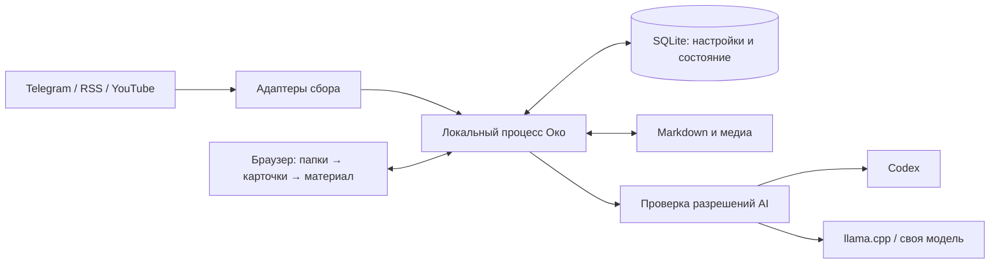

# Око: предложение минимальной локальной архитектуры

Статус: архитектурная основа согласована пользователем 2026-10-08 по всем трём предложенным решениям. Не реализация; конкретные интеграции и технические параметры требуют проверки при разработке.
Вопрос карты: [Минимальная локальная архитектура и восстановление](issues/13-local-architecture.md).

## Состав приложения

Один локальный Python-процесс: HTTP API, выдача браузерного UI, планировщик и исполнители заданий. Он слушает только loopback. Интерфейс — выбранные три колонки; собранные статические файлы обслуживает тот же процесс. Предлагаемый HTTP-слой — FastAPI; выбор UI-библиотеки не влияет на хранение и восстановление и может остаться для спецификации.

Отдельные процессы нужны только существующим внешним обработчикам: Codex и llama.cpp. Око управляет своими заданиями, но не останавливает чужие сессии Codex или общий сервер llama.cpp. Для старта не нужны Docker, Redis, брокер задач, отдельный сервер базы данных или автозапуск при входе в систему.



Внутренние границы: адаптеры источников; хранилище; очередь и жизненный цикл; построение представлений; обработчики AI; API читателя. Это модули одного приложения. Сборщик не решает, что прочитано, а модель не изменяет состояние чтения и файлы напрямую.

## Сбор

| Источник | Предлагаемый путь | Результат |
|---|---|---|
| Telegram, публичный и приватный | Адаптер существующего авторизованного Python-клиента; проверить доступные операции MCP/библиотеки до реализации | Сообщения, версии, связи альбомов, локальные медиа, идентификаторы для отметки истории |
| Другие RSS/Atom | Чтение ленты, затем попытка извлечения статьи и картинок | Полная статья либо доступный фрагмент с признаком неполноты |
| YouTube | Лента канала для обнаружения; отдельный адаптер получения доступных субтитров | Название, ссылка, превью; субтитры и тезисы по правилам фида |

OPML импортируется с папками. Узнаваемые Telegram-URL RSSHub преобразуются в Telegram-фиды, сохраняя исходный URL конфигурации. Не запускать два сборщика одного канала. Если канал нельзя однозначно сопоставить, показать состояние подключения; RSS остаётся возможным явно выбранным ограниченным способом, без обещания полноты Telegram-медиа или синхронизации прочитанного. Существующие учётные данные не копировать в новое хранилище; способ безопасного использования текущего клиента проверить на интеграционном шаге.

Конкретный поставщик субтитров ещё требует проверки при реализации: его недоступность оставляет карточку без тезисов, как уже согласовано. Аудиорасшифровку и скачивание YouTube-видео не добавляем.

Сбор выполняется небольшими страницами. Для каждой страницы сначала надёжно сохраняются идентификаторы обнаруженных материалов и задания загрузки; только затем продвигается позиция сканирования. Завершённость загрузки медиа учитывается отдельно. Повтор страницы безопасен благодаря уникальному ключу источника и публикации. RSS без стабильного GUID использует нормализованный URL; сомнительное совпадение не скрывает материал автоматически.

Первый импорт — согласованный период. Последующие запуски догоняют от последней позиции; пропущенные расписания объединяются в актуальное задание, а не воспроизводятся сотнями отдельных запусков. Если источник уже не отдаёт часть пропущенной истории, показываем пробел, не заявляем полный сбор. Повторный опрос недавних сохранённых материалов позволяет обнаруживать доступные изменения; универсального обнаружения удалений не обещаем.

## Хранение

```text
data/
  state.sqlite
  content/<item-id>/<revision>/original.md
  content/<item-id>/<revision>/media/...
  content/<item-id>/<revision>/captions.txt
  views/<view-id>/summary.md
  staging/<job-id>/...
```

**SQLite — источник истины для состояния.** Папки, фиды, настройки и их версии; идентификаторы и ссылки публикаций; позиции сканирования; пути файлов и статусы полноты; задания; точные составы сводок; отметки просмотра; ожидающие удаления и синхронизация Telegram. Очередь — таблица этой же базы, без отдельного сервиса. Изменения связанных отметок фиксируются одной транзакцией.

**Файлы — источник содержимого.** Тексты и сводки в Markdown, медиа и субтитры рядом. Заголовки, извлечённые тезисы, полные ответы модели и смысловые признаки не дублируются в долговечную служебную историю. Непросмотренное не имеет автоматически придуманного срока удаления.

База и файловая система не образуют общую транзакцию. Поэтому запись проходит через staging: подготовить и сбросить файлы на диск, атомарно переместить в конечный каталог, затем зафиксировать ссылки и завершённость в базе. Восстановление проверяет незавершённые операции и сиротские файлы. Готовым материал считается только после подтверждения наличия всех обязательных файлов. SQLite не пересоздаётся молча при повреждении: останавливаем обработку и показываем ошибку, чтобы не потерять отметки удаления.

## Обработка и AI

Последовательность: обнаружение → загрузка → фильтрация и тезисы → объединение в папке → публикация представления. Доступная часть исходника может показываться раньше с состоянием загрузки. Исходники сохраняются до просмотра, фильтры изменяют представление.

Начальные ограничения параллелизма: до трёх сетевых загрузок и одно AI-задание; это изменяемые технические значения, не обещание скорости. Большие обзоры разбиваются на части по возможностям модели, промежуточные результаты живут только вместе с непросмотренными исходниками.

Каждое задание содержит ссылки на точный набор исходников и их версии, версию настроек и выбранного обработчика. Перед отправкой заново проверяются разрешения фидов. Общая сводка не может отправить публичному AI ни один запрещённый исходник или его производный текст. При отсутствии разрешённого обработчика задание ждёт. Для нового фида предлагается выключенное разрешение публичного AI до явного выбора пользователя; разрешение очистки старой Telegram-истории также выключено по умолчанию.

Codex предлагается подключать через ограниченный адаптер одноразовых `exec`-заданий с проверяемым структурированным ответом. Основание — [выполненное исследование](../../docs/research/codex-processing.md), а не новая проверка аккаунта. До допуска реальных данных нужен технический тест изоляции: обработчик получает только разрешённый набор, не имеет доступа к общему data/, Telegram-инструментам и посторонним источникам; логи не сохраняют содержимое. Если выбранный запуск этого не обеспечивает, адаптер остаётся недоступным до исправления. Один промпт не считается изоляцией.

llama.cpp и другие модели подключаются через тот же контракт обработки. Endpoint и модель проверяются отдельно на допустимость передачи данных; слово «llama.cpp» само по себе не делает обработку локальной. Существующие исследования: [llama.cpp](../../docs/research/llamacpp-processing.md). Качество, лимиты и задержки всех обработчиков пока не измерены.

## Запуск и остановка

Предлагаемый сценарий: ярлык или команда запуска поднимает единственный экземпляр Око и открывает браузер. Повторный запуск открывает работающий экземпляр. Автозапуска и обработки при выключенном Око нет.

Каждая открытая вкладка поддерживает связь с локальным процессом. Потеря всех соединений приостанавливает выдачу новых заданий и отменяет текущие; после короткого периода на переподключение, ориентировочно 15 секунд, процесс завершает служебную фиксацию и выходит. Кнопка «Остановить Око» запускает эту процедуру немедленно для всех вкладок. Конкретное обнаружение потери связи должно иметь таймаут и проверяться в целевом браузере.

Это компромисс браузерной версии: заморозка вкладки может выглядеть как её закрытие и остановить обработку. Переключение вкладки само по себе не является сигналом остановки. После сна компьютера сначала проверяется живая сессия UI, потом возобновляются задания. Если нужен абсолютно точный жизненный цикл окна, потребуется отдельная desktop-оболочка; в минимальный вариант она не входит.

При остановке приложение прекращает новые сетевые/AI-запросы, отменяет текущие, завершает свои дочерние процессы и сохраняет задания для следующего запуска. Отмена локального клиента не гарантирует, что уже принятый облачным провайдером запрос перестал вычисляться; поздний результат не принимается. Отмена общего сервера моделей или чужих задач не выполняется.

Индикатор показывает фактические стадии, источники N/M, ожидающие/ошибочные задания и итог текущего прохода. «Завершено с ошибками» не скрывает ожидающую синхронизацию Telegram или недоступную модель.

## Просмотр и восстановление

1. При «Просмотрено» одна транзакция фиксирует просмотр всего выбранного набора, блокирует дальнейшие задания по нему, сохраняет минимальные отметки и требуемую синхронизацию Telegram, создаёт операцию удаления.
2. Карточка сразу исчезает. Око удаляет исходники, все версии, медиа, субтитры, сводки и временные AI-копии. Связанные представления инвалидируются; если они охватывали другие непросмотренные материалы, их можно построить заново по оставшемуся набору. Автоматически считать остальные материалы просмотренными нельзя.
3. Удаление физически выполняется сразу; при сбое/ошибке оно остаётся незавершённым и видимым в состоянии обслуживания. Поздно завершившийся сборщик или модель не могут опубликовать данные: запись проверяет отметку просмотра и поколение задания. Временные файлы устаревшей работы также удаляются.
4. При следующем запуске сначала выполняются оставшиеся удаления и очистка staging, затем восстанавливаются незавершённые задания. Задания прежнего процесса не считаются работающими. Наличие идентификатора уже просмотренного материала запрещает повторную загрузку.
5. Отдельная очередь подтверждает Telegram только до безопасной непрерывной границы истории. Она не требует сохранения текста. После неопределённого результата запроса допускается повтор того же накопительного подтверждения. Непросмотренные более ранние сообщения и начальная граница учитываются согласно [согласованному правилу](issues/11-read-sync-policy.md).

После удаления остаются только служебные идентификаторы, ссылки и отметки. Смысловые описания, embeddings, названия просмотренных публикаций и тексты ошибок с содержимым не сохраняются. Логи хранят тип ошибки, ID и этап. Дедупликация нового пересказа удалённого события не гарантируется.

| Место остановки | Поведение следующего запуска |
|---|---|
| Между обнаружением и загрузкой | Выполнить сохранённое задание загрузки |
| На половине медиафайла | Убрать/проверить временный файл, повторить загрузку; не отмечать Telegram автоматически до полноты |
| После записи файлов, до фиксации базы | Проверить незавершённую операцию, завершить либо убрать сироту |
| Во время вызова модели | Повторить незавершённое задание, возможно повторное потребление лимита; принять не более одного актуального результата |
| После просмотра, до удаления файлов | Сначала закончить удаление; материал не появляется заново |
| После удаления, до подтверждения Telegram | Повторить подтверждение по служебным отметкам |

Это восстановление после остановки процесса при исправном диске. Резервное копирование контента и восстановление после потери диска не предлагаются как скрытый архив просмотренного.

## Проверки для будущей реализации

Проверить принудительное завершение между шагами записи, повтор страницы без дублей, просмотр во время AI-задания без возвращения контента, удаление всех производных файлов, задержанную Telegram-отметку, отсутствие облачного запроса для запрещённого фида, остановку при закрытии последней вкладки и поведение после сна. Тест реальных интеграций сначала на ограниченном согласованном наборе. Сейчас эти проверки не выполнялись: рабочего приложения нет.

## Решения, предлагаемые пользователю

1. Python-процесс + SQLite для состояния + Markdown/файлы для содержимого; прямая Telegram-интеграция за адаптером, RSS и YouTube отдельно.
2. Работа привязана к открытым вкладкам с отменой при потере связи и коротким сроком завершения; явная кнопка остановки. Возможна остановка из-за заморозки браузером.
3. Для новых фидов публичный AI и очистка старой Telegram-истории выключены до явного включения.

Все три решения согласованы, ответ записан в вопрос карты. Следующий этап — спецификация. Реализация, схема таблиц, точные библиотеки извлечения контента и тестовые сценарии оформляются там.
