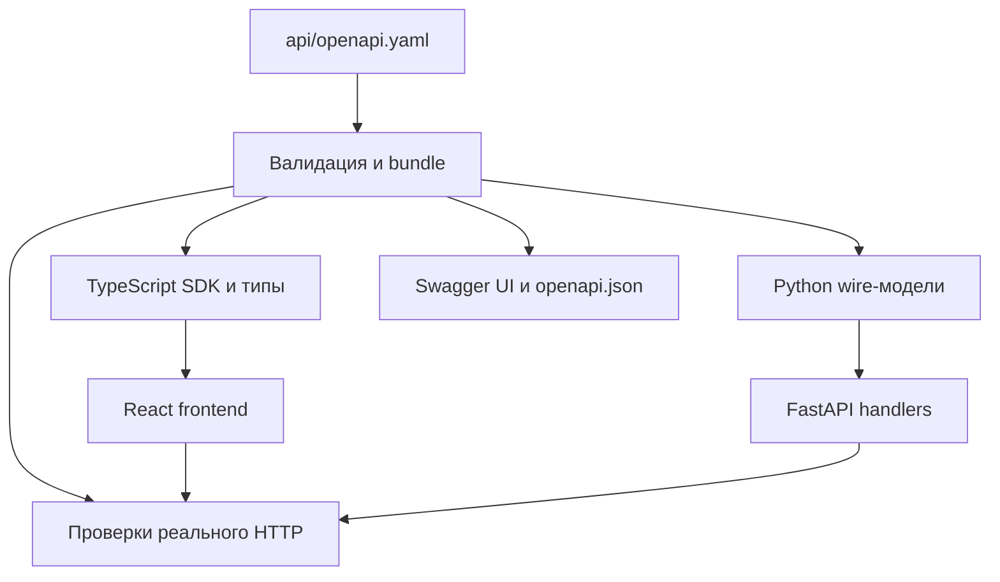

# API-first: OpenAPI, generated-библиотеки и просмотр контракта

Status: ready-for-agent
Date: 2026-10-14

Дополнение к [спецификации перехода](spec.md). Пользователь потребовал хранимую в репозитории OpenAPI-спеку, генерацию библиотек для обоих приложений и просмотр контракта. Здесь описан будущий результат; сама OpenAPI-спека, генераторы и Swagger в рамках подготовки плана ещё не создаются.

## Источник истины

`api/openapi.yaml` — редактируемый контракт в формате OpenAPI 3.1 с явно закреплённой patch-версией и JSON Schema dialect. Первоначально описать существующий HTTP interface по коду и фактическим синтетическим HTTP-сценариям. После этого изменение API начинается с YAML; генерация схемы из FastAPI не является способом обновлять контракт.

Файл находится в Git рядом с кодом. Использовать локальные refs; если спецификация станет слишком большой, разбить её на локальные части с единственным корневым файлом. Сборка формирует один bundled документ без сетевых refs. `info.version` меняется по правилам совместимости, а digest различает конкретные ревизии; ни версия, ни digest не содержат секретов или адреса текущей пользовательской сессии.

OpenAPI регламентирует транспортные данные и операции. Runtime/Store, правила обработки, допустимость бизнес-действия и UI-lifecycle не генерируются. В описаниях операций сохраняются существенные семантические условия: например, отмена HTTP-ожидания не откатывает запись, а неизвестный исход команды не разрешает её повторять автоматически.

## Полнота контракта

До переноса React-потребителей создать inventory всех `(method, path)` из reader API и сопоставить их с уникальными стабильными `operationId`. Scope — все `/api/` routes, а не только вызванные текущим экраном. Статические файлы, `/docs` и `/openapi.json` учитываются как служебные маршруты отдельно, без бесконечного включения документации в саму себя.

Контракт описывает:

- чтение/навигацию, материалы, предыдущие версии, счётчики и состояние;
- настройки уровней, фиды, RSS/Telegram, OPML, модели и YouTube, все операции истории;
- collect/stop, viewed/retry/regenerate/filter, обзоры и preview/подтверждение завершения папки;
- диагностику, исходы/receipts команд и их отмену, heartbeat/close;
- изображения и бинарные медиа текущих и прежних версий, content types и значимые response headers.

Для каждой операции указать параметры path/query/header, тело запроса и content type, успешные ответы и HTTP-коды ошибок, поля/ограничения, enum/unions, required/optional, допустимость null, примеры и bearer security. OPML сейчас передаётся как поле JSON: наличие файлового input в UI не является основанием описывать несуществующий multipart endpoint. Для бинарных ответов SDK не пытается декодировать JSON; media errors остаются описанными JSON-ошибками.

Описать существующие `X-Oko-Action`, `X-Oko-Error`, `X-Oko-Expected`, различение подтверждённой HTTP-ошибки и неизвестного сетевого исхода. Ошибка сети не становится выдуманным HTTP-ответом OpenAPI. Не выдавать обязательный `default` response с произвольным object за описание ошибок каждого маршрута.

Отсутствие PATCH-поля, явный null и значение — разные случаи. Например, отсутствие не меняет поле, а null может означать сброс наследования. Обязательные nullable-поля ответа остаются обязательными; необязательные поля не появляются автоматически с null/default. Политика дополнительных свойств и преобразования типов фиксируется по операции: существующие строгие ответы остаются строгими, строковые path/query параметры разбираются по своим правилам.

Глобальный bearer scheme отражает текущую локальную сессию. Host/origin-проверки и разрешённые значения динамических параметров также проверяются реализацией; наличие схемы не отменяет их. В схеме нет реального token, пользовательских URL/содержимого и credentials. Для встроенного UI используется относительный server URL текущего origin.

## Генерируемые библиотеки

### TypeScript

Базовый выбор — `@hey-api/openapi-ts` с plugins TypeScript, SDK и Fetch client. Выход — локальная библиотека `frontend/src/api/generated/`: модели запросов/ответов/ошибок, типизированные функции операций по `operationId` и клиент. React-модули используют эти функции; вручную поддерживаемого второго перечня URL/тел запросов нет.

Снаружи generated-каталога остаются настройка fetch/token/origin и преобразование ошибок Око. Передавать явно созданный клиент для сессии/тестов, чтобы не смешивать токены через глобальный singleton. Сохранить signal, keepalive, no-store, получение исходного Response/headers и raw binary. Для ссылок на медиа из ответа допустим общий авторизованный media fetch с проверкой своего origin; он не создаёт параллельную рукописную схему media routes.

Генерация TS не гарантирует runtime-проверку JSON. Серверные ответы валидируются на выходе, тестовые snapshots — по OpenAPI; ошибки сериализации/декодирования не превращаются в успешный результат. Дополнительный generated runtime-validator в браузере можно включить при доказанной необходимости, не переписывая схемы вручную.

Официальные возможности: [генератор](https://heyapi.dev/docs/openapi/typescript/get-started), [SDK](https://heyapi.dev/docs/openapi/typescript/plugins/sdk), [Fetch client](https://heyapi.dev/docs/openapi/typescript/clients/fetch). Версию закрепить точно: документация генератора предупреждает о breaking changes между выпусками. Удалённый registry/аккаунт не нужен, вход — локальный YAML.

### Python

Базовый выбор — `datamodel-code-generator`, выход `pydantic_v2.BaseModel` в `oko/reader/generated/`. Это используемая backend-библиотека входных/выходных DTO; её импорты входят в handlers и проверку ответов. Для параметров и операций получать необходимую машинную карту из bundled OpenAPI; не поддерживать независимый ручной контракт маршрутов.

Генерация моделей не реализует endpoint. Handlers связывают generated request/response types с текущими Runtime/Store. На этой границе явно преобразовываются wire DTO и domain values; внутренние модели с бизнес-валидацией не становятся альтернативной OpenAPI-спекой. Старые ручные wire-типы заменяются, а не сохраняются параллельно.

Сохранить нынешние ошибки: автоматическое подключение Pydantic не должно незаметно заменить существующие 400/409/503 на универсальный 422. Неверное серверное тело не должно молча терять лишние поля или получать defaults, чтобы «пройти» схему. Сериализация сохраняет различие unset/null; нужные исключения/преобразования происходят вне generated-файлов.

Источник: [datamodel-code-generator](https://datamodel-code-generator.koxudaxi.dev/). Поддержка генерации Pydantic из OpenAPI документирована; точное сохранение семантики Око ещё не проверено. Первый обязательный результат этапа 02 — тесты генерации на required/optional/null, PATCH, union/discriminator, alias, additionalProperties, error detail и binary operations. Если стандартная конфигурация меняет wire-поведение, исправить конфигурацию/шаблон генерации или выбрать совместимый генератор и зафиксировать причину до массового подключения. Ручная правка generated output не допускается.

## Сборка и воспроизводимость

В Git хранить OpenAPI, config/templates генераторов и generated-библиотеки для обоих языков с отметкой «не редактировать вручную». Это производные файлы, не дополнительные источники истины. Не публиковать пакеты в npm/PyPI: локальных модулей достаточно.

Планируемые команды:

| Команда | Результат |
| --- | --- |
| `npm run api:lint` | Проверка OpenAPI, refs, уникальных operation IDs, описания security и responses |
| `npm run api:generate` | Явное обновление обеих библиотек из YAML; Python generator вызывается из проектного окружения |
| `npm run api:check` | Генерация во временный каталог и сравнение с сохранённым output; drift даёт ошибку без записи в checkout |
| `npm run api:docs` | Локальный просмотр bundled-контракта в Swagger без запуска Око |

Frontend build запускает валидацию/генерацию TS и проверку соответствия, backend build — Python-генерацию и такую же проверку; общая сборка выполняет обе. Python-проверки могут вызывать Python-генератор напрямую и не требуют Node ради собственных DTO. CI проверяет обе ветви. Typecheck и упаковка используют только успешно проверенный generated output. Генерация не происходит при пользовательском запуске: Python-пакет уже содержит библиотеку, документ и готовые docs/assets.

Параметры, версии инструментов и lock-файлы закреплены. Генерация работает из локальных входов, без запущенного бэкенда, источников или загрузки спецификаций из сети. В output нет времени генерации, абсолютных путей и случайного порядка. Два запуска дают одинаковый результат. Все библиотеки, frontend build и документация содержат digest одного bundled-контракта; смешанная поставка отклоняется до старта работы.

Generated-файлы обновляются только явной командой подготовки. CI, тесты, Vite watch и package build генерируют во временное место и либо подтверждают сохранённую копию, либо завершаются ошибкой с командой обновления. Это сохраняет guard чистоты checkout и предотвращает автоматическое скрытие drift.

## Swagger UI

1. `npm run api:docs` запускает локальный просмотр на loopback из YAML/bundle. Он не создаёт Runtime/Store, не подключает Telegram/модели и не выдаёт heartbeat. Режим только просмотра: `Try it out` отключён, чтобы браузер не обращался к вымышленному API статического сервера.
2. У работающего Око `/docs` показывает тот же контракт, `/openapi.json` отдаёт его bundled JSON. Документ и assets не содержат пользовательских данных, просмотр не требует bearer; текущие ограничения host/origin сохраняются. Все настоящие `/api/` по-прежнему требуют bearer.
3. Встроенный `Try it out` доступен после явного Authorize и ручного выполнения запроса. Токен хранится только в памяти страницы, не в YAML, URL запроса документа или постоянном хранилище. Примеры синтетические; открытие документации не запускает команды и не импортирует token читателя автоматически.
4. JS/CSS/fonts/favicon и initializer локальные, закреплены и поставляются с приложением; remote validator Swagger отключён. Нужна собственная страница с внешним initializer, поскольку простого включения стандартного HTML FastAPI может быть недостаточно для текущего CSP. Проверить работу под CSP без глобального `unsafe-inline`/`unsafe-eval` и без CDN.
5. `/docs` у живого Око не считается вкладкой читателя и не меняет lease/grace. При отсутствии живого читателя backend останавливается как сейчас; для длительного чтения контракта служит standalone viewer. Жизненный цикл приложения ради документации не меняется.

Источники: [self-hosted docs FastAPI](https://fastapi.tiangolo.com/how-to/custom-docs-ui-assets/), [Swagger UI configuration](https://swagger.io/docs/open-source-tools/swagger-ui/usage/configuration/). Стандартный code-first `/openapi.json` FastAPI не является контрактом этой архитектуры; route выдаёт канонический bundle.

## Проверки, блокирующие расхождение

- Валидность OpenAPI и полнота inventory: каждый reader route имеет operationId в YAML и обработчик; добавленный/удалённый method/path, необъявленный status/content type/security не проходит незаметно. Swagger/static routes исключаются явно.
- Typecheck фронтенда использует generated SDK; Python импортирует generated-модели. Правка YAML меняет соответствующую библиотеку, а stale output ломает сборку. Тест проверяет использование библиотек на настоящем HTTP interface, а не просто наличие файлов.
- Настоящие запросы/ответы и ошибки сверяются с контрактом на временном хранилище. Есть негативные случаи required/null/enum/type/unknown fields по объявленной политике, неверный token, конфликт завершения папки и ошибка декодирования. Для media проверяются статус/headers/content type и тело, а не JSON-validator.
- Browser snapshots валидируются по тому же OpenAPI, включая запоздалые ответы. Текущий Ajv 6/draft-07 не является валидатором OpenAPI 3.1/JSON Schema 2020-12: заменить его совместимым инструментом либо обосновать проверяемое преобразование без потери семантики. Не менять `$schema` строкой, притворяясь, что преобразование выполнено.
- Сравнение с базовым OpenAPI выявляет потенциально несовместимые изменения в запросах и ответах. Оно не заменяет семантическое ревью; намеренное breaking change требует явного решения, версии и порядка обновления потребителей. Первоначальный baseline фиксируется после проверки существующего поведения.
- Документ, SDK и backend DTO имеют одинаковую ревизию. Swagger проверяется настоящим браузером с локальными assets/CSP, без внешних сетевых запросов; standalone-просмотр работает при неработающем Око.

Точный набор HTTP-кодов и моделей устанавливается из текущего поведения на этапе 01. Этот документ не объявляет непроверенные endpoint schemas готовыми. [OpenAPI 3.1 specification](https://spec.openapis.org/oas/v3.1.0).
