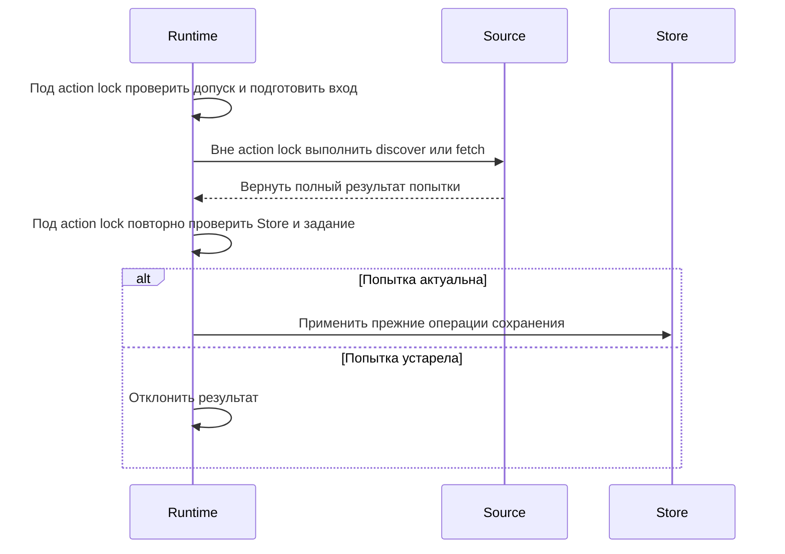

# Углубление Source: полный результат поиска и загрузки

GitHub: https://github.com/tgenman/oko/issues/41
Status: claimed
Дата: 2026-10-19

## Согласовано с пользователем

Углубить существующий Source: оставить discover/fetch, перенести настройку источников внутрь модуля сбора и возвращать полный снимок результата вместо чтения изменяемых полей после вызова.

Объём: RSS, Telegram web/client и YouTube; Demo и синтетические источники поддерживают тот же interface. Текущее продуктовое поведение сохраняется. Форматы сохранённых курсоров и их разбор в Store не меняются. ReadSync, AI-обработка и устройство workers не входят в работу.

Ниже — согласованный проект реализации в этих границах. Реализация разрешена пользователем через implement-spec 2026-10-19; фактические результаты записываются отдельно.

## Проблема и проверяемый результат

`Source` объявляет только `discover(cursor)` и `fetch(publication)`. Однако Runtime после await читает `identity_info`, `retry_error`, `more`, `gap`, `changes`, различает конкретные классы и выбирает разные аргументы fetch. `_sync_sources` конструирует adapters и меняет их настройки.

После изменения Runtime получает все факты попытки из возвращённого результата. Для настройки и выполнения discover/fetch ему не нужны изменяемые поля конкретного adapter. Настройка и особенности вызова находятся внутри модуля сбора. Сведения о нужных ресурсах выражены явно; управление этими ресурсами остаётся у прежних владельцев.

Это не требование удалить все упоминания Telegram из Runtime: проверки профилей, управление workers и исключённый из объёма ReadSync имеют собственные причины знать Telegram.

## Interface и ответственность

Существующая seam `Source` сохраняется. Её adapters — RSS, Telegram web/client, YouTube, Demo и существующие синтетические источники. Новый универсальный registry, общий framework и второй storage adapter не вводятся.

Планируемые места изменений:

- `oko/collection/contracts.py`: типы полных результатов и ресурсов fetch; Source interface.
- `oko/collection/`: модуль настройки adapters с кешем существующих экземпляров; точное имя файла выбирается при реализации.
- Существующие RSS/Telegram/YouTube/Demo adapters: возврат снимков, единый вызов fetch.
- `oko/reader/runtime.py`: использование настройки и результатов; сохранение исполнения, допуска и фиксации.
- Существующие синтетические Source и тесты прямых вызовов: согласованный переход на новый interface.

### Поиск публикаций: discover

Вход: существующий курсор либо его отсутствие.

Полный результат одной попытки содержит:

| Поле | Смысл |
| --- | --- |
| publications | Публикации в прежнем порядке, с прежней идентичностью и составом альбомов |
| cursor | Следующий курсор в прежнем формате |
| continuation | Отсутствует, если немедленное продолжение не требуется; иначе относительная задержка следующего прохода |
| observation | gap, changes и полученные сведения об идентичности источника |
| retry_error | Частичная ошибка поиска; может присутствовать вместе с полезным прогрессом |

`continuation` не заменяет обычный периодический сбор. Оно выражает нынешний `more`: 0 для немедленного продолжения и 0.1 секунды для существующей уступки очереди при ограниченной истории Telegram. Runtime назначает абсолютное время и учитывает ограничения аккаунта.

Полезный прогресс вместе с `retry_error` остаётся успешным результатом. Runtime сохраняет его и отдельно учитывает ожидание аккаунта. Нельзя превращать такой результат в исключение и терять курсор.

### Загрузка материала: fetch

Основное действие остаётся `fetch`. Его вход содержит публикацию и явно переданные ресурсы выполнения. Пример формы interface, без фиксации точных имён типов:

```python
await source.discover(cursor)                 # -> DiscoveryResult
await source.fetch(publication, resources)     # -> FetchResult
```

Небольшое описание требований Source сообщает Runtime, нужны ли временный каталог загрузки и средство получения субтитров. Это два существующих требования, а не открытый список возможностей. Способ доступа к Telegram и сведения для проверки профиля остаются явными данными доступа.

Результат fetch содержит `Material` и observation этой попытки. `Material.collection_error` сохраняет нынешний смысл; второе расходящееся поле ошибки в FetchResult не добавляется. Состояние субтитров, частичные вложения и source manifest также сохраняют прежний смысл.

Observation не является ссылкой на изменяемый dict adapter. Настройки входа и вложенные значения результата не должны незаметно изменяться при следующем вызове. Использовать отсоединённые типизированные значения; одного `frozen=True` для содержащего dict объекта недостаточно. Не менять правила параллельности adapters ради этого рефакторинга.

Сведения Telegram должны сохранять данные, необходимые текущему refresh claims и аватара. Различие «avatar отсутствует» и «avatar = None» сохраняется: первое не меняет сохранённую картинку, второе удаляет её. Тип не должен зависеть от Store.

Исключения `SourceError`, `SourceDeleted`, `SourceSkipped`, отмена и `CaptionsDeferred` сохраняют действующие последствия. Не вводить общий success/error union, который смешает отмену, частичную ошибку и намеренное исключение публикации.

### Настройка источников

Модуль сбора получает снимки существующих настроек фидов, данных доступа и внедрённые внешние adapters. Он выбирает RSS/Telegram web/client/YouTube, задаёт параметры начальной истории и запроса субтитров, сохраняет нужный кеш экземпляров.

Модуль не принимает Runtime или Store целиком и не выполняет произвольные переданные callbacks. Синхронная настройка не делает сетевых запросов, не создаёт workers и не пишет в SQLite.

Нельзя пересоздавать YouTubeSource при каждом опросе и терять latest/RSS windows. Нельзя менять порядок отмены при смене профиля или обновлять настройки выполняющейся попытки без существующего допуска. Требования к конфигурации одного вызова фиксируются при подготовке; актуальность перед сохранением проверяет Runtime.

Описание источника для статуса, включая changes до первого успешного сбора, доступно через модуль настройки. Runtime не читает `getattr(source, 'changes')` как обход нового interface.

## Три фазы выполнения



Runtime сохраняет lock, lanes, отмену, текущий Store, поколения заданий, проверку профилей и регистрацию внешних ожиданий. Он применяет сведения об ограничениях аккаунта, назначает продолжение и принимает результаты только после повторного допуска.

Store сохраняет идентичность, транзакции, версии, staging, публикацию файлов и восстановление. Наблюдения об источнике применяются после допуска; сетевое ожидание само не меняет подписки.

### Субтитры и файлы

`CaptionAttempt` остаётся у Runtime. YouTube adapter обращается к нему лениво, только при необходимости новых субтитров. Не приобретать допуск заранее: уже сохранённые субтитры не должны вызывать внешний запрос или ожидание permit. Blocked/deferred/terminal состояния и освобождение permit сохраняются.

Store создаёт DownloadStage с прежней проверкой допуска. Telegram adapter использует его при загрузке. Runtime сохраняет финальную проверку актуальности и очистку stage в finally, включая поздний результат отменоустойчивого adapter. Модуль сбора не сохраняет файлы в обход Store.

## Последовательность реализации

1. Зафиксировать существующие результаты выбранными проверками и снимками курсоров. Новые проверки нужны только для непокрытых условий.
2. Ввести полный результат discover/fetch и согласованно перевести adapters, синтетические источники и Runtime. Не оставлять постоянный параллельный старый interface.
3. Перенести конструирование и настройку источников в модуль сбора; сохранить кеш, доступ и описание статуса.
4. Удалить из пути сбора Runtime чтение изменяемых полей и выбор source-specific аргументов. Сохранить отдельное управление ReadSync, профилями и workers.
5. Проверить поведение через прежний HTTP interface и временное хранилище; провести независимое ревью владения, отмены и полноты результатов.

Шаги 2–4 допускают промежуточные правки внутри одной задачи; пользовательский запуск должен получить согласованное изменение всех callers. Не создавать отдельные tickets для каждого поля или adapter.

## Критерии приёмки

- Runtime больше не читает more/gap/changes/retry_error/identity_info источника после discover/fetch и не выбирает конкретную форму fetch по классу adapter.
- Модуль настройки скрывает создание и обновление adapters; кеш, требования к ресурсам и статус доступны через его interface.
- Результаты одной попытки не меняются при следующем вызове; частичный успех не теряет данные, курсор или ограничение аккаунта.
- Пагинация, порядок истории, альбомы, сообщения об ограничениях, сохранённые субтитры и предупреждения сохраняют поведение.
- Просмотр, удаление, смена профиля и остановка не допускают поздний результат; остановка не ждёт сеть под action lock.
- Ошибка одного аккаунта не задерживает другие lanes. FloodWait и частично выполненная история восстанавливаются после перезапуска.
- Форматы курсоров, схема SQLite, внешний HTTP-контракт и UI не меняются.
- Существующие синтетические источники работают через тот же Source interface без обращения к личным аккаунтам.

## План проверки

Test surface — существующий HTTP interface с настоящими временными SQLite/файлами и синтетическими внешними adapters. Не заменять эти сценарии проверками DTO или private helpers.

Основные наборы:

- `tests/collection/test_source_revisions.py`: частичная загрузка, версии, удаление источником, сохранность локальных данных.
- `tests/collection/test_telegram.py` и `test_telegram_contracts.py`: страницы, альбомы, late media, совместимость курсоров.
- `tests/reader/test_telegram_history.py`, `test_telegram_bindings.py` и `test_telegram_lanes.py`: история, смена привязки, поколения и FloodWait.
- `tests/collection/test_youtube.py` и связанные tests/reader сценарии YouTube: сохранённые субтитры, blocked/deferred/terminal и поздние результаты.
- `tests/lifecycle/test_runtime_actions.py`: отмена, удаление, остановка и ошибка подготовки.
- Дополнительные проверки на Source seam: независимость снимков, partial discovery + retry_error, продолжение 0/0.1 и явные ресурсы fetch. Заменять устаревшие проверки полей результата, не дублировать их.

Для итогового изменения состояния: обязательные проверки runner по риску изменения и независимое ревью. Не отключать тесты и не повышать таймауты ради рефакторинга. Реальные аккаунты и настоящий AI не нужны.

## Фактическая проверка этого документа

Изучены текущие contracts, adapters, Runtime, Store и существующие тестовые сценарии. Рассмотрены три независимых варианта interface; выбран существующий Source с полными результатами. Код не изменён, наборы тестов не запускались. Результаты будущей реализации должны быть записаны отдельно.

## Связанные решения

- [Управление работой](../../docs/architecture/reader-work.md)
- [Структура пакетов](../../docs/architecture/package-layout.md)
- [Состав чтения](../../docs/architecture/reading-composition.md)
- [Выбор модели Codex](../../docs/adr/0001-codex-execution-settings.md): не затрагивается.

Deletion test: удаление углублённого модуля вернуло бы в Runtime настройку adapters, особые аргументы fetch и трактовку результатов. Если реализация только перенесла проверки классов, но Runtime по-прежнему согласует те же поля и порядок, depth не увеличилась. Требуемые leverage и locality — один явный interface результата и одно место для особенностей сбора.
