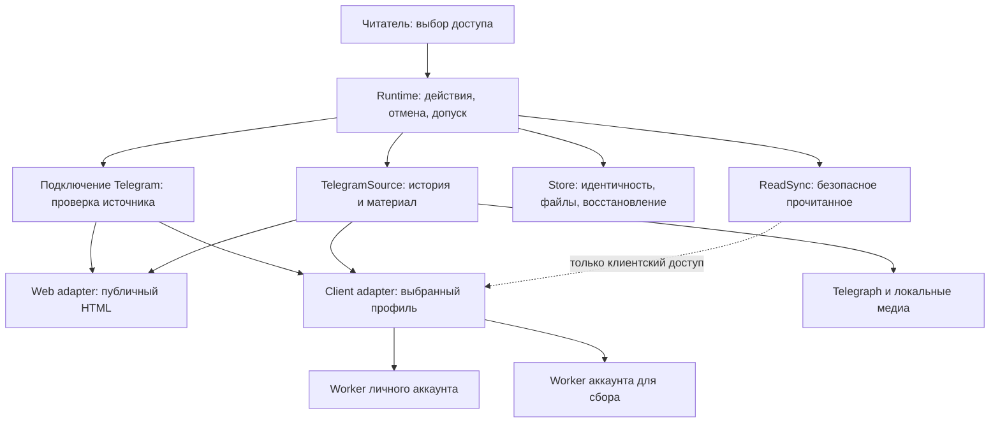

# [Telegram] 01: Контракт интеграции и проверочные fixtures

Status: ready-for-agent
Type: task
GitHub: https://github.com/tgenman/oko/issues/17
Blocked by: Нет

## Результат

Подготовить проверяемую основу для двух способов доступа: согласовать уже существующий canonical v3 с Telegram-планом и закрепить реальные HTML/SDK fixtures до удаления старых helpers.

## Основание и границы

[Спецификация](../spec.md) — источник всех требований, ограничений и пределов доказательств. Ниже сохранены относящиеся к шагу разделы; они не заменяют полный документ. Факты «текущего кода» и отчёты в исходной спецификации относятся к её версии, а не доказывают готовность реализации. Публикация issue не запускает реализацию и не разрешает действия с личными аккаунтами.

API-интеграция ведётся в [задаче №5](https://github.com/tgenman/oko/issues/5); этот пакет готовит её предметные Telegram-зависимости. На момент разбиения main — e0461daebbb731891b1ae0f574f35cb8c38059bf, [PR #16](https://github.com/tgenman/oko/pull/16) уже удалил OPML и перенёс историю/RSS/YouTube. Не реализовывать удаление OPML повторно: проверить сохранение результата. v3 — candidate/PENDING_REVIEW; baseline и разрешение выпуска не подменяются готовностью отдельного Telegram-шага.

Проверки: существующий HTTP interface читателя, Playwright и процессные fixtures с временной SQLite/файлами и синтетическими внешними adapters. Личные источники, аккаунты и настоящие модели не запускать. Проверяемые seams и архитектурное владение сохраняются. Фактические команды, результаты, ограничения и исправления ревью записывать отдельно от плана.

## Критерии приёмки

- [ ] Сверить текущий OpenAPI и generated libraries с web/client, profiles, duplicate/conflicts и delete; сохранить независимый HTTP, auth, lifetime и строгие DTO. Не создавать параллельный несовместимый API с тем же major и не утверждать baseline задачи №7.
- [ ] Закрепить в одном typed module interface Telegram binding, нормализованной страницы/публикации и общего envelope истории; Source сохраняет discover/fetch, Store не разбирает adapter-specific position.
- [ ] Подготовить публичные HTML fixtures: текст, ссылки, альбомы, доступные и недоступные медиа, пагинация/заглушки/пустые страницы. Наличие src и album anchors проверять фактической разметкой.
- [ ] Процессные/синтетические SDK-сценарии фиксируют whole-forum read для Общего, новой/удалённой темы и interleaved IDs; неизвестная семантика не объявляется подтверждённой, расширяющий global ack запрещён.
- [ ] Сохранить исходные evidence и ограничения; не выдавать синтетические проверки за реальную аккаунтную приёмку.

## Сохранённые требования спецификации

### 1. Ответственность modules и реальные seams

`TelegramSource` остаётся deep module сбора с наружным interface `Source.discover(cursor)` / `Source.fetch(publication)`. Внутри два adapters: публичный HTML и собственный Telethon-клиент. Два аккаунта используют одну implementation client adapter, с разными привязками и временем жизни. Не создавать отдельные классы сборщиков «личный» и «для сбора» и не заставлять веб реализовывать фиктивные `acknowledge/accounts/topics`.

- Runtime владеет заданиями, внешними ожиданиями, поколениями и проверкой актуальности перед фиксацией. Сеть находится вне `_actions`; запись Store — внутри последовательного участка.
- Store/Subscriptions владеют уникальностью, транзакциями и сохранением подключения. Source не пишет в SQLite и не подтверждает прочитанное самостоятельно.
- Telegram module скрывает пагинацию, группировку публикаций, подготовку материала и обогащение Telegraph. Операция проверки подключения возвращает описание источника, но не создаёт фид.
- ReadSync — отдельный module. Telegram-публикация, `members` или строка namespace не являются разрешением внешней отметки.
- AI-обработка остаётся после сохранения материала. Нет нового суммаризатора чатов, событий или обзоров.

Locality: HTML-селекторы и Telethon не распространяются по Runtime, Store и UI. Leverage: оба adapters используют историю, хранение неполного материала и Telegraph. Deletion test: module оправдан общими сценариями, а не factory с единственным `if`; удаление module вернуло бы эти правила в callers. Interface остаётся test surface; внутренние adapters заменяют только внешнюю сеть/SDK.

### 13. HTTP-контракт, переход и соседняя работа

Семантические операции: получить состояния двух профилей; привязать/проверить существующую сессию; создать Telegram-фид выбранным доступом; удалить фид. Существующие получение материалов, retry, история, просмотр и настройки папки сохраняются. Для web-варианта account/auto_read не принимаются; для client profile обязателен. Недоступный веб — ошибка до создания фида; нет скрытого fallback.

Ошибки имеют различимый code и typed details: duplicate source (существующий фид/доступ), неподтверждённая идентичность, неподключённый профиль, сменившийся аккаунт, профиль используется фидами, недоступный источник. Frontend не распознаёт эти состояния по русскому тексту. Изменение access/peer/account через PATCH существующего фида отвергается; изменение папки и разрешённых настроек остаётся возможным.

Canonical contract сейчас 2.0.0. `.scratch/independent-api/` отдельно проектирует v3 и пока требует сохранить OPML/topics. **Эта спецификация заменяет только требования сохранения OPML и отдельных тем**, а также прежнюю mutable transport-семантику Telegram; не отменяет независимый HTTP interface, строгие DTO, auth, lifetime и codegen. Чужую спецификацию в этой работе не переписывать. При реализации пересверить базу: если v3 ещё не реализован, оформить изменения текущего контракта как единый согласованный breaking release; если уже реализован — применить к нему с новым review. Не выпускать параллельно две несовместимые версии с одинаковым major.

Сначала менять OpenAPI, затем генерировать Python/TypeScript, обновлять consumers, semantic review и baseline по `api/README.md`. В текущей задаче ничего из этого не выполнять.

Миграция состояния локальная, транзакционная и без обращения к аккаунтам: сохранить обычные feeds/IDs/контент/прочитанность и явно заданные настройки; добавить claims из подтверждённых сохранённых peer/username. При коллизии записать всех старых владельцев в `telegram_claim_owners`, не удалять данные и не выбирать победителя; показать проблему, запретить новые конфликтующие подключения и разрешить ручное удаление лишнего фида. Существующие данные доступны; не останавливать весь Store из-за такого конфликта. Профили подтверждаются отдельно. Фидов тем у пользователя нет; универсальный механизм их слияния не нужен. Синтетическая база с неожиданными topic bindings должна получить понятный отказ миграции до изменения, а не потерю данных.
