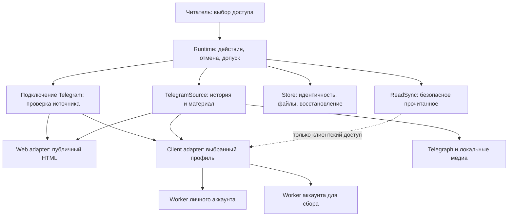

# Способы доступа к Telegram

Дата: 2026-10-15.
Состояние: продуктовые решения согласованы; техническая архитектура записана по поручению пользователя. Реализация не разрешена: пользователь явно запросил только спецификацию.

## Требования пользователя

- Читать публичные каналы через публичные веб-страницы Telegram; этот способ должен быть базовым.
- Дать пользователю выбор способа доступа для Telegram-фида.
- Сохранить доступ через собственный Telegram-клиент с двумя отдельными аккаунтами: личным для важных чатов, в которых пользователь состоит, и отдельным аккаунтом для сбора публичных чатов/групп и более полного получения медиа.
- Для веб-доступа перенести логику разбора страниц из локального RSSHub в Око.
- Сохранять доступное веб-медиа. Пользователь принимает ограничения веб-предпросмотра относительно клиентского доступа; это не означает разрешения скрывать неполноту материала.
- Сначала спроектировать архитектуру через grill-with-docs и improve-codebase-architecture.

## Факты текущего кода

- `oko/collection/telegram/client.py`: ClientRegistry уже поддерживает несколько именованных аккаунтов. Два аккаунта не требуют двух разных реализаций клиента.
- `oko/collection/contracts.py`: Source предоставляет discover/fetch; Material отдельно хранит полноту и причину неполноты.
- `oko/collection/telegram/source.py`: текущий TelegramSource использует клиент; содержит сбор истории, группировку альбомов и получение материала. LocalTelegram владеет одним worker, общей блокировкой запросов и staging-путём.
- `oko/subscriptions/subscriptions.py`: идентичность подключённого клиентом фида включает аккаунт, peer и тему. Смена аккаунта/peer/темы существующего фида отклоняется.
- `oko/reader/runtime.py`: выбор источника, namespace публикаций и некоторые условия истории/загрузки зависят от конкретного класса TelegramSource.
- `oko/collection/telegram/read_sync.py`: синхронизация прочитанного связана с клиентским доступом и аккаунтом; наличие Telegram-публикации не должно само по себе означать возможность внешней отметки.
- `oko/storage/store.py`: для обычной публикации тот же ID с другим URL может создать другую запись. Альбомы клиентского adapter используют grouped ID; совпадение номеров сообщений само по себе не решает переход web ↔ client.
- `oko/collection/telegram/client.py`: клиент создаётся с `receive_updates=False`; текущая реализация перечитывает известные непросмотренные публикации, а не получает поток всех правок/удалений. Возможности протокола не равны возможностям текущего adapter.
- `frontend/src/settings/connections.tsx`: подключение Telegram требует аккаунт; веб-режима без аккаунта пока нет.
- RSSHub `lib/routes/telegram/channel.ts` разбирает HTML через Cheerio, возвращая структуру RSSHub. Око написан на Python и принимает Material, поэтому перенос требует адаптации. Локальная версия RSSHub: d24f5136487a388662ec6656e4f1ba4ff46b0ed8; её LICENSE и package.json указывают AGPL-3.0. При переносе сохранить происхождение и лицензионные сведения; точный объём переноса ещё не выбран.

## Согласованные термины

«Способ доступа к Telegram» — согласованное название выбора «Веб», «Личный аккаунт», «Аккаунт для сбора». «Обработчик» в GLOSSARY.md остаётся средством ИИ-обработки. Термины «Способ доступа к Telegram» и «Тема форума Telegram» обновлены в словаре по решениям 6 и 3.

## Согласованные решения

### 1. Способ доступа неизменяем внутри фида

Пользователь выбрал разбор идентичности и уточнил: смена способа получения Telegram у существующего фида не предусмотрена. Для другого способа доступа пользователь удаляет фид и импортирует его заново.

- Способ доступа и выбранный клиентский аккаунт фиксируются при создании фида.
- Не проектировать переключение web ↔ client или между аккаунтами внутри существующего фида, включая автоматический fallback и получение недостающих вложений через другой доступ.
- Не требуется перенос карточек, курсоров и отметок прочитанного между способами доступа. Правила удаления и нового импорта остаются отдельными существующими сценариями; этим решением не задано новое поведение очистки или восстановления данных.
- Не требуется унифицировать веб- и клиентские идентификаторы публикаций ради смены доступа. Дедупликация и альбомы внутри каждого фида остаются обязательными.
- Существующие клиентские фиды не переводятся на веб автоматически; веб по умолчанию относится к новым подключениям.
- Архитектурный кандидат миграции идентичности при переключении исключён из объёма. Временный HTML-обзор отражает исследование до этого решения.

### 2. Один канал — один подключённый фид

Пользователь запретил одновременное подключение одного канала через разные способы доступа или аккаунты.

- При повторном добавлении канал не подключается заново, существующий фид и его настройки не меняются.
- Показывается всплывающее окно, сообщающее, каким способом канал уже подключён; для клиентского доступа указывается выбранный аккаунт.
- Пример текста (редакционная формулировка): «Этот канал уже добавлен через „Личный аккаунт“. Чтобы выбрать другой способ доступа, удалите существующий фид и добавьте канал заново».
- Проверка действует и при повторном выборе того же способа доступа. Другая папка не делает канал новым источником.
- Уникальность канала не должна зависеть от способа доступа или аккаунта. Это меняет правила допуска новых подключений по сравнению с текущей клиентской идентичностью account + peer + topic; формат хранения определён в разделе технической архитектуры: неизменяемая привязка и отдельные claims уникальности.
- Сопоставление канала при подключении требуется; унификация идентификаторов всех его публикаций между adapters по-прежнему не требуется.
- То же правило уникальности действует для группы целиком, включая форумные группы (решение 3).

### 3. Группа целиком, без отдельных фидов тем

Пользователь отклонил подключение отдельных тем: администраторы группы могут добавлять и удалять темы; пользователь не хочет управлять соответствующими фидами. Одна группа подключается одним фидом в одну тематическую папку, независимо от наличия и состава тем.

- Собирается группа целиком через выбранный клиентский аккаунт. Добавление, переименование или удаление темы не требует настройки нового фида или смены папки.
- Удалить возможность подключения темы как самостоятельного источника. Не сохранять её как скрытый или альтернативный режим.
- Включить в последующую реализацию упрощение кода: убрать загрузку/выбор тем из формы подключения; убрать параметры отдельных тем из действующего HTTP-контракта и перегенерировать библиотеки; удалить используемые только для отдельных тем операции и ветвления в source, worker и синхронизации прочитанного; убрать тему из целевой идентичности фида, настроек и курсоров.
- Удалять implementation после проверки использования: если часть работы с темами необходима для корректного сбора всей форумной группы или её безопасной отметки прочитанного, сохранить её внутри client adapter, без пользовательского выбора темы. Не заменять корректное чтение всех тем запросом, который возвращает только «Общее».
- При упрощении сохранить безопасную границу прочитанного, отмену и защиту от поздних ответов. Способ подтверждения прочитанного всей форумной группы требуется проверить по фактическому протоколу; не считать его автоматически равным нынешней операции одной темы.
- Заменить проверки отдельных фидов тем сценариями одного фида группы: сбор разных тем, появление новой темы, удаление темы, запрет повторного подключения группы через другой аккаунт или в другую папку.
- Пользователь подтвердил, что подключённых фидов отдельных тем у него нет. Миграция, объединение, остановка старых фидов тем и специальный интерфейс перехода не нужны. Удаление функциональности не требует сохранять её ради таких подключений; обычные фиды сохраняются.
- Пользователь ожидает возможную последующую обработку группы суммаризатором. Это объясняет выбор целой группы, но не является отдельным поручением реализовать суммаризатор или определять его объём обработки сейчас.
- Последующее уточнение: удобное чтение больших чатов и групп с темами пока не определено. На этом этапе сообщения собираются одним фидом и одним потоком, без новой агрегации в «новости» или сводки. Проблема большого количества сообщений сознательно отложена; удаление отдельных фидов тем остаётся в объёме.

Это целевая модель, а не утверждение об уже изменённом поведении. Прежняя спецификация `.scratch/telegram-topics/spec.md` сохраняется как описание предыдущего решения; реализация удаления ещё не начата.

### 4. Вступление в группы и чаты только вручную

- Пользователь сам вступает в нужную группу или чат в Telegram, затем указывает ссылку в Око и выбирает аккаунт, которому доступен источник.
- Правило одинаково для личного аккаунта и аккаунта для сбора. Автоматическое вступление, принятие приглашений и отправку заявок на вступление не реализовывать.
- Личный аккаунт не выполняет самостоятельных действий в Telegram, кроме сбора и отдельно разрешённых отметок прочитанного. На этом этапе аккаунт для сбора также не получает дополнительных действий от имени пользователя.
- Если выбранному аккаунту недоступен источник, показать ошибку подключения и предложить пользователю проверить доступ в Telegram. Не пытаться вступить автоматически или использовать другой аккаунт.
- Это правило не вводит требование Telegram-аккаунта или вступления для публичного веб-доступа.
- Политика отметок прочитанного согласована отдельно в решении 5.

### 5. Прочитанное в Telegram

- Для обоих клиентских аккаунтов по умолчанию основанием для отметки прочитанного служит «Просмотрено» в Око, с сохранением безопасной границы прочитанного.
- Автопрочитывание после полного сохранения материала остаётся отдельной настройкой фида и по умолчанию выключено.
- При включённом автопрочитывании неполная загрузка не даёт основания для отметки после сохранения; существующее правило безопасной границы сохраняется.
- У веб-доступа нет внешних отметок Telegram; настройка автопрочитывания для него неприменима. Локальное «Просмотрено» продолжает работать.
- Это значения по умолчанию для новых подключений. Решение не предписывает сбрасывать явно выбранные настройки существующих фидов.

### 6. Выбор доступа при добавлении фида

- Один список из трёх вариантов: «Веб», «Личный аккаунт», «Аккаунт для сбора».
- При добавлении фида по умолчанию выбран «Веб».
- Для личного аккаунта и аккаунта для сбора пользователь указывает соответствующий Telegram-профиль в настройках.
- Внутреннее различие сохраняется: два способа получения данных (веб и клиент) и два профиля клиентского доступа. Отдельная реализация сборщика для каждого аккаунта не нужна.
- Это выбор при создании, а не возможность переключить уже подключённый фид. Последующая замена профиля в настройках требует отдельного определения поведения. Массовый OPML-импорт исключён решением 7.

### 7. Удаление массового OPML-импорта

Пользователь решил отказаться от поддержки массового импорта OPML ради упрощения продукта и кода. Возможное возвращение — отдельная будущая задача.

- Удалить вкладку загрузки OPML, предпросмотр импорта и выбор папок при конфликтах.
- Удалить серверные операции предпросмотра и выполнения OPML-импорта, соответствующие схемы из OpenAPI и перегенерировать библиотеки.
- Удалить OPML-парсер и используемую только импортом логику. Проверить общие функции: одиночное добавление и распознавание источников сохранить.
- Удалить или заменить тесты OPML. Если другие сценарии создают подписки через импорт как вспомогательный шаг, перевести их на поддерживаемое одиночное подключение, сохранив проверяемое поведение.
- Обновить действующие инструкции и описания возможностей. Исторические отчёты не переписывать как результаты новой версии.
- Существующие подписки, включая ранее импортированные, сохраняются. Удаление способа добавления не означает удаления фидов или материалов.
- Не оставлять скрытый OPML-режим, выключатель или отдельную реализацию «на будущее».
- В пользовательских инструкциях о смене доступа использовать «удалить фид и добавить заново»; слово «импортировать» в прежних репликах об одном фиде не означает сохранения OPML.

Решение включено в объём предстоящей реализации; в рамках текущего проектирования обновлены документы, код ещё не удалён.

### 8. Telegraph целиком вместе с медиа

- Пользователь подтвердил сохранение полного текста статьи Telegraph и доступных медиа вместе с Telegram-постом, содержащим ссылку на статью.
- Сохранять локальные копии медиа, а не только внешние URL. Исходную ссылку и исходный текст поста сохранять.
- Статья дополняет собранный материал поста; отдельный фид Telegraph для этого не нужен.
- Недоступную статью или вложение нельзя считать успешно сохранённым. При проектировании явно определить отображение и повторную загрузку неполного материала, используя существующие понятия полноты и проблемы сбора.
- Это требование к сбору Telegram-публикации независимо от выбранного доступа. Раскрытие Telegraph не требует смены Telegram-аккаунта или перехода с веба на клиент.
- Способ получения статьи и её медиа определён в разделе технической архитектуры. Перенос опции RSSHub, которая только добавляет HTML с внешними ссылками на медиа, сам по себе требование локального сохранения не выполняет.

### 9. Неполный материал и смена профиля

- Пользователь подтвердил: доступная часть материала сохраняется и показывается; неполнота имеет явную причину и действие повторной загрузки. Пост из-за неполного вложения не скрывается.
- Пользователь подтвердил: нельзя заменить аккаунт роли другим аккаунтом, пока к профилю привязаны фиды. Повторный вход в тот же аккаунт разрешён.

## Техническая архитектура

Это проект последующей реализации, не описание уже работающих возможностей. Основание: исходники Око на `a0a12bfe9cec548ca9f38999ffad9a8069590c63`, текущие документы и локальный RSSHub на `d24f5136487a388662ec6656e4f1ba4ff46b0ed8`. Технические решения ниже приняты в рамках поручения пользователя проработать архитектуру; ограничения доказательств перечислены отдельно.

### 1. Ответственность modules и реальные seams

`TelegramSource` остаётся deep module сбора с наружным interface `Source.discover(cursor)` / `Source.fetch(publication)`. Внутри два adapters: публичный HTML и собственный Telethon-клиент. Два аккаунта используют одну implementation client adapter, с разными привязками и временем жизни. Не создавать отдельные классы сборщиков «личный» и «для сбора» и не заставлять веб реализовывать фиктивные `acknowledge/accounts/topics`.

- Runtime владеет заданиями, внешними ожиданиями, поколениями и проверкой актуальности перед фиксацией. Сеть находится вне `_actions`; запись Store — внутри последовательного участка.
- Store/Subscriptions владеют уникальностью, транзакциями и сохранением подключения. Source не пишет в SQLite и не подтверждает прочитанное самостоятельно.
- Telegram module скрывает пагинацию, группировку публикаций, подготовку материала и обогащение Telegraph. Операция проверки подключения возвращает описание источника, но не создаёт фид.
- ReadSync — отдельный module. Telegram-публикация, `members` или строка namespace не являются разрешением внешней отметки.
- AI-обработка остаётся после сохранения материала. Нет нового суммаризатора чатов, событий или обзоров.

Locality: HTML-селекторы и Telethon не распространяются по Runtime, Store и UI. Leverage: оба adapters используют историю, хранение неполного материала и Telegraph. Deletion test: module оправдан общими сценариями, а не factory с единственным `if`; удаление module вернуло бы эти правила в callers. Interface остаётся test surface; внутренние adapters заменяют только внешнюю сеть/SDK.

### 2. Привязка доступа и внутренний interface

Для нового подключения хранить различимые варианты, а не набор nullable-полей без инвариантов:

| Вариант | Обязательные сведения | Запрещено |
| --- | --- | --- |
| `web` | нормализованный username, подтверждённый адрес предпросмотра | аккаунт, сессия, автопрочитывание |
| `client` | роль `personal` или `collection`, ссылка на профиль, проверенный Telegram user ID, marked peer ID | публичный выбор темы, автоматическая смена аккаунта |

Внешний выбор по-прежнему состоит из трёх значений. Сохранённая привязка фиксирует **реальную личность аккаунта**, а не только изменяемую роль или имя `.env`. `feed_id` — идентификатор экземпляра подписки, независимый от адреса/аккаунта. Для новых фидов использовать новый opaque ID при каждом создании; существующие ID сохранить.

Внутренний seam Telegram-сбора предоставляет нормализованную страницу и конкретную публикацию: метаданные источника, сообщения/альбомы с устойчивыми IDs, границы страницы, признак продолжения, исходное содержание и ожидаемые медиа. Web/client adapters отвечают за получение и разбор, общий `TelegramSource` — за выбор count/date истории и выдачу `Publication`/`Material`. Конкретные dataclass-имена не являются публичным контрактом; generic plugin registry не нужен.

Source interface `discover/fetch` не расширяется account-операциями. Для Runtime создаётся явная привязка Telegram-фида: source, идентификатор курсора, lane выполнения и необязательная **клиентская** привязка ReadSync. Она строится из сохранённого варианта доступа. Удалить вывод этих свойств через `isinstance(TelegramSource)` и `bool(publication.members)`.

В Store разделить текущий блок `namespace == 'telegram'` на независимые действия: запись курсора/истории, обновление известных непросмотренных публикаций и регистрацию read eligibility. Последнее вызывается только для client binding. Веб может иметь `members` для альбомов и перечитывать известные посты без единого обращения к аккаунту. ReadSync получает нормализованные message IDs, внутренние topic scopes и нижнюю границу чтения из общего сценария; он больше не разбирает adapter cursor через `json.loads(cursor)['since']`. Эти сведения сохраняются без текста сообщений; нижняя граница чтения и архивная позиция — разные поля.

### 3. Уникальность источника и подключение

Одна активная подписка на группу/канал независимо от папки, аккаунта и способа доступа. Номер темы не входит в ключ. Числовые Telegram IDs передавать через HTTP точными десятичными строками, не JavaScript number; внутри Python — integer.

Хранение — `telegram_source_claims` с уникальным ключом `(kind, value)` (`peer` или `username`) и `telegram_claim_owners` со связями claim → feed и источником подтверждения. В штатном состоянии у claim один владелец, включая удаляемый фид. Только миграция может записать нескольких уже существующих владельцев: такой claim имеет конфликт и целиком резервирует адрес до ручного разрешения. Подключение под транзакцией проверяет claim и не добавляет второго владельца; при старом конфликте возвращает список существующих фидов. Это позволяет сохранить старые дубли без нарушения уникальности самой строки claim и без выбора «победителя». После удаления владельца связь снимается; последний владелец освобождает claim, а оставшийся единственный снимает конфликт. Marked peer сохраняет различие обычной группы и канала/супергруппы. `access_hash` принадлежит client adapter и конкретному аккаунту, не глобальной идентичности источника.

1. Привести `@name`, `t.me/name`, `telegram.me/name`, `t.me/s/name` и публичную ссылку на пост к username в нижнем регистре. Ссылку на сообщение/тему группы трактовать как адрес **всей группы**; UI показывает найденное название до подтверждения. Для клиента также разрешить точный marked ID и `t.me/c/...` после разбора формата. Не путать invite hash с username.
2. Проверить локальные claims. При известном дубле немедленно вернуть typed conflict с существующим `feed_id`, названием и способом доступа.
3. Если дубль неизвестен, проверить доступ только выбранным adapter. Веб не запускает Telegram worker. Клиент разрешает источник в пределах выбранного аккаунта, возвращает peer, основной и доступные активные дополнительные usernames. Для приглашения допустима проверка уже имеющегося членства без вступления; если приглашение не разрешается в уже доступную группу, запросить ссылку на сообщение/ID, а не выполнять Join/ImportChatInvite.
4. Под `_actions` повторно проверить runtime epoch, поколение профиля и все claims; в одной транзакции сохранить фид, историю и claims. Только затем ставить сбор. Два одновременных запроса не создают два фида.
5. При дубле ничего не обновлять в существующем фиде, включая папку и начальную историю. HTTP conflict несёт данные, UI показывает согласованное всплывающее окно.

**Предел веб-доказательства.** Проверенный RSSHub получает username и ссылки постов, но не устойчивый числовой peer. Нельзя выдумывать peer из HTML. Обычные варианты одного адреса и известные aliases распознаются; клиентские источники совпадают по peer независимо от аккаунта. Но без клиента нельзя гарантировать распознавание произвольного переименования, неизвестного альтернативного username или передачи username другому каналу. Номер поста, название, аватар и совпадение текста не заменяют доказательство идентичности.

Сохранённые aliases не перепривязывать молча. Если подтверждение даёт противоречащий peer, остановить подключение/сбор и показать проблему идентичности; не объединять данные. Уже работающий client adapter обновляет aliases при обычной проверке своего источника, но подключение веб-фида не запускает чужой client adapter для этой цели. Недоказуемая смена владельца веб-username остаётся ограничением; тесты не должны обещать строгую глобальную уникальность в этом случае. Если потребуется абсолютная гарантия при любых переименованиях, потребуется новое решение о дополнительном разрешении через аккаунт — оно не входит в этот объём.

### 4. Профили и восстановление авторизации

Две роли в настройках с привязкой к существующим именованным сессиям `ClientRegistry`. Не создавать новый мастер входа по телефону/коду, не копировать секреты в Store и не выдавать их через HTTP. UI получает имя профиля, состояние и подтверждённую личность; путь/ссылка на конфигурацию остаётся серверной настройкой.

После подключения worker вызывает `get_me()` и сверяет user ID **до** чтения, скачивания или отметки. Та же проверка выполняется после перезапуска, смены session-конфигурации и повторного входа. Ссылка на файл сессии или alias `.env` не доказывает, что аккаунт тот же.

- Тот же user ID: восстановление сессии допустимо, данные и безопасные границы остаются.
- Другой user ID при зависимых фидах: изменение настройки отклоняется. При внешней подмене `.env` профиль блокируется с проблемой `account-identity-mismatch`; чтение/ack не выполняются.
- Без зависимых фидов: роль можно привязать к другому существующему аккаунту после проверки.
- Проверка конфигурации и создание фида имеют общий контроль поколения; нельзя создать фид на старом профиле во время его замены.
- Два роли не должны создавать два worker на одну и ту же сессию. Если роли указывают один user ID, вернуть ошибку настройки: пользователь запросил два разных аккаунта.

Старые клиентские фиды не переводить на веб и не переименовывать аккаунты по догадке. Сохранить alias, peer, ID фида, настройки и контент. Если роли ранее не были заданы, пользователь сопоставляет существующие aliases ролям в настройках; до сопоставления и проверки user ID сохраняется подключение, но не допускаются новые задания от неподтверждённого аккаунта. Это состояние требует настройки, а не удаления данных. Если обнаружено больше двух реально используемых старых аккаунтов, не отбрасывать их: вывести конфликт конфигурации; этот нетипичный переход нельзя разрешать произвольным выбором двух.

### 5. Выполнение, отмена и независимость

На аккаунт — один ленивый worker, собственные lock, generation и spool. Ключ владения — проверенный user ID, а session lock дополнительно защищает саму сессию. До проверки профиля используется временный worker проверки; он не собирает материалы. Web adapter использует `httpx` и работает без файла Telegram-конфигурации.

Одних отдельных workers недостаточно: сейчас Runtime имеет один `_active`. Для независимого прогресса ввести фиксированные lanes внутри существующего Runtime: общий сетевой сбор (RSS/YouTube/web), личный аккаунт и аккаунт для сбора; не более одного collection/read задания в каждом. Существующее отдельное AI-задание сохраняется. Это ограниченный набор, не новый универсальный scheduler.

Store атомарно выбирает готовое задание для свободного lane; одно задание не выдаётся дважды. Архивная пагинация делает одну ограниченную порцию и уступает ход загрузке найденного материала и live-сбору. Все фиксации по-прежнему последовательны. Изменить `_active`-зависимые проверки статуса, остановки и удаления вместе, а не только запуск tasks.

`FLOOD_WAIT` превращается в `retry_at` аккаунта без sleep под общей блокировкой; сеть другого аккаунта и веб продолжает работу. Сетевой сбой не переводит фид на другой доступ. Stop отменяет все lanes и принадлежащие ожидания; «Просмотрено»/удаление фида отменяет его работу и запрещает позднюю фиксацию. Если прерывание SDK требует убить worker, перезапускается только соответствующий аккаунт. У каждого ответа проверяются Store, runtime epoch, поколение задания и профиля.

### 6. История, курсоры и альбомы

Сохранить существующий выбор начальной истории: последние N публикаций (default 20) либо дата с часовым поясом. Не добавлять отдельный продуктовый режим истории для веба. Уже существующий count/date manifest сохраняется; отдельную Telegram-функцию догрузки истории сверх действующего поведения в эту задачу не вводить.

- Курсор содержит версию формата, adapter и состояние сбора. Client cursor сохраняет нынешние `upper/before/after`, чередование live/history и состояние незавершённого выбора. Данные курсора нельзя читать через другой adapter.
- Web history идёт по `before`; результат разбирается в публикации до применения count. Фиксируется верхняя граница выборки. Одна страница — одна ограниченная порция работы, не бесконечный цикл внутри discover.
- Для live веба свежая страница может не доходить до предыдущей границы. Сохранить `catchup_upper`, `catchup_before` и старый подтверждённый `after`; обходить назад до известной границы, фиксируя найденные публикации по страницам. Продвинуть `after` только после завершения диапазона. Перезапуск продолжает незавершённый catch-up, а не перепрыгивает к самой новой записи.
- Курсор и manifest найденных публикаций фиксируются атомарно. Сбой загрузки вложения не требует вновь открывать весь диапазон: у материала остаётся отдельное задание.
- Отсутствие селекторов, редирект на заглушку, HTTP-ошибка и отсутствие движения курсора не означают конец истории. Отдельно проверять корректную пустую страницу/отсутствие продолжения; недоказанный конец обозначать проблемой/неполной выборкой.
- При продолжающемся архивном выборе новые сообщения не должны ждать его завершения. Между порциями догрузки проверять live; во время catch-up не менять его зафиксированную верхнюю границу.

Client album identity остаётся `grouped_id` с составом message IDs. Web использует собственный ID публикации из message wrapper и подтверждённый состав album anchors. При добавлении части альбома уже известный `members` используется для нахождения прежней карточки; порядок медиа не зависит от порядка завершения скачивания. Если группировка не подтверждена разметкой, не склеивать соседние посты по времени/подписи. Удаление первой части или новый URL не создают новую карточку известной публикации.

**Общий протокол истории.** Наружный `discover` по-прежнему возвращает publications и JSON cursor, но его Telegram-формат имеет общий envelope, которым владеет `TelegramSource`: `format_version`, `adapter`, `selection` и `position`. `position` содержит непрозрачное для Store adapter-состояние (client pagination либо web catch-up). `selection` содержит накопленный выбор истории: enrolled IDs текущей порции, `scan_complete`, `oldest`, состояние паузы, предупреждения, ошибку и `retry_at`. Источник настроек count/date и паузы — сохранённый `History`, а не независимо изменяемый adapter-флаг. Имена будущих typed полей закрепить в одном module контракта, не дублировать строковые словари у каждого adapter.

Store декодирует только общий envelope через общий typed decoder и в одной транзакции применяет enrollment/завершение/ошибку и сохраняет целый cursor. Флаги `history_ids/history_enroll/scan_complete` больше не извлекаются из произвольного adapter JSON. Для остальных sources сохранить текущий путь; не заставлять RSS/YouTube переходить на новый Telegram-формат в этой задаче. Count-история не допускает свои fetch до завершения manifest-выбора; новые live-публикации за фиксированной верхней границей к этому запрету не относятся. Пауза останавливает архивные порции, не live; ошибка оставляет незавершённый manifest и отдельное время retry, не объявляет выбор завершённым. Повтор той же порции идемпотентен.

Для старого клиентского cursor предусмотрен детерминированный decoder прежних полей: переносит selection и position без сброса границ и без повторного enrollment просмотренных. Store хранит новый envelope при следующей успешной фиксации. Неизвестная версия формата — видимая проблема совместимости, не начало истории с нуля. Отдельные проверки подтверждают блокировку fetch до `scan_complete`, паузу/ошибку/перезапуск и чтение старого cursor.

Нормализованный URL — ссылка для человека, а не запасной ключ создания Telegram-карточки. Для Telegram убрать fallback «тот же ID, другой URL → другой item»; идентичность задаётся сохранённым feed instance и ID публикации/составом альбома. Между adapters материал не мигрирует.

### 7. Перенос HTML-разбора RSSHub

Переносить поведение, адаптируя TypeScript/Cheerio к Python; не запускать RSSHub/Node как обязательный процесс Око, не превращать веб-сбор в потребление сгенерированного RSS. Использовать `httpx`, для CSS-разбора выбрать BeautifulSoup с встроенным `html.parser`; закрепить версию зависимости при реализации после проверки окружения. Не писать собственный CSS parser.

Из `channel.ts` перенести извлечение названия/описания, wrapper/ID/даты, текста и ссылок, цитаты ответа/источника пересылки, альбомов, фото, доступного видео/голосовых, стикеров, опросов, метаданных документов и заглушек. Отображаемые данные опроса — снимок, интерактивное голосование не добавляется. Полностью неподдерживаемый пост не выкидывать: сохранить доступный текст/ссылку и неполноту.

Не переносить RSSHub routeParams, генератор XML, поисковые/визуальные переключатели, RSS-кеш, клиент `teleproto` и streaming-маршрут `/telegram/media`. Временный HTML-кеш допускается только внутри ограниченного цикла получения, не вместо сохранённой истории. Веб-адреса нормализуются, редирект повторно проверяется; `telegram.me` остаётся возможным сетевым адресом без смены способа доступа.

Содержание переводится в принятые `Material.text/description`, ссылки и локальные вложения. HTML Telegram не передаётся как исполняемый DOM. Сохранять смысл текста, абзацы, цитаты и адреса ссылок; оформление сайта не является требованием копии. Изменения текстового представления проверяются fixtures, а не только совпадением количества постов.

У перенесённых фрагментов сохранить upstream commit, путь, атрибуцию и файл AGPL-3.0 из RSSHub в `docs/licenses`. Не выдавать переписывание на Python за независимую реализацию без заимствования. Точные требования поставки сверить перед распространением; эта спецификация фиксирует происхождение, не даёт юридического заключения.

### 8. Telegraph, медиа и полнота

Один общий шаг обогащения после web/client adapter, до `Store.save`. Из исходного поста извлечь уникальные прямые ссылки `telegra.ph`/`www.telegra.ph`, получить `getPage(..., return_content=true)`, сохранить заголовок/текст/подписи/ссылку статьи и доступные изображения, аудио/видео. Вложенные обычные ссылки не обходить рекурсивно. Внешние iframe сохранять ссылкой с явной пометкой, если содержимое нельзя получить как поддерживаемый файл; не заявлять полную автономную копию такого embed.

Получение файлов принадлежит module сбора; финальные файлы — Store. Для каждого ожидаемого вложения нужен manifest: стабильный ключ, происхождение (Telegram или конкретная Telegraph-статья), тип, порядок, локальное имя, статус и причина отсутствия. Связь вложения с текстом/статьёй сохраняется. URL скачивания — временное местоположение, не глобальная идентичность файла.

- Загружать потоково во временный каталог задания; не складывать все большие вложения сразу в RAM. Для нового пути добавить к существующему byte payload типизированный staging payload. Store принимает только собственный staging-файл данного задания, проверяет размер/путь и публикует атомарно. Произвольный путь от источника недопустим. Старые byte payload других sources продолжают работать.
- Сохранить действующий клиентский предел 200 МиБ на файл и применить его также к web/Telegraph. Превышение даёт неполный материал с причиной, не успешную загрузку и не вечный автоматический retry. Это ограничение реализации Око, не Telegram.
- HTTP timeout/429/5xx дают управляемую повторную попытку; неподдерживаемый тип/непредоставленный файл — видимое ограничение с ручной повторной загрузкой. Не считать подпись `not supported in browser` доказательством отсутствия `src`: проверять реальные элементы.
- При наличии обложки без видео сохранить обложку, но обозначить отсутствие видео. Документ без доступного файла сохранить как метаданные/ссылку, не как скачанный документ.
- Сохранять полученную часть при ошибке другой. Ранее принятые файлы/Telegraph-текст не заменять пустотой из-за сетевой ошибки. Для повторной загрузки брать текущие URL со страницы, не доверять бессрочности CDN-ссылок.
- Проверять HTTP(S), адрес назначения и перенаправления; не выполнять scripts/iframe, не обращаться к локальным/служебным адресам из внешнего HTML. Использовать изолированный HTTP downloader без Telegram session/cookie credentials.
- Номера `image-N`/`media-N` назначаются manifest и сохраняются между retry. Убрать нынешний разбор `media-N` как обязательного Telegram message ID: у Telegraph-файла такого ID нет.

`Material.full` означает полноту доступной выбранным способом копии при известных ограничениях, а не совпадение с максимальным клиентским представлением Telegram. Известная заглушка или отсутствующее обнаруженное вложение делает копию неполной; скрытое Telegram содержимое, которого нет в ответе и о котором нет признака, нельзя автоматически обнаружить. Этот предел показывается в описании веб-доступа.

### 9. Версия публикации и завершение загрузки

Существующий `Versions.payload_fingerprint` включает bytes медиа и поэтому не различает первое скачивание пропущенного файла и авторскую правку. Сохранить immutable файловые снимки, но добавить сведения об исходном состоянии отдельно от локальной загрузки.

Source manifest описывает нормализованный текст/структуру, состав альбома и ожидаемых вложений, доступные признаки правки, а также статьи Telegraph. Не включать счётчики просмотров, transient CDN signatures, временные ошибки и пути staging. Веб-ключ медиа строится по сообщению и месту в подтверждённом media block, а не по подписанному URL. Если стабильность ключа не доказана, помечать неопределённость, не изобретать авторскую правку.

| Наблюдение | Результат |
| --- | --- |
| Тот же исходный manifest, впервые скачан ожидаемый файл | Новый физический снимок, без видимой авторской версии |
| Изменился текст/состав исходной публикации | Новая видимая версия |
| Уже известный файл при успешной повторной загрузке имеет другие bytes | Изменение содержимого, новая версия |
| Временная ошибка файла/статьи, ранее сохранённых | Сохранить прежнее содержимое, отдельно состояние попытки |
| Telegraph впервые загрузился вместо прежнего ожидания | Дополнение копии, не авторская правка поста |
| Успешно получен изменившийся текст ранее сохранённой статьи | Новая версия собранного содержимого с указанием происхождения Telegraph |

Сравнение использует прежний и новый manifests и hashes **общих уже известных** ресурсов; неизвестные раньше bytes не являются доказательством правки. Для старых материалов без manifest сохранить прежнюю идентичность, принять первый надёжный manifest как baseline без ложной авторской правки только при неизменном ранее известном содержимом.

Физический `content_version` меняется при изменении доступных bytes/текста даже у дополнения копии: браузер и обработка должны видеть новое содержимое. Не замораживать AI-актуальность под предлогом «не авторская правка». Метка «Изменено» и предыдущие авторские версии опираются на исходное изменение, а не операционную ошибку или первое получение вложения.

### 10. Группы целиком и безопасное прочитанное

Убрать внешний `topic_id`, UI выбора тем, отказ worker `choose forum topic` и фильтрацию сбора одной темы. Получать историю всей группы без `reply_to` ограничения. Тема не создаёт отдельный фид/папку/пользовательский cursor. Альбомы группируются по явным IDs, а не по принадлежности к теме. Не включать Telegram `toggleViewForumAsMessages`: это меняет настройки аккаунта, а для локального единого потока не требуется.

**Сведения о теме внутри протокола могут остаться.** У форумов есть собственные read counters тем; удаление продуктовой функции не означает право подтверждать всю группу вместо безопасной части. Worker сохраняет минимальный topic membership сообщения, нужный для подтверждений. ReadSync по-прежнему привязан к одному фиду/аккаунту, но внутри может хранить подтверждённую границу по теме.

Сначала вычислять безопасную границу по всему собираемому потоку группы (не перескакивать более раннее неподтверждённое сообщение из другой темы); затем применять её к допустимым сообщениям соответствующих тем и вызывать подтверждение только в этих темах. Частичный успех фиксировать по каждой теме, повторять неподтверждённую часть идемпотентно. Это консервативное правило сохраняет согласованную безопасность; более агрессивное независимое продвижение тем не вводится.

Обычные группы/каналы используют существующий подтверждённый путь. Для форумов протокольные сценарии должны доказать обработку «Общего», новой/удалённой темы и interleaved IDs. Если семантика `readDiscussion` для конкретного случая не подтверждена, оставить видимую проблему синхронизации; сбор и локальное «Просмотрено» работают, но не посылать расширяющий global ack. Это критерий допуска внешней отметки, а не разрешение выдать непроверенную реализацию за готовую.

Сохранить нижнюю границу истории и серверное состояние, а не помечать произвольное старое содержимое прочитанным. `max_id=0` никогда не использовать как «нечего подтверждать». Удаление фида и stop не означают «Просмотрено» и не порождают новые acknowledgements.

### 11. Удаление фида и повторное добавление

Фактический код имеет очистку истории, но не удаление подписки. Для согласованного сценария нужен отдельный `remove_feed` в Runtime и действие в настройках фида. Не использовать удаление истории как эквивалент.

Проектный смысл удаления: удалить локальную подписку и её собранное содержимое/версии/медиа/производные результаты, настройки, задания и локальные отметки. Не удалять сообщения Telegram, не выходить из группы и не помечать её прочитанной. Подтверждение в UI явно описывает локальную очистку; это часть будущего пользовательского действия, не действие текущего проектирования.

Последовательность: под `_actions` отметить фид удаляемым, закрыть допуск, увеличить поколения и отменить его задания; очистить контент через существующую возобновляемую файловую очистку; удалить зависимые записи и claims, освободить профиль. Не вызывать `viewed()` как shortcut, поскольку это может создать eligibility. До завершения очистки claims остаются заняты с состоянием «удаляется»; повторное добавление не пересекается с незавершённым удалением. Сбой и перезапуск продолжают очистку.

После удаления новая подписка получает новый feed ID и новый cursor/read state. Старый поздний ответ не может совпасть с новой подпиской даже при том же канале. Уже отправленную до удаления внешнюю отметку нельзя отменить; deletion предотвращает новые, но не обещает откат Telegram.

### 12. Удаляемое и сохраняемое

| Область | Изменение |
| --- | --- |
| `frontend/src/settings/connections.tsx`, `menus.tsx`, owner | Удалить OPML и выбор тем; добавить выбор доступа, настройки двух профилей, duplicate popup и удаление фида |
| `oko/subscriptions/subscriptions.py` | Удалить ImportRequest/preview/import_opml/import-only XML; сохранить одиночное распознавание источников; хранить binding и claims |
| `oko/reader/app.py`, Runtime | Удалить операции OPML и публичный список тем; подключать выбранным доступом, удалять фид, управлять profiles/lanes |
| `oko/collection/telegram/source.py` | Общий сценарий истории/получения Telegram-публикации, без process ownership вперемешку с парсером |
| `oko/collection/telegram/client.py`, `worker.py` | Существующий клиент и session locks; профиль/личность, per-account worker, сбор всей группы |
| `oko/collection/telegram/topics.py` | Удалить product-facing выбор и фильтрацию темы; оставить только необходимую внутреннюю семантику прочитанного, перенести её в client/read-sync implementation |
| Новые `telegram/web.py`, `telegram/telegraph.py` | HTML adapter и общее обогащение статьи; parser helpers внутри этих modules, без файла на каждую функцию |
| `collection/contracts.py`, `storage/versions.py` | Manifest/стадия загрузки, различие дополнения и авторской правки; сохраняется единый Store |
| `telegram/read_sync.py` | Только client bindings; внутренние forum read scopes без отдельных фидов |
| OpenAPI и generated libraries | Удалить OPML/topics; описать access/profile/delete/conflict, не редактировать generated вручную |

Перенос `LocalTelegram` из source в существующий client module/соседний worker owner допустим для locality, но не вводить второй registry поверх ClientRegistry. Количество файлов не является целью; сохранять глубокие modules и не делать пассивные forwarding interfaces.

### 13. HTTP-контракт, переход и соседняя работа

Семантические операции: получить состояния двух профилей; привязать/проверить существующую сессию; создать Telegram-фид выбранным доступом; удалить фид. Существующие получение материалов, retry, история, просмотр и настройки папки сохраняются. Для web-варианта account/auto_read не принимаются; для client profile обязателен. Недоступный веб — ошибка до создания фида; нет скрытого fallback.

Ошибки имеют различимый code и typed details: duplicate source (существующий фид/доступ), неподтверждённая идентичность, неподключённый профиль, сменившийся аккаунт, профиль используется фидами, недоступный источник. Frontend не распознаёт эти состояния по русскому тексту. Изменение access/peer/account через PATCH существующего фида отвергается; изменение папки и разрешённых настроек остаётся возможным.

Canonical contract сейчас 2.0.0. `.scratch/independent-api/` отдельно проектирует v3 и пока требует сохранить OPML/topics. **Эта спецификация заменяет только требования сохранения OPML и отдельных тем**, а также прежнюю mutable transport-семантику Telegram; не отменяет независимый HTTP interface, строгие DTO, auth, lifetime и codegen. Чужую спецификацию в этой работе не переписывать. При реализации пересверить базу: если v3 ещё не реализован, оформить изменения текущего контракта как единый согласованный breaking release; если уже реализован — применить к нему с новым review. Не выпускать параллельно две несовместимые версии с одинаковым major.

Сначала менять OpenAPI, затем генерировать Python/TypeScript, обновлять consumers, semantic review и baseline по `api/README.md`. В текущей задаче ничего из этого не выполнять.

Миграция состояния локальная, транзакционная и без обращения к аккаунтам: сохранить обычные feeds/IDs/контент/прочитанность и явно заданные настройки; добавить claims из подтверждённых сохранённых peer/username. При коллизии записать всех старых владельцев в `telegram_claim_owners`, не удалять данные и не выбирать победителя; показать проблему, запретить новые конфликтующие подключения и разрешить ручное удаление лишнего фида. Существующие данные доступны; не останавливать весь Store из-за такого конфликта. Профили подтверждаются отдельно. Фидов тем у пользователя нет; универсальный механизм их слияния не нужен. Синтетическая база с неожиданными topic bindings должна получить понятный отказ миграции до изменения, а не потерю данных.

### 14. Проверка последующей реализации

Все автоматические проверки используют временные SQLite/файлы, публичные HTML fixtures и синтетические внешние adapters. Личные подписки/аккаунты не запускать. Проверка будущей реализации — через HTTP interface читателя и Playwright; процессный worker проверяется subprocess fixture, а не только импортом.

1. Без Telegram-конфигурации веб-фид подключается и собирается; worker не создан, ReadSync не вызывается.
2. Три пользовательских варианта, веб default; client требует настроенный профиль. Нет OPML/выбора тем в UI и контракте.
3. URL-варианты, известные aliases и один peer разных аккаунтов дают один фид; параллельное подключение даёт один успех и один duplicate popup без изменения существующего фида.
4. Переприсвоенный подтверждённый username даёт identity conflict; неизвестную веб-смену не выдавать за гарантированно распознаваемую.
5. Замена профиля при зависимых фидах запрещена; повторный вход того же user ID разрешён; внешняя подмена session не приводит к чтению/ack другим аккаунтом.
6. Большое/зависшее скачивание одного аккаунта не останавливает веб и второй аккаунт; stop отменяет все задачи, поздние результаты отвергаются. FloodWait не занимает общую блокировку.
7. История count/date, альбом на стыке страниц, удаление первой части, catch-up длиннее страницы и перезапуск посередине; ни пропусков из-за продвижения cursor, ни возврата просмотренных.
8. Полный Telegram-пост с несколькими Telegraph-ссылками; локальные фото/видео/документы, стабильные имена и происхождение. Недоступный файл/iframe обозначен, исходный пост сохранён.
9. Догрузка файла и впервые доступная статья не создают «Изменено»; реальная правка текста/известного файла создаёт. `content_version` и производные результаты обновляются корректно.
10. Одна группа, разные темы, новая/удалённая тема и «Общее»; один фид/папка, все сообщения в потоке. Внешняя отметка не перескакивает неразобранное; retry частичного ack безопасен. Нет join/accept invite/toggle forum view.
11. Delete во время connect/discover/media/Telegraph/read; восстановление после сбоя очистки; новый feed ID после re-add, отсутствие старых карточек/read state и отсутствие новых Telegram-отметок от удаления.
12. Сохранение обычных старых подписок, выявление коллизий claims без потери данных; удаление OPML не ломает одиночное добавление RSS/YouTube. Fixtures перестают зависеть от OPML.

Регрессии существующих tests/collection, tests/reader, tests/lifecycle сохранять по поведению. Удалять тесты снятых продуктовых функций, а не защиту отмены/просмотра, которая случайно использовала их для setup. Выполнить `python scripts/api.py validate`, `npm run api:generate`, `npm run api:check`, целевые HTTP/browser/process проверки и полный набор по `docs/agents/development.md`; обновление baseline — только по semantic review из `api/README.md`. Записать фактические результаты отдельно от плана.

### 15. Порядок реализации и критерий готовности

1. Согласовать текущую contract baseline с соседней v3-работой; проверить HTML fixtures и протокол whole-forum read на синтетических SDK-сценариях до удаления старых helpers.
2. Ввести binding/claims/profile identity и remove-feed с сохранением старых данных; подготовить schema migrations и новый контракт.
3. Изолировать workers и lanes, разделить сбор/ReadSync; сохранить работающий client adapter, убрать product topic selection.
4. Добавить web adapter и bounded history/catch-up; затем общий Telegraph/media manifest и версионность дополнения.
5. Подключить UI, удалить OPML и obsolete branches, обновить инструкции/атрибуцию; выполнить проверки и независимое ревью.

Это последовательность проверяемых изменений, а не разрешение реализовать их сейчас. Не считать готовностью наличие трёх пунктов меню: обязательны весь путь сохранения медиа, duplicate protection, cleanup/re-add и безопасные client acknowledgements. Веб-предпросмотр не обещает клиентскую полноту, абсолютное распознавание смены username или восстановление удалённых до сбора сообщений.

### 16. Основания и ограничения исследования

- Код: `oko/collection/contracts.py`, `telegram/source.py`, `client.py`, `worker.py`, `topics.py`, `read_sync.py`; `oko/storage/store.py`, `versions.py`; `oko/subscriptions/subscriptions.py`, `history.py`; `oko/reader/runtime.py`, `app.py`; frontend settings; `api/openapi.yaml`.
- RSSHub: `lib/routes/telegram/channel.ts`, `telegraph.ts`, `templates/video.tsx`, LICENSE. Первоначальный код переносится с атрибуцией; client `teleproto` не заимствуется.
- [История Telegram](https://core.telegram.org/method/messages.getHistory), [темы форумов и View as messages](https://core.telegram.org/api/forum), [readDiscussion](https://core.telegram.org/method/messages.readDiscussion), [channels.readHistory](https://core.telegram.org/method/channels.readHistory), [Telegraph API](https://telegra.ph/api).
- Документация описывает наличие методов и структуры, но не заменяет проверку всех эффектов отметки «Общего» и остальных тем. Реальная аккаунтная проверка не выполнялась. Её нельзя проводить молча от имени личного аккаунта; синтетические проверки не объявлять доказательством серверной семантики.
- Ранее просмотрены публичные страницы с `before`; сырой HTML в текущем окружении отдельно не получен. Наличие устойчивых album anchors/точных селекторов закрепить fixtures при реализации; не считать браузерную заглушку доказательством отсутствия медиа.

## Фактическая проверка

Прочитаны исходный код и действующие документы Око/RSSHub; выполнено независимое read-only исследование Telegram-пути. Личные аккаунты, источники и worker не запускались. Изменений поведения и прогонов тестов реализации нет. HTML-обзор — отдельный временный артефакт, не реализация.

HTML-обзор создан во временном каталоге: `architecture-review-20261015-095307.html`. Визуальная проверка не состоялась: Playwright Chromium не установлен, запуск установленного Chrome завершился SIGABRT. Системный `open` также не открыл файл; запрос открытия через панель Codex принят со статусом queued. Рендеринг диаграмм не подтверждён. В checkout параллельно происходят посторонние изменения; они не относятся к этой задаче. Создан только этот файл спецификации, существующие код и GLOSSARY.md не изменялись этой задачей.

Последующее уточнение пользователя: в GLOSSARY.md изменено только определение темы форума; в прежнюю спецификацию тем добавлена ссылка на заменяющее решение. Изменения ограничены документами; исходный код и данные подписок не изменены.

### Проверка технического проектирования 15 октября 2026

- Повторно изучен текущий HEAD `a0a12bfe9cec548ca9f38999ffad9a8069590c63`; выполнены два независимых read-only исследования кода: идентичность/подключение и сбор/хранение/отметки.
- Проверены официальные описания forum topics, readDiscussion, channels.readHistory и Telegraph API. Личные аккаунты, worker и источники не запускались.
- Изменён только этот документ в рамках данного поручения. Канонический OpenAPI, generated libraries, код, зависимости и пользовательское хранилище не изменены.
- Автоматическая проверка документа: целостность fenced-блоков, уникальность разделов, наличие локальных файлов, пробельные ошибки и diff задачи. Прогоны тестов реализации и рендеринг Mermaid не выполнялись; схемы проверены по синтаксису вручную.
- Независимое ревью технического раздела выявило два замечания: представление старых конфликтующих claims и общий envelope истории. Оба исправлены в разделах 3 и 6. Ревью не является проверкой реализации.
- Повторное независимое ревью исправленных разделов подтвердило закрытие обоих замечаний; новых противоречий в этих исправлениях не обнаружено. Итоговый diff текущего поручения содержит только `.scratch/telegram-access/spec.md`.
