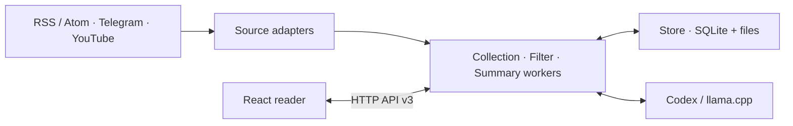

<div align="center">

# Oko · Око

**Your sources. One place to read.**

A local reader for RSS, Telegram, and YouTube, with optional AI filtering and summaries.

[Quick start](#quick-start) · [User guide](docs/guide.md) · [Architecture](docs/architecture/README.md) · [Contributing](#contributing)

</div>

---

Oko collects publications from sources you choose and organizes them into topic folders. Read saved articles, browse Telegram posts with their media, and turn available YouTube captions into summaries. Your library lives in a local data directory; you choose whether and how a model processes it.

The interface follows a simple flow: **folders → cards → material**. Opening a card keeps its content. Explicitly marking it viewed finishes it and deletes its saved content, media, and generated summaries.

## What you can do

- **Bring sources together.** Add RSS/Atom feeds, YouTube channel feeds, and Telegram sources through public web access or an existing Telegram account.
- **Read saved content.** Oko extracts article text and saves supported images and Telegram attachments locally. Partial downloads remain visible with a reason and recovery action.
- **Organize your reading.** Group feeds into topic folders, set their importance, and inherit settings from Oko to folder to feed.
- **Choose your AI.** Use a connected llama.cpp server or supported Codex CLI for filtering and publication summaries. Public AI processing requires permission for the feed.
- **Control the work.** Follow collection and processing status, pause initial history, retry failed downloads, or switch collection and processing off while keeping saved material readable.
- **Keep results current.** Processing checks prevent late responses from replacing newer work or restoring deleted content. Oko stores the latest publication state.

## Quick start

Oko currently runs from a source checkout. Use a Unix-like environment; the maintained desktop installation targets macOS. The UI is currently in Russian. This README and the introductory guides are in English.

**Requirements:** Python 3.11–3.14, uv **0.11.28**, and Node.js **26.12.0** (see [.node-version](.node-version)).

```sh
git clone https://github.com/tgenman/oko.git
cd oko

uv sync --locked --python python3.11
npm ci
npm run api:generate
npm run build

# Explore with synthetic publications and a separate data directory.
uv run --locked python -m oko --demo --data /tmp/oko-demo
```

The browser opens automatically. The demo uses a synthetic source; no personal subscriptions or Telegram account are needed. Use a fresh data directory to reset publications you have marked viewed.

To start a new library:

```sh
uv run --locked python -m oko --data ./data
```

Existing nonempty stores from the previous pipeline require the documented offline migration before launch; see the [migration runbook](docs/development/publication-migration.md).

Add a feed in the reader and choose its topic folder and initial history. Model connections are optional and configured separately in settings.

By default, the server pauses work after losing its reader-tab heartbeat and exits after the reconnection grace period. For an instance that stays available without open tabs:

```sh
uv run --locked python -m oko --persistent --port 8765 --data ./data
```

The persistent profile remembers browser sign-in and keeps serving the reader. Switching Oko off stops collection and processing; stopping the server is a separate action. See the [user guide](docs/guide.md) for profiles, integrations, and data handling.

## How it fits together



A Python application serves both the React frontend and the HTTP API. Execution owns shared admission; three workers own collection, filtering, and summaries; Store owns persistence and recovery. Collection and model adapters sit behind shared contracts. The editable [OpenAPI specification](api/openapi.yaml) generates the Python DTOs and TypeScript client.

Read the [architecture overview](docs/architecture/README.md) for module responsibilities, data flow, state ownership, and the rules for accepting asynchronous results.

## Development

```sh
# Rebuild frontend assets when sources change; run Python separately.
npm run dev

# Check generated API clients without changing files.
npm run api:check

# Run the project checks.
./scripts/check ui
./scripts/check python types
./scripts/check http
./scripts/check all --compact
```

Node.js prepares frontend assets; it is not needed to serve the built reader. Startup rejects missing or stale frontend builds. After changing frontend sources, rebuild before launching Python.

Browser tests use Playwright with temporary data and synthetic integrations. See the [browser test setup](tests/browser/README.md), [check workflow](docs/development/check-workflow.md), and [development process](docs/agents/development.md) for prerequisites and focused checks.

## Documentation

| Start here | What it covers |
| --- | --- |
| [User guide](docs/guide.md) | Sources, model setup, settings, data, and runtime profiles |
| [Architecture overview](docs/architecture/README.md) | Components, ownership, lifecycle, and design invariants |
| [HTTP API](api/README.md) | OpenAPI contract, code generation, and API rules |
| [Source checkout](docs/development/package.md) | Frontend delivery and local launch |
| [macOS Docker installation](docs/development/docker.md) | Managed releases, host Codex bridge, backup, and rollback |
| [Domain glossary](GLOSSARY.md) | Canonical product terms |
| [Verification reports](docs/verification/) | Checks performed for specific changes and integration limits |

The deeper design documents, glossary, and operational runbooks are currently in Russian. The [previous README](docs/README.previous.ru.md) is retained as historical reference, including detailed integration notes; it is not the current setup guide.

## Project status and limitations

Oko is under active development. RSS extraction is heuristic and does not execute page JavaScript. Telegram web access depends on publicly available pages; account access requires an existing session. YouTube collection saves metadata, previews, and available captions, **not full video or audio**. Oko does not transcribe audio or video.

Real integrations have had bounded acceptance checks, documented in the verification reports. Those checks do not guarantee source availability or model quality for every subscription. The managed Docker release targets macOS with Linux ARM64 containers and a separate host process for Codex; it is not a generic cross-platform installer.

## Contributing

[Open an issue](https://github.com/tgenman/oko/issues) for bugs or proposed changes. For a bug, include reproduction steps, expected behavior, runtime profile, and relevant diagnostics with private content and credentials removed.

Before changing code, read [AGENTS.md](AGENTS.md), the [glossary](GLOSSARY.md), and the architecture document for the affected scenario. Verify changes through the existing reader HTTP interface and, where relevant, Playwright. Use temporary storage and synthetic sources/models for automated tests.

## Third-party notices

Telegram session-lock code includes adaptations from telegram-mcp under [Apache 2.0](docs/licenses/telegram-mcp-Apache-2.0.txt). Telegram web and Telegraph extraction includes adaptations from RSSHub; see the [attribution notice](docs/licenses/RSSHub-NOTICE.md) and [AGPLv3 text](docs/licenses/RSSHub-AGPL-3.0.txt).

These notices describe third-party components. A project-wide license has not yet been declared in this repository.
