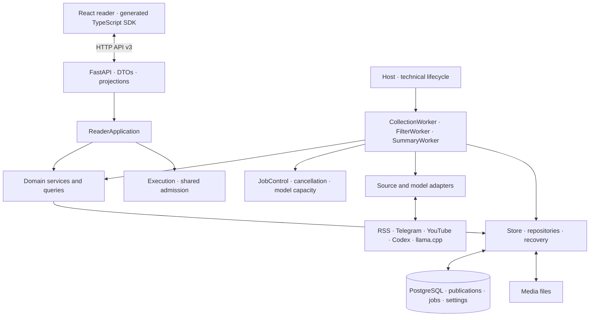
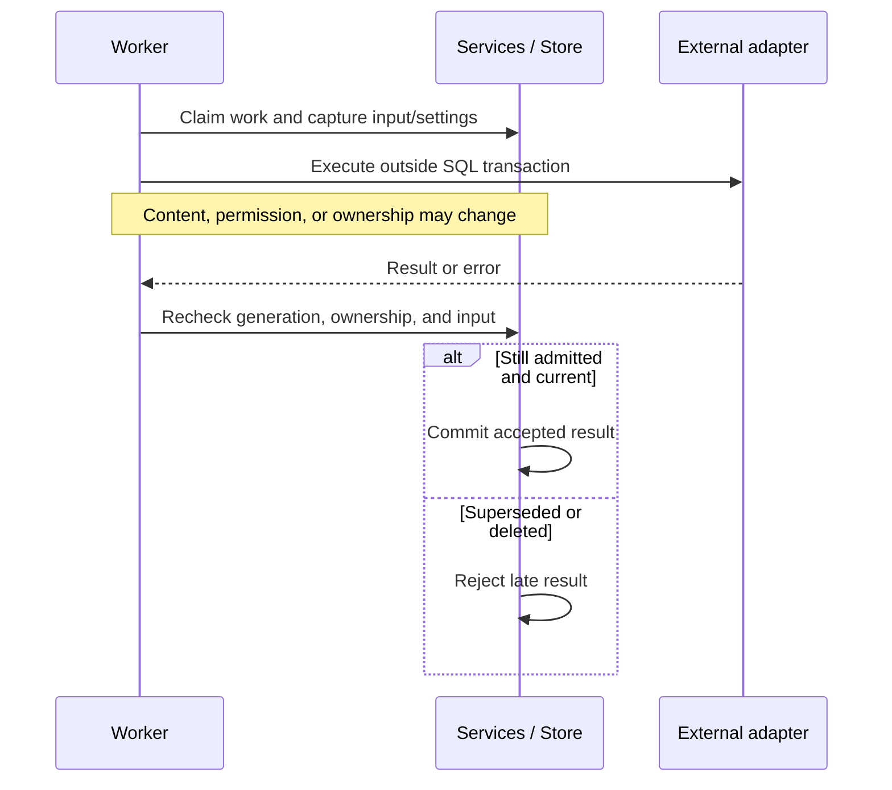

# Architecture

Oko is a local reading application with a React frontend and a Python backend. One backend serves the built interface, HTTP API, and saved media. PostgreSQL stores publication content and durable state; media bytes live in files. Node.js is a build-time dependency.

This overview describes the current three-worker pipeline. Detailed documents retain explicitly labeled proposals and historical reports; those are not evidence that a proposal has shipped.

## System map

The diagram shows responsibilities and collaborations rather than a sequence of calls. Three independent workers coordinate through saved publication states and jobs. There is no central Runtime orchestrating the stages.

## Code map

| Location | Responsibility |
| --- | --- |
| `frontend/src/` | React rendering, navigation, focus, drafts, reading coordination, and browser response admission |
| `api/openapi.yaml` | Canonical editable HTTP contract |
| `oko/reader/` | HTTP contract, generated DTOs, and wire projections |
| `oko/application/` | ReaderApplication and user scenarios |
| `oko/services/` | Domain operations and queries; no job or adapter ownership |
| `oko/domain/` | Shared errors, prepared processing input, and collection effects |
| `oko/workers/` | CollectionWorker, FilterWorker, SummaryWorker, and JobControl |
| `oko/collection/` | Source contracts, discovery, fetching, media streams, adapters, and protocol clients |
| `oko/processing/` | AI contracts, attribution, instructions, validation, and Codex/llama.cpp adapters |
| `oko/storage/` | PostgreSQL, entity repositories, JobRepository, processing results, media files, and recovery |
| `oko/subscriptions/` | Feed models and settings inheritance |
| `oko/execution.py` | Shared admission and user-action serialization |
| `oko/host.py` | Technical startup and shutdown lifecycle |
| `oko/__main__.py` | CLI configuration, instance locking, and process launch |
| `tests/` | HTTP, collection, processing, lifecycle, Node, and Playwright scenarios |

See [package layout](package-layout.md) and [application layers](application-layers.md) for detailed boundaries.

## From a source to a card

1. A feed records a source identity, adapter, opaque cursor, topic folder, and collection/processing settings.
2. CollectionWorker discovers publication identities and commits an accepted batch together with its cursor. Adapters use external keys rather than database IDs.
3. Publication content is saved in PostgreSQL. Media descriptions become separately scheduled downloads; text can be readable before all attachments are ready.
4. FilterWorker and SummaryWorker claim eligible work through persisted jobs. Disabled stages are skipped; filtered-out publications are not summarized.
5. Workers execute network/model calls outside SQL transactions and accept results only after checking current ownership and generation.
6. Server queries and HTTP projections provide reading cards, effective settings, material, and status. The browser rejects late responses for superseded selections.

Publication status moves through `pending_collection → pending_filtering → pending_summary → ready`, with `filter_out` as a filtering outcome. Job errors and source waits are separate from publication stages. Interrupted running jobs return to pending with a delay during recovery.

A publication is identified by `(platform, external_id)`. Feed/publication membership is many-to-many; publication links represent relationships such as RSS entry → article and Telegram post → Telegraph article. A Telegram album is one publication. Telegram groups, supergroups, and forums are currently unsupported. See [latest publication state](latest-publication.md) and the [glossary](../../GLOSSARY.md).

## Ownership and concurrency

| Owner | Owns |
| --- | --- |
| Browser | DOM, focus, selection, drafts, local preferences, and admission of responses to the current view |
| Reader session | Heartbeats, polling, BroadcastChannel, and page events |
| ReaderApplication | User-facing scenarios and coordination with domain services |
| Execution | Shared admission, serialized actions, and external-check admission |
| Three workers | Collection, filtering, summaries, owned attempts, and external adapters |
| JobControl | Active attempts, cancellation, and shared model capacity |
| Store | Short transactions, repositories, durable jobs, files, and recovery |
| Host | Technical lifecycle and orderly shutdown |

The browser does not recompute server reading membership or processing freshness. A successful server write remains committed when its form closes. Independent read requests do not promise one transactional snapshot.

Execution's action mutex and PostgreSQL's access lock have separate roles. Network waits and model execution run outside SQL transactions. Shutdown closes admission and invalidates job generations before waiting for cancellation; a cancellation-resistant adapter cannot restore deleted content or accept work into an old Store.

There is one React root with named portals. Reading coordination connects the list, tree, opened material, and reader actions. See [reader work](reader-work.md), [frontend/backend](frontend-backend.md), and [UI state ownership](ui-settings.md).

## Processing and late responses

Filtering and summary results are stored as JSON with input/settings hashes, signatures, timestamps, and provenance. Changed input removes the old result; unchanged input preserves it. Shared publications use one coordinated result. Updates to a linked article can invalidate the root publication's result without recursive traversal.

Codex model, reasoning effort, and Fast selections apply to future work. They do not invalidate completed results or change the settings captured by an active attempt. Provenance remains separate from freshness. See [publication processing](publication-processing.md), [processing coordination](processing-coordination.md), and [ADR 0001](../adr/0001-codex-execution-settings.md).

Public AI processing requires feed permission. Local llama.cpp use requires explicit confirmation and the adapter's loopback/model checks; these do not attest an arbitrary server. Codex has binary admission and supported sign-in/quota checks. There is no automatic processor fallback.

## Content, media, and deletion

Oko stores the latest publication state, rather than an immutable history of content versions. An already opened revision may remain temporarily in browser memory until the reader switches to an update.

Media downloads stream to a temporary file, flush to disk, move into place, and commit ready state in a short transaction. Ownership and generation checks protect acceptance. Files live under `media/<publication_id>/<media_id>`. Media identity distinguishes an updated locator for the same resource from replacement content. Text remains available when one attachment fails.

Opening or copying preserves material. Filtering can hide it without deleting it. Explicit viewing deletes local publication content and owned media/results; there are no permanent viewed tombstones in the current pipeline. Rediscovery or an explicit history reload can create that publication again. Source unavailability does not itself mean that the user finished reading.

Folder completion uses the server's full composition, including hidden and not-yet-loaded material. Telegram read synchronization has a separate safe frontier: external read state does not delete Oko content. See [reading composition](reading-composition.md) and [opened material](opened-material.md).

## Runtime profiles and delivery

| Profile | Lifetime and purpose |
| --- | --- |
| Default checkout | Reader heartbeats; pauses and exits after loss of presence and grace period |
| `--persistent` | Explicit lifetime with remembered browser sign-in; available without open tabs |
| `--api-only` | Explicit lifetime without the web reader |
| Managed Docker release | Persistent reader container and separate host Codex process on macOS |

Enabled/disabled work is separate from server lifetime. Switching Oko off stops collection and processing while saved material remains readable in persistent mode.

Python validates frontend assets and contract freshness before starting application work. Vite builds immutable asset generations; older chunks remain available to open tabs during watch rebuilds. The OpenAPI specification generates Python DTOs and the TypeScript SDK. `/docs` and `/openapi.json` expose API documentation; Swagger does not create a reader lease.

New or empty stores use the current pipeline. Nonempty legacy stores require offline migration; startup refuses to silently convert them. See [migration](../development/publication-migration.md), [pipeline release](../development/pipeline-release.md), [checkout delivery](../development/package.md), and [Docker operations](../development/docker.md).

## Verification and detailed documents

Behavioral tests use the existing reader HTTP interface, temporary PostgreSQL/files, and synthetic sources/models. Playwright exercises the real browser. Worker startup, cancellation, late responses, deletion, and restart recovery require scenario checks. Live integrations provide separate, bounded evidence rather than guarantees of upstream availability.

The deeper documents are currently in Russian:

| Topic | Document |
| --- | --- |
| Current data model, adapters, jobs, and stages | [Latest publication state](latest-publication.md) |
| Layers, services, and transactions | [Application layers](application-layers.md) |
| Actions, cancellation, admission, and shutdown | [Reader work](reader-work.md) |
| Opened content and delayed browser responses | [Opened material](opened-material.md) |
| Menus, settings, and drafts | [UI settings](ui-settings.md) |
| Cards, hidden material, and folder completion | [Reading composition](reading-composition.md) |
| React, generated clients, and asset delivery | [Frontend/backend](frontend-backend.md) |
| Actual checks and integration limits | [Verification reports](../verification/) |
| Browser prerequisites and checks | [Browser setup](../../tests/browser/README.md) |
