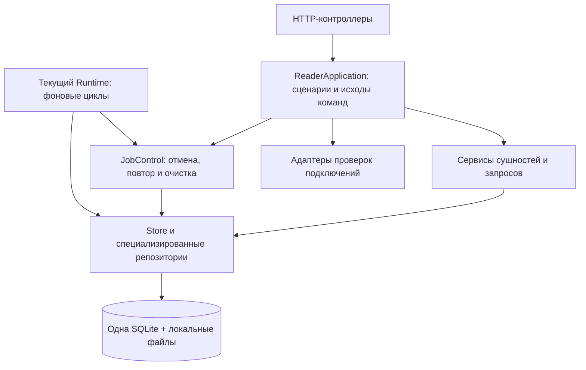
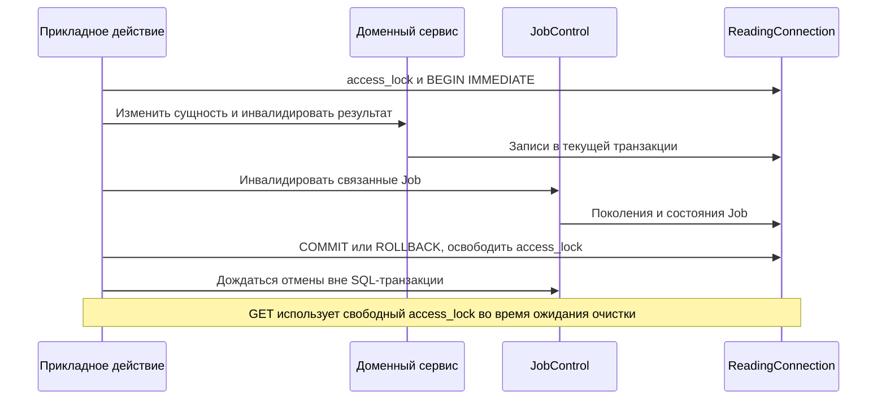

# Слои приложения после #113

HTTP-контроллеры получают ReaderApplication, а не Runtime или Store. Протокол
OpenAPI, DTO и wire-проекции остаются в reader. Фоновые циклы пока остаются в
Runtime; их перенос в три независимых воркера относится к следующему этапу.

## Владельцы

- reader/app собирает Execution, JobControl и ReaderApplication до старта lifespan.
- Execution хранит текущий Store, допуск, epoch, регистрацию внешних ожиданий
  и callbacks чтения. Приём позднего ответа сохраняет прежние проверки исходного
  хранилища, поколения и текущего допуска.
- ReaderApplication владеет пользовательскими сценариями и внешними проверками.
  Lifecycle callbacks предоставляют остановку/питание и синхронизацию источников;
  приложение не получает весь Runtime как зависимость.
- services/subscriptions, reading и connections объединяют доменные последствия
  изменения сущностей. CommandJournal сохраняет исходы пользовательских команд.
  Эти сервисы не получают Job и не вызывают внешние адаптеры.
- ReadingQueries выдаёт факты, проверенные дескрипторы медиа и версии ресурсов.
  ReaderFacts сохраняет пакетные SQL-запросы и request-local cache. Wire-преобразование
  остаётся в HTTP-адаптере; SQL-соединение ему не передаётся.
- SubscriptionRepository содержит прежнюю SQL-реализацию подписок; модели,
  значения и валидация сохраняют существующий модуль импорта.
- JobControl владеет текущими задачами, отменой, повтором и очисткой. Его использует
  как существующий планировщик, так и прикладные действия. Новые кроны ещё не включены.

## Транзакция и две разные задачи координации

У Store одно ReadingConnection. Его access_lock — единственная блокировка SQL:
она охватывает короткую transaction, существующие connection-контексты и
синхронные сервисные проекции. Внутри этих участков нет await. RLock позволяет
сервису и вложенным репозиториям использовать уже захваченное соединение.
Он различает потоки, а не asyncio Task; запрет приостановки проверяется отдельно.

Прежний Execution._actions сохраняет порядок пользовательских действий и одной
очистки клиента. Эта координация может ждать завершения отмены; SQL access_lock
в этот момент свободен. Поэтому чтение материалов и подписок доступно во время
длительного Telegram.close. Использовать action mutex как SQL-блокировку всего
GET нельзя: это блокировало бы читатель на внешней очистке. Это уточнение
реализации короткой общей SQL-блокировки; второго SQL-соединения или второй
блокировки базы не вводится.

Сервисы получают общий контекст через тот же конкретный Storage. Внешняя
transaction подавляет внутренние commit прежних репозиториев, пока не завершено
полное действие. begin_write присоединяется к уже открытой транзакции без нового
BEGIN. Пойманная ошибка вложенного connection-контекста помечает весь контекст
как прерванный: внешний scope не может зафиксировать его частично.

Единственный commit сохраняет настройки, доменную инвалидацию и изменения Job;
пересчёт списков ReaderVersions выполняется перед этим commit. Ошибка пересчёта
откатывает данные и версии. Только после фиксации выполняются ожидания отмены
и изменения внешнего состояния приложения. Существующие fault hooks
after_viewed_commit/after_feed_delete_commit отложены до реального commit;
сбой такого hook происходит уже после сохранения, как и прежде.

## Остановка и медиа

Обычные запросы используют require_store и закрытый допуск. Финальная проекция
остановки использует отдельный retained_store до физического закрытия соединения;
она не открывает доступ новым командам.

OpenMediaResponse получает файловый дескриптор под SQL-блокировкой проверки
ресурса. Передача идёт с этого дескриптора порциями после освобождения блокировки.
Удаление публикации после подготовки ответа не ломает уже открытый файл.
ASGI finally закрывает дескриптор и при ошибке/отмене отправки.

## Проверки и следующий этап

Основная приёмка остаётся HTTP с временной SQLite и синтетическими адаптерами;
браузерные сценарии проверяют формы, неизвестный исход, переключение доступа и
завершение чтения. Новые проверки покрывают rollback между настройками и Job,
пойманный вложенный rollback, unlink медиа до отправки и закрытие при её ошибке.
SQL-бюджеты навигации и материала закрепляют исходные 11 и 23 statements.

Схема данных, HTTP-контракт и рабочая установка не переключаются этим этапом.
Runtime ещё обслуживает прежние фоновые циклы. Переход к трём воркерам и единый
рабочий выпуск относятся к следующим двум задачам.
