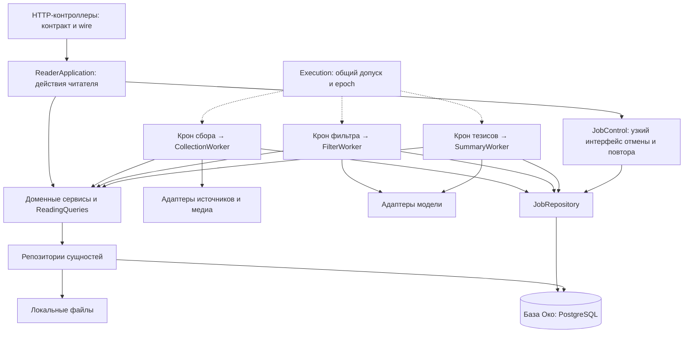

> Действующее хранилище — PostgreSQL. Описание прежних миграций ниже является историей #115; команды переноса старого формата сняты. Текущий порядок: [PostgreSQL](../development/postgresql.md).

# Слои приложения и три воркера

Целевой код #114 заменяет Runtime над пайплайном тремя независимыми кронами
в одном Python-процессе. Это решение заменяет прежнюю роль Runtime из #89.
Рабочий экземпляр переключается один раз в #115: совместимые код и хранилище,
сразу все три воркера. Подготовка кода не запускает миграцию пользовательских данных.

## Владельцы

- reader/app собирает HTTP и ReaderApplication. Контроллеры получают application
  и query-сервисы, не Store или SQL. Публичные имена DTO RuntimeStatus и ошибки
  runtime_disabled сохранены для совместимости HTTP.
- Host открывает/восстанавливает Store, запускает и останавливает три крона и
  обслуживает технический lifecycle читателя. Host не выбирает и не принимает Job.
- Execution хранит текущий Store, допуск, epoch, внешние ожидания и callbacks чтения.
  Он не управляет последовательностью этапов.
- CollectionWorker владеет discover/fetch/download_media, Telegram read sync,
  ограничениями источников и периодической очисткой файлов. Медиа — часть сбора,
  четвёртого воркера нет. Фильтр и тезисы имеют собственные циклы и выбор заданий.
- JobControl хранит активные asyncio-задачи и общий лимит модели, обеспечивает
  отмену, ручной повтор и очистку. Сам он не запускает следующий этап. Общая ёмкость
  модели остаётся равной одной попытке, collection lanes и лимиты источников сохранены.
- JobRepository выполняет SQL для захвата, поколений, условного finish, повтора,
  source-wait и восстановления. Сохранённый payload связывает Job с ревизией входа. Старым Job с прежней
  совпавшей подписью ревизия добавляется без переоткрытия terminal/source-wait.
- ProcessingService готовит и принимает вход/результат; CollectionService —
  публикации, курсоры и связи; MediaService — ресурс и его файл. Сервисы не получают
  Job, не вызывают адаптеры, не завершают транзакцию. Возвращённые CollectionEffects
  содержат доменные последствия; Job на их основании создаёт владелец сбора.
- Репозитории FilterResults, SummaryResults, ProcessingState, Publications и
  специализированные SQL-модули заменяют прежние прикладные объекты в Store.
  Store владеет соединением, файлами, репозиториями и recovery.

## Одна короткая SQL-транзакция

У Store одно соединение через `storage/database.py` и одна общая SQL-блокировка access_lock (RLock).
Порядок JobRepository.transaction: блокировка → проверка допуска → BEGIN (PostgreSQL) →
операции → COMMIT/ROLLBACK → освобождение. Сервисные чтения и HTTP-снимки используют
ту же блокировку. Вложенные репозитории присоединяются к текущей транзакции;
внутренний connection-контекст не выполняет второй BEGIN или commit.
Перехваченная вложенная ошибка помечает внешнюю транзакцию для обязательного rollback.
Перед commit обновляются читательские версии и счётчики.

Execution._actions отдельно сохраняет порядок действий и lifecycle. Он может ждать
отмены/закрытия Telegram-клиента; SQL-блокировка в это время свободна, GET доступны.
RLock не различает asyncio Task, поэтому внутри защищённых SQL-секций запрещены await;
это проверяется автоматическим контрактом. Сеть, модель и скачивание — вне них.

Захват Job и фиксация _pass (feed_id, снимок правил, ревизия) выполняются одним
commit. Между фильтром и тезисами, включая перезапуск, используется один выбор фида.
Актуальность отдельно проверяется по текущему входу и разрешениям. Параметры Codex
сохраняются для попытки и переносятся вместе с поколением при recovery; новые
модель/reasoning/Fast применяются к будущей работе согласно ADR-0001.

При приёме воркер проверяет Store/допуск/running/поколение, сервис — доменную
ревизию и подпись. Затем сервис сохраняет результат, воркер условно завершает ровно
одну Job и сервис обновляет стадию. Всё входит в один commit. Ноль изменённых строк
finish и исключение откатывают обе части. Устаревшая ошибка также не меняет новую
попытку; всё ещё принадлежащая старому входу Job условно отменяется.

Догрузка статьи сохраняет вход, инвалидацию корней и _revision в одной транзакции.
Ревизия — сохраняемый токен, который не переиспользуется при A → B → A.
Соседний воркер на собственном проходе согласует только свои Job. Он не вызывается
сбором и не получает право принять старый успех или retry до своего следующего тика.
failed/unavailable/cancelled не возобновляются от одного ожидающего статуса публикации;
для нового входа нужна новая ревизия. Обязательное ожидание источника не сокращается.

Подготовка различает работу модели, no_input, ожидание исходника и выключенный этап.
Допуск Job проверяет воркер. Подтверждённый no_input сохраняется без модели вместе с
done; ошибка загрузки не становится пустым успехом. filter_out не запускает summary.
Ручная регенерация сохраняет прежние актуальные тезисы до успешной замены.

## Файлы и миграция

MediaOutput записывает staging только при действующем допуске. Затем storage делает
fsync/move в защищённый final-путь вне SQL-транзакции. Под короткой блокировкой
проверяются текущее описание ресурса и Job; старый locator не перезаписывает
обновлённый. Ревизия fetch относится к описанию источника и не меняется из-за
отдельной догрузки файла. ready, ссылка на файл, ревизия входа и done фиксируются
вместе. После rollback возможен лишний файл, но не ложный ready. Активные пути
защищены до завершения/отказа; cleanup удаляет остатки после снятия защиты.
OpenMediaResponse открывает дескриптор под блокировкой и передаёт его после её
освобождения: удаление материала не ломает начатую передачу; finally закрывает fd.

Офлайн-инструмент `python -m oko.storage.migration SOURCE NEW_DIRECTORY` готовит
отдельное хранилище формата Publication, соответствующее базе #112/#113. Он требует
остановленного владельца instance.lock, проверяет отсутствие групп/неизвестных типов,
SQLite, ID, долговечные настройки, результаты и хеши файлов; выдаёт migration-report.json.
Статус/сообщение Telegram-профиля штатно сбрасываются для повторной проверки
при запуске; account/user_id/generation/checked и остальные настройки сохраняются.
Источник остаётся неизменным; существующий destination не перезаписывается.
Более старый формат до Publication требует прежнего проверенного конвертера и
отвергается явно. Неизвестный Telegram Web не считается доказанным каналом.
В #115 проверка повторяется под остановленными записями перед единым переключением.

Полная схема и пример тезисов: [human](../human/pipeline-workers.md).
Проверки реализации: [отчёт #114](../verification/pipeline-workers-114.md).

### Совместимость старого Publication-формата (#115)

`migration --legacy` проверяет SQLite backup в памяти до создания target и до
открытия Store. Потерянный source_kind восстанавливается только для точного старого
Web-binding: совпадают config/binding, platform/adapter, username и canonical URL,
сохранились username claim и его единственный владелец с evidence=public preview.
Это следствие прежней успешной проверки публичной истории, а не предположение
по kind=web. Противоречащий тип, лишние поля, клиентский доступ без доказанного типа
и отсутствие подтверждения остаются отказом.

Завершённые/отменённые orphan fetch/delete/download_media с непрозрачным ID и
завершённые history_members доказанного источника остаются в исходных таблицах.
Дополнительно migration_retired_rows хранит их неизменяемые row_json/SHA256.
Guard допускает исключение только для существующей, совпадающей с аудитом строки,
которая всё ещё является завершённым техническим остатком. Неизвестные и активные осиротевшие
задания, pending-история без владельца и явные признаки групп не получают такого исключения.
Аудит не участвует в выборе работы и не возобновляет Job. Штатное удаление либо
новая корректная строка не блокируются старым аудитом; для изменённого orphan
исключение больше не действует. Исходная SQLite и все её строки сохраняются.

Облачный backend, права ролей, lease и отдельные миграции описаны в [PostgreSQL](../development/postgresql.md). Тексты и результаты остаются SQL-данными, медиа — локальными файлами.
