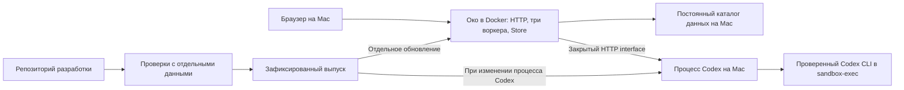

# Рабочее Око в Docker и Codex на Mac

Дата: 2026-10-19. Статус: реализация разрешена пользователем через implement-spec; фактические результаты записываются отдельно.

Пользователь выбрал этот Mac и сохранение обработки через Codex и разрешил реализацию. Во время реализации пользователь отложил имя oko: текущий адрес — http://localhost:8765, без изменения DNS и порта 80. Перенос личных данных и перезапуск личного экземпляра остаются отдельными действиями установки.

## Результат для пользователя

Рабочее Око доступно по постоянному локальному адресу, пока в репозитории меняются код, зависимости и сборка интерфейса. Разработка и проверки используют отдельные данные. Новая версия попадает в рабочее Око отдельным обновлением после проверок; завершение задачи разработки само по себе ничего не переключает.

Основной адрес — `http://localhost:8765`. Начальный вариант предполагает короткую недоступность при установке обновления. Пока Mac спит, выключен или Docker Desktop остановлен, доступность не гарантируется. После входа пользователя и запуска Docker Desktop рабочие процессы восстанавливаются автоматически.

## Состав и владение

| Часть | Ответственность |
| --- | --- |
| Око в контейнере | Интерфейс читателя, сбор источников, настройки, очередь работы, разрешения публичного AI, актуальность и сохранение результатов |
| Процесс Codex на Mac | Каталог моделей, проверка допуска и лимитов, выполнение и отмена собственных дочерних процессов, очистка временных файлов |
| Постоянные данные | SQLite, материалы, медиа, настройки, состояние включения и диагностика Око |
| Установка выпуска | Выбор согласованных версий контейнера и процесса Codex, резервная копия и переключение |

Воркеры и Store сохраняют обязанности из [управления работой](reader-work.md) и [согласования обработки](processing-coordination.md). Процесс Codex не читает базу Око, не выбирает публикации и не сохраняет принятые тезисы. Новая долговечная очередь на Mac не вводится.

## Изоляция рабочего выпуска

Контейнер содержит зафиксированные Python-код, зависимости, generated DTO и готовую сборку React. Node нужен на этапе сборки. Исходники рабочего checkout, его `.venv`, `node_modules` и каталог frontend build не монтируются. Начать можно с запуска из снимка репозитория внутри образа, сохранив существующую проверку assets; возвращать wheel для этой задачи не требуется.

Процесс Codex тоже устанавливается из зафиксированного выпуска в отдельный каталог со своим Python-окружением. Запуск через `.venv` изменяемого checkout нарушит изоляцию. Состав выпуска содержит идентификатор исходного снимка, digest образа, версию процесса Codex и версию протокола. Не использовать изменяемый `latest` как единственную ссылку для отката.

Рабочие данные и конфигурация запуска находятся вне репозитория, например в `~/Library/Application Support/Oko/`; конкретный путь выбирается при реализации. Каталог данных монтируется в контейнер как `/data`. Авторизация Codex остаётся на Mac; контейнер получает только отдельный секрет связи с процессом Codex. Общего каталога заданий между Mac и контейнером нет.

Секреты, личные данные, Telegram-сессии и резервные копии исключаются из контекста Docker-сборки явным списком включаемых файлов либо проверяемым `.dockerignore`.

Telegram остаётся в контейнере вместе со сбором. Существующие файлы авторизации подключаются отдельно от кода с необходимым доступом для обновления сессии. Их расположение и перенос проверяются отдельно: пути в текущей конфигурации могут быть абсолютными. Разработка не подключается к этим файлам. llama.cpp, если используется на Mac, требует адреса хоста вместо контейнерного localhost.

## Сеть и вход в читатель

В контейнере HTTP-сервер слушает `0.0.0.0` на фиксированном внутреннем порту 8765. Docker публикует его только на `127.0.0.1:8765` Mac. Изменения DNS/hosts и привязка порта 80 в текущий объём не входят. Смена внутреннего IP контейнера не меняет адрес читателя. При занятом порту установка сообщает конфликт и не останавливает чужой процесс.

Постоянный читатель требует входа по паролю; launcher больше не выдаёт браузерные cookie через bearer. Все логины используют общие данные и права. Пароли хранятся scrypt-хэшами; отзываемые host-only HttpOnly SameSite=strict cookie действуют 30 дней. Смена пароля и отключение логина отзывают его сессии. Отсутствующая или повреждённая конфигурация закрывает браузерный доступ. Локальный service bearer остаётся для readiness и независимых клиентов; внешний HTTPS-origin его не принимает. Проверки Host/Origin и CSRF сохраняются. Forwarded-заголовки не определяют origin. Защищённые потоки проверяют сессию между фрагментами; при потере доступа браузер очищает читатель и прерывает ожидающие чтения.

Управление доступами и необязательная HTTPS-публикация: [вход по паролю](../development/password-login.md).

Внешний адрес читателя отделяется от адреса сокета. PID внутри контейнера не используется для управления процессами Mac. Локальный launcher открывает читатель без токена; браузер внутри контейнера не запускается. После обновления старая вкладка предлагает восстановить подключение. Служебный токен читателя не совпадает с секретом процесса Codex.

Око обращается к процессу Codex по `host.docker.internal` на отдельном порту. Процесс слушает loopback Mac; достижимость именно такого listener из Docker Desktop обязательна к проверке на этом Mac. Если она не работает, сетевой вариант пересматривается до реализации подключения; открывать listener на всех интерфейсах автоматически нельзя.

Каждая операция процесса Codex требует собственного bearer, включая получение статуса и каталога. Browser Origin отклоняется, CORS не разрешается, redirects не используются, служебный hostname исключается из HTTP-прокси. Браузер обращается только к Око. Секрет защищает от случайного доступа других локальных процессов и контейнеров, но не от владельца аккаунта Mac или администратора Docker.

Docker документирует [связь с хостом через host.docker.internal](https://docs.docker.com/desktop/features/networking/networking-how-tos/) и [ограничение опубликованного порта localhost](https://docs.docker.com/desktop/features/networking/). Это основание проекта, а не результат проверки установленного Docker Desktop.

## Interface процесса Codex

Внутри Око сохраняется `CodexClient`: `check`, `catalog`, `complete`. Для контейнера добавляется сетевой adapter. Локальный adapter остаётся пригоден для разработки. Аргумент `directory` относится к локальному временному пространству adapter; путь контейнера не передаётся на Mac.

Служебный протокол процесса Codex имеет собственную версию. Это новая закрытая HTTP-граница, отдельная от публичного API читателя. При реализации она получает машинно проверяемый OpenAPI-контракт и проверки совместимости; существующий `api/openapi.yaml` читателя меняется только при необходимом изменении поведения читателя.

| Операция | Содержание |
| --- | --- |
| Статус / проверка | Версия протокола, ID запуска процесса, версия выпуска, доступность проверенного CLI, авторизации, изоляции и лимитов. Без материала и запуска обработки |
| Каталог | Существующий нормализованный каталог моделей и возможностей |
| Создать задание | ID запуска Око, ID задания, prompt, schema результата, модель, усилие и Fast; ответ подтверждает принятие и ID запуска процесса Codex |
| Получить состояние / результат | По ID задания: выполняется, завершено, ошибка или отменено; готовый ответ — текст существующего `complete` |
| Продлить владение | Подтверждение, что создавший задание воркер Око ещё ждёт его |
| Отменить / освободить | Идемпотентная остановка и удаление содержимого задания после получения результата |

Первый вариант выполняет одно AI-задание одновременно, как общий модельный слот Око. Занятость возвращается явно; скрытой очереди заданий на Mac нет. Служебная отмена и продление доступны во время выполнения. Повтор создания с тем же ID и тем же запросом возвращает текущее состояние без нового запуска; другой запрос с тем же ID отклоняется. Завершённые и отменённые ID остаются как ограниченные по времени записи без содержимого, чтобы задержанный повтор не запускал их заново. Истечение владения окончательно завершает попытку: запоздалое продление её не оживляет. После удаления записи ID клиент не повторяет создание старой попытки.

Процесс принимает только перечисленные поля и ограниченные размеры. Клиент не задаёт команду, путь к бинарнику, рабочий каталог, переменные окружения, shell, sandbox-профиль или произвольные CLI-флаги. Параметры модели проверяются по каталогу; schema — по допустимому формату и размеру. Ограничения входа, ответа и хранения результата должны быть одинаковыми в контракте и обоих adapter, с явной ошибкой превышения.

Сохраняются текущие `sandbox-exec`, проверка SHA-256 CLI, запрет инструментов и пользовательских правил, одноразовое выполнение, проверки журналов и очистка. Авторизация читается на Mac существующим способом. Разрешение публичного AI проверяет воркер до отправки материала; процесс повторно проверяет свой допуск перед запуском CLI. Неизвестная версия или неподтверждённая изоляция блокирует обработку, сохраняя доступность чтения.

## Выполнение, отмена и сбои

1. Воркер получает подготовленный сервисом запрос и снимок параметров согласно текущим правилам. Сетевой adapter проверяет совместимость и доступность процесса Codex; перед передачей материала воркер повторно проверяет допуск.
2. Процесс принимает запрос под уникальным ID и создаёт свой временный каталог. Состояние и результат держит в памяти; временные файлы CLI доступны только владельцу Mac.
3. Во время ожидания adapter опрашивает состояние и продлевает владение. Предлагаемые исходные значения: продление раз в 5 секунд, срок владения 20 секунд. Эти константы протокола проверяются при реализации; отдельные пользовательские настройки для них не нужны.
4. Сохраняются существующие ограничения времени CLI: до 120 секунд на выполнение, отдельные ограничения проверок и каталога. Полное время ожидания adapter учитывает эти этапы и ограниченное сетевое ожидание; каждое действие имеет timeout.
5. После получения ответа Око валидирует его существующим способом и проверяет актуальность перед принятием. Освобождение содержимого на Mac выполняется сразу после передачи ответа в память Око; дальнейший сбой сохранения восстанавливается через Store. Неполученный результат удаляется после истечения владения.
6. При отмене adapter отправляет отмену независимо от отменяемой задачи ожидания. Процесс завершает только свою группу CLI, очищает файлы и подтверждает остановку. Если подтверждение не получено, владение перестаёт продлеваться; новое задание не принимается, пока прежнее не остановлено.

Обрыв запроса создания имеет неизвестный исход: сначала уточняем состояние того же ID у того же запуска процесса, без нового запуска модели. Повтор неизвестного ID после потери связи допускается только как запрос состояния, а не автоматическое повторное создание. При смене ID запуска процесса старый ответ утрачен; Око показывает прерванную попытку и возвращается к существующей политике восстановления Store. Гарантировать ровно один внешний запрос после сбоя процесса нельзя; возможный повтор учитывается как новая попытка.

После падения контейнера lease останавливает оставшийся CLI. Для каждого задания предлагается небольшой дочерний supervisor: он владеет группой CLI и следит за управляющим pipe от процесса Codex, сроком владения и предельным временем. Закрытие pipe при падении родителя завершает CLI и очищает каталог; файловый lock задания освобождается только после очистки. Новый экземпляр не запускает работу до освобождения прежнего lock. Одного перезапуска Python недостаточно; EOF, аварийное завершение supervisor и освобождение lock требуют отдельной проверки. Если supervisor сам погиб и остановка CLI не подтверждена, новое выполнение блокируется до явной очистки принадлежащих выпуску процессов. При старте также очищаются собственные остаточные временные каталоги; содержимое не пишется в служебные журналы. Очистка после аварийного завершения не обещает безопасного стирания блоков диска.

После сна Mac просроченные задания не возобновляются по старому владению: до приёма новых команд процесс сопоставляет монотонное и календарное время и завершает прежнюю работу. После смены входа, разрешений, «Просмотрено» или выключения Око поздний ответ не принимается даже при недоставленной отмене.

## Постоянная доступность и состояние включения

Контейнерный профиль сохраняет HTTP и чтение без вкладок. При включённом Око сбор и обработка могут идти в фоне; при выключенном — остановлены, материалы доступны. Закрытие последней вкладки не выключает Око и не завершает процесс. Состояние включения восстанавливается из Store, чтобы перезапуск контейнера не включал остановленный пользователем сбор.

Это предлагаемое изменение относительно действующего `client_presence`; сейчас `explicit` связан с `--api-only`, поэтому нужна отдельная настройка lifetime с веб-интерфейсом. Нельзя получать постоянный запуск огромными lease/grace или поддельной вкладкой. Текущие изменения выключенного состояния в checkout не считаются завершённой зависимостью: будущая реализация должна согласовать их контракт.

Выключение сбора и остановка процесса — разные действия. Полная остановка рабочего экземпляра выполняется средствами установки/Docker и надзора Mac. Политика автоматического восстановления не должна отменять такую явную остановку. Предлагается Docker `unless-stopped` и пользовательский LaunchAgent для процесса Codex с управляемой установкой/выгрузкой. Автозапуск предполагает сеанс вошедшего пользователя, работающий Docker Desktop и отсутствие его режима сна для контейнеров.

Недоступность процесса Codex отключает только соответствующую обработку. Чтение и сбор продолжаются по своим правилам. Health контейнера проверяет HTTP и доступность Store; готовность Codex показывается отдельно и не вызывает цикл перезапуска Око.

## Обновление, перенос и откат

1. Собрать выпуск из явного снимка, проверить generated-контракт и assets, выполнить проверки на временных данных. Рабочая версия продолжает работать. Проверить совместимость протокола контейнера и процесса Codex.
2. По отдельному действию остановить рабочее Око, дождаться отмены принадлежащего ему задания Codex и освобождения файлов. Сделать копию всего согласованного каталога данных и записать текущие версии выпуска. Если корректная остановка или копия не подтверждены, переключение не начинается.
3. При необходимости заменить процесс Codex зафиксированной версией, затем запустить контейнер с тем же постоянным каталогом. Две версии не открывают его одновременно. Readiness проверяет запуск и чтение; проверка Codex не отправляет личный материал модели.
4. При успешном запуске обновление завершено. Открытые вкладки должны обнаружить смену экземпляра/версии и предложить перезагрузку без повторной отправки старых изменяющих команд. Старые frontend chunks не считаются сохранёнными между образами.
5. При неудаче вернуть прежнюю согласованную пару. Перед возвратом версии проверить совместимость схемы и предметных данных. Если нужен restore, сохранить неудавшееся состояние отдельно и явно учитывать потерю изменений после резервной копии; автоматическая перезапись данных запрещена. Безопасный автоматический откат допустим только до пользовательских записей и внешних действий новой версии либо при доказанной обратной совместимости.

Первый перенос из `data/` проводится при остановленном старом экземпляре. Новое Око использует проверенную копию; прежний каталог сохраняется как точка возврата. Первичная проверка чтения выполняется с выключенным сбором, затем отдельно проверяются пути Telegram и доступность обработчиков. Подключение личных источников, отправка материала Codex и переключение launcher требуют задания на такой перенос.

## Будущая реализация и критерии приёмки

Объём реализации: зафиксированная сборка и Compose; контейнерный запуск/lifetime и внешний URL; сетевой `CodexClient`; служебный контракт и процесс на Mac; установка/запуск/обновление/откат; документация. Начать с синтетической проверки сети и отмены между Mac и Docker, затем выполнять перенос. Общая новая платформа заданий, Redis, PostgreSQL, публичный доступ, TLS и одновременная работа двух выпусков с общей базой в этот объём не входят.

Будущие проверки через HTTP читателя, Playwright и временные данные:

- Правки репозитория, установка dev-зависимостей и неуспешная сборка не меняют работающий выпуск и процесс Codex.
- Контейнер выдаёт согласованные assets/API; launcher открывает правильный адрес и восстанавливает доступ после обновления токена. Недопустимые Host/Origin и доступ из LAN отклоняются.
- `http://localhost:8765` открывается после пересоздания контейнера без изменений DNS/hosts. Повторное открытие в авторизованном браузере не требует URL с токеном; чистый браузер не получает доступ к API автоматически. Проверяется конфликт порта 8765 без остановки чужого процесса.
- Закрытие вкладок сохраняет доступность; выключение прекращает работу и сохраняется после restart; явная остановка не отменяется надзором.
- Неверный секрет и версия протокола, занятость, большие запросы и ошибки схемы отклоняются; произвольные пути/команды недопустимы.
- Повтор ID, потерянное подтверждение создания, отмена и готовый поздний ответ не создают дублирующего запуска или сохранения.
- Падение контейнера, процесса Codex и сон Mac завершают осиротевшие задания; остальные источники и чтение сохраняют доступность при отказе Codex.
- Перезапуск сохраняет данные; резервная копия восстанавливается; несовместимый откат блокируется; права файлов подходят контейнеру и Mac.
- UI показывает недоступность Codex отдельно от недоступности Око; восстановление не вызывает массового пересчёта готовых результатов и сохраняет модель, усилие, Fast и происхождение.

Реальная проверка авторизации, sandbox и обработки Codex выполняется отдельно по разрешённому синтетическому запросу. Она не подменяется успешными тестами сетевого adapter. Внешние права проверяются на этом Mac, включая отсутствие доступа к процессу из LAN и достижимость loopback из Docker.

## Историческая проверка проекта до реализации

2026-10-19: изучены текущие `CodexClient`/`LocalCodex`, CLI запуска, lifetime, HTTP-защита, проверка assets и документы владения Runtime/Store. Установлено, что локальный Codex требует macOS и проверенный бинарник, а штатный веб-запуск связан с присутствием клиента. Документация Docker сверена по ссылкам выше. Проверены локальные ссылки документа и diff.

На этапе проектирования контейнер, процесс на Mac, LaunchAgent, перенос данных и сценарии приёмки не запускались. Результаты последующей реализации фиксируются отдельно в docs/verification/docker-runtime.md; этот исторический раздел их не заменяет.
