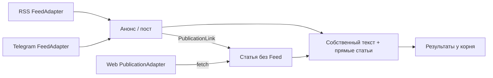

# Отдельные связанные публикации

В целевом хранилище анонс RSS и Telegram-пост сохраняют собственный content.
Основная статья RSS и непосредственно указанные статьи Telegraph — отдельные
Publication без Feed. `publication_links` связывает их с корнем; принадлежность
фиду находится только в `feed_publications`. Один внешний ключ статьи даёт одну
публикацию, даже если на неё ссылаются несколько корней.

## Адаптеры и идентичность

`RSSAdapter` реализует общий FeedAdapter. Внешний ключ записи — платформа rss и
JSON-массив `[нормализованный URL фида, guid/id]`; при отсутствии guid/id используется
URL записи. Разделители в исходных строках не меняют границы компонентов ключа.
Без обоих идентификаторов запись пропускается с диагностикой. Разные записи с одним
ключом в одном проходе — постоянная ошибка; ключ не заменяется придуманным ID.

URL записи открывает её permalink, а при его отсутствии — настоящий URL фида.
Отсутствие permalink не создаёт связь со статьёй. Обычные ссылки в описании остаются
содержимым. Только основной permalink RSS создаёт отдельную статью.

`WebAdapter` реализует PublicationAdapter: обычный HTML и API Telegraph. У статьи
свой внешний ключ other_web/telegraph с нормализованным URL. Для Telegraph ключом
служит путь страницы без tracking query/fragment, одинаковый для RSS и Telegram. Перенаправление меняет
базу относительных ссылок, сохраняя запрошенную идентичность. Статья не добавляет
собственные ссылки в обход. Self-link не создаётся.

Telegram Web возвращает внешний ключ Telegraph; загрузка статьи выполняется
отдельной fetch-job, а не внутри получения поста. Старый путь хранения продолжает
использовать прежнюю совместимость до финального переноса.

Готовые записи discover сохраняются без повторного fetch. У повреждённой записи
с известным ключом остаются metadata, needs_fetch и issue; полезные соседи страницы
сохраняются. Ошибка целой страницы не продвигает курсор.

## Курсор RSS

Курсор — строка с идентификаторами зафиксированного окна и текущей позицией,
без копий текста. Начальная позиция включается; страницы идут от старых к новым.
resolve_feed получает текущую страницу. Архив запрашивается только при недостатке
глубины cursor_before или для записей выбранной страницы discover/fetch. Обход
останавливается после нахождения нужных записей; циклические ссылки не повторяются.
Недобор возвращается с диагностикой, сетевой сбой остаётся ошибкой.

Пока has_more=true, новые записи не меняют верхнюю границу. После завершения следующий
вызов открывает актуальное конечное окно основной RSS-страницы. Основная статья
повторно проверяется при наблюдении RSS-записи; ожидания и постоянные ошибки
сохраняют свой допуск. Окно может повторить
ранее прочитанную запись: целевой RSS не хранит запрет на повторное появление.
После удаления локальных файлов освобождается внешний ключ; повтор создаёт новый
внутренний UUID. Настройки и курсор фида сохраняются в существующем хранилище.

## Сбор и обработка

Все этапы используют прежнюю jobs и три независимых воркера. Доступный текст корня обрабатывается
сразу; пустой анонс с ещё не загруженной статьёй не считается подтверждённо пустым.
Загрузка или изменение статьи меняет вход корня и отменяет устаревшие результаты.
Фильтр получает тексты раздельно; removed сопоставляется с Publication и индексом
исходного блока. Меняется только filtered_content корня, не content статьи.
Тезисы ссылаются на реальные ID и URL использованных публикаций.

Фото и вложения описываются MediaReference и скачиваются отдельными download_media.
Содержимое ссылается на MediaFile.id. MIME, имя и размер уточняются ответом сервера.
Неизменное описание незавершённого скачивания сохраняет ID; изменение ресурса
требует нового описания. Готовый файл без доказанной неизменности не переиспользуется
как новая версия только на основании совпадения URL.

Удаление ссылки освобождает статью только после исчезновения последнего владельца.
Поздний ответ отменённой job не принимается. Ручной повтор корня также повторяет
связанные статьи и их медиа, сохраняя обязательное ожидание источника. CollectionWorker
проверяет общий срок origin перед каждым запросом RSS/Web и медиа статьи. Срок
сохраняется в state и действует для новых заданий после перезапуска; другой origin
продолжает работу. Адаптер не получает соединение с базой.

## Читатель и перенос

Полный и селективный HTTP-интерфейсы показывают корень, прямую статью и ошибки.
Медиа статьи сохраняют URL собственного владельца. Диагностика связанной статьи
и её файлов указывает на доступные читателю корни; отсутствие Feed у статьи не
создаёт отдельную карточку или некорректный feed_id. Изменение связанного входа
меняет ревизию корня и версии его частей; открытая вкладка сохраняет показанное
содержимое до выбора новой версии.

Целевая схема снимает старую уникальность `(feed_id, url)`: разные RSS-записи могут
ссылаться на одну статью. Схема PostgreSQL обеспечивает это ограничение через применённые миграции.
Сохраняется уникальность `(platform, external_id)`.

Новые RSS-фиды перенесённого хранилища используют этот путь. Конвертация уже
существующих RSS-строк и окончательное удаление совместимости входят в финальный
перенос. Рабочее пользовательское хранилище автоматически не переключается.

Фактические проверки: [отчёт #94](../verification/linked-publications-94.md).
