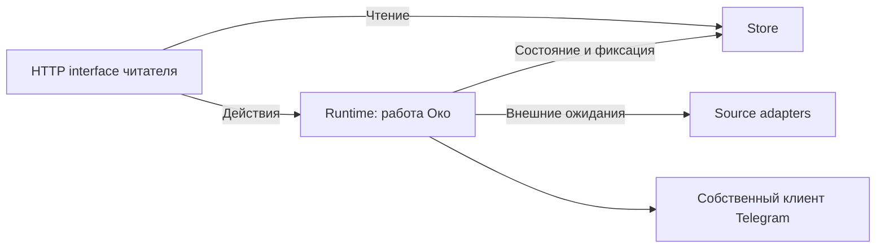

# Управление работой Око

2026-10-08. Согласованный кандидат 01 из архитектурного обзора. Исходная база: `ab206cb39596326296b3fbda3c298b5e6e49ca95`.

## Согласованные решения

Модуль скрывает полные сценарии действий читателя: «Просмотрено», переключение источника, закрытие последней вкладки и остановку Око. Вызывающий код не согласует самостоятельно отмену задания, инвалидацию поколения, очистку процесса и удаление контента.

Изменения состояния выполняются последовательно. Сетевые ожидания находятся вне этой последовательности, чтобы подключение или скачивание не задерживало остановку. Чтение карточек и настроек остаётся через существующий interface Store. Store отвечает за идентичность, транзакции, файлы и восстановление. Общий контракт Source и устройство хранения остаются отдельными кандидатами.

## Размещение ответственности

`oko/runtime.py` — module работы Око. Его interface выражает действия читателя; порядок исполнения и допуск находятся в implementation. `oko/app.py` принимает запросы, проверяет их форму и локальную сессию, переводит ошибки действий в HTTP и читает Store. Оно не управляет активным заданием, поколениями, процессом Telegram или порядком удаления.

Существующие seams сохранены: RSS/Telegram/Demo adapters удовлетворяют Source; реальный клиент Telegram и синтетический adapter заменяемы для проверок. Новый общий процессный framework, второй adapter хранения и дополнительные абстракции не добавляются.

## Правила выполнения

- Все команды изменения состояния и фиксация результата задания используют одну блокировку действий.
- Подготовка сетевого результата проходит вне блокировки. Его принятие проверяет актуальность задания, текущую работу вкладок и состояние хранилища.
- Проверки аккаунта и подключения Telegram регистрируются как принадлежащие модулю ожидания. Остановка, смена транспорта и другие прерывающие действия отменяют их. Поздний ответ не создаёт фид; прерванное подключение требует повторного действия пользователя.
- Намерение остановки сразу закрывает допуск новых действий. Очистка и закрытие Store сохраняют последовательный порядок.
- «Просмотрено» сначала фиксируется в Store, затем модуль отменяет принадлежащую ему работу и выполняет задание удаления. Store сохраняет независимую защиту от позднего результата.
- Исчезновение последней вкладки начинает прежнее ожидание завершения; повторное закрытие вкладки не продлевает этот срок.

Поведение читателя, правила хранения, отсутствие фонового автозапуска и отсутствие отметок прочитанного Telegram сохраняются. Занятая Telegram-сессия остаётся отдельным ограничением интеграционной приёмки.

## Проверка

Согласованный test surface — HTTP interface читателя с настоящими временными SQLite/файлами, заменяемыми внешними источниками и процессными проверками. Существующие тесты не меняют своё устройство из-за переноса implementation.

Новый `tests/test_runtime_actions.py` проверяет просмотр и смену транспорта из двух вкладок во время очистки, доступность чтения при ожидании, остановку во время устойчивого к отмене подключения и запрет его позднего результата, а также повторное закрытие вкладки без продления grace. Первое поведение сначала воспроизвело HTTP 500 из-за повторной очистки. Проверка grace выявила и помогла исправить регрессию первоначального переноса.

Отдельная проверка потери локального вложения перед повторной загрузкой сначала воспроизвела необработанную ошибку подготовки задания. Подготовка возвращена под обработку ошибок: читатель остаётся доступным, ошибка сбора видна, просмотр и удаление доступны. Store и алгоритм восстановления контента при этом не менялись.

Итоговые проверки и две независимые оси ревью: [отчёт](../verification/runtime-actions.md).
