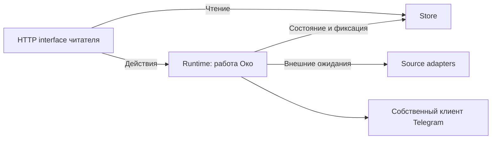

# Управление работой Око

2026-10-08. Согласованный кандидат 01 из архитектурного обзора. Исходная база: `ab206cb39596326296b3fbda3c298b5e6e49ca95`.

С 2026-10-19 выключение работы и завершение приложения разделены:
[включение и выключение Око](work-power.md). Прежняя остановка процесса остаётся
для POST /api/v3/stop и закрытия последней вкладки.

## Согласованные решения

Модуль скрывает полные сценарии действий читателя: «Просмотрено», переключение источника, закрытие последней вкладки и остановку Око. Вызывающий код не согласует самостоятельно отмену задания, инвалидацию поколения, очистку процесса и удаление контента.

Изменения состояния выполняются последовательно. Сетевые ожидания находятся вне этой последовательности, чтобы подключение или скачивание не задерживало остановку. Чтение карточек и настроек остаётся через существующий interface Store. Store отвечает за идентичность, транзакции, файлы и восстановление. Общий контракт Source и устройство хранения остаются отдельными кандидатами.

## Размещение ответственности

`oko/runtime.py` — module работы Око. Его interface выражает действия читателя; порядок исполнения и допуск находятся в implementation. `oko/app.py` принимает запросы, проверяет их форму и локальную сессию, переводит ошибки действий в HTTP и читает Store. Оно не управляет активным заданием, поколениями, процессом Telegram или порядком удаления.

Существующие seams сохранены: RSS/Telegram/Demo adapters удовлетворяют Source; реальный клиент Telegram и синтетический adapter заменяемы для проверок. Новый общий процессный framework, второй adapter хранения и дополнительные абстракции не добавляются.

## Правила выполнения

- Все команды изменения состояния и фиксация результата задания используют одну блокировку действий.
- Подготовка сетевого результата проходит вне блокировки. Его принятие проверяет актуальность задания, текущую работу вкладок и состояние хранилища.
- Проверки аккаунта и подключения Telegram регистрируются как принадлежащие модулю ожидания. Остановка, смена транспорта и другие прерывающие действия отменяют их. Поздний ответ не создаёт фид; прерванное подключение требует повторного действия пользователя.
- Намерение остановки сразу закрывает допуск новых действий. Очистка и закрытие Store сохраняют последовательный порядок.
- «Просмотрено» сначала фиксируется в Store, затем модуль отменяет принадлежащую ему работу и выполняет задание удаления. Store сохраняет независимую защиту от позднего результата.
- Исчезновение последней вкладки начинает прежнее ожидание завершения; повторное закрытие вкладки не продлевает этот срок.

Поведение читателя, правила хранения, отсутствие фонового автозапуска и отсутствие отметок прочитанного Telegram сохраняются. Занятая Telegram-сессия остаётся отдельным ограничением интеграционной приёмки.

## Проверка

Согласованный test surface — HTTP interface читателя с настоящими временными SQLite/файлами, заменяемыми внешними источниками и процессными проверками. Существующие тесты не меняют своё устройство из-за переноса implementation.

`tests/lifecycle/test_runtime_actions.py` проверяет просмотр и удаление фида из двух клиентов во время очистки, доступность чтения при ожидании, остановку во время устойчивого к отмене подключения и запрет его позднего результата, а также повторное закрытие вкладки без продления grace. Первое поведение сначала воспроизвело HTTP 500 из-за повторной очистки. Проверка grace выявила и помогла исправить регрессию первоначального переноса.

Отдельная проверка потери локального вложения перед повторной загрузкой сначала воспроизвела необработанную ошибку подготовки задания. Подготовка возвращена под обработку ошибок: читатель остаётся доступным, ошибка сбора видна, просмотр и удаление доступны. Store и алгоритм восстановления контента при этом не менялись.

Итоговые проверки и две независимые оси ревью: [отчёт](https://github.com/tgenman/oko/blob/365e2b38f86d6e2bedccbb40b14c615b6f069455/docs/verification/runtime-actions.md).

## Выполнение Telegram после #19 (2026-10-15)

Runtime имеет три фиксированных collection/read lanes: common для общего сетевого
сбора, personal и collection для проверенных Telegram-профилей. Отдельное AI-задание
сохранено. Store атомарно резервирует задания свободного lane, а фиксации результатов
остаются последовательными под action lock. Worker принадлежит проверенному user ID;
lock, generation и spool изолированы. Проверка новой конфигурации использует временный
worker без сбора. FloodWait сохраняет deadline аккаунта и освобождает остальные lanes.

Просмотр и удаление отменяют принадлежащую фиду работу и закрывают его worker;
общая остановка отменяет все lanes и проверки. ReadSync хранит безопасную границу
всего потока и подтверждённые границы тем. Серверное прочитанное учитывается при
проверке потока, но неизвестная/удалённая тема не разрешает расширяющий global ack.
Частично успешное подтверждение сохраняется до повтора или перезапуска.

## Внешние проверки Runtime (2026-10-20)

Согласованный кандидат 01 обзора от 2026-10-19. Реализация разрешена пользователем
после согласования объёма: внутренний рефакторинг с сохранением поведения.

Внутренний module `_ExternalCheck` в `oko/reader/runtime.py` скрывает регистрацию
внешнего ожидания, освобождение регистрации при завершении и допуск результата
под общей action lock. Его interface — начать один внешний вызов и принять его
результат в защищённом участке. Store и поколение проверки хранятся в implementation;
предметный код не передаёт их парой и не ведёт реестр ожидающих запросов.
Это увеличивает depth: locality защиты от поздних ответов сосредоточена в одном
module, leverage распространяется на RSS/YouTube, Telegram, llama.cpp и Codex.

Runtime сохраняет владение допуском и отменой. Начальная предметная валидация,
ошибки, таймауты, проверка личности и поколения Telegram-профиля, последовательность
шагов подключения и изменения состояния остаются у своих сценариев. Существующие
adapters и внешний HTTP interface сохраняются; новый framework выполнения и
новый доменный термин не вводятся.

Одна операция охватывает один внешний вызов и принятие его результата. Несколько
операций соединяет предметный сценарий. Отдельные захваты блокировки и нынешние
моменты проверки актуальности сохраняются, включая повторный допуск Telegram перед
записью. Клиентское подключение Telegram сохраняет исходное хранилище, а финальный
допуск использует поколение последнего запроса сведений. Для неуспешной проверки
профиля запись недоступности допускается только в исходном актуальном контексте.
Сохранение настроек Codex после каталога по-прежнему проверяет хранилище и допуск,
не добавляя проверки поколения; готовые результаты и параметры начатой работы
сохраняются согласно ADR-0001.

Обнаруженные различия обработки отмены сохраняются: RSS и клиентский Telegram
передают настоящую отмену вызывающего запроса; проверки llama.cpp и Codex переводят
её в существующие ошибки действий; Telegram web preview передаёт отмену без такого
перевода. Их унификация требует отдельного решения.

Проверяем через существующий HTTP interface с временными SQLite/файлами и
синтетическими adapters: успешные/неуспешные проверки, остановку и выключение во время
ожидания, устойчивый к отмене поздний ответ, смену настроек/профиля и повторный запуск.
Тесты не обращаются к внутренним счётчикам и классу ожидания. Фактические запуски
и независимое ревью записываются отдельно в `docs/verification/external-checks.md`.

## Чтение статуса и стоимость действий (#55)

Статус собирает кандидатов проблем, настройки, привязки и сведения о работе
в одном синхронном чтении. Фиксация изменений проблем выполняется после выхода
из снимка чтения. HTTP-проекция получает те же привязки, а принадлежность материала
запрашивает только для объектов проблем. Совпадающее сохранённое тело проблемы
не переписывается; идентичность, исходы и сроки очистки сохраняются.

Диагностика переиспользует только заголовок, полноту и причину неполноты файла.
Ключ содержит путь текущей версии, inode, mtime_ns и размер; описание и текст
публикации не кэшируются. Смена файла/версии инвалидирует данные; снимок удаляет
неактуальные элементы, просмотр сразу освобождает соответствующую запись.

Подготовка завершения получает карточки выбранного фида/папки и сохраняет
прежний точный состав подтверждения, включая скрытые и ещё недоступные записи.
Индексы по материалу ограничивают обновление истории и отмену заданий; индекс
идентичности команды поддерживает поиск последнего исхода. Runtime остаётся
владельцем действия, Store — фиксации и восстановления.

Сводка работы включает ожидающие/выполняющиеся задания и записи с ошибкой;
успешно завершённый архив не участвует в расчёте текущего состояния. Частичный
индекс активных заданий поддерживает этот расчёт. Ошибки истории ищутся от её
выбранных записей по ключу задания, поэтому пустая история не сканирует архив.

## Telegram HTTP и явная перезагрузка (2026-10-21)

Runtime задаёт общий бюджет HTML для `t.me`/`telegram.me`: по умолчанию 2 запроса
в секунду без всплесков. В Настройках Око глобальный `Telegram Request Limit`
принимает от 0,1 до 10 запросов/с и задаёт также отдельный бюджет каждого сервера
медиа. Значение сохраняется, сброс возвращает 2; изменение применяется без
перезапуска и отмены выполняющихся запросов и сохраняет deadline 429.
Подключения и фоновые задания используют один допуск; каждый сервер вложений
и аватаров использует отдельный бюджет той же частоты. Проверяются
также переходы. Ожидание частоты выполняется вне action lock, а длительная пауза
освобождает lane. Store сохраняет deadline и ступень паузы после HTTP 429;
ручное обновление и запуск не отменяют его. `Retry-After` поддерживает секунды
и HTTP-date; без пригодного заголовка пауза растёт от минуты до часа.
MTProto сохраняет отдельное ожидание FloodWait.

Обычное обновление Telegram web/client собирает новые и догружает неполные
материалы. Полные копии повторно не запрашиваются для обнаружения правок и удалений.
Команда «Загрузить заново» в меню поста использует существующий HTTP retry и
получает публикацию со всеми вложениями, соблюдая допуск источника. Полная старая
копия остаётся текущей до успешной полной замены, включая случай изменившегося
текста с недоступным вложением. Временная ошибка сохраняет автоматический повтор;
окончательная прекращает его с видимой причиной. Неизменное содержимое сохраняет
результаты обработки, показ новых версий использует прежние правила открытого материала.

## Частичный результат Telegram web при сбое загрузки вложения

Если текст или пригодные вложения уже получены, сетевой сбой вложения (включая
обрыв потока и HTTP 5xx) сохраняется как `SourceManifest.download_partial`.
Полученные файлы и прежние полные копии вложений сохраняются; оборванный файл
не публикуется. Runtime завершает сбор без автоматического повтора. Store
не возвращает такой материал в загрузку при обычном сборе/перезапуске;
явное действие «Retry download» выполняет новую попытку. Настоящая смена
текста/состава исходной публикации продолжает обнаруживаться обычным способом.
Ограничение частоты Telegram и терминальные ошибки смешанного результата
сохраняют прежнее управление ожиданиями/ошибками. Пять standalone-постов
без веб-текста этим правилом не переклассифицируются.

Причина сбоя проецируется в существующий красный блок со стабильной ссылкой
на конкретное сообщение Telegram; подписанные CDN-адреса не становятся
пользовательской ссылкой. Сохранённая копия отмечается отдельно. Флаг полноты
не является авторской правкой и не меняет fingerprint обработки.
