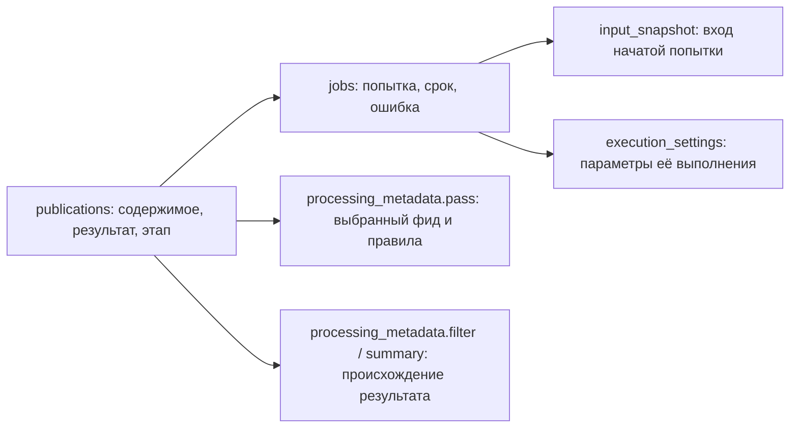

# Физическая схема Publication и Job

29 октября 2026. **Предложение к [проекту хранения без триггеров](storage-redesign.md), не миграция и не реализованная схема.** SQL ниже приведён для ревью; он не запускался. Согласованные продуктовые решения сохранены в [Publication](../human/publication.md) и [Job](../human/jobs.md). Здесь уточняются физические поля, ограничения и перенос из текущей схемы.

## Кто хранит какой факт



Контекст прохода не является очередью. Результат не переносится в Job. При ручной регенерации публикация хранит предыдущие актуальные тезисы, а Job — новую попытку. На одной публикации допускается одна Job каждого вида; сбор и медиа принадлежат крону сбора.

## publications

Предлагаются **17 колонок**. `text` для ID сохраняет нынешние внутренние идентификаторы без массового преобразования; новые ID создаёт Python. JSON-поля становятся настоящим JSONB вместо текста с JSON. `source_order` пока сохраняется для текущих HTTP-полей и источников с неизвестной датой; его удаление не включается автоматически в замену dated-полей.

```sql
CREATE TABLE publications (
    id                  text PRIMARY KEY CHECK (id <> ''),
    platform            text NOT NULL CHECK (platform IN (
        'telegram', 'youtube', 'telegraph', 'instagram',
        'twitter', 'other_web', 'rss'
    )),
    external_id         text NOT NULL CHECK (external_id <> ''),
    url                 text NOT NULL CHECK (url <> ''),
    title               text NOT NULL DEFAULT '',
    published_at        timestamptz,
    discovered_at       timestamptz NOT NULL,
    source_order        bigint,
    status              text NOT NULL DEFAULT 'pending_collection'
                        CHECK (status IN (
                            'pending_collection', 'pending_filtering',
                            'filter_out', 'pending_summary', 'ready'
                        )),
    lifecycle           text NOT NULL DEFAULT 'active'
                        CHECK (lifecycle IN ('active', 'deleting')),
    source_deleted      boolean NOT NULL DEFAULT false,
    has_observed_update boolean NOT NULL DEFAULT false,
    content             jsonb NOT NULL DEFAULT '{}'
                        CHECK (jsonb_typeof(content) = 'object'),
    media_ids           text[] NOT NULL DEFAULT ARRAY[]::text[]
                        CHECK (array_position(media_ids, NULL::text) IS NULL),
    filtered_content    jsonb NOT NULL DEFAULT '{}'
                        CHECK (jsonb_typeof(filtered_content) = 'object'),
    summarized_content  jsonb NOT NULL DEFAULT '{}'
                        CHECK (jsonb_typeof(summarized_content) = 'object'),
    processing_metadata jsonb NOT NULL DEFAULT '{}'
                        CHECK (jsonb_typeof(processing_metadata) = 'object'),
    UNIQUE (platform, external_id),
    CHECK (
        lifecycle <> 'deleting'
        OR (
            title = '' AND content = '{}'::jsonb
            AND filtered_content = '{}'::jsonb
            AND summarized_content = '{}'::jsonb
            AND processing_metadata = '{}'::jsonb
            AND cardinality(media_ids) = 0
        )
    )
);
```

Значения platform описывают модель, а не наличие работающих адаптеров для каждого значения.

| Поля | Смысл и владелец записи |
| --- | --- |
| `id`, `platform`, `external_id` | Внутренняя и внешняя идентичность; сохраняет операция обнаружения |
| `url`, `title`, даты, `source_order` | Сведения источника; сохраняет операция сбора |
| `status` | Требуемый этап обработки; вычисляет операция Python после изменения фактов |
| `lifecycle` | Данные ещё нужны чтению/зависимостям либо идёт их незавершённая очистка; наличие собственной карточки задают принадлежности |
| `source_deleted` | Подтверждённое исчезновение у источника; не означает локальный просмотр |
| `has_observed_update` | Факт, необходимый для текущего признака Changed/Updated. Переносится из текущего сохранённого признака; не означает доказанную авторскую правку |
| `content`, `media_ids` | Последнее содержимое и ссылки на медиа; операция сбора сохраняет согласованно |
| `filtered_content`, `summarized_content` | Единственный сохранённый результат каждого этапа; его содержимое не копируется в jobs |
| `processing_metadata` | Контекст выбранного фида и сведения о сохранённых результатах |

`has_observed_update` предлагается выделить из служебного JSON, чтобы сохранить нынешнее поле карточки без возвращения `_reader` или таблицы версий. Изменение settings, старт Job или смена временной ссылки не выставляют его автоматически. Дополнение неполной загрузки не объявляется новой авторской версией. Точные события переноса existing Changed сверяются с текущим контрактом; новая история версий не вводится.

Нет `source_id`, `published`, `published_known`, `viewed`, `complete`, `feed_id` и общей `input_revision`. Принадлежность находится в `feed_publications`. Готовность текста для этапа определяется status и явными фактами сбора/медиа/Job; общего дублирующего full-флага нет. `ready` допускает выключенные этапы, а пустой результат no_input имеет явное происхождение: CHECK на «непустые тезисы при ready» был бы неверным.

Предлагаемый состав `processing_metadata` ограничен схемой Python:

- `pass`: выбранный `feed_id` и снимок значимых правил прохода. Настройка enabled отдельно управляет новыми запусками и не отменяет уже начатый вызов.
- `filter`, `summary`: подпись результата, время принятия, фид обработки, обработчик и фактические параметры выполнения; `reason = no_input`, если этап завершён без модели.
- Подпись результата — одна каноническая signature. Отдельные input_hash/settings_hash не используются как конкурирующие основания актуальности. При необходимости объяснения остаются фактические сведения о входе/правилах, а не ещё одна версия.

Это уточнение физического хранения относительно прежнего эскиза metadata. Результат после выключения этапа остаётся с той же signature/provenance. Снимок текущей попытки не перезаписывает metadata принятого результата до успешного finish.

### Очистка после просмотра

Сначала одной транзакцией удаляются принадлежности просмотренной карточки и
определяется нужность данных другим корням чтения. Если публикация ещё нужна
как зависимость, её исходник/файлы и lifecycle=active сохраняются; собственной
карточки больше нет. Собственные результаты AI и контекст прохода без фида
очищаются, нужная работа сбора остаётся под допустимым доступом.

Только для недостижимых публикаций закрываются поколения изменяющих их Job,
сохраняется задание очистки, удаляются содержимое/результаты/заголовок и меняется
lifecycle на deleting. Задание очистки содержит служебные ID и storage keys,
а не копию текста. Такая строка остаётся до завершения очистки, затем удаляется
явно Python-операцией. [Связи и расчёт нужности](storage-relations-schema.md)
уточняют этот порядок, включая циклы и общие статьи.

До удаления строки её внешняя идентичность остаётся занятой. Повторное обнаружение не оживляет deleting-строку через UPSERT. Если публикация обнаружена снова после окончательной очистки, у неё новый внутренний ID; ответ старой Job не может записать её заново. Открытые файловые дескрипторы и общие статьи сохраняют ранее согласованные правила.

`lifecycle` не является долговечным списком всего когда-либо просмотренного. Данные для Telegram и текущей загрузки истории сохраняются в их собственных таблицах до очистки публикации.

## jobs

Предлагаются **19 колонок**, включая перенесённые сведения попытки. Имена операций пока сохраняют существующие значения: переименование `theses`/`feed-delete` не смешивается с заменой хранения. Поля `kind` и `item` получают предметные имена `operation` и `target_id`.

```sql
CREATE TABLE jobs (
    id                 bigint GENERATED ALWAYS AS IDENTITY PRIMARY KEY,
    operation          text NOT NULL CHECK (operation IN (
        'discover', 'fetch', 'download_media', 'filter',
        'theses', 'read', 'delete', 'feed-delete'
    )),
    target_id          text NOT NULL CHECK (target_id <> ''),
    feed_id            text,
    status             text NOT NULL DEFAULT 'pending'
                       CHECK (status IN (
                           'blocked', 'pending', 'running', 'done',
                           'failed', 'unavailable', 'cancelled'
                       )),
    generation         bigint NOT NULL DEFAULT 0 CHECK (generation >= 0),
    attempt_count      bigint NOT NULL DEFAULT 0 CHECK (attempt_count >= 0),
    manual_once        boolean NOT NULL DEFAULT false,
    next_run_at        timestamptz NOT NULL DEFAULT CURRENT_TIMESTAMP,
    retry_delay_seconds integer NOT NULL DEFAULT 0
                       CHECK (retry_delay_seconds >= 0),
    wait_scope         text,
    payload            jsonb NOT NULL DEFAULT '{}'
                       CHECK (jsonb_typeof(payload) = 'object'),
    input_snapshot     jsonb CHECK (
                           input_snapshot IS NULL
                           OR jsonb_typeof(input_snapshot) = 'object'
                       ),
    execution_settings jsonb CHECK (
                           execution_settings IS NULL
                           OR jsonb_typeof(execution_settings) = 'object'
                       ),
    queued_at          timestamptz DEFAULT CURRENT_TIMESTAMP,
    started_at         timestamptz,
    finished_at        timestamptz,
    elapsed_seconds    double precision
                       CHECK (elapsed_seconds >= 0
                              AND elapsed_seconds < 'Infinity'::double precision),
    error              jsonb CHECK (
                           error IS NULL OR jsonb_typeof(error) = 'object'
                       ),
    UNIQUE (operation, target_id),
    CHECK (
        status <> 'running'
        OR (generation > 0 AND started_at IS NOT NULL AND finished_at IS NULL)
    )
);
```

`attempt_count` — диагностический счётчик фактических начатых попыток, не предел повторов. Он не равен generation: отмена или изменение входа закрывают допуск, даже если новый внешний вызов ещё не начался. `manual_once` сохраняет существующий смысл явного повторного получения, в том числе недоступного исходника; он не обходит stop, запрет новых запусков этапа, права или source wait.

Уточнение после сценарной проверки: `blocked` сохраняет нужную работу, которая
пока не допускается из-за выключенного этапа, зависимости или неподготовленной
конфигурации. Это не failed/unavailable и не отмена запроса. Крон выбирает только
pending по индексу; владелец изменившегося условия явно пересматривает blocked.
Кратковременная занятость общего слота модели не переводит все Job в blocked:
воркер ждёт слот и затем берёт обычную pending Job.

Job создаётся вместе с потребностью в работе в транзакции операции записи.
Отсутствие Job при требуемой работе считается нарушением для миграционной/startup
сверки, а не основанием постоянно искать «публикации без Job» в обычном polling.

### Объект работы

| operation | target_id | Крон |
| --- | --- | --- |
| `discover`, `read`, `feed-delete` | ID фида | Сбор |
| `fetch`, `delete` | ID публикации | Сбор |
| `download_media` | ID MediaFile | Сбор |
| `filter` | ID публикации | Фильтрация |
| `theses` | ID публикации | Тезисы |

Единого FK на `target_id` нет: тип определяется operation. `feed_id` — явный контекст операции для диагностики/среза сбора, иногда nullable; он не является способом определить принадлежность публикации. У очистки и сохранённой диагностики ID могут переживать удаление фида, поэтому безусловный FK с CASCADE на jobs не вводится. Проверку существования выполняет владеющая операция, учитывая допустимые cleanup-состояния.

### JSON-поля имеют отдельные обязанности

| Поле | Что хранится | Что не хранится |
| --- | --- | --- |
| `payload` | Типизированное намерение операции: явная регенерация, служебные ключи очистки, контекст запроса адаптера | Копии результата фильтра/тезисов, нарастающий журнал попыток |
| `input_snapshot` | Signature и правила конкретного запуска, ID использованных публикаций/ресурсов, выбранный фид, подтверждённый no_input | Полная вторая копия текста и медиа |
| `execution_settings` | Обработчик и фактические параметры модели именно подготовленной попытки | Живой глобальный выбор, секреты доступа |
| `error` | Один последний сбой: code, message, attempt generation, время, resolved; ограниченные и очищенные от секретов подробности/requests | Неограниченная история ошибок и копия успешного содержимого |

Для pending Job, которая ещё не была подготовлена, `input_snapshot` и `execution_settings` могут быть NULL. AI-Job в running обязана иметь проверенный input_snapshot; параметры модели обязательны, если нужен внешний вызов. Это семантическое правило Python для разных operation, а не процедура в БД. No-input обработка не выдумывает фактический запуск модели.

На обычный список статуса выбираются нужные скалярные поля, а не `SELECT *` с JSON-диагностикой. `error` может хранить уже resolved последний сбой после успешной попытки; текущая ошибка определяется вместе со статусом и признаком resolved. Не требуется вторая копия того же сообщения в `collection_attempts`.

Снимки сохраняются для восстановления прерванной работы. При восстановлении только актуального входа прежние параметры уже начатой работы переносятся в новое поколение. При изменении входа старая подготовка больше не используется; новая работа готовится явно. После просмотра текстовые диагностики и снимки, способные содержать удаляемое содержимое, очищаются в той же операции; служебный ID сам по себе не является содержимым публикации.

### Время ожидания

`next_run_at` заменяет пару старых `next` (монотонное время процесса) и `retry_at` (абсолютное время). В базе остаётся только абсолютный UTC deadline. Монотонные часы используются для измерения длительности внутри живой попытки.

При временной ошибке Python вычисляет следующий срок по backoff. При source wait он берёт максимум backoff и ограничения источника, сохраняет область в `wait_scope`. Ручной повтор/новый вход/restart не сокращают такой срок. Если для области есть более позднее общее ограничение в `youtube_access` или состоянии Telegram, захват также проверяет его; копия срока одной Job не разрешает обойти общий запрет.

`queued_at` относится к текущему ожиданию, `started_at`/`finished_at` и elapsed — к последней начатой попытке. Новый захват сбрасывает finished/elapsed в NULL и назначает started. Измеренная длительность 0 отличается от неизвестной NULL. Прерывание с известной длительностью сохраняет её, а crash не выдумывает точное время окончания. Восстановление назначает новое generation и pending либо blocked по текущему допуску; restart не объявляет старые монотонные значения новыми абсолютными датами.

Новые записи получают queued_at; для прежних данных неизвестное время допустимо
как NULL и показывается как неизвестное. Время миграции не выдаётся за время
постановки старого задания. Неизвестное время начала старой running попытки также
не выдумывается: после остановки прежнего владельца она переходит в восстановимое
ожидание с новым поколением; следующий реальный захват задаст started_at.

### Идентичность попытки

Принимающий код проверяет `Job.id`, `generation`, `status = running`, текущий Store, доступность объекта, фактическую signature и разрешения. Само выключение этапа после начала не отвергает результат. Изменение текста, удаление или отзыв разрешения по-прежнему могут его отвергнуть.

ID Job не переиспользуется, sequence не сбрасывается при очистке строк. Для миграции старые ID вставляются явно через разрешённый режим identity, sequence выставляется выше максимума. Restore меняет идентичность библиотеки по принятому правилу; ответы прежнего Store не передаются новому. Проверка пары ID + generation остаётся необходимой даже при совпавшей signature.

## Индексы: первая проверяемая версия

```sql
CREATE INDEX publications_processing_candidates
    ON publications (status, discovered_at, id)
    WHERE lifecycle = 'active'
      AND status IN ('pending_collection', 'pending_filtering', 'pending_summary');

CREATE INDEX publications_reading_order
    ON publications (published_at DESC NULLS LAST, id DESC)
    WHERE lifecycle = 'active';

CREATE INDEX jobs_due
    ON jobs (operation, next_run_at, id)
    WHERE status = 'pending';

CREATE INDEX jobs_running
    ON jobs (id)
    WHERE status = 'running';

CREATE INDEX jobs_blocked
    ON jobs (operation, target_id, id)
    WHERE status = 'blocked';

CREATE INDEX jobs_target
    ON jobs (target_id, operation);

CREATE INDEX jobs_feed_status
    ON jobs (feed_id, status, operation, id)
    WHERE feed_id IS NOT NULL;
```

UNIQUE-ограничения уже создают индексы внешней идентичности публикации и `(operation, target_id)`. Обратный jobs_target нужен команде, которая инвалидирует все виды работы одного объекта. Индексы принадлежностей и графа описываются вместе с соответствующими таблицами, а не дублируются в publications.

Индекс чтения — кандидат для направления newest с указанным расположением NULL. Он не доказывает поддержку всех комбинаций oldest/NULL/папок без сортировки: каждый контрактный порядок проверяется отдельно. Запрос filter-крона учитывает существующую failed/unavailable Job, а не запускает всю выборку pending_filtering безусловно. Большой набор таких ошибок не должен вытеснять готовые задания из первой порции.

`FOR UPDATE SKIP LOCKED` блокирует только выбранные объекты внутри короткой транзакции. Другие операции соблюдают тот же порядок блокировок «объект → Job», включая принятие результата. Сеть и модель идут после COMMIT. Эти индексы пока не измерены на PostgreSQL; дополнительные индексы вводятся по планам и реальной цене чтения/записи.

## Перенос текущих полей

Для периодического повторного `discover` отдельный кандидатный индекс и правила
использования done Job описаны в [схеме фидов и расписания](storage-feeds-schema.md#курсор-и-расписание-сбора).

| Сейчас | Предлагается | Проверка при переносе |
| --- | --- | --- |
| `items.id` | `publications.id` | ID и все ссылки сохраняются |
| `source_id` | Удалить дополнительную идентичность | Все обращения переводятся на ID или `(platform, external_id)`; неоднозначности дают отказ |
| `published`, `published_known`, `published_at` | Один `published_at` | Неизвестная дата остаётся NULL; разошедшиеся известные значения не выбираются молча |
| `discovered_at` | Обязательный `discovered_at` | Восстановить из подтверждённого факта обнаружения; отсутствие факта не заменять временем миграции без отдельного решения |
| `viewed` | Принадлежности, нужность данных и lifecycle | Просмотренная карточка не возвращается; зависимость может оставаться active без карточки; недостижимые данные получают cleanup |
| `complete` | Состояния сбора/медиа/Job и этап публикации | Сохранить доступный текст, отличить ошибку получения от подтверждённого no_input |
| `members` | Платформенные ID сообщений в `content.extra.telegram`; основания прочитанного — в Telegram-таблицах | До очистки content перенести необходимые основания; незагруженная публикация также может хранить технический extra при pending_collection |
| `source_order` | `source_order` | Сохранить, пока его потребители не заменены отдельным решением |
| `source_deleted` (таблица) | `publications.source_deleted` | Не подменять просмотром |
| Текущий сохранённый `changed` | `has_observed_update` | Сохранить фактическую семантику; не вычислять по времени миграции |
| JSON как TEXT | JSONB и массив media_ids | Невалидный JSON/ссылки — ошибка переноса, не пустой объект |
| `jobs.kind`, `item` | `operation`, `target_id` | Все operation сопоставлены; исторический пустой discover target переводится в подтверждённый ID фида |
| `jobs.attempt`, `manual_once` | `attempt_count`, bool `manual_once` | Счётчик не становится лимитом повторов |
| `jobs.next`, `retry_at`, `queued_wall` | `next_run_at`, `queued_at` | Не конвертировать monotonic без известного основания; сохранить durable deadline/source wait |
| `jobs.problem_code`, `error` и диагностика попытки | JSONB `error` | Сохранить code/message, последнее событие и resolved; не потерять исходный failure за коротким текстом |
| Старые `done` с незакрытой ошибкой | Явно классифицированный исход Job и source state | Не объявлять успешным сбором только по слову done; например, подтверждённая недоступность источника переносится с её причиной и правилом повтора |
| Старые `done` после cancel_history без готового результата | `cancelled` при доказанном основании отмены | Не запускать отменённую историю заново как «исправление отсутствующего результата» |
| `execution_settings` | `jobs.execution_settings` и input_snapshot | Совпадение Job/generation/signature обязательно; чужой снимок не прикрепляется |
| `collection_attempts` | Времена/длительность/ошибка Job | Перенести текущую сохранённую попытку; итог фида отдельно у feeds |
| `filter_inputs`, `thesis_inputs` | Метаданные результата/снимок Job либо проверяемая подготовка | Не объявлять отсутствие старого результата успешным этапом |

Это правила преобразования, а не утверждение о чистоте личной базы. Предварительная проверка должна выявить неизвестные operation/platform, orphan-ссылки, неверные даты, конкурирующие внешние ключи и несовместимые снимки. Неизвестные данные не удаляются ради прохождения миграции.

## Что ещё относится к соседним частям схемы

- FK для `feed_publications`, `publication_links`, `media_files`, граф нужности и выбор основного фида — в [проекте связей и удаления](storage-relations-schema.md).
- Формат общих ограничений Telegram и их связь с wait_scope — при детализации Telegram/state.
- HTTP Changed/completeness/availability должны получать факты из новых владельцев; данный DDL сам по себе не доказывает полноту адаптации всех ответов.
- Перед выпуском обязательны реальные проверки миграции и HTTP, включая выключение этапа во время running, retained filter, регенерацию, A → B → A, restart, shared-publication и чистку файлов.

## Фактическая проверка документа

Сверены существующие schema/job/collection/processing поля и согласованные human-правила. Автоматически проверены количество колонок (17 и 19), уникальность их имён, локальные ссылки и форматирование. SQL и Mermaid просмотрены статически; локальный PostgreSQL-парсер `pglast` недоступен. Ни SQL, ни миграции, ни runtime-тесты в рамках этого проектирования не запускались; это не подтверждение работоспособности DDL или его планов.
