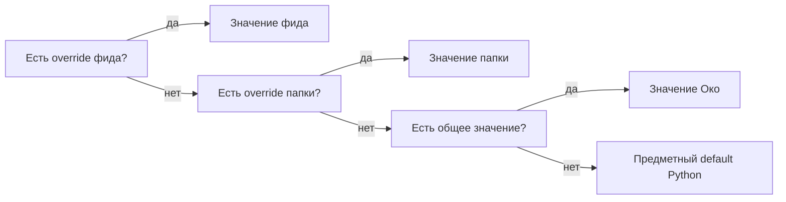

# Физическая схема фидов, папок и настроек

29 октября 2026. **Предложение для обсуждения, без реализации.** Продолжение
[общего проекта](storage-redesign.md), [ядра](storage-core-schema.md) и
[связей](storage-relations-schema.md). SQL не запускался; число таблиц остаётся 20.

## Владельцы данных

| Таблица | Хранит | Не хранит |
| --- | --- | --- |
| `folders` | Идентичность, название и порядок папки | Копии фидов, счётчики публикаций, готовые effective settings |
| `feeds` | Идентичность источника, папку, adapter/config/cursor, параметры сбора и сведения фида | Дубли JSON настроек фильтра/тезисов и отдельный счётчик версий |
| `settings` | Явные переопределения на уровне Око, папки и фида | Полные вычисленные настройки каждого фида |
| `jobs` | Ближайший запуск, текущую попытку и повтор | Второй редактируемый интервал сбора |

`Feed.filter_config` и `Feed.summary_config` остаются объектами модели приложения,
но предлагается вычислять их из settings. Это уточнение физического хранения,
а не отмена настройки обработки на уровне фида.

## folders — 3 колонки

```sql
CREATE TABLE folders (
    id       text PRIMARY KEY CHECK (id <> ''),
    title    text NOT NULL UNIQUE CHECK (btrim(title) <> ''),
    position bigint NOT NULL DEFAULT 0
);
```

ID не зависит от названия. Переименование не меняет связи и не пересчитывает
обработку. Равные position допустимы: окончательный порядок однозначно задаётся ID.
Нынешний порядок отображения, включая приоритет числового префикса названия,
не меняется автоматически при замене SQL-схемы.

Фид всегда относится к одной папке. Удаляется только пустая папка: сначала
Python удаляет её overrides, затем строку. Автоматическое удаление содержимого
папки через FK CASCADE не вводится. «Без папки» остаётся обычной сохранённой
папкой с ID, а не особым значением NULL.

## feeds — 26 колонок

Часть полей пришла из `feed_details`, `collection_results` и `telegram_avatars`.
Увеличение одной строки здесь сопровождает удаление трёх отдельных таблиц;
при списочном чтении выбираются только нужные колонки.

```sql
CREATE TABLE feeds (
    id                     text PRIMARY KEY CHECK (id <> ''),
    platform               text NOT NULL CHECK (platform IN (
        'telegram', 'youtube', 'telegraph', 'instagram',
        'twitter', 'other_web', 'rss'
    )),
    external_id            text NOT NULL CHECK (external_id <> ''),
    url                    text NOT NULL CHECK (url <> ''),
    original_urls          text[] NOT NULL DEFAULT ARRAY[]::text[]
                           CHECK (array_position(original_urls, NULL::text) IS NULL),
    title                  text NOT NULL CHECK (btrim(title) <> ''),
    description            text NOT NULL DEFAULT '',
    folder_id              text NOT NULL
                           REFERENCES folders(id) ON DELETE RESTRICT,
    sort_order             bigint GENERATED BY DEFAULT AS IDENTITY UNIQUE,
    importance             text NOT NULL DEFAULT 'normal'
                           CHECK (importance IN ('normal', 'elevated', 'high')),
    enabled                boolean NOT NULL DEFAULT true,
    lifecycle              text NOT NULL DEFAULT 'active'
                           CHECK (lifecycle IN ('active', 'deleting')),
    connection_state       text DEFAULT 'needs_connection'
                           CHECK (connection_state IN (
                               'needs_connection', 'connected', 'unavailable', 'ambiguous'
                           )),
    public_ai              boolean NOT NULL DEFAULT false,
    adapter                text NOT NULL CHECK (adapter <> ''),
    config                 jsonb NOT NULL DEFAULT '{}'
                           CHECK (jsonb_typeof(config) = 'object'),
    cursor                 text NOT NULL DEFAULT '',
    interval_seconds       integer CHECK (interval_seconds > 0),
    created_at             timestamptz DEFAULT CURRENT_TIMESTAMP,
    modified_at            timestamptz DEFAULT CURRENT_TIMESTAMP,
    last_discovery_at      timestamptz,
    last_viewed_at         timestamptz,
    last_collection_result jsonb NOT NULL DEFAULT '{}'
                           CHECK (jsonb_typeof(last_collection_result) = 'object'),
    avatar_image           bytea CHECK (octet_length(avatar_image) <= 131072),
    avatar_mime            text,
    avatar_digest          text,
    UNIQUE (platform, external_id),
    CHECK (lifecycle = 'deleting' OR connection_state IS NOT NULL),
    CHECK (
        (avatar_image IS NULL AND avatar_mime IS NULL AND avatar_digest IS NULL)
        OR
        (avatar_image IS NOT NULL AND avatar_mime IS NOT NULL AND avatar_digest IS NOT NULL)
    )
);

CREATE INDEX feeds_folder_order ON feeds (folder_id, sort_order, id);
```

Значения platform описывают модель; они не обещают наличие адаптеров для каждой
платформы. Нераспознанный старый фид не получает вымышленную platform ради NOT NULL.
Такие данные выявляются до переключения и требуют отдельного разрешения неоднозначности.

### Идентичность, URL и порядок

- `(platform, external_id)` — единственная внешняя идентичность. Старые `identity`
  и `kind` не поддерживаются параллельно с ней.
- `url` — нормализованный адрес источника. `original_urls` сохраняет исходные
  пользовательские адреса/локаторы, если они отличаются; это происхождение
  подключения, а не второй ключ для поиска публикаций. Старые значения не теряются.
- Telegram может сначала иметь внешний ключ URL, затем подтверждённый peer ID.
  Уточнение меняет external_id той же строки; конфликт UNIQUE отклоняет операцию,
  а не объединяет два фида автоматически.
- `sort_order` сохраняет текущий порядок добавления из rowid. Он не зависит от
  created_at, поскольку историческая дата может быть неизвестна.
- `importance` остаётся свойством фида даже при отсутствии сортировки карточек по
  важности. Его нынешнее участие в правилах YouTube проверяется при переносе;
  оно не должно отменять явно выключенный этап в новой модели.

### Подключение и включённость

`enabled` — включённость сбора через фид. `connection_state` — сохранённое состояние
его подключения. `lifecycle` — обычный фид или незавершённое удаление. Эти значения
не подменяют друг друга: временная недоступность источника не означает удаление,
а выключенный сбор не удаляет публикации и не равен выключению фильтра/тезисов.

Недоступность Telegram-профиля выводится из `telegram_profiles` и binding при чтении
и допуске. Она не копируется массовым UPDATE в каждый feeds.connection_state.
Сохранённые состояния фида описывают его собственную проверку/подключение.

`adapter` хранит зарегистрированное имя единственного выбранного adapter.
`config` хранит только его собственные параметры. Для Telegram подтверждённая
роль аккаунта/связь с профилем остаётся в `telegram_bindings`; в config не хранится
вторая редактируемая копия binding. Фабрика adapter собирает эти данные в памяти.
Peer после подтверждения принадлежит внешней идентичности; username/aliases и
факты подтверждения сохраняются у владельцев Telegram, не в трёх колонках feeds.

Предлагается перенести `read_history` и `auto_read` в настройки Telegram binding:
это свойства чтения Telegram, неприменимые к RSS/YouTube. Их nullable-смысл и
связь с безопасной границей закреплены в [проекте Telegram](storage-telegram-history-schema.md);
флаги не отбрасываются при удалении прежних колонок feeds.

Смена adapter выполняется отдельной явной операцией с внешней проверкой до SQL.
В транзакции обновляются adapter/config, закрываются старые Job и сбрасывается
несовместимый cursor. Сохранённые публикации не исчезают. Автоматического перехода
на другой способ доступа при сетевой ошибке нет. Это не правило «дать закончиться
после выключения AI-этапа»: смена способа получения имеет отдельные последствия.

### Сведения фида

| Поле | Что означает |
| --- | --- |
| `created_at` | Создание фида в Око |
| `modified_at` | Последнее содержательное изменение его сведений/настроек; не каждое чтение |
| `last_discovery_at` | Последняя успешно сохранённая страница обнаружения; не готовность всех медиа |
| `last_viewed_at` | Последнее локальное завершение чтения, относящееся к фиду; не подтверждение Telegram |
| `last_collection_result` | Последний подтверждённый итог сбора и ограниченный снимок последней относящейся ошибки |

Неизвестные старые даты остаются NULL. Подставлять время миграции вместо
неизвестной истории нельзя. `description` становится единственной колонкой;
разошедшиеся значения feeds и feed_details сопоставляются, а не перезаписываются
произвольно.

Предлагаемый `last_collection_result` хранит краткий снимок последнего успеха
(operation, Job ID, время, длительность) и ограниченный снимок последнего сбоя
(operation/attempt ID, время, message, разрешённые подробности, resolved).
Состояние текущей Job и последний итог фида могут различаться: Job переиспользуется
или очищается, а прежний итог ещё объясняет состояние источника. Поэтому это
явный снимок события, а не ссылка на изменяемый JSON другого объекта.

Снимок обновляется атомарно с исходом попытки. Успех другой операции не закрывает
ошибку, например скачивания медиа. Существующие ограничения диагностики сохраняются;
нет бесконечного журнала или копий содержимого публикации. Просмотр/удаление
объекта очищает относящиеся к удаляемому содержимому сведения по прежним правилам,
а не оставляет их скрытой копией в последнем результате фида.

Последний успех нельзя просто заменить запросом по текущим done jobs: та же строка
Job позже переиспользуется, и прежнее успешное завершение перестаёт быть её текущим
состоянием. Поэтому этот небольшой итог фида является отдельным сохраняемым фактом.
Ограничение размеров диагностики и отсутствие бесконечной истории сохраняются.

Аватар, MIME и digest записываются/очищаются вместе. Digest вычисляет Python по
принятым байтам; сохранённый digest позволяет строить URL без чтения изображения.
Существующий предел 128 КиБ сохранён. Навигация не делает SELECT * из feeds и не
получает avatar_image либо полную диагностику вместе с названиями фидов.

## settings — 4 колонки с настоящими FK

Ранее в общем проекте был эскиз `settings(scope, owner, field, value)`. Уточнение
предлагает сохранить один интерфейс «область + владелец + поле», но физически
заменить универсальную строку owner двумя проверяемыми ссылками. Отдельный ID
настройки не нужен: на неё не ссылаются другие таблицы.

```sql
CREATE TABLE settings (
    folder_id text REFERENCES folders(id) ON DELETE RESTRICT,
    feed_id   text REFERENCES feeds(id) ON DELETE RESTRICT,
    field     text NOT NULL CHECK (field <> ''),
    value     jsonb NOT NULL CHECK (value <> 'null'::jsonb),
    CHECK (folder_id IS NULL OR feed_id IS NULL),
    CONSTRAINT settings_one_value
        UNIQUE NULLS NOT DISTINCT (folder_id, feed_id, field)
);
```

| folder_id | feed_id | Область |
| --- | --- | --- |
| NULL | NULL | Общие настройки Око |
| ID папки | NULL | Папка |
| NULL | ID фида | Фид |
| ID папки | ID фида | Запрещено CHECK |

Здесь намеренно нет PK по nullable-колонкам; логическую уникальность обеспечивает
именованный UNIQUE NULLS NOT DISTINCT. Он не допускает двух общих значений одного
field и сам создаёт уникальный индекс. Такое поведение подтверждено
[документацией PostgreSQL](https://www.postgresql.org/docs/current/sql-createtable.html).
Операции адресуют настройку по области/field и используют null-safe сравнение.

SQL проверяет владельцев и уникальность. Python имеет фиксированный каталог полей:
их тип, допустимые области, default и влияние на обработку. Неизвестное поле или
недопустимая область отклоняются. Это не произвольная система plugin-настроек.

### Наследование



Отсутствие строки означает наследование. `false`, `0` или допустимая пустая строка
являются значениями, а не пропуском уровня. JSON null не хранится: команда сброса
удаляет строку. Это позволяет однозначно отличать «выключить здесь» от «как у папки».

Основные поля обработки/показа сохраняют нынешние имена `originals`, `theses`,
`prompt_theses`, `prompt_filters`, `processor`. Сервисные параметры интервала,
лимита Telegram HTTP и retry сохраняют свои допустимые области; наличие общей
таблицы не делает глобальный параметр автоматически настраиваемым для папки.

Проверен особый случай текущего `youtube_theses`: высокая важность включает
тезисы даже при effective theses=false. В новой модели это противоречило бы
согласованному запрету новых запусков выключенного этапа. Предлагается учитывать
предметные правила YouTube как defaults, поверх которых действует явный override;
ни platform, ни importance не превращают явное false обратно в true.
При переносе такие расхождения перечисляются отдельно как следствие принятой
семантики выключения, а не маскируются утверждением о полном совпадении старого
и нового допуска. Готовые результаты при этом сохраняются.

### Отдельный переключатель фильтра

В нынешнем коде фильтр включается непустым `prompt_filters`. Для согласованного
правила «выключить новые запуски, сохранить результат и дать текущему закончиться»
этого недостаточно: очистка промпта одновременно меняет значимый вход.

Предлагается поле настройки **`filter_enabled`** отдельно от `prompt_filters`.
Отключение пишет только boolean и не стирает промпт. `theses` уже является
существующим отдельным переключателем подготовки тезисов; второго синонима для
него не вводится. Включённый фильтр требует непустого эффективного промпта;
Python проверяет эту согласованность на затронутых фидах.

При переносе старых prompt overrides создаются соответствующие filter_enabled
на тех же уровнях: true для непустого промпта и false для пустого. При отсутствии
переопределений default остаётся выключенным. До переключения сравниваются
эффективные значения каждого фида: миграция не должна неожиданно включить фильтр.
Будущий HTTP-контракт настроек потребует явного поля переключателя и штатной
генерации OpenAPI; в рамках этого документа код/контракт не меняются.

### Изменение и удаление владельцев

Операция настройки получает согласованный снимок эффективных значений до/после,
обновляет только затронутые результаты и поколения по правилам общего проекта.
Перемещение фида в другую папку включает такую же проверку наследования.
Переименование папки/фида не меняет значения обработки.

FK защищают от orphan-настроек. Перед удалением пустой папки или завершением
удаления фида Python явно удаляет его overrides; CASCADE не выполняет скрытую
часть команды. Изменение глобального значения не трогает публикации фида,
чей effective value остался прежним благодаря override.

## Курсор и расписание сбора

`cursor` — непрозрачная строка adapter. Новые публикации страницы, memberships,
результат наблюдения и cursor сохраняются одной транзакцией. Сбой до commit
оставляет прежний cursor; повтор сопоставляет публикации по внешнему ключу.
Курсор не продвигается только потому, что внешний запрос завершился успешно.

Предлагается `feeds.interval_seconds` как nullable явный интервал фида. NULL означает
действующий глобальный `feed_refresh_minutes × 60`; копии вычисленного интервала
в каждой строке нет. Текущий столбец с default 1200 не доказывает реальный интервал:
рабочий путь сейчас берёт общую настройку с default 15 минут. Перенос сверяет
фактическую политику, а не механически копирует неиспользуемый default.

Глобальный интервал и явный интервал фида — политика. Конкретный ближайший запуск
хранится только в `jobs.next_run_at` у `(discover, feed_id)`:

1. После полного успешного обновления Job получает done, а следующий срок —
   время завершения плюс действующий интервал. Это предложенная политика нового
   расписания; приёмка отдельно сравнивает её с нынешним общим циклом.
2. Когда срок наступил, тот же крон сбора переводит разрешённую Job в ожидание
   нового запуска и захватывает её обычным способом. Другого scheduler/крона нет.
3. Продолжение страниц незавершённого обхода не ждёт периодического интервала.
   Оно использует ту же уникальную Job и сохранённый cursor.
4. Временная ошибка использует retry/backoff и ограничения источника. Обычный
   периодический таймер не перезаписывает этот срок и не снимает unavailable/failed.
5. Ручное обновление не создаёт второй discover; обязательное ожидание источника
   сохраняется. Пропущенные периоды объединяются в один актуальный запуск.

Для готовых периодических Job предлагается дополнительный узкий индекс:

```sql
CREATE INDEX jobs_discovery_schedule
    ON jobs (next_run_at, target_id)
    WHERE operation = 'discover' AND status = 'done';
```

После смены интервала пересчитываются только будущие обычные discover-старты,
а не retry/source waits и не уже running вызовы. При выключении фида расписание
не удаляется: ещё не начатое нужное обновление может быть blocked с сохранённым
сроком. Failed/unavailable не снимаются автоматически одним включением фида.
После разрешения сбора наступившее обновление выполняется один раз,
без восстановления сотен пропущенных периодов. Общий stop/допуск Око проверяется
независимо от включённости конкретного фида.

## Перенос прежних полей

| Сейчас | Целевой владелец | Проверка |
| --- | --- | --- |
| `feeds.identity`, `kind`, `platform`, `external_id`, `url` | platform/external_id/url | Восстановить подтверждённую идентичность; неоднозначные старые значения не угадывать |
| `transport` и `enabled` | enabled, adapter и connection_state | Пауза не стирает выбранный adapter; не переносить значение только по старому столбцу-дублю |
| `connection = deleting` | lifecycle=deleting | Прежнее состояние подключения может быть неизвестно; NULL допустим только у deleting |
| `rowid` | sort_order | Сохранить порядок и обновить identity sequence |
| `feed_details` | description и четыре даты в feeds | Разошедшиеся дубли дают отчёт; неизвестные даты остаются NULL |
| `collection_results` | last_collection_result и error у Job | Перенести последний успех/сбой; разрешённость ошибки привязана к операции |
| `telegram_avatars` | avatar_image/mime/digest | Проверить размер, MIME и digest; не читать bytes при каждом списочном запросе |
| `telegram_peer`, `telegram_username`, `telegram_account` и JSON-дубли binding | Внешняя идентичность, claims, binding/profile | Переносить только подтверждённую личность, сохранить конфликты и alias evidence |
| `read_history`, `auto_read` | Telegram binding | Сохранить значения и nullable-смысл; не менять фактическую границу прочитанного |
| `initial_days` | Проверенный переход на initial_history | Не терять активное старое окно, если оно ещё имеет смысл; непереносимое состояние блокирует переключение |
| `filter_config`, `summary_config` и settings | Одни overrides в settings | Сверить фактические effective settings рабочего пути; не предпочитать механически JSON-дубль |
| `settings(scope, owner, field, value TEXT)` | folder_id/feed_id/field/value JSONB | Проверить существование владельца, область, тип; прежний null-reset становится отсутствием строки |

Текущий `sync_feeds/configure_feed`, который при чтении конфигурации переписывает
новые колонки из старых, после перехода удаляется. Сведения источника изменяются
только явной операцией сохранения. Все зависимости от старых колонок должны быть
переведены до их удаления; наличие нового DDL само по себе этого не подтверждает.

## Будущая приёмка

- Однозначное наследование; явные false/пустой prompt и сброс override.
- FK и NULLS NOT DISTINCT запрещают orphan и двойное общее значение одного поля.
- Переименование не вызывает модель; перемещение в папку меняет только реально
  изменившиеся правила; override сохраняет прежнее поведение.
- Выключение filter_enabled не очищает промпт/результат и не отменяет running;
  включение без подходящего промпта не начинает ошибочный вызов.
- Перенос имени/даты/аватара не меняет идентичность фида и публикаций.
- Сохранение страницы и cursor откатывается вместе; старый adapter не принимает
  ответ после смены доступа; конфликт внешнего ключа не объединяет фиды.
- Успех discover не закрывает ошибку download_media; смена поколения или очистка
  Job не подменяет последний итог фида новым состоянием другой попытки.
- Периодический запуск, страницы, ручное обновление, retry, restart и выключение
  не создают дубликаты Job и не сокращают обязательное ожидание источника.
- Навигация не загружает аватары/полную диагностику; plans/latency проверяются
  на изолированной PostgreSQL, включая множество закрытых Job.

## Проверка документа

Прочитаны существующие subscriptions/settings/details/collection owners и
human-модель Feed. Синтаксис NULLS NOT DISTINCT сверён с первичной документацией.
Количество колонок (3, 26, 4), уникальность имён, локальные ссылки, форматирование
и состав diff проверены статически. Карта всех 44 прежних таблиц остаётся полной.
SQL, миграции и продуктовые тесты не запускались; производительность не измерена.
