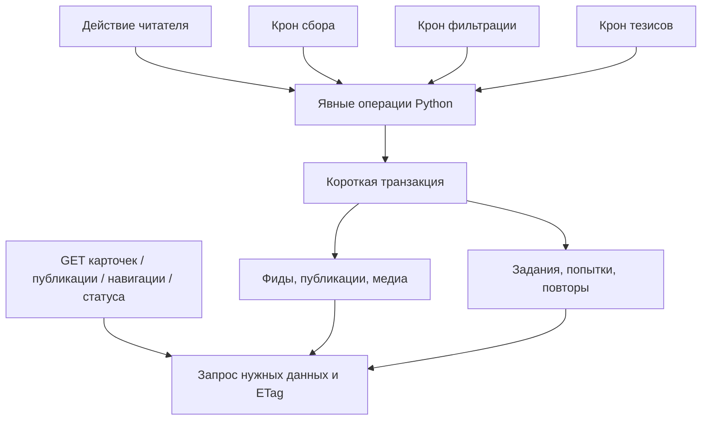
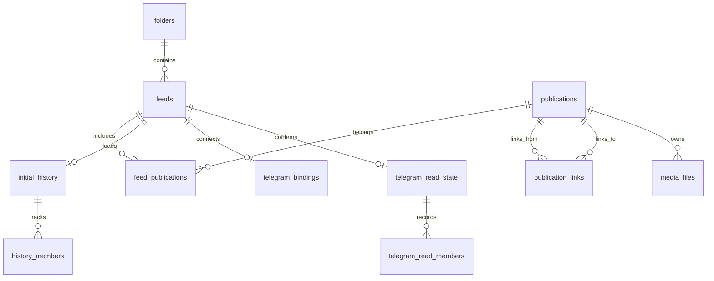
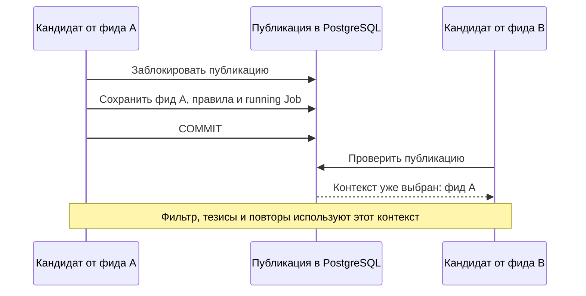
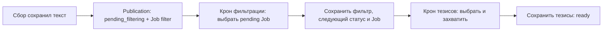

# Проект хранения Око без триггеров

29 октября 2026. **Черновик для обсуждения. Только проект; реализация и изменение рабочей базы не разрешены этим документом.**

Задание пользователя: сократить таблицы и перенести обязанности всех триггеров в код. Уточнённый объём: «Сначала проект новой схемы». Зафиксировано направление; конкретная схема ниже предложена для согласования. Число таблиц не является квотой на удаление данных.

Итоговый [сценарный разбор](../verification/storage-design-scenarios-20261029.md)
уточнил атомарную постановку Job и состояние blocked. Следующий исполнитель
использует [порядок реализации и переключения](storage-implementation-plan.md).
Оба документа отделяют статическую проверку проекта от ещё не выполненных
миграций, runtime-тестов и выкладки.

Исходная база исследования: `54cf7217d832feff359730590c90ebb87f0561ee`, миграции 001–006. В них 44 действующие таблицы, включая `oko_schema_migrations`. Статическое применение CREATE/DROP TRIGGER даёт 149 пользовательских триггеров: исторические 145 плюс четыре membership-триггера миграции 006. Это состав схемы в checkout, не проверка установленного выпуска. [История решений](../verification/sql-trigger-history-20261029.md).

## Предлагаемый результат

- **20 таблиц вместо 44:** 19 прикладных и таблица миграций.
- **Ноль пользовательских триггеров и прикладных хранимых функций в установленной схеме.**
- Три независимых крона: сбор, фильтрация, подготовка тезисов. Сбор также владеет медиа, read sync Telegram и повторяемой очисткой файлов. Четвёртого обработчика инвалидации нет.
- Python явно сохраняет результат, меняет состояние и проверяет допустимость перехода. Связанные записи входят в одну короткую транзакцию.
- PostgreSQL хранит факты и обеспечивает PK, UNIQUE, FK, CHECK, индексы, транзакции и блокировки строк. Внутренние триггеры PostgreSQL для FK не относятся к удаляемой прикладной логике.
- Карточки и открытая публикация используют согласованные предметные GET с ETag. Сохранённого универсального каталога версий UI больше нет.



Схема показывает обязанности, не новый общий scheduler. Каждый крон сам выбирает свою работу. Операции размещаются в существующих `services/`, `storage/`, `workers/`; новый универсальный event bus или имитация SQL-триггеров в Python не вводятся.

## Что сохраняем из продуктовой модели

Основы: [глоссарий](../../GLOSSARY.md), [публикация](../human/publication.md), [Job](../human/jobs.md), [три крона](../human/pipeline-workers.md), [ADR-0001](../adr/0001-codex-execution-settings.md).

- Одна публикация определяется `(platform, external_id)`. Принадлежность фидам — многие ко многим. Связанная статья может существовать без собственного фида.
- Храним последнее содержимое и актуальные результаты. Фильтр и тезисы остаются в публикации, не в таблице принадлежности фиду.
- Согласовано 29 октября: первый фид, начавший обработку общей публикации, задаёт правила её прохода. Выбор сохраняется между фильтрацией, тезисами, повторами и restart. Разрешения всех участвующих источников проверяются перед внешним вызовом и при принятии результата.
- Изменение модели Codex, reasoning или Fast для будущих запусков не обесценивает готовый результат и не меняет параметры начатой попытки.
- Статусы публикации: `pending_collection`, `pending_filtering`, `filter_out`, `pending_summary`, `ready`. Статусы файлов и попыток отдельные.
- Постоянная ошибка Job не запускается снова от одного ожидающего статуса публикации. Нужен новый вход, допустимое изменение условий или ручной повтор.
- Ручная регенерация при прежнем входе сохраняет принятые тезисы до успешной замены.
- Согласовано 29 октября: выключение фильтрации или тезисов сохраняет уже готовый результат и запрещает новые запуски этого этапа. Само выключение не очищает содержимое результата и его происхождение.
- Дополнительно согласовано: сохранённый актуальный фильтр продолжает действовать; уже начатой попытке выключенного этапа даём закончиться. Выключение этапа и остановка всего Око — разные действия.
- «Просмотрено» удаляет собранное содержимое и результаты. Общие связанные статьи и файлы остаются, пока у них есть другие владельцы. Поздний ответ не возвращает удалённое.
- Прочитанное в Telegram, безопасная граница прочитанного, начальная история и обязательные ожидания источника сохраняются.

Текущие HTTP-проекты [карточек](cards-http-design.md) и [открытой публикации](publication-http-design.md) учитываются как целевые контракты. Их статус реализации проверяется перед будущей интеграцией: в checkout есть параллельные незавершённые изменения. Этот проект не объявляет их выпущенными.

Уточнение 29 октября: проверен активный чат «check (3)» (`01a18189-3bba-72d0-9d0e-1144e31c4f13`) и его worktree `/Users/dabondarev/.codex/worktrees/publication-reading/oko`, HEAD `0338eb5532097e7b16b98988dedbdc9898357b18` с текущими правками. [PR #179](https://github.com/tgenman/oko/pull/179) уже переводит оставшихся потребителей на `GET /navigation`, компактный `GET /status` и `GET /status/details`. Карточки и публикация уже имеют предметные GET; модуль `versions_v3.py` удалён. Агент ещё исправляет проверки перед выпуском; завершённая выкладка здесь не подтверждена.

Эта HTTP-работа — внешняя зависимость проекта хранения, её не нужно реализовывать повторно. При этом её новые GET пока используют `reader_entities` для ранней проверки ETag статуса и `reader_identity` для `X-Oko-Storage-Id`. Удаление маршрута не удаляет эти внутренние зависимости. Проект ниже заменяет их реализацию, сохраняя согласованные GET, разделение статуса/подробностей и защиту от смены библиотеки.

## Двадцать таблиц

| Группа | Таблицы | Почему остаются |
| --- | --- | --- |
| Чтение и содержимое — 6 | `folders`, `feeds`, `publications`, `feed_publications`, `publication_links`, `media_files` | Сущности и связи продукта |
| Выполнение и конфигурация — 3 | `jobs`, `settings`, `state` | Работа, наследуемые настройки и долговечное состояние Око |
| Загрузка истории — 2 | `initial_history`, `history_members` | Выбранный объём, границы и исходы публикаций текущей загрузки |
| Telegram — 5 | `telegram_profiles`, `telegram_bindings`, `telegram_claim_owners`, `telegram_read_state`, `telegram_read_members` | Доступ, подтверждённые идентичности и безопасное внешнее прочтение |
| YouTube — 1 | `youtube_access` | Сохранённые ограничения получения субтитров |
| Действия и проблемы — 2 | `reader_action_results`, `reader_problems` | Исходы команд, актуальные и недавние проблемы |
| Миграции — 1 | `oko_schema_migrations` | История совместимости установленной схемы |

Здесь `publications` заменяет `items` с сохранением внутренних ID. Остальные оставляемые таблицы сохраняют имена: переименование ради стиля не является частью упрощения.

Физические поля и FK трёх связанных таблиц (`feed_publications`,
`publication_links`, `media_files`), достижимость общих статей и порядок очистки
описаны в [проекте связей и удаления](storage-relations-schema.md).

Поля `feeds`, `folders` и `settings`, явное наследование и расписание сбора
уточнены в [проекте фидов и настроек](storage-feeds-schema.md).

Пять таблиц доступа/read sync Telegram и две таблицы текущей загрузки истории
уточнены в [отдельной физической схеме](storage-telegram-history-schema.md).
Она сохраняет факты, которые должны переживать удаление текста публикации.

Оставшиеся `state`, `youtube_access`, `reader_action_results`, `reader_problems`
и `oko_schema_migrations` описаны в [служебной схеме](storage-service-schema.md).

### Покрытие физической схемы

| Документ | Таблиц | Состав |
| --- | ---: | --- |
| [Ядро](storage-core-schema.md) | 2 | publications, jobs |
| [Связи и медиа](storage-relations-schema.md) | 3 | feed_publications, publication_links, media_files |
| [Фиды и настройки](storage-feeds-schema.md) | 3 | folders, feeds, settings |
| [Telegram и история](storage-telegram-history-schema.md) | 7 | profiles, bindings, claims, read_state, read_members, initial_history, history_members |
| [Служебные данные](storage-service-schema.md) | 5 | state, youtube_access, reader_action_results, reader_problems, oko_schema_migrations |
| **Всего** | **20** | Каждая таблица описана один раз |

Это полный кандидат физической схемы, но не готовая миграция. DDL в документах
не исполнялся; потребители старых полей/функций и план переноса всё ещё должны
быть реализованы и проверены совместно. Конкретные данные рабочей библиотеки
в рамках проектирования не исследовались.



На схеме показаны логические связи. `history_members` может сохранять исход уже просмотренной публикации без её содержимого; такую ссылку нельзя автоматически удалять FK-каскадом. `jobs` имеет разные типы объектов и отдельно описан ниже.

## Полная карта существующих таблиц

«Убрать» означает убрать отдельное хранение производного состояния после замены его потребителей. «Объединить» означает перенести значимые поля с проверкой данных. Ни одна строка таблицы не удаляется только ради уменьшения общего числа таблиц.

| Сейчас | Решение | Целевой владелец данных или замена |
| --- | --- | --- |
| `collection_attempts` | Объединить | Поля текущей попытки и ограниченная диагностика в `jobs` |
| `collection_results` | Объединить | Последний успех/ошибка сбора в `feeds` |
| `execution_settings` | Объединить | Зафиксированные параметры попытки в `jobs` |
| `feed_details` | Объединить | Даты и описание в `feeds`; расхождения дублей проверяются |
| `feeds` | Оставить | Источник, настройки подключения, курсор, расписание, итог сбора |
| `filter_inputs` | Объединить | Подпись принятого результата в `publications.processing_metadata`; подпись подготовленной попытки в `jobs`, без третьей копии |
| `folders` | Оставить | Тематические папки |
| `history_members` | Оставить | Факты текущей загрузки истории, включая исход viewed |
| `initial_history` | Оставить | Выборка/прогресс/остановка истории |
| `items` | Заменить именем `publications` | ID и содержимое сохраняются; согласованное выравнивание полей |
| `jobs` | Оставить | Единственное хранение выполнения заданий |
| `processing_dirty` | Убрать | Операция изменения входа сразу обновляет актуальность и статус публикации |
| `processing_stage_dirty` | Убрать | Каждый крон выбирает публикации по статусу и учитывает свою Job |
| `reader_action_results` | Оставить | Исходы пользовательских команд |
| `reader_action_superseded` | Убрать | Индекс `(identity, sequence)` и запрос наличия более позднего исхода |
| `reader_entities` | Убрать | ETag предметного HTTP-ответа; нет версии на каждый вид UI-ресурса |
| `reader_feed_counts` | Убрать | SQL count по принадлежности и состоянию публикаций |
| `reader_folder_counts` | Убрать | SQL count с устранением дублей общих публикаций |
| `reader_identity` | Объединить | UUID библиотеки переносится в `state`; `X-Oko-Storage-Id` сохраняется |
| `reader_job_time` | Убрать | `jobs.next_run_at` и сравнение с текущим временем |
| `reader_lists` | Убрать | Ограниченный GET списка; нет сохранённых вариантов scope/sort/hidden |
| `reader_material_links` | Убрать | JSONB ссылок в исходной записи журнала + GIN, если план его подтверждает |
| `reader_originals` | Убрать | Вычисленное наследуемое значение настройки при чтении |
| `reader_problems` | Оставить | Состояние и завершение проблем, а не только текущий текст ошибки Job |
| `reader_runtime` | Убрать | Живые сведения Host/Execution в памяти; долговечный power intent в `state` |
| `reader_visibility` | Объединить | Скрытость определяется актуальным `Publication.status = filter_out` и результатом фильтра |
| `reader_youtube_time` | Убрать | `youtube_access.blocked_until` и текущее время |
| `settings` | Оставить | Единственный источник наследуемых overrides |
| `source_deleted` | Объединить | Явный признак в `publications`, отдельно от просмотра пользователем |
| `state` | Оставить | Только ключи, которым требуется пережить restart |
| `telegram_avatars` | Объединить | Необязательные avatar bytes/MIME/digest в `feeds`; в списочных SELECT их нет |
| `telegram_bindings` | Оставить | Подтверждённый способ доступа к фиду |
| `telegram_claim_owners` | Оставить | Соответствие peer/username владельцу, с основанием подтверждения |
| `telegram_profiles` | Оставить | Личность аккаунта, роль и поколение подтверждения |
| `telegram_read_dirty` | Убрать | Индексированный `telegram_read_state.needs_sync`, устанавливаемый Python |
| `telegram_read_members` | Оставить | Независимые факты saved/viewed и проверенное отсутствие отдельных сообщений; допускается очистка позади подтверждённой границы |
| `telegram_read_state` | Оставить | Аккаунт/peer подтверждения, граница, обычное ожидание и needs_sync; ошибка/срок попытки принадлежат read Job |
| `thesis_inputs` | Объединить | Подпись принятого результата в публикации и подготовленной попытки в `jobs`, без третьей копии |
| `youtube_access` | Оставить | Реальные ограничения источника, не UI-флаг paused |
| `feed_publications` | Оставить | Принадлежность и основной фид; убрать дублированный `is_unviewed` |
| `media_files` | Оставить | Описание, состояние, storage key и причина недоступности файла |
| `publication_links` | Оставить | Связь исходной публикации со статьёй; обратный индекс для инвалидации |
| `reader_membership_dirty` | Убрать | Нет сохранённых счётчиков и списков для пересогласования |
| `oko_schema_migrations` | Оставить | Версии, имена и checksum миграций |

Итого: **14 таблиц производного состояния убираются, 10 объединяются с владельцами, 20 остаются**. Историческая `telegram_source_claims` в эти 44 не входит: её уже удаляет миграция 005.

## Основные поля и единственный источник каждого факта

Это логический обзор. Подробный кандидат физической схемы `publications` и `jobs`, включая типы, NULL/default, ограничения, индексы и карту переноса полей, вынесен в [схему ядра](storage-core-schema.md). SQL там не запускался и не является миграцией. Идентификаторы не перекодируются массово в UUID только ради формы; допустимость типов проверяется по фактическим значениям при подготовке миграции.

### Publication

- `id`, `source_id`, уникальная пара `(platform, external_id)`, `url`, `title`, `published_at`, `discovered_at`.
- `content`, `filtered_content`, `summarized_content`, `processing_metadata` — JSONB; `media_ids` — массив ID по согласованной модели. Python сохраняет блоки и список медиа согласованно.
- `status` — этап публикации. Отдельного сохранённого состояния «карточки» нет.
- `processing_metadata` хранит подписи принятых результатов, выбранный фид/правила прохода и происхождение результатов. Текущая подпись вычисляется для затронутого этапа при записи/подготовке; отдельной сохранённой копии каждой текущей подписи нет. Поля имеют фиксированную схему Python; произвольного набора `_reader`-дублей нет.
- Уточнение проекта: отдельный `Publication.input_revision` предлагается не вводить. При полном переходе на явные операции записи `Job.generation` закрывает старую попытку при каждом изменении её входа/допуска, включая A → B → A. Это упрощение допустимо только вместе с описанным ниже правилом атомарной инвалидации всех затронутых Job.
- `source_deleted` — подтверждённое удаление источником. Не заменяет «Просмотрено».
- В физическом проекте предлагается `has_observed_update` для сохранения нынешнего Changed/Updated без `_reader` и истории версий. Это не отметка любой записи в строку и не доказательство авторской правки. `source_order` сохраняется до отдельной замены его потребителей.
- Технический `lifecycle` различает ещё нужные данные и их незавершённую очистку. Он не добавляет стадий в `PublicationStatus`. Просмотр убирает принадлежности карточки; исходник и файлы, нужные другим публикациям, остаются как зависимость. Только недостижимое содержимое очищается в транзакции команды, после чего минимальная deleting-запись живёт до завершения файловой очистки.

`source_id` сохраняется с текущей семантикой и потребителями; его удаление не входит в эту задачу. Дубли дат и полноты в content рассматриваются отдельно в карте переноса. Несогласованные поля, например порядок элементов с неизвестной датой, не исчезают автоматически от переименования таблицы.

`filter_inputs` и `thesis_inputs` больше не держат отдельную копию подписи. Принятый результат принадлежит публикации, а зафиксированный вход текущего внешнего вызова — Job. Во время новой попытки эти два факта могут различаться, поэтому их не объединяем в одно изменяемое значение.

### Feed и настройки

`feeds` хранит идентичность, папку, параметры источника, курсор, расписание, даты обновления и последний итог сбора. Поля `feed_details` переносятся по смыслу; например, два существующих description нельзя слепо перезаписать друг другом. Ошибка сбора содержит `operation_id`/`attempt_id`: успех другой операции не закрывает её автоматически.

`settings` предлагается оставить единственным физическим хранилищем наследуемых настроек. `Feed.filter_config`/`summary_config` в модели приложения становятся представлением этих настроек. **Это предложение о физическом хранении требует согласования:** human-документы закрепляют принадлежность настроек фиду, но текущая реализация содержит и JSON-поля фида, и overrides. В проекте исключено параллельное сохранение одного значения в обоих местах. Настройки адаптера источника остаются в `feeds.config`.

`state` остаётся небольшим набором известных ключей: включённость работы, UUID библиотеки для `X-Oko-Storage-Id`, глобальная конфигурация обработчиков и необходимые поколения восстановления. `sources-version`, технические версии журналов и UI не переносятся по умолчанию: каждый ключ проходит проверку по потребителю. Секреты аккаунтов и файлы авторизации не переносятся в эти JSON-поля.

#### Физическое хранение настроек: предложенная форма

Интерфейс операции сохраняет область `oko`/`folder`/`feed`, владельца и поле.
Уточнённое физическое представление — `settings(folder_id, feed_id, field, value jsonb)`:
оба nullable ID имеют настоящие FK; оба NULL означают общую настройку, одновременно
заданные ID запрещены. `UNIQUE NULLS NOT DISTINCT` защищает одно значение поля на
уровне, включая общий. Это заменяет первоначальный эскиз с универсальным owner.
Допустимые поля и тип значения проверяет фиксированная схема Python.
Подробности и DDL — в [схеме настроек](storage-feeds-schema.md).

| Запись настройки | Значение |
| --- | --- |
| Строки для данного уровня нет | Наследовать следующий уровень |
| Значение `false` | Явно выключено; наследование остановлено |
| Допустимая пустая строка | Явное пустое значение, а не отсутствие override |
| Команда сброса override | Удалить строку; восстановить наследование |

Порядок: явное значение фида → папки → общая настройка Око → предметное значение
по умолчанию. Выбор проверяет наличие ключа, а не истинность значения: `false`
не должен заменяться на родительское `true`. Предметные defaults, например для
YouTube, остаются явными правилами Python и не размножаются по строкам settings.

`Feed.filter_config` и `Feed.summary_config` в этом варианте являются
вычисляемыми объектами для приложения. Их полные копии не сохраняются также
в `feeds`. Конфигурация соединения с источником, cursor и расписание фида остаются
у `feeds`; идентичность/разрешения фида не переезжают в произвольные поля settings.
Выбор этого физического представления остаётся предложением проекта, а не новым
согласованным продуктовым правилом.

Операция изменения настройки под блокировкой вычисляет эффективные значения
затронутых фидов до/после. Она классифицирует изменение:

- только enabled: новые захваты запрещаются/разрешаются; актуальные результаты
  и уже running попытки сохраняются;
- значимые правила/вход: пересматриваются результаты и поколения затронутых Job;
- параметры будущего выполнения Codex: меняется только подготовка будущей попытки;
- эффективное значение не изменилось: состояние обработки не меняется.

Сохранённый снимок правил прохода — факт о выбранной обработке, а не второй
редактируемый источник настроек. Снимок отдельной Job дополнительно фиксирует
параметры именно начатой попытки. Они могут отличаться от текущих настроек без
ошибки; это необходимо для завершения работы и объяснения происхождения результата.

Для фильтра предлагается отдельное наследуемое `filter_enabled`: нынешняя
проверка непустого prompt_filters не позволяет выключить новые запуски, сохранив
сам промпт и допуск уже начатой попытки. Для тезисов используется существующий
переключатель theses. Перенос должен сохранить эффективную включённость каждого
фида, а обновление OpenAPI настроек выполняется только при реализации.

### Job

Сохраняются уникальность `(operation, target_id)`, статус попытки, `next_run_at`, `generation`, backoff, обязательная область ожидания и последняя ошибка. Добавленные из отдельных таблиц поля:

- снимок входа: подпись, выбранный фид и правила; отдельный `input_revision` из прежнего проекта не дублируется;
- зафиксированные параметры выполнения модели;
- времена очереди/начала/завершения и длительность текущей попытки;
- ограниченная диагностика последнего сбоя сбора с исходными requests;
- `feed_id` там, где он нужен для выборки статуса сбора без обхода графа.

Времена сохраняются как абсолютные UTC timestamps. Монотонные часы используются только для длительности в живом процессе. После restart сроки источников и повторов не обнуляются. JSONB подходит для снимка параметров и подробной диагностики; поля выбора/захвата/порядка остаются обычными колонками с индексами.

Предложенные статусы Job: `blocked`, `pending`, `running`, `done`, `failed`, `unavailable`, `cancelled`. Blocked добавлен после сценарной проверки для сохранённой, но пока не допускаемой работы; внешний контракт причин проверяется отдельно. В одной строке сохраняется текущая попытка, а не бесконечная история запусков. Принятые результаты остаются в публикации. Правила очистки завершённых Job не расширяются этим проектом; при будущем удалении строки generation/ID нельзя переиспользовать так, чтобы принять старый ответ.

`target_id` полиморфный: фид, публикация или файл зависит от operation. Универсальный FK на него не выдумывается. Существование и допустимость объекта проверяются операцией записи. Минимальные cleanup-задания могут переживать удаление содержимого объекта.

## Общая публикация и первый начавший фид

**Согласованное правило:** общая публикация использует настройки первого фида,
который начал обработку. Фильтр и тезисы не выбирают разные фиды. Ни скорость
ответа модели, ни временная ошибка не переопределяют этот выбор.

**Предложенная техническая фиксация:** началом считаем успешный commit захвата
первой Job обработки, а не порядок HTTP-ответов модели или момент обнаружения
публикации. До commit есть только кандидат; rollback не оставляет владельца.
После commit выбор восстанавливается даже при падении процесса до отправки
внешнего запроса. Это не гарантирует отсутствие повторного внешнего вызова после
сбоя; гарантируется единственное допустимое сохранение по Job/generation.

Контекст хранится в `publications.processing_metadata.pass`: `feed_id` и снимок
значимых правил фильтра/тезисов. Сведения о параметрах конкретной модели принадлежат
отдельной Job и выбираются при её начале согласно ADR-0001. Отдельной таблицы
владельцев обработки нет. Основной фид представления в `feed_publications` и
фид обработки не объявляются автоматически одним и тем же фактом.

Порядок первого захвата:

1. Крон выбирает свою pending Job по индексу и определяет допустимый фид для
   её публикации. Учитываются доступность входа, настройки, права,
   ограничения источника и свободная ёмкость модели.
2. Блокирует публикацию. Если контекст уже выбран, использует его вместо
   собственной кандидатуры и заново проверяет применимость своего этапа.
3. Если контекста нет, сохраняет выбранный фид и снимок правил вместе с захватом
   уникальной Job. Все изменения входят в одну транзакцию.
4. После commit выполняет внешний вызов. Следующий этап читает сохранённый контекст.

Для ещё не выбранного фида один общий status не определяет выбор: у разных фидов
могут быть включены разные первые этапы. Операция появления потребности создаёт
не больше одной Job на каждый возможный первый этап. Если у одного фида первым
будет фильтр, а у другого сразу тезисы, обе Job могут быть кандидатами, но выбор
фида всё равно делается только при первом успешном захвате под блокировкой публикации.

В той же транзакции победитель сохраняет контекст и пересматривает вторую Job:
нужный позже этап становится blocked, ненужный выбранному проходу — cancelled.
После фильтра blocked-тезисы переводятся в pending только если они нужны.
Поэтому разные кроны не запускают один проход с разными правилами. Перебор фидов
ограничен выбранной публикацией; нет фонового поиска всей библиотеки без контекста.



Для простоты предлагается сохранять выбранный фид, пока его принадлежность
существует: ошибки, новые данные и ручная регенерация не устраивают новую гонку
между фидами. Значимые изменения правил выбранного фида пересматривают только
затронутые этапы; само имя другого фида или его промпт не перехватывают обработку.
Такое продолжение правила первого начавшего является предложением реализации.

Удаление выбранной принадлежности — отдельная явная операция. Предлагается в той
же транзакции закрыть допуск её незавершённых попыток и сбросить текущий контекст.
Если остались фиды и нужна работа, первый допустимый новый захват выбирает одного
из них. Сохранённые результаты и происхождение не переписываются на нового фида:
их применимость проверяется по новым правилам. До подтверждения результата нельзя
выдавать его за актуальный по ещё не выбранным правилам. При отсутствии фидов
сохраняется режим связанной статьи без собственной ИИ-обработки; недостижимые
данные переходят к штатной очистке. Автоматической гонки новых моделей нет.

Выключение этапа выбранного фида не передаёт его работу другому фиду. Текущая
попытка заканчивается; последующие запуски подчиняются настройке. Ограничения
публичного AI всех участвующих источников действуют независимо от выбранного фида.

Приёмка: два конкурентных кандидата с разными правилами; rollback первого захвата;
падение после commit; временная ошибка первого; restart между фильтром и тезисами;
разные enabled у фидов; удаление выбранной принадлежности во время модели;
изменение промпта другого фида. Ожидается один сохранённый контекст и отсутствие
смешения правил/происхождения результатов.

## Три крона выбирают работу по состоянию

| Крон | Какие данные выбирает | Что делает успешная запись |
| --- | --- | --- |
| Сбор | Свои pending Job и наступившее расписание discover; Telegram needs_sync подготавливает read Job | Сохраняет содержимое/медиа/курсор, статус и необходимые Job той же транзакцией |
| Фильтрация | Pending Job filter; статус публикации, правила и вход повторно проверяются при захвате | Сохраняет фильтр, следующий статус и следующую работу |
| Тезисы | Pending Job theses, включая явную регенерацию при готовом результате | Сохраняет тезисы и переводит в ready |

Общий Job по `(operation, target_id)` не даёт создать дубликат. На каждом проходе крон учитывает существующую Job:

- Для того же входа `running` не захватывается заново; `failed`/`unavailable` не превращаются в новый `pending` только из-за статуса публикации.
- `pending` запускается после `next_run_at` и проверки источника, разрешений и общей ёмкости модели.
- Новый значимый вход разрешает заменить старую попытку с новым поколением. Обязательный source wait при этом сохраняется для своей области.
- `done` с актуальным результатом не выполняется снова. Подтверждённый no_input завершается без модели.
- Статья без собственного фида собирается для родителя, но не получает собственную фильтрацию/тезисы без соответствующего основания.

Предыдущий этап не вызывает следующий крон. Его операция сохраняет результат,
статус и нужную Job одной транзакцией. Следующий крон самостоятельно выбирает
pending работу по индексу. Ручная регенерация представлена Job и не требует
скрывать прежний результат или ложно менять готовность публикации.



Схема показывает случай с обоими включёнными этапами и успешным фильтром. Выключенные этапы пропускаются, `filter_out` не попадает в крон тезисов.

### Уточнение: этап публикации и состояние попытки

Предлагается зафиксировать два разных вопроса:

- `Publication.status`: какой результат ещё нужен публикации?
- `Job.status`: что происходит с попыткой получить этот результат?

Начало внешнего вызова не меняет этап публикации. Пока фильтр выполняется,
публикация остаётся `pending_filtering`, а Job имеет `running`. При ошибке
публикация тоже остаётся `pending_filtering`: сообщение и правило повтора
принадлежат Job. Новые стадии публикации ради ошибки или захвата не вводятся.

| Публикация | Job соответствующего этапа | Действие крона |
| --- | --- | --- |
| Ожидает этап | Нет Job для требуемой работы | Нарушение для миграционной/startup сверки; обычный крон не компенсирует его полным обходом |
| Ожидает этап либо этап выключен | `blocked` | Не выбирать; операция изменения нужного условия пересмотрит допуск |
| Ожидает этап | `pending`, срок наступил | Проверить вход/допуск и захватить |
| Ожидает этап | `pending`, срок ещё не наступил | Пропустить |
| Ожидает этап | `running` с актуальным входом | Пропустить |
| Ожидает этап | `failed` или `unavailable` для того же входа | Пропустить до ручного повтора или соответствующего изменения условий |
| Ожидает этап | Операция изменения входа перевела существующую Job в `pending` с новым поколением | Следующий крон заново готовит вход и выполняет попытку после разрешённого срока |
| `ready` | Нет явной регенерации | Пропустить |
| `ready` | Явная регенерация тезисов в `pending` | Выполнить новую попытку, сохраняя прежние актуальные тезисы |

Для нового входа переиспользуется уникальная строка Job с новым поколением.
`cancelled` сам по себе не является основанием повторного запуска: владелец
команды должен явно поставить работу снова. Сочетание ожидающего этапа и
`done` для того же входа без результата — нарушение согласованности, которое
исправляет проверка восстановления, а не бесконечный обычный polling.

Если Job уже существовала, операция изменения входа атомарно закрывает старую
попытку и ставит её в ожидание только при сохранении потребности в работе.
Если Job ещё нет, операция возникновения потребности создаёт её в той же транзакции.
Поэтому сброс постоянной ошибки
от нового входа не зависит от сравнения со старым hash на каждом тике; основание
перехода сохранено непосредственно в статусе и поколении Job.

Крон выбирает pending Job, а затем проверяет соответствующие публикации,
актуальный этап, срок, разрешения и источник. Failed/unavailable/blocked исключены
из индекса запуска. Неизменная постоянная ошибка не переоткрывается от очередной
записи того же текста. План запроса и стоимость проверяются на большом архиве
ошибок и завершённых заданий, а не только на пустой библиотеке.

Успешный фильтр одной транзакцией сохраняет результат, завершает свою Job,
переводит публикацию в следующий этап и подготавливает Job тезисов. Сбой не
оставляет pending_summary без задания. Это уточнение заменяет прежний вариант
документа с созданием следующей Job только на следующем тике: тот вариант
требовал бы повторного поиска публикаций без Job. Три крона остаются независимыми.

Подготовку Job выполняет владелец транзакции по явным эффектам операции сервиса.
Сервис не вызывает другой worker, не управляет внешним вызовом и не коммитит
самостоятельно. Неперсистентный список эффектов не становится новой очередью
или event bus. Отложенная постановка обязательной Job через after-commit callback
не допускается: падение между commit и callback потеряло бы работу.

При выключении этапа ещё не начатые нужные Job становятся blocked и сохраняют
сроки/намерение, включая явную регенерацию. Running продолжается. После включения
владелец настройки пересматривает blocked: подходящий результат может снять
обычную потребность, но незавершённый явный запрос регенерации не теряется.
Постоянная ошибка остаётся failed и не снимается одним переключением enabled.

### Как вычисляется статус после принятых решений

Проверки идут в следующем порядке для доступной публикации с выбранным контекстом:

1. Необходимый вход ещё не получен — `pending_collection`. Ожидание обычной картинки
   само по себе не блокирует обработку уже доступного текста.
2. Актуальный сохранённый фильтр скрывает публикацию — `filter_out`, даже если
   новые запуски фильтра выключены.
3. Нужен результат включённого фильтра либо первый фильтр уже running и ему дают
   закончиться — `pending_filtering`.
4. Актуальные тезисы уже есть — `ready`; их регенерация отражается только в Job.
5. Нужны включённые тезисы либо их первая попытка уже running — `pending_summary`.
6. Все нужные результаты получены или оставшиеся этапы выключены — `ready`.

Это функция Python от сохранённых фактов, а не триггер. После завершения running
попытки статус пересчитывается снова: выключенный этап не требует ещё одной попытки,
но принятый результат продолжает действовать. Например, фильтр, выключенный после
начала вызова, всё ещё может успешно скрыть публикацию; его результат принимается
при неизменившемся входе и разрешениях. Ошибка такой попытки сохраняется в Job,
а повтор не начинается до разрешения новых запусков.

### Как устраняется полный периодический обход

При изменении текста, связанной статьи, правил или принадлежности Python сразу вычисляет последствия для затронутых публикаций: подписи, допустимость старых результатов и следующий статус. Эти изменения входят в транзакцию исходного действия. Нет фонового прохода «проверить всё, вдруг что-то изменилось» и отдельной очереди переоценки рядом с `jobs`.

Изменение настройки фида охватывает его публикации; настройка папки — публикации её фидов; общая настройка может затронуть всю библиотеку. Это допустимая работа при реальном изменении. До записи вычисляются эффективные значения до/после: no-op, изменение имени и смена будущей модели Codex не запускают массовый пересчёт.

Для больших изменений Python получает входы пакетно и пишет последствия пакетно. Глобальная операция может быть дорогой; проект не обещает константное время. Требуется отдельный замер верхнего объёма библиотеки. Если он покажет неприемлемую транзакцию, способ постепенного применения правил проектируется отдельно с явными правилами видимости; новая dirty-таблица не добавляется автоматически.

Обратный индекс `publication_links(target_publication_id, source_publication_id)` находит родителей изменившейся статьи. Изменение графа и входов родителя атомарно. Циклы не создают бесконечный обход; посещённые ID учитываются один раз. Потеря файла остаётся обнаруживаемой ошибкой: сервис сообщает её владельцу сбора, который явно меняет состояние файла/публикации и Job. Только память процесса не является единственным хранением уже принятого повторного задания.

## Актуальность результатов и изменение входов

Этот раздел уточняет предложенную схему. Он не меняет реализацию и не объявляет
автоматически согласованными новые детали поведения.

### Два механизма с разными обязанностями

**Подпись входа** — hash канонического набора данных, от которых зависит результат
конкретного этапа. Она отвечает на вопрос: можно ли использовать сохранённый
результат сейчас? Подпись сохраняется вместе с результатом и в снимке попытки.

**Поколение Job** — непереиспользуемый допуск попытки. Вместе с ID Job оно отвечает
на вопрос: разрешено ли этому внешнему ответу изменить базу? Одинаковая подпись
после изменения A → B → A не восстанавливает допуск старой попытки.

| Механизм | Где хранится | Когда меняется |
| --- | --- | --- |
| Подпись принятого результата | `publications.processing_metadata.filter/summary` | При принятии результата |
| Подпись и параметры внешнего вызова | Снимок текущей попытки в `jobs` | При подготовке новой попытки |
| `Job.generation` | Одна колонка `jobs` | При новом запуске, отмене или утрате актуальности/допуска |

Отдельные таблицы подписей, Publication.input_revision и история UI-версий для
этих обязанностей не нужны в предложенном варианте. Уже принятый результат и
выполняющаяся попытка остаются разными фактами: при регенерации они существуют
одновременно и не перезаписывают метаданные друг друга.

### Из чего строится подпись

| Этап | Значимые входы |
| --- | --- |
| Фильтр обычной публикации | Передаваемый текст/цитаты, контекст и происхождение частей, значимый заголовок, правила фильтра, выбранный обработчик |
| Обычные тезисы | Актуальный принятый отфильтрованный текст, включая случай выключенных новых запусков фильтра; если результата нет и фильтр не требуется/не выполняется — исходный текст; контекст, правила тезисов и обработчик |
| YouTube-тезисы | Исходные субтитры и их подтверждённая доступность, правила тезисов и обработчик; доступ к этапу зависит от исхода фильтра |

В подпись входят именно данные, которые влияют на смысл/применение результата.
Правила использования публичного AI отдельно проверяются на каждом допуске;
их изменение также пересматривает актуальность по действующим правилам продукта.
Временный URL того же файла, байты неиспользуемой обложки, имя папки и будущий выбор
модели Codex/reasoning/Fast сами по себе не меняют подпись результата. Параметры
фактического запуска остаются в provenance согласно ADR-0001.

### Таблица изменений

| Событие | Фильтрация | Тезисы | Следующее состояние |
| --- | --- | --- | --- |
| Повторно получено то же значимое содержимое | Сохранить результат и текущую попытку | Сохранить результат и текущую попытку | Прежнее |
| Изменился текст или контекст, передаваемый модели | Пересмотреть подпись, убрать доказанно устаревший результат | Пересмотреть зависимый вход; старый запуск больше не допускается | Первый нужный незавершённый этап |
| Догрузилась связанная RSS/Telegraph-статья | То же правило для каждого затронутого родителя | То же правило для каждого затронутого родителя | По готовности фактического входа |
| Загрузилось изображение/сменился временный URL, вход модели прежний | Сохранить | Сохранить | Этапы обработки не меняются; меняются данные медиа |
| Появились или изменились субтитры | Пересмотреть, если изменился вход фильтра | Пересмотреть YouTube-тезисы | По готовности субтитров и фильтра |
| Изменился только промпт тезисов | Сохранить | Пересчитать, если этап включён | `pending_summary`, если предыдущие этапы готовы |
| Изменился промпт фильтра | Пересчитать | Проверить зависимость от нового результата фильтра; приостановить допуск старой попытки | `pending_filtering` |
| Изменились модель Codex, reasoning или Fast для будущего запуска | Сохранить готовое и параметры начатой попытки | Сохранить готовое и параметры начатой попытки | Прежнее |
| Сменился выбранный обработчик этапа | Пересмотреть затронутый этап | Пересмотреть затронутый этап и его зависимости | Первый нужный незавершённый этап |
| Изменились права публичного AI | Закрыть запрещённый допуск и пересмотреть актуальность | То же правило; учитывать все источники составного входа | Ожидающий этап + причина в Job, если выполнение запрещено |
| Этап выключен | Сохранить и применять актуальный фильтр; дать текущей попытке закончиться; новые запуски запрещены | Сохранить готовые тезисы; дать текущей попытке закончиться; новые запуски запрещены | Прежний результат действует; начатая работа учитывается до её завершения |
| Этап включён | Выполнить при отсутствии подходящего результата | Выполнить после готовности предыдущего этапа | Первый нужный незавершённый этап |
| Явная регенерация тезисов при прежнем входе | Сохранить | Сохранить прежний актуальный результат до успешной замены | `ready` + отдельная ожидающая/выполняющаяся Job |
| Просмотр публикации | Очистить собственный результат, закрыть собственную AI-попытку | То же правило | Карточка исчезает; нужный другим корням исходник остаётся зависимостью, недостижимое идёт в cleanup |

Область наследования определяется эффективными значениями, а не фактом записи
в settings. Изменение общей настройки не затрагивает фид, который переопределяет
её прежним значением. Изменение настроек другого фида общей публикации не должно
молча менять выбранного владельца прохода; ужесточение разрешений участвующего
источника применяется сразу. Правило первого начавшего согласовано; технический
порядок выбора и смены контекста при удалении фида описан ниже как предложение.

**Согласовано 29 октября 2026:** пользователь выбрал вариант «Сохранять, но не
выполнять новые запуски». Само выключение этапа сохраняет готовый результат,
его подпись и происхождение. При повторном включении результат проверяется по
текущему входу и правилам: подходящий используется без модели; неподходящий
требует новой обработки. Если в период выключения изменился сам вход, действуют
обычные правила актуальности — это отдельное событие от выключения.

Включённость этапа является условием запуска, а не признаком отсутствия
сохранённого результата. Нельзя возвращать «подписи нет, потому что этап выключен»
и на этом основании удалять результат, как делает текущий путь согласования.
Изменение будущих параметров Codex также ничего не очищает согласно ADR-0001.

Дополнительно пользователь подтвердил: сохранённый актуальный фильтр продолжает
действовать, уже начатой попытке даём закончиться. Поэтому hidden и отфильтрованный
текст не исчезают при одном переключении enabled. Если вход позже изменился,
неподходящий прежний фильтр больше не применяется, а новые запуски выключенного
этапа не начинаются. Новые публикации без готового фильтра используют исходный текст.

Для running Job одно выключение не меняет generation и не вызывает отмену.
При принятии результата enabled не проверяется как новое требование; остаются
проверки входа, поколения, доступности публикации, прав и общего допуска Око.
Ошибка сохраняется, но новый retry не начинается до разрешения новых запусков.
Если начатый фильтр ещё выполняется, тезисы его не обгоняют: ожидается его исход,
после которого статус пересчитывается с учётом сохранённого результата и настроек.
Начатая регенерация тезисов по-прежнему не скрывает предыдущий актуальный результат.

### Если результат фильтра ещё неизвестен

Изменение промпта фильтра не доказывает, что итоговый текст для тезисов изменится.
Предлагается сохранить единственный прежний результат тезисов с его подписью,
но не выдавать его как актуальный, пока обязательный фильтр не завершён. Это
не архив версий и не дополнительная таблица: ожидание следует из
`Publication.status = pending_filtering`.

После фильтра Python сравнивает фактический вход тезисов с подписью сохранённого
результата. Совпадает — результат снова применим, вызов модели не нужен. Различается —
результат очищается и публикация переходит в `pending_summary`. Если фильтр скрывает
публикацию, тезисы не выдаются и не запускаются. Для YouTube сравниваются исходные
субтитры, а фильтр определяет допуск. Уже выполнявшаяся до изменения правил попытка
не получает допуск обратно даже при совпадении нового входа.

Это уточнение экономит повтор модели, но требует отдельного сценария приёмки:
ошибка нового фильтра не должна показывать прежние тезисы как проверенные по новым
правилам. При уже доказанном изменении входа старый результат очищается сразу.

### Одна операция изменения входа

Python под блокировкой затронутых объектов выполняет в одной транзакции:

1. Сохраняет новое содержимое, правила или связи.
2. Определяет затронутые этапы по их реальным входам и допуску.
3. Закрывает старый допуск существующих Job этих этапов: новое поколение;
   `pending`, если работа всё ещё нужна, либо `cancelled`, если она больше не нужна.
4. Сохраняет ещё актуальные результаты; очищает доказанно устаревшие;
   пересчитывает этап публикации. Если сохранённого результата достаточно,
   ненужная новая попытка отменяется, а не изображается успешным внешним вызовом.
5. Сохраняет обязательные сроки источника и фиксирует транзакцию.

Выключение новых запусков само по себе не является изменением входа и не выполняет
шаг 3 для running Job. Оно меняет допуск будущих захватов. Уже начатый вызов
завершается по согласованному правилу; переключение не подменяет отмену по другим
основаниям, например после просмотра или отзыва разрешений.

Физическая отмена asyncio-задачи происходит после commit. Её успешность не является
защитой данных: внешний адаптер может всё равно прислать ответ. При принятии
проверяются текущие `Job.id`, `generation`, `status = running`, наличие доступной
публикации, подпись фактического входа и разрешения. Успех и ошибка используют
одинаковые проверки. Снимок старой попытки не перезаписывает обновлённые правила
прохода: запись результата меняет только принадлежащие этапу поля.

Закрытие допуска не означает мгновенного освобождения внешнего ресурса: пока
отмена не подтверждена или вызов не завершился, JobControl продолжает учитывать
занятую ёмкость модели. Новый pending не обходит общий лимит выполнения.

| Шаг примера | Содержимое | Поколение Job | Допуск старого ответа |
| --- | --- | ---: | --- |
| Начат внешний вызов | A | 10 | Разрешён при остальных выполненных проверках |
| Принято изменение | B | 11 | Закрыт |
| Содержимое вернулось к прежнему | A | 12 | Остаётся закрытым: ответ несёт 10 |

Числа в таблице иллюстративные. Подпись A снова совпадает, но поколение не совпадает.
Отдельный токен входа у публикации поэтому не нужен **при выполнении всех условий**:
все записи идут через владельцев; изменение входа и поколения атомарно;
при удалении/повторном создании Job не переиспользуется пара ID + generation;
восстановление и импорт также соблюдают эти правила. Это требование будущей
реализации, а не утверждение, что текущий код уже может удалить `_revision`.

### Дополнительная приёмка этих правил

- A → B → A во время внешнего вызова: поздние успех и ошибка не принимаются.
- Изменился только промпт тезисов: принятый фильтр и актуальная попытка фильтра сохраняются.
- Новый фильтр дал тот же вход тезисов: готовые тезисы используются без новой модели;
  при ошибке фильтра они не выдаются как актуальные.
- Меняется глобальная настройка с локальными overrides: обрабатываются только фиды
  с реально изменившимся эффективным значением.
- Выключение этапа сохраняет результат, подпись и provenance после restart; новые
  вызовы модели не начинаются. Повторное включение с тем же входом использует
  результат без нового запуска, с изменившимся — применяет правила актуальности.
- Сохранённый фильтр после выключения продолжает скрывать публикацию и определять
  текст обычных тезисов. Выключение во время running сохраняет допуск успешного
  ответа, если вход/права прежние; ошибка не запускает новую попытку до включения.
- Изменились только описание файла/временная ссылка: модель не вызывается снова,
  если её собственный вход остался тем же.
- Сбой между изменением входа и инвалидацией Job откатывает обе записи.
- Восстановление или создание новой Job не возвращает допуск старому ID/поколению.

## Явные операции вместо цепочек триггеров

Названия ниже обозначают обязанности внутри существующих modules, а не новый публичный API.

| Операция Python | Что входит в одну транзакцию | Владелец |
| --- | --- | --- |
| Сохранить результат сбора | Публикация, ссылки/описания медиа, актуальность результатов, статус, исход истории, условный finish Job и итог сбора | CollectionWorker + CollectionService |
| Сохранить фильтр | Допуск, результат и происхождение, следующий статус, актуальность входа тезисов, условный finish Job | FilterWorker + ProcessingService |
| Сохранить тезисы | Допуск, результат и происхождение, `ready`, условный finish Job | SummaryWorker + ProcessingService |
| Изменить правила | Настройки, затронутые эффективные правила и состояния публикаций, инвалидация старых запусков | Сервис настроек + JobControl |
| Добавить/удалить принадлежность | `feed_publications`, выбор основного фида, проверка разрешений и актуальности прохода | Сервис публикаций/фидов |
| Просмотреть публикации | Завершение членства, пересчёт нужности общих данных, очистка недостижимого содержимого и собственных результатов без фида, инвалидация затронутых поколений, cleanup, факты истории и read sync | Сервис чтения + JobControl |
| Сохранить проблему/исход команды | Исходная JSONB-запись и её состояние | Владелец проблем/действий |
| Изменить Telegram-состояние | Binding/profile/eligible member/frontier и `needs_sync`, сохранённая Job при необходимости | Telegram-операция или CollectionWorker |

Для публикаций с несколькими фидами сохраняется текущая семантика общего результата и прохода. `is_primary` поддерживает явная операция принадлежности; уникальный частичный индекс запрещает два основных фида. Если удаляется основной фид, операция выбирает нового или фиксирует отсутствие владельца. Дублированный `is_unviewed` больше не нужен. Для всех путей изменения принадлежности используется одна операция, а не обязательный набор ручных вызовов у каждого вызывающего кода.

Вызов операции должен быть достаточен для корректного результата. Контроллер не обязан помнить «теперь обновить счётчики, пометить грязное и повысить версию». SQL-парсер, автоматически угадывающий изменённую таблицу, не вводится: он повторил бы скрытую архитектуру триггеров.

### Полное покрытие групп триггеров

| Группа в миграциях 001–006 | Число | Судьба обязанности |
| --- | ---: | --- |
| `reader_v_*` | 107 | UI-версии, сохранённые счётчики, flags времени и варианты списков удаляются вместе с прежним протоколом; чтение строится из данных продукта |
| `source_*` | 16 | Операции настройки/подключения явно обновляют конфигурацию источников; долгоживущий счётчик sources-version не нужен. При restart конфигурация читается из БД |
| `journal_*` | 9 | Ссылки читаются из JSONB, superseded определяется запросом; обслуживание журнала выполняет Python |
| `telegram_*` | 6 | Python обновляет `needs_sync` в существующей строке read state |
| `collection_*` | 4 | Python сохраняет время очереди, итог сбора и очищает/переносит диагностику при завершении или удалении владельца |
| `processing_*` | 3 | Python обновляет актуальность и статус публикации в операции изменения входа |
| `membership_*` | 4 | Python поддерживает основного владельца и последствия изменения принадлежности; отдельной инвалидации UI нет |
| **Всего** | **149** | **Нет оставленной группы прикладных триггеров** |

После commit обновляются только несохраняемые представления процесса: список активных адаптеров, кэш настроек и сигналы отмены. Ошибка callback не должна терять долговечное задание или делать незафиксированные данные видимыми. Конфигурация повторно загружается при restart; все обязательные повторы уже представлены в БД.

Крон проверяет актуальную конфигурацию своего фида при подготовке внешнего вызова и пересоздаёт adapter при расхождении с его снимком. Неуспешный callback не оставляет старую конфигурацию единственным источником истины до restart. Успех callback не является условием сохранности принятого действия.

## Транзакции и PostgreSQL

Предлагается сохранить один экземпляр Око с тремя кронами. Несколько процессов и горизонтальное масштабирование не являются целью. При этом общий `RLock` одного SQL-соединения заменяется владением соединением на срок транзакции из ограниченного пула. Размер пула выбирается при реализации по фактическому числу параллельных операций.

Глобальный допуск Execution нужен для выключения/остановки, внешних ожиданий и ёмкости модели. Он не служит единственной защитой записи в PostgreSQL. Захват использует блокировки строк и повторную проверку состояния.

Текущий изменяемый `SettingsCache` одного соединения нельзя без изменений разделить между соединениями пула: его rollback-обновления рассчитывают на прежнюю сериализацию. В проекте снимок настроек принадлежит транзакции/запросу; общий кэш, если останется, публикует только зафиксированные неизменяемые значения и не определяет актуальность внешнего результата.

Кандидатные ID сначала читаются из индекса pending jobs без изменения состояния.
Порядок захвата: объект работы, затем затрагиваемые Job в стабильном порядке ID.
Для публикации используется FOR UPDATE SKIP LOCKED, затем повторно проверяется
существующая Job; для обнаружения — фид, для файла — публикация и файл.
Между выбором кандидатного ID и захватом состояние может измениться: такая Job
пропускается. Не допускается в одном пути брать Job раньше публикации, а в другом
позже неё. Отсутствующая Job восстанавливается специальной сверкой, не этим циклом.

Операции с несколькими объектами используют единый порядок: конфигурация/профили и ограничения источника → фиды по ID → публикации по ID → файлы по ID → Job по ID. SQL-чтение без изменения не требует лишнего FOR UPDATE. Состав зависимостей проверяется после получения блокировок; при его изменении транзакция повторяется. Эти правила требуют конкурентных тестов, а не только единичного успешного запуска.

Уточнение для membership/links/удаления: [проект связей](storage-relations-schema.md)
предлагает короткую транзакционную блокировку изменений графа библиотеки, получаемую
до перечисленных row locks. Она защищает определение нужности от параллельного
добавления нового корня. Обычные операции результатов модели и чтения её не берут;
сеть и файловое удаление выполняются после завершения SQL-транзакции.

```mermaid
sequenceDiagram
    participant W as Крон
    participant DB as PostgreSQL
    participant EXT as Источник или модель
    W->>DB: BEGIN; заблокировать объект и Job
    W->>DB: проверить статус, срок и допуск
    W->>DB: running + новое поколение + снимок входа
    W->>DB: COMMIT
    W->>EXT: внешний вызов
    EXT-->>W: результат или ошибка
    W->>DB: BEGIN; заблокировать объект и Job
    W->>DB: проверить поколение, вход и разрешения
    W->>DB: результат + следующий статус + done
    W->>DB: COMMIT
```

Нет сети, модели и ожидания отмены внутри SQL-транзакции. Finish, изменивший ноль строк, откатывает результат. Поздняя ошибка проверяется так же, как поздний успех. При остановке старый объект Store и его допуск не становятся действительными для нового процесса.

Single-instance lease остаётся: новый процесс начинает восстановление только после потери владения старым. Он переводит прерванные running в ожидание с новым поколением; абсолютные сроки и обязательные ограничения источников сохраняются. Добавление FOR UPDATE не является разрешением запускать второй независимый recovery. Изменение этого правила — отдельный проект.

«Дать начатой попытке закончиться» не означает новый внешний запуск после её
утраты при crash. Если этап уже выключен, восстановленная работа становится
blocked, а не обходит выключение из-за старого enabled=true в снимке. Готовый
результат сохраняется; будущий retry требует действующего допуска. Снимок правил
объясняет прежнюю попытку, но не выдаёт бессрочное разрешение новым вызовам.

Файлы сохраняют staging/fsync/move и повторяемую очистку. Запись в PostgreSQL не объявляется атомарной с файловой системой. Сбой после move может оставить лишний файл, но не ложное состояние ready. После просмотра сохраняются исходники/файлы, нужные другим корням; для недостижимого остаётся только необходимая информация для cleanup и внешней отметки. Старые результаты не могут создать очищенную публикацию заново через UPSERT.

## Интерфейс без таблиц версий

Переход с `POST /reading/check` выполняет PR #179. Проект хранения принимает его предметные GET как внешний контракт: карточки, публикация, навигация, компактный статус и подробности статуса. Допуск команд и остановка остаются в основном статусе; подробности загружаются по условиям нового UI. Повторная разработка HTTP-маршрутов не входит в этот проект.

**Даже полное удаление reading/check недостаточно:** в проверенном PR `status_tag()` всё ещё читает `queries.versions.version('status','runtime')`, а карточки и другие GET используют сохранённые признаки версий и идентичность библиотеки. Для схемы из 20 таблиц эти внутренние чтения должны исчезнуть; UUID библиотеки переносится в `state`, а не удаляется из контракта.

Предлагается вычислять ETag из канонического представления конкретного ответа и UUID библиотеки. Он учитывает query-параметры и всё содержимое ответа, включая `total` и курсор. Это не глобальный счётчик БД. GET не создаёт строки версий и не пишет в БД. После обычного restart UUID сохраняется; при restore/смене библиотеки сохраняется принятое правило смены идентичности. Заголовок `X-Oko-Storage-Id` и отказ публикации при несовпадающей ожидаемой библиотеке остаются. Правила поздних ответов и выбранной области остаются на клиенте.

Это изменение относительно текущей реализации PR #179: она умеет вернуть 304 статуса до построения ответа по сохранённой версии. Отказ от такой оптимизации не следует из нового HTTP-контракта автоматически и должен быть подтверждён замерами. Для компактного статуса и details сохраняются независимые ETag и независимые запросы.

Если один ответ собирается несколькими SELECT, они выполняются в одном read-only REPEATABLE READ snapshot: порция, total и ETag относятся к одному состоянию. Разные HTTP-запросы не объявляются общим атомарным снимком. Проверка ссылки на отсутствующую публикацию и истёкшего курсора остаётся обязательной.

Для карточек читается только ограниченная порция. Полный текст в карточки не загружается. Счётчики читаются агрегатами по принадлежностям и состояниям: общая публикация не считается дважды внутри папки. Эффективная настройка originals вычисляется из настроек, без отдельной таблицы.

`paused`, наступивший retry и текущая длительность определяются из сохранённого deadline и живых часов. Изменение такого ответа по времени не требует записи в БД. Если статус содержит изменяющуюся каждую секунду длительность, его ETag тоже может меняться; обещать постоянный 304 нельзя.

**Компромисс:** ETag сокращает передачу ответа, но сам по себе не отменяет SELECT и сборку ответа. `count` по всем непросмотренным не становится O(1) от наличия индекса. Навигация и counts требуют планов и измерений. Публикации/тексты посторонних областей не разбираются ради проверки видимой порции. Возврат сохранённых счётчиков допускается только как пересмотр проекта по конкретному неудовлетворительному замеру, а не как незаметное восстановление старых таблиц.

Ссылки проблем и команд читаются из `body` JSONB: сохраняется единственный исходный массив objects. Для него проверяется GIN/выражение containment; новые копии ссылок в отдельных таблицах не создаются. Очистка старых исходов использует bounded DELETE и EXISTS более поздней sequence того же identity; последний исход и незавершённая команда не удаляются из-за возраста соседней записи.

## Индексы и ограничения

Минимальный кандидатный набор; окончательная форма проверяется через EXPLAIN ANALYZE на синтетической PostgreSQL:

- UNIQUE `publications(platform, external_id)` и индексы выбора по `status`/дате/ID только доступных публикаций.
- PK `feed_publications(feed_id, publication_id)`, обратный индекс `(publication_id, feed_id)`, UNIQUE основной принадлежности по publication_id.
- Обратный индекс родителей `publication_links(target_publication_id, source_publication_id)`.
- UNIQUE `jobs(operation, target_id)`, частичный индекс по operation/deadline/ID для pending и отдельная выборка running для восстановления.
- Индексы media по владельцу/статусу; текущей истории по run_id и публикации; Telegram members по фиду/порядку сообщений и read state по `needs_sync`. History_members не хранит второй независимый feed_id.
- Журнал: `(identity, sequence DESC)`, срок завершения/очистки и проверенный JSONB-индекс objects.

JSON хранится как JSONB, bool как boolean, даты как timestamptz. Прикладные `oko_json_*`, `oko_max`, `oko_reader_*` и функции инвалидации заменяются нативными выражениями PostgreSQL и параметрами из Python. В БД не остаётся PL/pgSQL бизнес-логики. Существующие constraints не удаляются ради сокращения числа объектов схемы.

## Порядок будущего перехода

1. Согласовать этот проект и способ вычисления ETag без старых таблиц. Уточнить владельца физических настроек. Взять проверенный результат PR #179 из актуального main; повторно сверить его DTO и внутренние зависимости от reader-таблиц. HTTP-контракты заново не проектировать.
2. Закончить инвентаризацию записей: для каждого INSERT/UPDATE/DELETE указать одну явную операцию-владельца из этого проекта. Прямые SQL-записи в тестовых fixtures переводятся на согласованные операции или явно строят уже согласованное состояние.
3. Реализовать операции Python и новый путь чтения на изолированной синтетической БД. При проверке нового пути пользовательские триггеры отсутствуют; нельзя принять зелёные тесты, где последствия всё ещё выполняет старый триггер.
4. Подготовить **новую** миграцию после существующих. Старые миграции и checksum не переписывать. На отдельной копии проверить перенос полей, сохранение ID, результатов, попыток, read frontier и истории. Отсутствующие/противоречивые владельцы и разошедшиеся дубли дают отчёт и отказ, а не произвольный выбор значения.
5. Сначала в миграции удалить пользовательские триггеры, затем переносить данные явным SQL. Удалять функции и таблицы по зависимостям после переноса; не использовать безразборный CASCADE. Финальная схема — 20 таблиц и ноль прикладных triggers/functions.
6. Выпустить совместно код, схему и frontend. Переключение рабочей установки требует отдельного задания пользователя и backup PostgreSQL вместе с файлами. Старый код с новой схемой не запускается. Возврат на старый backup после новых записей не является без потерь обратимым действием.

Миграции старых выпусков исторически могут содержать CREATE TRIGGER: это не нарушение целевого устройства. Проверяется конечный каталог PostgreSQL после применения всей истории. Временный режим двойного выполнения обязанностей Python+trigger не выпускается: он удвоил бы эффекты.

## Проверка проекта и будущей реализации

### Сделано при проектировании

Итог структурной проверки полного кандидата из 20 таблиц записан отдельно:
[проверка физического проекта](../verification/storage-schema-design-20261029.md).

- Прочитаны схема 001–006, владельцы чтения/записи/заданий/истории/Telegram и согласованные human-документы.
- Составлена полная карта 44 таблиц и всех семи групп из 149 объявленных активных триггеров.
- Выбраны операции, которым переходят необходимые обязанности; лишние проекции удаляются вместе с протоколом.
- Автоматически сверена карта: все 44 таблицы покрыты ровно один раз; после учёта PR #179 — 14 удалений отдельных структур + 10 объединений + 20 оставляемых таблиц. Локальные ссылки существуют. Mermaid-схемы проверены вручную; локальный Mermaid-парсер отсутствует. Уточнение о выключении этапов и первом начавшем фиде меняет только этот проект и `docs/human/publication.md`, `docs/human/jobs.md`; diff отделён от прежних правок checkout.
- Продуктовые тесты и миграции не запускались. Выигрыш производительности и корректность переноса данных пока не подтверждены.

### Обязательная будущая приёмка

| Сценарий | Что доказывает |
| --- | --- |
| Пустая БД и копия старой схемы → все миграции | Ровно 20 таблиц; `pg_trigger` не содержит пользовательских триггеров; нет прикладных stored functions |
| Два конкурентных захвата одной работы через разные соединения | Одна принятая попытка, корректный SKIP LOCKED и отсутствие двойного вызова |
| Изменение входа/просмотр во время внешнего вызова | Поздний успех и ошибка не меняют новый объект/Job; A → B → A не возвращает старый допуск |
| Ошибка между сохранением результата и finish | Rollback результата, статуса и Job вместе |
| failed/unavailable при ожидающем статусе публикации | Idle-крон не создаёт бесконечный повтор; ручной retry и новый вход работают |
| Общая публикация и связанная статья в нескольких фидах | Сохранение выбранных правил прохода, разрешений, counts и достижимых файлов |
| Смена фильтра, промпта, роли Telegram и глобальных правил | Только затронутые состояния; готовая работа не инвалидируется сменой будущей модели Codex |
| Просмотр и crash на каждом этапе файловой очистки | Контент не возвращается; cleanup повторяется; история и Telegram-основания сохраняются |
| Restart с running и source wait | Новый generation; прежний deadline не сокращается; второй Store не запускает recovery |
| История и раннее непрочитанное сообщение Telegram | Исходы viewed не теряются, безопасная граница не перескакивает препятствие |
| Playwright: карточки, публикация, навигация, статус, ошибки и возврат после restart | Предметные GET/ETag заменили все старые версии; нет чтения удалённых таблиц |
| 100 / 400 / 20 000 публикаций, высокий процент done jobs, несколько общих фидов | Индексированный выбор работы, ограниченная порция, цена counts и глобального изменения правил измерены раздельно |

Основная проверка — существующий HTTP interface, настоящий браузер через Playwright и изолированный PostgreSQL с синтетическими источниками/моделью. Личные подписки и рабочая база не нужны для доказательства нового устройства. Число SQL не является единственным критерием: измеряются длительность, строки/буферы плана, размер ответа, цена записи и блокировки.

## Решения для обсуждения

Предлагается принять весь набор совместно:

1. Цель 20 таблиц с сохранением описанных продуктовых фактов; отдельные Telegram/history/journal-таблицы остаются.
2. Сохранение предметных GET из PR #179 с заменой внутренних сохранённых UI-версий. UUID библиотеки и `X-Oko-Storage-Id` остаются; возможность отказаться от раннего 304 статуса проверяется замерами.
3. Состояния публикаций и Job — единственный путь подготовки/выполнения трёх кронов; статус и нужная Job сохраняются атомарно. Крон читает pending по индексу, blocked сохраняет пока не допускаемую работу. Нет параллельных очередей processing_dirty и постоянного поиска публикаций без Job.
4. Явные операции Python, короткие транзакции и row locks; один процесс Око остаётся владельцем восстановления.
5. `settings` — единственный физический источник наследуемых настроек; конфигурации фида в модели приложения являются его представлением. Это уточнение физического хранения, а не отмена настройки этапов на фиде.
6. Подписи результатов и `Job.generation` выполняют разные обязанности; отдельный Publication.input_revision не нужен при атомарной инвалидации всех затронутых попыток. Это предложение нового устройства, не разрешение удалить текущую защиту без её замены.
7. **Согласовано:** готовый результат при выключении этапа сохраняется и актуальный фильтр продолжает действовать; новые запуски запрещены, начатой попытке даём закончиться. Повторное включение использует ещё подходящий результат.
8. **Согласовано:** общая публикация использует настройки первого начавшего фида на весь проход. Это заменяет выбор по первому успешному ответу; техническая фиксация выбора и смена контекста ниже остаются проектом реализации.

Документ не ставит ready-for-agent и не создаёт задачу реализации. Согласованные правила сохранения и применения результата, завершения начатой попытки и первого начавшего фида отражены также в описаниях Publication и Job. Остальные предложения не меняют согласованные human-документы автоматически; фактические результаты реализации записываются отдельно.
