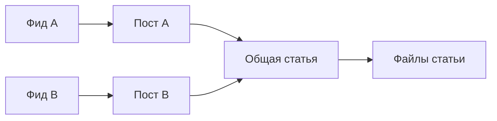
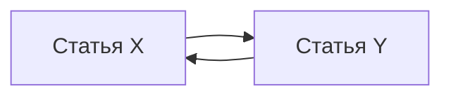

# Связи публикаций, медиа и удаление

29 октября 2026. **Проект, без реализации.** Продолжение [схемы ядра](storage-core-schema.md) и [общего проекта](storage-redesign.md). SQL приведён для ревью и не запускался. Число целевых таблиц остаётся 20.

## Две разные причины сохранять публикацию

Публикация нужна, если у неё осталась принадлежность фиду либо до неё ведёт цепочка
связей от такой публикации. Наличие собственной карточки и необходимость хранить
содержимое не являются одним и тем же фактом.



Просмотр поста A удаляет его принадлежности чтению. Статья и её файлы остаются
для поста B. Если у самой статьи была карточка и пользователь просмотрел её,
статья также может остаться как зависимость поста B. После исчезновения последнего
читаемого владельца статья и файлы допускаются к очистке.

Это сохраняет уже описанное поведение [общих публикаций](shared-publications.md)
и [медиа](../human/media.md). Прежняя фраза проекта «при просмотре сразу очистить
содержимое» уточняется: она применяется только к данным, больше никому не нужным.

## feed_publications — 3 колонки

```sql
CREATE TABLE feed_publications (
    feed_id        text NOT NULL REFERENCES feeds(id) ON DELETE RESTRICT,
    publication_id text NOT NULL REFERENCES publications(id) ON DELETE RESTRICT,
    is_primary     boolean NOT NULL DEFAULT false,
    PRIMARY KEY (feed_id, publication_id)
);

CREATE UNIQUE INDEX feed_publications_one_primary
    ON feed_publications (publication_id) WHERE is_primary;

CREATE INDEX feed_publications_by_publication
    ON feed_publications (publication_id, feed_id);
```

Здесь нет `viewed`, `is_unviewed`, состояния фильтра или тезисов. Наличие строки
означает, что публикация входит в состав чтения фида. Просмотр глобальной карточки
убирает все её принадлежности; удаление фида убирает только принадлежности этого фида.

`is_primary` сохраняет нынешний основной фид представления: подпись карточки
не меняется от выбора папки. Первый добавленный владелец становится основным;
при его удалении Python выбирает оставшегося в стабильном порядке ID. Повторное
обнаружение не отбирает основной фид у существующего. Это правило представления,
а не выбор фида обработки по первому начавшему.

Частичный UNIQUE запрещает два основных фида. Условие «при наличии принадлежностей
ровно одна основная» поддерживает одна операция Python под блокировкой публикации.
SQL-триггер для этого не нужен. Операция добавления проверяет lifecycle: deleting
публикацию нельзя снова включить в чтение как будто удаления не было.

## publication_links — 2 колонки

```sql
CREATE TABLE publication_links (
    source_publication_id text NOT NULL
        REFERENCES publications(id) ON DELETE RESTRICT,
    target_publication_id text NOT NULL
        REFERENCES publications(id) ON DELETE RESTRICT,
    PRIMARY KEY (source_publication_id, target_publication_id),
    CHECK (source_publication_id <> target_publication_id)
);

CREATE INDEX publication_links_parents
    ON publication_links (target_publication_id, source_publication_id);
```

Строка означает зависимость содержимого: RSS-запись → основная статья или пост →
Telegraph-статья. Несколько вхождений ссылки в blocks не создают несколько строк.
Контент и набор связей сохраняются одной операцией; несуществующий target отклоняет FK.

Рекурсивное определение нужных данных не разрешает рекурсивно скачивать произвольные
ссылки. Политика раскрытия остаётся прежней. Self-link запрещён; возможный цикл
из разных публикаций обрабатывается конечным обходом с устранением повторных ID.

### Почему нельзя удалять по числу входящих ссылок



Если ни до X, ни до Y нельзя дойти от публикации в фиде, обе не нужны. Их взаимные
ссылки не должны удерживать их навсегда. Поэтому ни reference count, ни проверка
«нет входящей строки publication_links» сами по себе не заменяют достижимость.

Корни чтения — публикации с оставшимися `feed_publications`. Скрытые, ещё не
загруженные и относящиеся к выключенному фиду публикации также являются корнями:
выключение сбора и скрытие фильтром не означают просмотр.

Для удаления набора объектов предлагается один расчёт затронутого компонента:

1. До изменения связей найти компонент по исходящим и входящим ссылкам от
   затронутых ID; включить оба конца удаляемых связей.
2. Выполнить изменение принадлежностей/связей.
3. Найти оставшиеся корни внутри компонента.
4. Пройти направленные ссылки от этих корней с устранением повторов.
5. Недостижимую часть компонента перевести в удаление.

Компонент вычисляется по ID и связям без чтения текстов. Для пакетного просмотра
он вычисляется один раз, а не заново для каждого ID. В худшем случае компонент
может охватить большую часть библиотеки; это не обещание O(1). Отдельные несвязанные
публикации не обходятся только из-за удаления соседнего фида.

## media_files — 13 колонок

Одна строка описывает один ресурс одной публикации. Другие посты используют файл
через общую публикацию-статью. Дедупликация разных ресурсов по одинаковым байтам
не вводится, поэтому таблица совместного владения физическими файлами не нужна.

```sql
CREATE TABLE media_files (
    id                text PRIMARY KEY CHECK (id <> ''),
    publication_id    text NOT NULL
        REFERENCES publications(id) ON DELETE RESTRICT,
    resource_key      text NOT NULL CHECK (resource_key <> ''),
    resource_identity text,
    source_adapter    text NOT NULL CHECK (source_adapter <> ''),
    source_context    jsonb NOT NULL DEFAULT '{}'
                      CHECK (jsonb_typeof(source_context) = 'object'),
    source_locator    text NOT NULL,
    name              text NOT NULL DEFAULT '',
    mime_type         text,
    size_bytes        bigint CHECK (size_bytes >= 0),
    storage_key       text UNIQUE CHECK (storage_key <> ''),
    status            text NOT NULL DEFAULT 'pending_download'
                      CHECK (status IN ('pending_download', 'ready', 'unavailable')),
    reason            text NOT NULL DEFAULT '',
    UNIQUE (publication_id, resource_key),
    CHECK ((status = 'ready') = (storage_key IS NOT NULL)),
    CHECK (status <> 'unavailable' OR reason <> '')
);

CREATE INDEX media_pending_download
    ON media_files (publication_id, id)
    WHERE status = 'pending_download';
```

`source_adapter` и `source_context` — предложенные дополнения, закрывающие старый
вопрос: кто после restart понимает сохранённый непрозрачный locator. Adapter
задаётся зарегистрированным внутренним именем. Context имеет фиксированную схему
для этого adapter: например, роль/подтверждённая личность Telegram и peer; для
публичной веб-загрузки достаточно пустого объекта. Токены, сессии и пароли сюда
не копируются. Идентичность самой публикации берётся из publications.

При захвате Job текущие adapter/context/locator/resource_identity фиксируются
в её снимке. Смена доступа, личности или ресурса явно закрывает старую попытку.
Job не должна после restart случайно передать locator от одного adapter другому.
Если источник контекста исчез, сначала требуется допустимое получение нового
описания через действующий доступ; старый приватный доступ не угадывается.

Resource key уникален только внутри своей публикации. Подтверждённо тот же ресурс
с обновлённым locator сохраняет ID и готовый файл. Для нового ресурса либо отсутствия
подтверждения тождества назначается новый ID. Если повторная загрузка показывает
другие байты без доказанного сохранения идентичности содержимого, старый media URL
не начинает молча отдавать другой ресурс: выполняется явная замена ID/ссылок.

### Владение ссылками и байтами

- `media_ids` содержит уникальные ID текущего собственного набора MediaFile;
  несколько блоков могут ссылаться на один из этих ID.
- В собственном content нет прямого присвоения чужого MediaFile. Общие файлы
  приходят через связанную публикацию. Составное filtered_content может ссылаться
  на медиа её доступных зависимостей с сохранением происхождения.
- Python проверяет соответствие ID, строк media_files и ссылок блоков в той же
  транзакции. FK не проверяет ссылки внутри JSONB или массива автоматически.
- При замене медиа операция обновляет ссылки в content и применимых производных
  представлениях, включая родителей связанных статей. Неизменный текстовый вход
  сам по себе не требует нового вызова модели; старые удалённые media ID не должны
  остаться в применимом filtered_content.
- Роль медиа задаётся блоком content. `source_context` не используется для рендера.

`storage_key` — непрозрачный относительный ключ в управляемом каталоге, отдельно
от ID и locator. Python проверяет путь и принадлежность хранилищу; внешняя строка
не используется как произвольный файловый путь. При каждой новой записи байтов
предлагается новый уникальный конечный ключ, который не переиспользуется для
следующей попытки. Старый ответ тогда не перезапишет файл новой попытки.

`ready` требует существующего файла и key; CHECK доказывает только наличие key,
проверку файловой системы выполняет Python. Известный размер 0 означает пустой
файл, NULL — неизвестный размер. При принятии загрузки сохраняется проверенный
размер. MIME и имя могут быть неизвестны по прежним правилам. Ошибка повторного
скачивания уже доступного ресурса остаётся в Job: прежний рабочий файл не теряет
ready только из-за сетевого сбоя.

## Операции удаления и сохранения

| Операция | Изменение БД | Что остаётся |
| --- | --- | --- |
| Просмотреть карточку | Убрать все её принадлежности; сохранить факты истории/Telegram; пересчитать нужность | Содержимое, ещё нужное другим корням |
| Удалить фид | Убрать только его принадлежности; заменить основной фид/контекст обработки по правилам | Публикации остальных фидов и их зависимости |
| Убрать ссылку на статью | Сохранить новый content и набор links; пересмотреть результаты родителя и нужность статьи | Статья, если у неё есть другой владелец |
| Заменить ресурс | Закрыть старую download Job; заменить MediaFile и ссылки атомарно | Старые байты до безопасной очистки, но не под видом нового ресурса |
| Догрузить файл | Проверить снимок/поколение; опубликовать storage_key + ready + done | Старый ключ после замены становится кандидатом очистки |

Если просмотренная публикация остаётся зависимостью, её lifecycle остаётся active.
У неё нет собственной карточки. Её собственные фильтр/тезисы и выбранный контекст
обработки очищаются после исчезновения последних принадлежностей; родители
используют её исходное содержимое. Нужные fetch/download работы сохраняются или
переподготавливаются под действующий контекст. Новые собственные AI-этапы без фида
не назначаются. При повторном явном обнаружении принадлежность может появиться
снова; старые отменённые попытки не получают допуск обратно.

Для недостижимых публикаций одна транзакция:

1. Закрывает поколения всех работ, способных изменить удаляемые объекты.
2. Сохраняет служебные данные cleanup в `jobs` (`operation = delete`).
3. Удаляет media_files и относящиеся к удаляемым объектам links/принадлежности.
4. Очищает заголовки, content, результаты и processing_metadata;
   переводит оставшиеся минимальные строки в lifecycle=deleting.
5. Фиксирует изменение. Файловая очистка выполняется после commit.

При удалении links сначала пересматриваются результаты, которые больше не могут
ссылаться на прежние входы. Текущий применимый результат не должен оставлять
ссылку на уже удалённый объект. Архив или новый скрытый владелец для удержания
неактуальных результатов не вводится.

После безопасной очистки файлов Python удаляет deleting-строки и завершает delete
Job. RESTRICT на FK помогает заметить пропущенную связь вместо неявного каскада.
При замене одного файла публикация остаётся active: её delete-Job не используется
для другого смысла. Старый file key становится обычным неиспользуемым файлом,
который подбирает существующая периодическая очистка кроном сбора.

## Две необходимые защиты от гонок

### Изменение графа и проверка нужности

Одних блокировок уже найденных строк недостаточно для простой проверки графа:
параллельная операция может добавить новый читаемый корень выше по цепочке.
Предлагается один короткий `pg_advisory_xact_lock` на изменения графа этой библиотеки.
Его берут операции membership, links и определения недостижимых публикаций,
до блокировок отдельных строк. Все пути изменения графа соблюдают этот порядок.

Тот же порядок нужен операциям, которые по составу графа выбирают затронутые
публикации и сразу меняют их: например, применению настроек к фиду/папке и
инвалидации родителей после догрузки статьи. Иначе принадлежность, добавленная
между выборкой и записью, могла бы пропустить изменение. Блокировка берётся до
чтения такого состава и до row locks; задним числом внутри операции её не получают.

Это встроенная блокировка PostgreSQL, вызываемая явным Python-кодом, не хранимая
прикладная функция. Она не охватывает обычные чтения, вызовы моделей, запись
результата фильтра или передачу байтов. Транзакция не удерживается на сетевом
ожидании/физическом удалении. Сериализация ограничена изменением графа; её цену
нужно измерить на пакетном сборе и удалении. Перенос этого порядка в общий
SQL-access-lock не является частью проекта.

Операция, получившая graph lock после начала удаления, увидит deleting и не
прикрепит новую живую ссылку к очищаемой строке. Операция, сохранившая ссылку раньше,
будет учтена при расчёте нужности. Прямые SQL-записи в обход владельцев не являются
поддерживаемым интерфейсом; FK сам по себе не обеспечивает этот протокол.

### Перемещение файла и фиксация ready

В одном процессе сохраняется короткий механизм допуска файловых операций:
реестр активных временных/конечных ключей. Он принадлежит текущему Store.

1. До записи/перемещения воркер регистрирует оба ключа как активные.
2. Скачивает, делает fsync/move вне SQL-транзакции.
3. Под блокировками объекта/Job проверяет актуальность и фиксирует ready + done.
4. Освобождает защиту путей после commit либо отказа/rollback.

Очистка удаляет файл только если он отсутствует среди сохранённых storage_key
и среди активных путей. Решение и unlink согласуются с регистрацией активных путей;
устаревший снимок всех ссылок, сделанный до публикации файла, недостаточен.
Ключи не переиспользуются, а активная защита не снимается до фиксации.

После сбоя новый процесс сначала подтверждает исключительное владение библиотекой
и её файловым корнем. Затем оставшиеся неиспользуемые файлы можно собрать без
восстановления старых in-memory отметок. Deleting-очистка ждёт освобождения активного
сохранения; остановленный старый ответ не имеет права опубликовать готовность.

Открытие media сначала получает дескриптор при действующем допуске. Его срок жизни
защищён до завершения HTTP-передачи; cleanup соблюдает существующий механизм
открытых чтений. Четвёртый крон или новая таблица lease-файлов не добавляются.

## Перенос прежних данных

| Сейчас | Перенос | Что проверить до удаления старой структуры |
| --- | --- | --- |
| `feed_publications` с `is_primary`, `is_unviewed` | Сохранить принадлежности и primary; убрать is_unviewed | Не считать его независимым источником просмотра; сверить с публикацией и незавершённой очисткой |
| Несколько/ни одного primary при наличии принадлежностей | Отчёт о нарушении, затем явное исправление | Не выбирать случайного владельца молча |
| `publication_links` | Сохранить направленные пары | Существование обеих публикаций, self-link, соответствие содержимому; цикл не означает автоматическую потерю данных |
| Поля `media_files` | Сохранить ID, владельца, ключ ресурса, описание, статус и storage_key | Уникальность ресурса/ключа файла, соответствие media_ids и blocks |
| Отсутствующие source_adapter/source_context | Восстановить по подтверждённому источнику и доступу | Не определять непрозрачный locator только по его виду; неоднозначность даёт отчёт и останавливает переключение |
| Ready-строка без файла | Зафиксировать нарушение, подготовить допустимое восстановление | Не объявлять потерянные байты успешно перенесёнными и не удалять их описание молча |
| Файл без строки БД | Кандидат отдельной очистки | Не удалять до сверки backup, активных сохранений и принятия новой установки |

Сведения истории и основания read sync переносятся до удаления содержимого.
Перенос не создаёт искусственных memberships для зависимых статей. Все изменения
доступа и идентичности сохраняют защиту от поздних результатов.

## Проверка будущей реализации

| Сценарий | Ожидаемый результат |
| --- | --- |
| Два поста используют одну статью; просмотрен один | Статья и её MediaFile остаются |
| Статья имеет свою карточку и нужна другому посту; карточка просмотрена | Принадлежности статьи удалены, исходник остаётся как зависимость |
| Удалён последний читаемый владелец | Вся недостижимая часть переходит в cleanup |
| Цикл X → Y → X без читаемых корней | Цикл не удерживает содержимое |
| Фид выключен или публикация скрыта фильтром | Данные остаются нужны; cleanup не запускается по этому основанию |
| Во время cleanup добавляется membership или ссылка | Один из допустимых порядков транзакций; живая ссылка не ведёт к очищенному содержимому |
| Сбор добавляет несколько публикаций параллельно | Ровно один primary на публикацию; нет дубля внешнего ключа |
| Старый ресурс заменён при running загрузке | Старый успех/ошибка не меняют новую строку и новый файл |
| Сбой после move, до commit | Нет ложного ready; файл подбирает повторяемая очистка |
| Сбой после commit, до снятия защиты | Сохранённый storage_key защищает готовый файл после restart |
| Очистка совпадает с move/commit | Активный конечный файл не удаляется по старому снимку ссылок |
| Изменилось только медиа при прежнем входе текстовой модели | Ссылки в применимых представлениях обновлены, модель не вызывается заново |
| При restart locator относится к прежнему доступу | Нет отправки непрозрачного locator неподходящему adapter; требуется проверенный контекст |

Проверяются реальные HTTP и PostgreSQL-транзакции, fault points и временные файлы
с синтетическими источниками. Для больших компонентов отдельно измеряются число
обходов графа, строки/буферы плана и время удержания graph lock. Продуктовые гарантии
не подтверждаются одним успешным запуском SQL.

## Фактическая проверка проектирования

Прочитаны текущие SQL-связи, `publication_links.py`, `media.py`, удаление в
`publications.py` и продуктовые документы. Автоматически проверены количество
колонок (3, 2, 13), уникальность имён, локальные ссылки и форматирование. DDL,
Mermaid и алгоритмы просмотрены статически; PostgreSQL и файловые операции не запускались. Это предложение
технического устройства, а не выполненная миграция или подтверждённая производительность.
