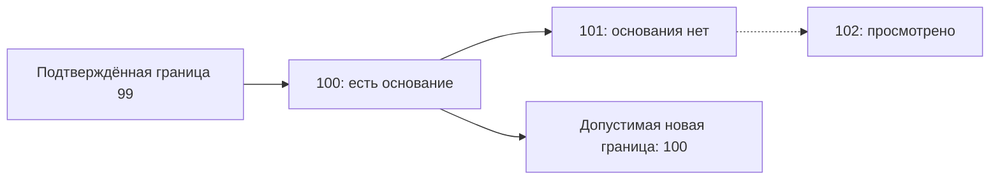

# Telegram и текущая загрузка истории

29 октября 2026. **Проект, без реализации и внешних действий.** Продолжение
[схемы хранения](storage-redesign.md), [фидов](storage-feeds-schema.md) и
[Publication/Job](storage-core-schema.md). Здесь семь оставляемых таблиц;
целевое число таблиц всей базы остаётся 20. SQL не запускался.

## Какие факты нужны отдельно

| Таблица | Сохраняемый факт |
| --- | --- |
| `telegram_profiles` | Какая проверенная личность связана с ролью аккаунта |
| `telegram_bindings` | Каким способом фид использует аккаунт и какие отметки разрешены |
| `telegram_claim_owners` | Какому фиду принадлежит подтверждённый peer/username |
| `telegram_read_state` | Граница прочитанного для конкретного аккаунта и канала |
| `telegram_read_members` | Основания отметки отдельных сообщений, ещё нужные для продвижения границы |
| `initial_history` | Параметры и состояние текущего подбора последних N публикаций |
| `history_members` | Какие публикации вошли в подбор и чем закончилась их загрузка |

Это не семь обработчиков. Все внешние операции Telegram и истории выполняет
существующий крон сбора. Настройки, курсор и личные учётные данные не дублируются
в каждой таблице.

## telegram_profiles — 7 колонок

```sql
CREATE TABLE telegram_profiles (
    role        text PRIMARY KEY CHECK (role IN ('personal', 'collection')),
    session_ref text NOT NULL CHECK (session_ref <> ''),
    user_id     bigint UNIQUE CHECK (user_id > 0),
    generation  bigint NOT NULL DEFAULT 0 CHECK (generation >= 0),
    state       text NOT NULL DEFAULT 'unavailable'
                CHECK (state IN ('ready', 'unavailable', 'identity_mismatch')),
    checked_at  timestamptz,
    message     text,
    CHECK (state <> 'ready' OR user_id IS NOT NULL)
);
```

`session_ref` — ссылка на существующую конфигурацию аккаунта, не байты сессии,
пароль или токен. `user_id` — подтверждённая Telegram-личность. Две роли не могут
незаметно оказаться одним аккаунтом; UNIQUE обеспечивает это и при конкурентных
операциях. NULL допускает ещё не подтверждённую личность.

Поколение меняется при замене/отзыве контекста доступа. Обычная запись времени
проверки не создаёт новое поколение. Ответ проверки относится к захваченному
поколению; поздняя проверка не подтверждает уже заменённую сессию.

После restart аккаунт сначала перепроверяется. Пока личность недоступна или
не совпадает с ожидаемой, внешние операции этого аккаунта не допускаются.
Сохранённый локальный контент остаётся доступным. Замена user_id при существующих
bindings не выполняется как простое редактирование строки: требуется явный
переход связанного доступа и его read state.

## telegram_bindings — 5 колонок

```sql
CREATE TABLE telegram_bindings (
    feed_id       text PRIMARY KEY REFERENCES feeds(id) ON DELETE RESTRICT,
    profile_role  text REFERENCES telegram_profiles(role) ON DELETE RESTRICT,
    generation    bigint NOT NULL DEFAULT 1 CHECK (generation > 0),
    read_history  boolean NOT NULL DEFAULT false,
    auto_read     boolean,
    CHECK (profile_role IS NOT NULL OR (auto_read IS NULL AND NOT read_history))
);
```

Способ получения задаёт `feeds.adapter`. При веб-доступе profile_role=NULL и
внешняя отметка прочитанного отсутствует. Клиентский adapter требует выбранной
роли с подтверждённой личностью. Согласованность adapter и binding проверяет
одна операция Python; FK не проверяет значение колонки другой таблицы.

| auto_read | Что разрешено |
| --- | --- |
| NULL | Read sync не настроен/неприменим; внешняя отметка не выполняется |
| false | Основание — явное «Просмотрено» в Око |
| true | Дополнительно допускается подтверждённое полное сохранение публикации |

`read_history` — отдельное явное разрешение обработать старую историю до начальной
границы. Его не включают только потому, что пользователь добавил фид или выбрал
аккаунт для сбора. Nullable auto_read переносится без автоматического превращения
неизвестного выбора в разрешённое действие.

Peer берётся из подтверждённой внешней идентичности фида, а не редактируется ещё
раз в binding. Username не является надёжной заменой личности канала; alias facts
находятся в claims. В feeds.config не сохраняется вторая копия binding.

Смена роли, adapter или разрешений read sync увеличивает binding generation и
закрывает допуск старых read Job. Смена доступа не означает смену самого канала:
peer должен быть подтверждён тем же. Переход на другой аккаунт не переносит его
границу прочитанного; правила этого случая описаны ниже.

## telegram_claim_owners — 5 колонок

```sql
CREATE TABLE telegram_claim_owners (
    kind        text NOT NULL CHECK (kind IN ('peer', 'username')),
    value       text NOT NULL CHECK (value <> ''),
    feed_id     text NOT NULL REFERENCES feeds(id) ON DELETE RESTRICT,
    evidence    jsonb NOT NULL CHECK (jsonb_typeof(evidence) = 'object'),
    observed_at timestamptz,
    PRIMARY KEY (kind, value)
);

CREATE INDEX telegram_claims_feed ON telegram_claim_owners (feed_id);
```

Предлагается один текущий владелец нормализованного alias. Это усиливает прежний
ключ `(kind, value, feed)` и закрывает конкурентное создание двух фидов по одному
username. Если старые данные уже содержат разных владельцев одного alias,
миграция сообщает конфликт и не выбирает победителя сама.

Evidence хранит способ и основание сопоставления, например проверку канала через
клиент и наблюдавшийся peer. Это небольшой факт подтверждения, не история сообщений.
Старый текст evidence можно перенести как legacy note; неизвестное время остаётся
NULL и не выдаётся за новую проверку.

Username может перейти другому каналу. Противоречие между новым подтверждённым
peer и прежним evidence останавливает автоматическое обновление. Добавление
нового alias не меняет Feed.id; конфликт с существующим владельцем не запускает
автоматическое слияние. При удалении фида Python явно удаляет его claims.

## telegram_read_state — 7 колонок

```sql
CREATE TABLE telegram_read_state (
    feed_id          text PRIMARY KEY
                     REFERENCES telegram_bindings(feed_id) ON DELETE RESTRICT,
    account_user_id  bigint NOT NULL CHECK (account_user_id > 0),
    peer_id          bigint NOT NULL CHECK (peer_id <> 0),
    initial_boundary bigint CHECK (initial_boundary >= 0),
    confirmed        bigint NOT NULL DEFAULT 0 CHECK (confirmed >= 0),
    needs_sync       boolean NOT NULL DEFAULT true,
    waiting_reason   text NOT NULL DEFAULT ''
);

CREATE INDEX telegram_read_pending
    ON telegram_read_state (feed_id) WHERE needs_sync;
```

Account и peer здесь — идентичность факта подтверждения. Они намеренно сохраняются
рядом с confirmed: число, полученное для одного аккаунта/канала, нельзя применять
к другому только потому, что Feed.id остался тем же. Владелец операции сравнивает
их с актуальным profile/binding/feed перед каждым внешним действием.

`confirmed` — последняя известная подтверждённая граница в этом контексте;
`initial_boundary` — установленная граница старой истории до начальной выборки.
Её нельзя вычислять из времени подключения или из максимального локального ID.
Пока нужная граница не установлена, соответствующая внешняя отметка не допускается.

Таблица не хранит вторую ошибку попытки, retry deadline и signature всего списка
eligible. Ошибка и срок принадлежат Job `read`; waiting_reason объясняет обычное
ожидание предыдущего сообщения/выборки, которое само по себе не является сбоем.
Старая `telegram_read_dirty` заменяется одной колонкой needs_sync.

## telegram_read_members — 5 колонок

```sql
CREATE TABLE telegram_read_members (
    feed_id    text NOT NULL
               REFERENCES telegram_read_state(feed_id) ON DELETE RESTRICT,
    message_id bigint NOT NULL CHECK (message_id > 0),
    saved      boolean NOT NULL DEFAULT false,
    viewed     boolean NOT NULL DEFAULT false,
    missing    boolean NOT NULL DEFAULT false,
    PRIMARY KEY (feed_id, message_id)
);

CREATE INDEX telegram_read_candidates
    ON telegram_read_members (feed_id, message_id)
    WHERE NOT missing AND (saved OR viewed);
```

Предлагаются два независимых основания вместо пары eligible/reason:

- `saved`: есть подтверждённый факт полного сохранения этого сообщения/альбома.
- `viewed`: пользователь явно завершил его разбор в Око.

Эффективное основание: `viewed OR (auto_read IS TRUE AND saved)` при NOT missing.
Запись saved не стирает viewed. Выключение auto_read не стирает факты, но больше
не использует saved как самостоятельное основание.

Saved записывается владельцем сохранения независимо от текущего auto_read:
это факт, а не разрешение выполнить RPC. Операции сбора/медиа и изменения
зависимостей явно обновляют затронутые основания; обычный read sync не сканирует
заново весь фид ради поиска давно сохранённых публикаций. При первом подключении
client-доступа или переносе старой схемы допустимо отдельное ограниченное по
порциям восстановление фактов из подтверждённых данных тем же кроном сбора.

Полное сохранение — принятие обязательного содержимого и файлов, включая нужные
зависимости, а не одна запись Publication или готовые тезисы. Ошибка скачивания
и подтверждённо недоступный обязательный файл не превращаются в полный успех.
Сохранённый факт относится к сообщению, а не к отображаемому статусу модели.

Для Telegram-альбома записываются ID его сообщений. Одна Publication не означает
один message_id. До удаления просмотренного контента операция переносит нужные
основания во все соответствующие bindings. FK на publications здесь нет: эти
служебные факты должны пережить удаление её текста.

Missing устанавливается только по проверенному окну внешней истории. Пробел
между двумя целыми ID сам по себе не доказывает удаления. Повторное наблюдение
сообщения снимает missing. Строки не хранят текст и медиа.

Для ограничения роста предлагается порционная очистка строк не выше confirmed
после сохранения подтверждения для того же аккаунта/peer. Повторная история не
обнуляет confirmed. Это не аудит всех прочтений: старые основания после надёжно
пройденной границы для будущего продвижения не нужны.

## Как безопасно продвигается граница

Telegram принимает max_id — границу, до которой сообщения отмечаются прочитанными.
Это подтверждено [описанием channels.readHistory](https://core.telegram.org/method/channels.readHistory).
Поэтому максимальный из локально просмотренных ID не является безопасным решением.

Иллюстративный пример, auto_read=true:

| Сообщение | Основание | Можно пройти |
| --- | --- | --- |
| 100 | Полностью сохранено | Да |
| 101 | Нет основания и внешнего подтверждения прочтения | Нет |
| 102 | Просмотрено в Око | Пока нет: перед ним 101 |



Крон сбора читает фактическую внешнюю границу и ограниченное окно сообщений.
Он идёт по возвращённым сообщениям, а не по всем целым числам между ID. Пройти
сообщение можно по локальному основанию, подтверждённому внешнему прочтению
или явному read_history в установленной старой области. Первое препятствие
останавливает продвижение. Неполное окно продолжается следующей попыткой;
неизвестная часть не объявляется прочитанной.

Перед отправкой проверяются Job/generation, личность аккаунта, peer, поколения
profile/binding, текущие разрешения и общий допуск. RPC выполняется вне SQL.
После ответа подтверждение сохраняется только в тот же актуальный контекст.
Локальная отметка не продвигается вперёд до внешнего подтверждения.

Если Telegram принял отметку, а процесс упал до commit, следующая попытка сначала
сверяет состояние Telegram. Ошибка/потеря ответа не доказывает отсутствие внешнего
эффекта. SQL и RPC не образуют общую транзакцию: изменение настройки после отправки
RPC не может гарантированно отменить уже отправленную отметку. Оно закрывает новые
отправки и допуск старого ответа к новому контексту, но не «откатывает Telegram».

### Не потерять новые события во время запроса

Предлагаемый порядок работы с needs_sync:

1. Операция страницы, полного сохранения или просмотра пишет факты и needs_sync=true
   в одной транзакции.
2. Подготовка read Job блокирует read_state, сохраняет снимок и снимает флаг в той же
   транзакции, в которой создаёт/захватывает Job. До внешнего вызова всё уже сохранено.
3. Новые события во время RPC снова ставят true. Они не отменяют безопасный уже
   отправленный префикс, если доступ и личность не изменились.
4. Завершение старой Job обновляет confirmed/ожидание, **но не снимает needs_sync**.
   Новый true остаётся для следующего прохода.

При rollback подготовки флаг остаётся. При сбое после commit сохраняется Job для
восстановления; при ошибке попытки её retry работает и без нового сигнала.
Если выборка истории ещё не готова, её завершение обязательно ставит needs_sync
снова. Одного volatile-флага процесса для этих случаев недостаточно.

### Смена аккаунта или способа доступа

Изменение binding закрывает прежние Job/generation в той же транзакции.
Для того же подтверждённого user_id и peer граница может сохраняться, например
при обновлении ссылки на сессию. Для другого аккаунта предлагается удалить старые
members и начать read_state заново после проверки его внешнего состояния.
Старые confirmed и основания не становятся разрешением для новой личности.
Сохранённые публикации при этом не удаляются; факты полного сохранения для нового
контекста можно восстановить только по реально доступным данным и настройке auto_read.

При веб-доступе внешнее прочтение не выполняется. При переходе обратно на client
личность, права и граница устанавливаются явно. Удаление фида является локальным
действием и не создаёт новых оснований отметить историю Telegram прочитанной.

Неизвестная начальная граница запрещает пользоваться read_history для неизвестной
старой области. Она не заменяет остальные основания: продвижение по явно просмотренным
сообщениям возможно лишь если весь соответствующий префикс независимо проверен
от внешней подтверждённой границы и не содержит неподтверждённых препятствий.
Отмена подбора N сама по себе не разрешает отметить всю оставшуюся историю.

## initial_history — 7 колонок

```sql
CREATE TABLE initial_history (
    feed_id            text PRIMARY KEY REFERENCES feeds(id) ON DELETE RESTRICT,
    run_id             uuid NOT NULL UNIQUE,
    requested_count    bigint NOT NULL CHECK (requested_count > 0),
    selection_started  boolean NOT NULL DEFAULT false,
    selection_complete boolean NOT NULL DEFAULT false,
    control_state      text NOT NULL DEFAULT 'active'
                       CHECK (control_state IN ('active', 'paused', 'cancelled')),
    adapter_state      jsonb NOT NULL DEFAULT '{}'
                       CHECK (jsonb_typeof(adapter_state) = 'object'),
    CHECK (NOT selection_complete OR selection_started)
);
```

Одна строка на фид описывает только текущую/последнюю выбранную загрузку истории,
а не архив всех запусков. Run ID меняется при новом явном подборе. Requested count
считает уникальные публикации, не отдельные сообщения альбома и не обязательно
число новых карточек: уже известная публикация может войти в подбор.

`adapter_state` содержит установленную границу подбора и подтверждённые сведения
о его ограничениях: warnings, stop_reason и непрозрачные данные adapter. Текущая
позиция обхода остаётся в feeds.cursor. Count/control flags не копируются ещё раз
в редактируемые поля adapter_state. Внешние ошибки/сроки попытки берутся из Job;
недобор из-за доступной глубины источника является отдельным итогом подбора.

Устанавливается фиксированная верхняя граница. Новые сообщения после неё не
расширяют задним числом выбранные «последние N». Переход к обычному сбору после
завершения/отмены использует правила cursor конкретного adapter, а не арифметику
ID или универсальное присваивание пустого cursor.

### Начало, продолжение, пауза

- Принятая страница, её memberships, history_members, cursor и прогресс подбора
  сохраняются одной транзакцией с проверкой run_id и поколения discover Job.
- Пауза сохраняет выборку, границы и cursor. Возобновление не создаёт новую историю
  и не отменяет обязательный source wait.
- Отмена фиксирует control_state=cancelled, закрывает допуск старых действий этой
  истории и сохраняет уже собранные публикации. Обычный сбор получает корректную
  позицию продолжения; просмотренные данные не возвращаются от поздней страницы.
- Новый подбор получает новый run_id. Старые history_members явно очищаются до
  замены ключа; старый ответ не может добавить их в новый run.
- Пауза/отмена не прекращают работу, которая независимо нужна другому владельцу.
  Scope затронутых Job определяется явно, без массового снятия общих задач.

Уточнение после сценарной проверки: пауза переводит принадлежащую только этому
run незавершённую работу в blocked, отмена — в cancelled, не в done. Статус
публикации при этом может оставаться pending_collection: содержимое ещё не
получено, но запрос на загрузку приостановлен/отменён. Обычный polling не создаёт
его заново. Возобновление, новый подбор или новое независимое основание явно
подготавливают Job; пересоздание run само по себе не возобновляет весь прежний
отменённый набор. Сохранённая cancelled Job переживает удаление старых history_members.

При общей публикации операция сначала проверяет другие действующие основания
работы. Один paused/cancelled run не должен заблокировать fetch, нужный другому
фиду или текущей публикации-родителю. Старый код cancel_history записывает done;
при переносе такой исход преобразуется в cancelled только при подтверждённой
связи с отменённой историей, а не объявляется успешной загрузкой.

Selection_started отличается от selection_complete: первый принятый фрагмент
подбора уже может существовать, пока верхний состав ещё не установлен полностью.
Пустая, но законченная выборка отличается от ещё не начавшейся. Статус UI
pending/selecting/loading/paused/waiting/done/cancelled вычисляется из этих фактов,
контроля и Job; отдельная таблица статусов не вводится.

## history_members — 3 колонки

```sql
CREATE TABLE history_members (
    run_id         uuid NOT NULL REFERENCES initial_history(run_id) ON DELETE RESTRICT,
    publication_id text NOT NULL CHECK (publication_id <> ''),
    outcome        text NOT NULL DEFAULT 'pending'
                   CHECK (outcome IN (
                       'pending', 'retrying', 'loaded',
                       'incomplete', 'unavailable', 'viewed'
                   )),
    PRIMARY KEY (run_id, publication_id)
);

CREATE INDEX history_members_publication ON history_members (publication_id, run_id);
```

FK на Publication намеренно нет: итог загрузки должен пережить просмотр и удаление
её содержимого. Publication ID остаётся служебным идентификатором, а не способом
восстановить удалённый текст. Feed определяется через run, не хранится второй раз.

Сохраняется текущая семантика outcome: `viewed` обозначает завершение просмотра
до завершённой загрузки; уже loaded/incomplete запись не перестаёт быть фактом
загрузки только из-за последующего просмотра. Loaded не означает, что текст
до сих пор хранится. Общий прогресс считается по текущему run, не по всем Job
библиотеки и не по сокращающейся очереди.

Поздняя страница старого run не меняет состав нового. При этом принятый актуальный
результат загрузки самой публикации может обновить outcomes всех текущих run,
которые действительно содержат её: готовность общего объекта не принадлежит
одному инициатору. Это обновление по текущему факту под блокировкой, а не запись
старого outcome из захваченного до отмены снимка.

До полного окончания подбора доступное число публикаций ещё не является итоговым
недобором. После завершения сравниваются requested_count и число уникальных members;
причина ограничения сохраняется и показывается. Ошибка источника не выдаётся за
естественное окончание истории.

## Перенос и проверки

| Старое поле/таблица | Предлагаемый перенос | Нельзя делать |
| --- | --- | --- |
| `telegram_profiles.account`, checked | session_ref, checked_at | Копировать файлы сессии в БД или выдумывать подтверждение личности |
| JSON binding и флаги в feeds | profile_role/generation/read_history/auto_read | Держать вторую изменяемую копию binding в feeds.config |
| `telegram_peer` и username | Внешняя идентичность и claims | Считать совпадение username доказательством того же peer |
| Claims с несколькими владельцами | Конфликт до переключения | Молча выбрать одну строку для нового PK |
| `telegram_read_dirty` | needs_sync=true для соответствующих read_state | Терять ожидающую сверку при очистке старой таблицы |
| read_state.error и retry | Ошибка/срок соответствующей read Job | Выдумывать успешную внешнюю попытку либо обнулять ожидание при переносе |
| Read state без account/peer контекста | Подтверждённая привязка к прежнему аккаунту и каналу | Приписывать confirmed новому аккаунту по текущему случайному binding |
| eligible/reason | saved/viewed по фактическому основанию | Приравнивать неизвестный reason к разрешённому внешнему действию |
| `initial_history.selection`, frozen, scan_complete | run/count/flags/adapter_state | Считать старый default scan_complete=true завершённой выборкой при frozen=false |
| `history_members(feed,item,outcome)` | run_id/publication_id/outcome | Удалять outcomes по FK вместе с просмотренной публикацией |
| Старый режим since/date | Подтверждённая граница либо отчёт о непереносимости | Незаметно заменять активное окно новой count-выборкой |

При отсутствующем старом run-токене можно назначить новый служебный UUID при
атомарном переносе всего текущего run и его Job. Это новая идентичность допуска,
а не вымышленная историческая дата. Неоднозначная личность или граница read state
не имеют молчаливого преобразования: предварительная сверка сообщает проблему,
а переключение откладывается до решения о переносе этих фактов. Исходная
библиотека и backup сохраняются; read sync не запускается с выдуманным контекстом.

Будущие синтетические сценарии приёмки:

- Два соединения пытаются назначить одинаковый аккаунт двум ролям или один alias
  разным фидам: одна согласованная запись, явный конфликт второй.
- Смена profile/binding во время проверки или RPC: нет записи подтверждения
  в новый контекст; уже отправленный внешний эффект не объявляется откатанным.
- Сообщения 100/101/102, пробелы ID, альбом и внешне прочитанные сообщения:
  граница не перескакивает первое неподтверждённое препятствие.
- Auto_read=false: saved не достаточно, viewed достаточно; смена режима не
  уничтожает факты и не теряет уже принятую внешнюю границу.
- Полное сохранение с незагруженной статьёй/файлом не признаётся завершённым;
  явный просмотр сохраняет своё отдельное основание.
- Новый needs_sync во время read Job остаётся после её завершения.
- Падения до/после подготовки, внешнего acknowledge и commit дают восстановимый
  результат без ложного локального подтверждения.
- При смене аккаунта прежние confirmed/members не применяются к новой личности.
- История: повтор страницы, новый run, pause/resume, cancel, недобор, сообщения
  после фиксированной границы и просмотр до окончания загрузки.
- Удаление общего объекта не стирает текущие исходы истории и нужные read-факты.

## Фактическая проверка документа

Прочитаны текущие `read_sync.py`, `telegram.py`, `history.py`, read/recovery Job
и внешний вызов в CollectionWorker. Кумулятивный max_id проверен по первичной
документации Telegram. Число колонок, уникальность имён, локальные ссылки и
форматирование проверены автоматически; DDL и Mermaid просмотрены вручную.
Реальные аккаунты, подписки, Telegram API и PostgreSQL не использовались;
SQL, миграции и сценарии восстановления не запускались.
