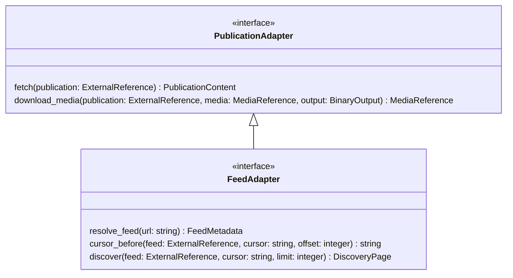
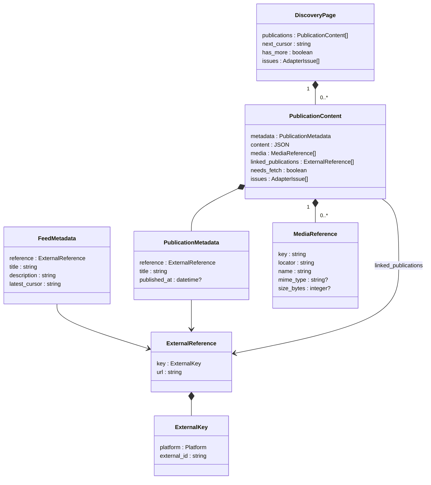
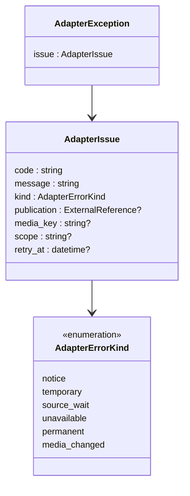

# API адаптеров

Внутрипроцессный контракт Python. UML показывает интерфейсы и типы данных;
OpenAPI остаётся форматом действующего HTTP API читателя и здесь не требуется.
Адаптер знает внешний протокол и получает настройки доступа при создании.
Он не получает соединение БД, внутренние ID, enabled или расписание.

## Интерфейсы

Все операции асинхронные. `BinaryOutput` — открытый оркестратором поток байтов;
адаптер пишет в него, оркестратор владеет файлом и завершает сохранение.

- `resolve_feed` возвращает метаданные и курсор последней публикации на момент запроса.
- `cursor_before`: offset=0 оставляет позицию; для последних N используется N−1.
  Пропуски ID и альбомы считает адаптер. При нехватке истории возвращается самая
  старая доступная позиция, при пустой истории — пустая строка.
- `discover` идёт от старых публикаций к новым, включая начальную позицию.
  Курсор хранит верхнюю границу текущего прохода; следующая страница не повторяет
  предыдущую. После завершения окна следующий регулярный запуск открывает новое.
- `fetch` возвращает тот же внешний тип публикации, что и элементы discover.
  Если содержимое уже получено, needs_fetch=false; файлы скачиваются независимо.
- `download_media` возвращает уточнённые свойства того же ресурса. Истёкший locator
  обновляет адаптер через исходную публикацию. Если ресурс заменён — media_changed;
  оркестратор обновляет публикацию через fetch, не записывает другой файл под старым ID.

## Данные

`?` означает nullable. Списки могут быть пустыми; content до получения равен `{}`,
не null. Неизвестный заголовок — пустая строка. Внешние ключи вычисляет только адаптер.

Platform: telegram, youtube, telegraph, instagram, twitter, other_web, rss.
PublicationContent — транспортный ответ, не дополнительная сущность базы.

В `$media` исходного JSON находится key ресурса внутри публикации; media содержит
описания с locator. Перед сохранением Око заменяет key внутренним ID. Связанная
публикация передаётся через ExternalReference и при сохранении получает publication_id.
Недобор истории определяется по запрошенному N и доступным уникальным публикациям
после завершения обхода; причины ограничения передаются в issues.

## Диагностика и ошибки

Issues вместе с результатом означают полезную частичную загрузку. Исключение
означает отсутствие принимаемого результата операции. Notice — только информация
(например, подтверждённое отсутствие субтитров), не причина повтора или исключения.
Source_wait требует scope и retry_at. Неизвестные внешние ссылки не выдумываются.
Остальные категории определяют временный повтор, ожидание доступности, остановку
до ручного повтора или обновление описания заменённого ресурса.

Сохранение страницы и курсора атомарно. Ошибка всей страницы не продвигает курсор.
Подробные правила выполнения, медиа и миграции — в
[итоговой спецификации](https://github.com/tgenman/oko/issues/89).
