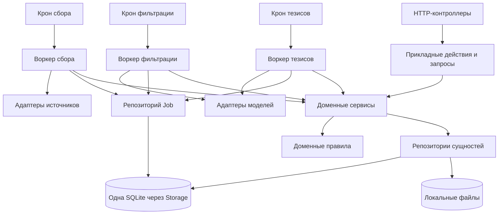
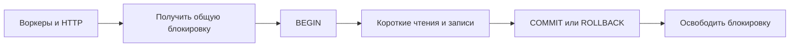
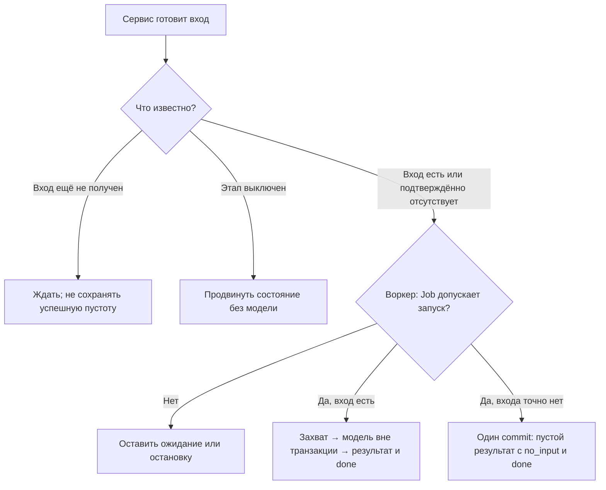
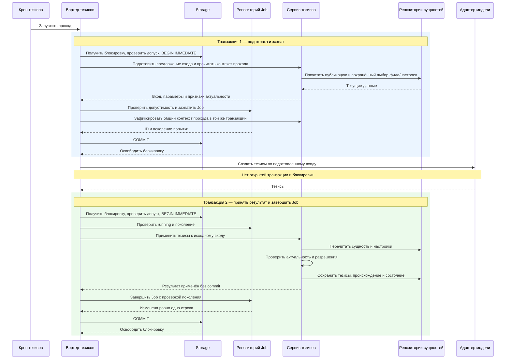
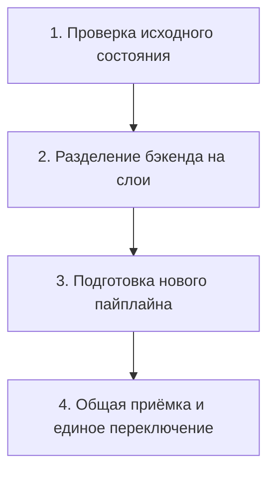
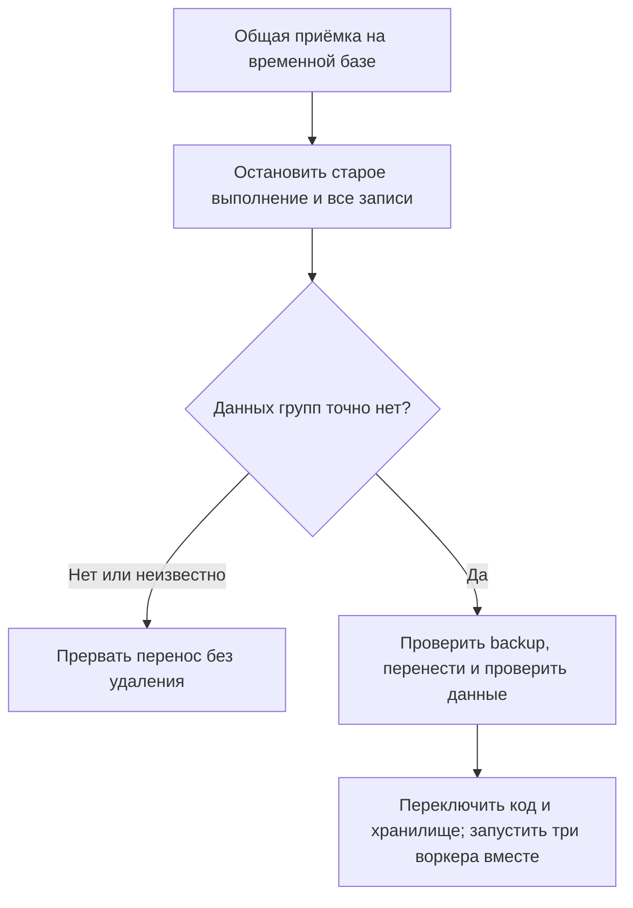
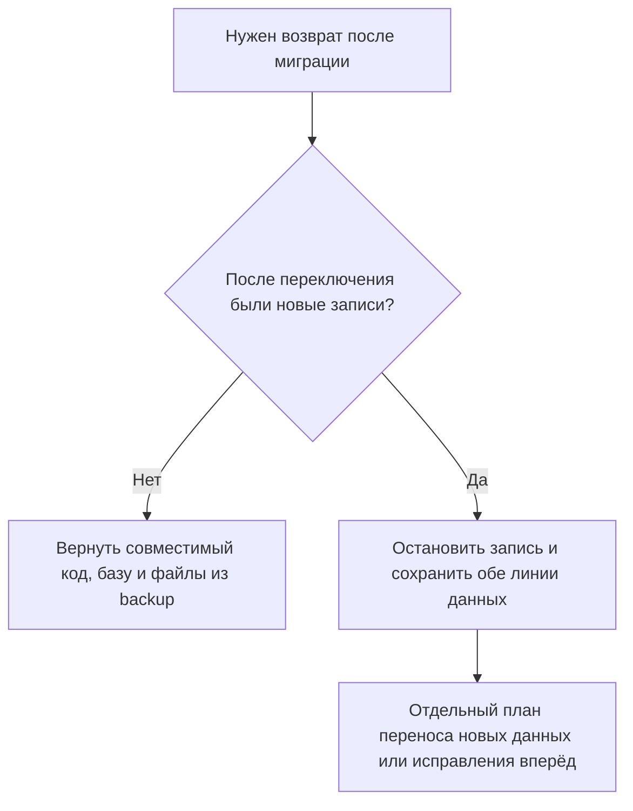

# Бэкенд: сервисы, воркеры и SQLite

Целевая архитектура, 2026-10-24. Это проект, а не отчёт о реализации.
Подробности: [архитектура](../architecture/backend-layers-design.md) и
[план перехода](../architecture/backend-layers-migration.md).

## Кто кого вызывает

Воркеры управляют заданиями и вызывают адаптеры. Сервисы работают с доменными
сущностями через репозитории. Воркеры не вызывают друг друга. У каждого свой крон.



| Участник | Ответственность |
|---|---|
| Контроллер | Разбирает HTTP-запрос, вызывает действие и возвращает ответ |
| Прикладное действие | Выполняет команду пользователя; при необходимости объединяет изменение сущности и отмену заданий |
| Воркер | Создаёт и захватывает Job, вызывает адаптер, назначает повторы, отменяет и завершает Job |
| Доменный сервис | Готовит вход, проверяет правила и актуальность, применяет результат к сущностям; без Job и вызовов адаптеров |
| Репозиторий | Читает и записывает данные в переданном контексте; сам не делает commit |
| Storage | Владеет одним соединением SQLite, общей блокировкой, транзакциями и файлами |
| Адаптер | Выполняет внешний запрос и возвращает результат или ошибку |

Точка входа открывает и восстанавливает хранилище, запускает HTTP и три крона.
При завершении она останавливает их и закрывает соединение. Runtime над пайплайном нет.
Это решение пользователя заменяет фразу #89 «Runtime владеет выполнением/отменой».
Дополнительно принято единое переключение всех трёх воркеров и удаление старого
пути групп Telegram с проверкой отсутствия данных. Эти решения заменяют требование
#89 сохранять групповой путь и возможность раздельных рабочих переключений.
Остальные продуктовые правила #89 остаются в силе.
HTTP-проверки подключения используют отдельный прикладной сценарий с внешним
вызовом. Отмена Job из HTTP выполняется через интерфейс управления заданиями
воркера в транзакции прикладного действия; доменный сервис не управляет Job.

## Одно соединение, короткие транзакции

SQLite допускает одну транзакцию записи на базу. В нашем проекте соединение тоже
одно. Все операции с ним проходят через общую блокировку Storage, включая снимки
чтения. Чтение не попадает внутрь чужой незавершённой записи.



Сервисы и репозитории внутри операции используют один контекст транзакции.
Они не открывают собственную транзакцию и не захватывают блокировку повторно.
Внутри транзакции нет await. Сетевые вызовы и скачивание файлов идут вне неё.

```text
Время →
Тезисы:  [захват Job] ─────── запрос модели ─────── [результат + done]
Сбор:                 [захват Job] ── запрос источника ── [запись]
```

Это пример порядка, а не измерение времени. Участки в квадратных скобках используют
соединение по очереди. Запросы модели и источника могут выполняться одновременно.
Каждая запись заново проверяет допуск и актуальность после внешнего ожидания.

## Подготовка не всегда приводит к вызову модели



Сервис определяет доменный исход. Воркер решает, можно ли запускать Job.
failed/unavailable не переоткрываются только потому, что публикация ждёт обработки.
Нужно основание по #89: например, явный повтор или изменение доступности.
Обязательное ожидание источника сохраняется. filter_out завершает обработку
публикации без тезисов; это отдельный результат, не отсутствие входа.

## Пример: создание тезисов

Ниже показана ветка, в которой вход есть и Job допускает вызов модели.



Первый commit фиксирует захват задания и контекст попытки. До этого воркер не
вызывает модель. Пока он ждёт ответ, другие воркеры и HTTP используют базу.

Второй commit сохраняет тезисы и done вместе. Сервис и репозиторий Job работают
на одном соединении внутри одной транзакции, которую открыл воркер через Storage.
Если сервис отверг результат или завершение Job не прошло проверку поколения,
Storage выполняет rollback обеих частей и освобождает блокировку.

Падение после записи тезисов, но до commit не оставляет частично принятого
результата. Падение после commit оставляет и тезисы, и done. После перезапуска
незавершённая попытка может повторить внешний запрос; exactly-once для сети нет.

Файлы не входят в транзакцию SQLite. Загрузка в staging проходит без блокировки
соединения. Готовый файл защищён от очистки до приёма/отказа; затем одна SQL-транзакция
фиксирует ссылку на файл и done. После rollback может остаться лишний файл для
очистки, но готовая запись не должна ссылаться на ещё не сохранённый файл.

## Догрузка статьи и общий контекст обработки

Фильтрация и тезисы общей публикации используют один выбранный фид и набор
настроек на весь проход. Сервис сохраняет выбор в processing_metadata при первом
допущенном этапе. Воркер тезисов продолжает этот выбор после фильтрации и после
перезапуска. Он не выбирает случайно настройки другого фида. Изменение входа или
правил создаёт новый проход; смена модели/Fast сама по себе этого не делает.

```mermaid
sequenceDiagram
    participant C as Воркер сбора
    participant P as Сервис публикаций
    participant D as Хранилище
    participant W as Воркер тезисов
    C->>P: Статья догружена
    P->>D: Новый текст, инвалидация корня и новая ревизия входа
    Note over C,D: Один commit; сервис не меняет Job
    W->>D: На своём кроне прочитать ревизию через сервис
    W->>D: Согласовать свою Job с новым поколением
    Note over W,D: Старый ответ или ошибка не пройдут проверку ревизии
```

Ревизия входа и поколение Job — разные значения. Изменение ревизии сразу запрещает
старой попытке записать ответ. Владелец Job обновляет её на своём проходе; воркеры
не вызывают друг друга. Если приложение упало между этими шагами, новый вход
остаётся в базе и будет обработан после восстановления.

## Переход и возврат



| Этап | Внутренние подзадачи |
|---|---|
| 1. Исходное состояние | Проверить код, данные, состояние #89 и отсутствие данных групп |
| 2. Слои бэкенда | Общие транзакции и интерфейс Job → пилот настроек → подписки, подключения, чтение и действия |
| 3. Новый пайплайн | Подготовить три воркера и общий контекст обработки; проверить гонки и сбои; убрать старые входы и путь групп из целевого кода |
| 4. Приёмка и переключение | Проверить всё вместе на временной базе; остановить старое выполнение; повторить проверку групп; проверить backup и перенос; запустить три воркера вместе |

Подзадачи и проверки подробно сохранены в
[плане перехода](../architecture/backend-layers-migration.md). Этапы 1–3 не
переключают рабочий пайплайн. Четыре этапа не означают четыре коммита: внутри
каждого допускаются несколько проверяемых изменений.

Детали единственного рабочего переключения относятся к этапу 4:



Минимальный интерфейс Job выделяется до пилота. Подготовку можно делать несколькими
изменениями, но рабочее переключение одно. До него работает старый полный путь;
после — все три новых воркера. Смешанного режима между ними нет.

Старый путь групп удаляется из нового кода. До миграции проверяются не только
публикации, но и пустые групповые подключения, настройки, сообщения/темы, задания,
история и ссылки на файлы. Проверка повторяется после остановки всех записей.
Если данные групп есть или тип объекта неизвестен, перенос останавливается
без удаления данных. Telegram-каналы, включая клиентский доступ, остаются.
Удаление программного пути групп не разрешает уничтожать найденные данные.



После новых записей автоматический rollback с потерей данных запрещён.
Сохранить новые записи в архив недостаточно, чтобы разрешить убрать их из
рабочего состояния. Старое хранилище не уничтожается. Это условия будущей
миграции, не разрешение запускать её сейчас.
