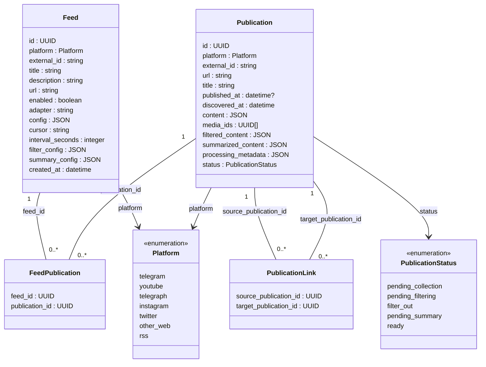

# Сущности базы

Текущий эскиз сущностей проектируемого пайплайна.

Выполнение хранится в служебной таблице [Job](jobs.md), основанной на текущей
`jobs`. Статусы публикации и медиа отделены от состояния конкретного запуска.

## Связь фида и публикации

Связь многие ко многим: фид может содержать несколько публикаций,
а публикация — принадлежать нескольким фидам или существовать без фида.
Записи разных RSS-лент — отдельные публикации. Они могут ссылаться на одну
публикацию-статью; эта ссылка сама по себе не означает принадлежность статьи RSS-фиду.

Таблица `FeedPublication` хранит принадлежность:

- `feed_id` — внешний ключ на `Feed.id`.
- `publication_id` — внешний ключ на `Publication.id`.
- Составной первичный ключ — `(feed_id, publication_id)`.

Таблица `PublicationLink` хранит направленную ссылку между публикациями:

- `source_publication_id` — внешний ключ на `Publication.id` публикации, содержащей ссылку.
- `target_publication_id` — внешний ключ на `Publication.id` публикации, на которую ссылаются.
- Составной первичный ключ — `(source_publication_id, target_publication_id)`.

Одна пара записывается один раз. `PublicationLink` фиксирует наличие связи,
а не каждое вхождение ссылки в тексте. Обратная связь автоматически не создаётся.
Например, RSS-запись связана с RSS-фидом через `FeedPublication` и с веб-статьёй
через `PublicationLink`. Прямая принадлежность статьи RSS-фиду из этого не следует.

Правила удаления связанных записей и ограничения на циклы и ссылки на себя
пока не определены.

## Внешняя идентичность

Внешний ключ фида — `(platform, external_id)`. Feed и Publication используют
общий enum `Platform`. Уникальность обеспечивается отдельно в каждой таблице.
`Feed.external_id` определяет поток внутри платформы.
Для YouTube это ID канала, для RSS — URL ленты.
Для Telegram действует правило заполнения:

- Пока настоящий ID канала Telegram неизвестен, `external_id = url`.
- Когда настоящий ID получен, `external_id` заменяется на ID Telegram
  в строковом виде в той же записи фида.

Внутренний `Feed.id` и связи с публикациями при этом сохраняются.
Отдельное поле `username` этим решением не добавляется.
Таким образом, внешний ключ Telegram-фида может уточняться после создания.
При конфликте с уже существующим внешним ключом показываем ошибку пользователю
и не фиксируем изменение; уникальность обязательна, автоматического слияния нет.
Правила нормализации URL и уточнение внешних ключей ранее собранных публикаций
ещё предстоит определить.

Тип потока и адаптер доступа — отдельные понятия. Например, Telegram-канал
можно читать через веб или аккаунт. Выбранный адаптер и настройки сбора хранятся
прямо в Feed: `adapter`, `config`, `cursor`, `interval_seconds`. Отдельной таблицы
FeedCollection нет (решение 69 заменяет прежнее разделение). У фида один активный
адаптер, смена выполняется явно, без автоматического перехода на другой способ
доступа при ошибке. Ближайший запуск и ошибки выполнения хранятся в Job.
Запись RSS имеет платформу `rss`
и может ссылаться на публикацию другой платформы.
При смене адаптера старые операции отменяются, поздние ответы не фиксируются.
Сохранённые публикации остаются, незавершённая работа продолжается через новый
адаптер; старый курсор автоматически не переносится.
RSS сайта и HTML-раздел сайта не считаются автоматически одним
фидом: состав публикаций может различаться.

Внешний ключ публикации — `(platform, external_id)`.
Адаптер формирует `Publication.external_id` по правилам платформы, независимо
от внутреннего `Feed.id`. Для YouTube достаточно ID видео, для веб-статьи
предложен канонический URL. Для RSS ключ записи формируется из URL ленты
и ID записи. Принадлежность фидам хранится отдельно от идентичности публикации.
Правила остальных платформ описаны в [модели публикации](publication.md).

Состав полей, обязательность и конкретные типы остаются эскизом, кроме явно
согласованных решений, описанных в [модели публикации](publication.md).

У Publication отсутствующий заголовок — `title = ""`, неизвестная дата источника —
`published_at = null`. `discovered_at` всегда содержит время обнаружения в Око.

## Настройки обработки

`Feed.filter_config` и `Feed.summary_config` содержат включённость этапа, промпт
и настройки обработчика. При начале прохода выбранные настройки фиксируются,
чтобы фильтрация и суммаризация использовали согласованный набор. Настройки
адаптера в `config` остаются отдельными от настроек обработки.

## Сохранение страницы

Обнаруженные публикации страницы, их принадлежность фиду и новый курсор сохраняются
одной короткой транзакцией после получения ответа адаптера. Сбой до фиксации
оставляет прежний курсор; повтор страницы сопоставляет существующие публикации
по `(platform, external_id)`. Курсор не продвигается без сохранения страницы.
