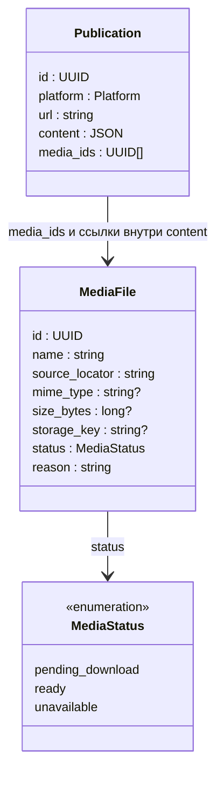

# Медиа и файлы

## Согласованные правила

- Фотографии, видео, аудио и вложения скачиваем и сохраняем локально.
  Исключение для YouTube-видео описано ниже.
- YouTube-видео оставляем внешним. Сохраняем только его обложку и субтитры.
- Содержимое публикации хранит ссылки на внутренние ID медиа.
- `Publication.media_ids` хранит полный список ID медиа публикации отдельно от JSON.
- Адаптер скачивает один элемент медиа за вызов. Управление загрузкой и сохранением
  принадлежит оркестратору.
- Частичный результат допустим: ошибка одного файла не отменяет доступный текст
  и успешно полученные файлы.
- Адаптер пишет байты одного файла в поток, предоставленный оркестратором.
  Оркестратор владеет временным файлом и завершением сохранения; целиком держать
  файл в памяти не требуется.
- Независимые медиа догружаются отдельно от фильтрации и суммаризации.
  Обработка допускается после получения необходимого ей входа: текста для текстовых
  операций, субтитров для YouTube-тезисов, изображений для использующей их операции.
  Отсутствие обложки не задерживает обработку доступных субтитров.
- Ошибка `download_media` сообщается типизированным исключением и относится
  к одному файлу, а не отменяет весь результат сбора.
- Locator — строка, которую интерпретирует адаптер. Для веба это URL; прямой URL
  не требуется от остальных способов доступа. Постоянный ID файла назначает Око.
- Адаптер возвращает ключ ресурса внутри публикации отдельно от locator.
  Подтверждённо тот же ресурс с новым locator сохраняет внутренний ID; новый ресурс
  или невозможность подтвердить тождество требуют нового ID. Дедупликации по байтам нет.
- Временные ошибки повторяются бесконечно с настраиваемой задержкой; счётчик
  и предел попыток исключены. Обязательное ожидание источника соблюдается.
- Пауза распространяется только на указанную адаптером область ограничения,
  а не автоматически на весь фид или весь сбор.
- Для истёкшего locator адаптер получает контекст исходной публикации и обновляет
  адрес того же ресурса. ID файла сохраняется; замена самого ресурса этим правилом
  не разрешается.
- Задержка повторов удваивается от 1 минуты до 1 часа. Начальная и максимальная
  задержки настраиваются; обязательное ожидание источника сохраняет приоритет.
- Заменённый файл получает новый ID. После сохранения нового содержимого старый
  файл можно удалить, если больше нет ссылок. До успешного скачивания замены
  специально его не удерживаем. Физическое удаление выполняет периодическая очистка.
- Общая статья и файлы удаляются только когда больше не нужны другим
  непросмотренным публикациям; собственная непросмотренная принадлежность статьи
  фиду также удерживает её содержимое.
- Новый текст сохраняется независимо от завершения загрузки новых медиа.
  До загрузки показывается ожидание или ошибка нового файла, а не прежнее изображение.
- Неизменившийся вход обработки сохраняет её результат при повторном сборе;
  смена временного URL не является изменением содержимого.
- После обрыва повтор скачивает файл с начала; частичный временный файл удаляется.
- `unavailable` снимается при подтверждённом исчезновении ограничения. Новый
  ресурс получает отдельный ID. Повторное обнаружение не отменяет ожидание источника.
- Смена адаптера отменяет старые операции; их поздние ответы не публикуются.

## Предлагаемая модель

`MediaFile` описывает файл, который нужно скачать или который уже сохранён.
Для внешнего YouTube-видео запись локального файла не создаётся: его адрес
остаётся в `Publication.url`. Обложка и субтитры — отдельные `MediaFile`.

`storage_key` — адрес файла в нашем хранилище. Он отделён от внешнего адреса
получения файла и от постоянного `MediaFile.id`.
`source_locator` — URL или непрозрачные данные получения файла, которые понимает
адаптер. Привязка к нужному адаптеру для повтора после перезапуска ещё не определена.
Неизвестные размер, MIME-тип и ключ хранения представлены `null`. Отсутствующее
имя — `""`. Нулевой размер означает настоящий пустой файл. При `ready` локальный
файл и `storage_key` обязательны. Готовность задаётся статусом.

Роль файла (фотография, вложение, обложка, субтитры) задаётся местом ссылки
в содержимом публикации. Формат блоков и маркера `$media` описан
в [формате содержимого](content-format.md).
`pending_download` — ожидание загрузки или разрешённого повтора; `ready` — файл сохранён;
`unavailable` — подтверждённая недоступность выбранным способом доступа.
Прежний `failed` по исчерпанию попыток исключён вместе с пределом попыток.
Причина хранится отдельно в `reason`. Одиночный сетевой сбой не означает `unavailable`.
Выполняющаяся загрузка отмечается в `Job`, не новым статусом файла. Доступная внешняя ссылка
сохраняется для открытия вне Око.

## Сохранение и очистка

1. Адаптер полностью записывает файл в предоставленный временный поток.
2. Оркестратор перемещает готовый файл в постоянное хранилище.
3. В короткой транзакции проверяет актуальность задания, сохраняет storage_key
   и переводит MediaFile в ready вместе с завершением задания.

Файл сохраняется до ready в БД. При падении или отклонении позднего результата
может остаться неиспользуемый файл, который удалит очистка. Связи и новое
содержимое публикации фиксируются в БД независимо от физического удаления
прежних файлов.

Отдельная периодическая очистка удаляет файлы без пользователей и остатки
прерванных загрузок. Активные скачивания, включая промежуток между перемещением
файла и фиксацией в БД, должны быть защищены от очистки. Удаление большого файла
не выполняется внутри транзакции публикации. Интервал очистки и точный механизм
координации ещё предстоит закрепить.

## Описание медиа в ответе адаптера

`MediaReference` содержит key (ключ ресурса внутри публикации), locator, name,
mimeType и sizeBytes. Последние два значения могут быть неизвестны (`null`).
Список описаний возвращается в `PublicationContent.media`, а `$media` внутри
контента содержит соответствующий key. Перед сохранением оркестратор заменяет
ключи внутренними ID. Контракт приведён в [UML и контрактах адаптеров](adapters.md).
`needsFetch` в PublicationContent относится к получению содержимого публикации;
незавершённое скачивание медиа само по себе не устанавливает его в true.

## Открытые вопросы

- Как связать сохранённый locator с адаптером и контекстом публикации для повтора.
- Как описывается набор необходимых входов для каждого вида обработки.
- Точное представление подтверждённого отсутствия субтитров в ответе адаптера;
  обработка завершается с пустым результатом без вызова модели (решение 63).
- Владение файлами, удаление и общие ссылки из нескольких публикаций.
