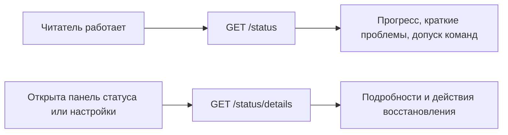

# Навигация и состояние Око

Согласованный в обсуждении целевой интерфейс. Реализация ведётся в [задаче #177](https://github.com/tgenman/oko/issues/177); этот документ не подтверждает её завершение или выпуск.

## Навигация

`GET /navigation` одним ответом возвращает данные левой панели:

```json
{
  "total": 1250,
  "folders": [{
    "id": "folder-1",
    "title": "Продукт",
    "count": 120,
    "feeds": [{"id": "feed-7", "title": "Название канала", "avatar_url": null, "count": 35}]
  }]
}
```

`total` — счётчик All Items. `count` — счётчик папки или фида. Счётчики учитывают непросмотренные нескрытые публикации. Порядок папок и фидов задаётся порядком массивов. Настройки фидов и карточки не включаются.

Текущий интерфейс дополнительно использует тип фида для значка, признак
непросмотренных публикаций (включая скрытые) для Show Read и состояние удаления
для блокировки действий. Поэтому первый рабочий срез навигации передаёт также
`kind`, `has_unviewed`, `connection` и `telegram_access` (для текста
подтверждения удаления Telegram-фида); это расширение примера, необходимое для
сохранения существующих действий.

## Состояние

`GET /status` показывает включённую работу, сбор, обработку и актуальные проблемы:

```json
{
  "enabled": true,
  "collection": {"state": "running", "completed": 12, "total": 30},
  "processing": {"state": "idle", "completed": 0, "total": 0},
  "problems": [{"id": "problem-1", "message": "Не удалось обновить источник", "feed_id": "feed-7"}]
}
```

`state` — `idle` или `running`; `completed` и `total` показывают прогресс. Если проблем нет, `problems` — пустой массив. Историю ошибок и подробности отдельных заданий этот ответ не содержит.

У обоих ответов есть ETag: `If-None-Match` с совпадающей меткой даёт `304` без тела; при изменении — `200` и новый ответ. Для статуса метка строится из сохранённой версии и текущего состояния работы. Совпавшая метка проверяется до построения подробного ответа; неизменившийся статус не собирает историю проблем. Навигация вычисляет метку по своему ответу и идентичности библиотеки.

[Карточки](cards.md) и [открытая публикация](opened-publication.md) имеют собственные GET. Универсальный `reading/check` удалён.

## Разделение статуса и подробностей

Согласовано 29 октября 2026. Постоянный опрос использует `GET /status`.
Кроме краткого примера выше, основной ответ сохраняет `runtime_state`,
`work_allowed`, `api_version`, `lifetime` и число активных сессий: они нужны
для запуска, допуска команд и остановки. Сведения об ошибках источников,
число диагностик и просмотренные ID поддерживают существующие предупреждения
и согласование интерфейса. Истории работ и действий восстановления здесь нет.
Сбор идёт непрерывно: у очереди нет зафиксированной границы партии.
Поэтому при активной работе `completed` и `total` равны `null`, а при отсутствии
работы — `0`. Размер оставшейся очереди не выдаётся за процент завершения.
Числовой пример выше иллюстрирует формат для известного прогресса; текущая
реализация не изобретает отсутствующий счётчик завершённых операций.

`GET /status/details` загружается при открытой панели статуса. Он содержит
подробные текущие и недавно завершённые проблемы, доступные действия
восстановления и сведения о работе. При закрытии панели постоянный опрос
подробностей прекращается. При открытых настройках тот же запрос поддерживает
прогресс истории и параметры доступа к YouTube; закрытые настройки не требуют
фонового чтения подробностей. Явный отказ от неудачной команды может разово
запросить детали перед её удалением из статуса.



Оба GET имеют независимые ETag. Заголовок `X-Oko-Storage-Id` связывает принятые
ответы с библиотекой и сохраняет защиту уже реализованного `GET /publication/{id}`
при восстановлении базы. Это HTTP-заголовок, а не универсальный JSON-протокол.
`POST /reading/check`, старые `GET /reading/materials/{id}` и `GET /materials/{id}` удалены; публикация
по-прежнему читается одним `GET /publication/{id}`. Настройки и команды не меняют
своего предметного назначения.
