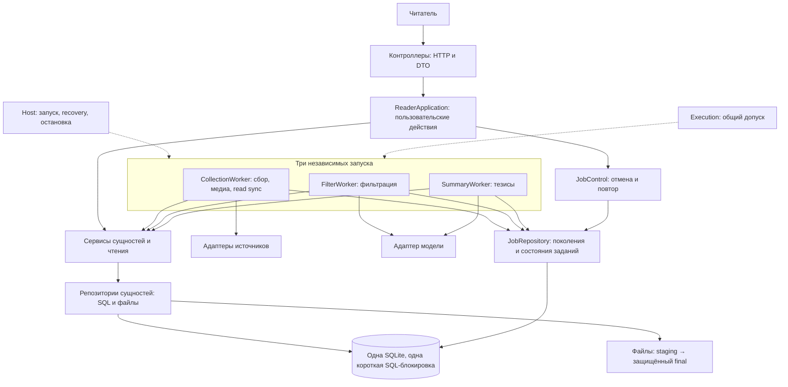

# Кто кого вызывает в целевом бэкенде

Три независимых крона работают в одном процессе. Они заменяют Runtime над
пайплайном из #89. Host собирает зависимости и управляет временем жизни процесса.
Один релиз #115 переключает все три воркера и совместимое хранилище вместе.



## Создание тезисов

```mermaid
sequenceDiagram
    participant Cron as Крон тезисов
    participant W as SummaryWorker
    participant J as JobRepository
    participant S as ProcessingService
    participant R as Репозитории сущностей
    participant DB as SQLite
    participant AI as Адаптер модели
    Cron->>W: собственный проход
    W->>J: блокировка, допуск, BEGIN
    W->>J: захват pending → running, новое поколение
    W->>S: подготовить вход и сохранённый контекст прохода
    S->>R: feed_id, правила, ревизия и исходники
    R->>DB: читать/сохранить _pass
    W->>J: COMMIT, освободить блокировку
    W->>AI: проверить обработчик, вызвать модель
    Note over AI,DB: Сеть вне SQL; сбор, другой крон и HTTP могут пользоваться SQLite
    AI-->>W: результат или ошибка
    W->>J: блокировка, допуск, BEGIN
    W->>J: проверить running и поколение
    W->>S: принять только актуальный вход и разрешения
    S->>R: сохранить тезисы и происхождение
    R->>DB: запись доменного результата
    W->>J: условный finish ровно одной Job
    W->>S: обновить стадию публикации
    W->>J: COMMIT обеих частей, освободить блокировку
    Note over W,DB: Ошибка или finish=0 → ROLLBACK результата и done
```

Если текста подтверждённо нет, участок модели пропускается: пустой результат с
reason=no_input и done сохраняются той же второй транзакцией. Если исходник ещё
ожидается или этап выключен, успешная Job не выдумывается. При filter_out тезисы
не запускаются. Во время регенерации прежние актуальные тезисы остаются доступны.

Догрузка входа сразу сохраняет новую ревизию и инвалидирует результат корня.
SummaryWorker согласует свои задания на собственном следующем проходе; старый
успех и старая ошибка уже не могут изменить новую работу. Фильтр и тезисы
продолжают сохранённый выбор фида и правил после перезапуска.

[Технические границы и перенос](../architecture/application-layers.md).
