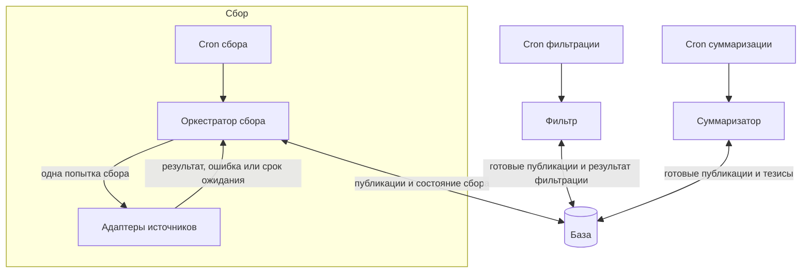

# Пайплайн обработки информации

## Согласовано

Проектируем бекенд отдельно от UI. Пайплайн должен расширяться на новые источники
через адаптеры.

Через пайплайн проходит одна сущность — [публикация](publication.md).
Её идентичность сохраняется, а статусы в базе меняются по мере обработки.
Предыдущий этап сохраняет результат и переводит статус публикации. Следующий
крон выбирает записи по этому статусу и организует выполнение через служебную
[Job](jobs.md). Захват и фиксация результата используют короткие транзакции;
внешние вызовы выполняются вне них.
Согласованные [статусы и переходы](publication.md#статусы-и-переходы)
учитывают необязательные этапы и завершение через `filter_out`.

### Независимое управление этапами

У сбора, фильтрации и суммаризации отдельные кроны. Каждый этап сам выбирает
готовую работу из базы и сохраняет результат и новый статус публикации.
Этапы не вызывают друг друга; их согласование происходит через статусы в базе.
Общего оркестратора всего пайплайна нет.

У каждого этапа своё расписание, ограничения параллельности и управление
повторами. Оркестратор сбора управляет только сбором.

Общие механизмы, например захват задания для защиты от одновременной обработки,
переиспользуем без общего управления этапами: атомарный захват Job и проверка
поколения при сохранении. См. [короткие транзакции](jobs.md#короткие-транзакции).

### Управление сбором

Cron сбора запускает этап сбора. Оркестратор определяет, какие фиды пора обновить.
Настройки интервалов и сроки следующего запуска хранятся в базе.

Оркестратор выбирает адаптер, запускает сбор, сохраняет результат, управляет
повторами после ошибок и отменой. Точное программное устройство cron ещё не выбрано.

Ответ discover сохраняется короткой транзакцией: публикации страницы вместе
с новым курсором. После сбоя до фиксации страница запрашивается повторно;
существующие публикации сопоставляются по внешнему ключу.

Адаптер знает протокол источника и выполняет одну попытку сбора. Он не содержит
собственного cron или бесконечного цикла обновления. Если источник требует
ожидания, адаптер сообщает ограничение оркестратору, который назначает повтор.
Так общие правила управления сбором не повторяются в каждом адаптере.

Дедупликацию по содержимому пока исключили. Проверка наличия публикации по её
внешнему ключу остаётся частью модели.

Обычные группы Telegram исключили из текущего пайплайна. Для групп рассматриваем
получение сообщений страницами без постоянного хранения всей переписки.

## Пока не определено

- Окончательные типы ошибок и переходы при отсутствии необходимого входа.
- Конкретные интервалы и механизм запуска кронов каждого этапа.
- Численные ограничения параллельности каждого этапа; захват и временные повторы
  согласованы в [Job](jobs.md).
- Контракты адаптеров.
- Маршрутизация загрузки публикаций без фида: после сбора они готовы,
  отдельно не обрабатываются; их текст используется при обработке исходного поста.
- Устройство пагинации групп и охват супергрупп этим сценарием.
- Хранение и жизненный цикл медиа.

## Очистка файлов

Отдельная периодическая очистка удаляет файлы без пользователей и остатки
прерванных загрузок. Активные сохранения защищены от очистки. Физическое удаление
происходит вне транзакций публикаций; см. [медиа](media.md#сохранение-и-очистка).
