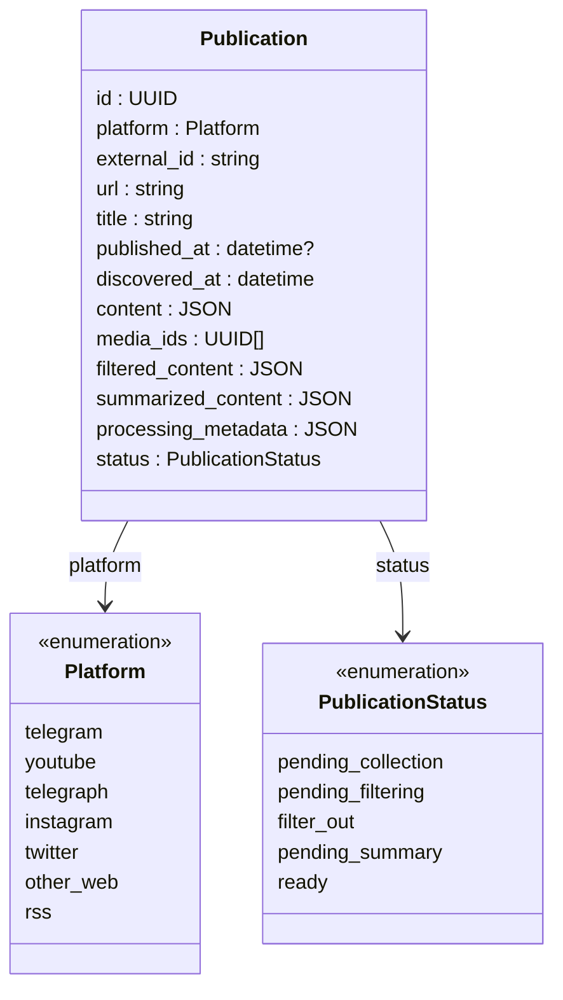
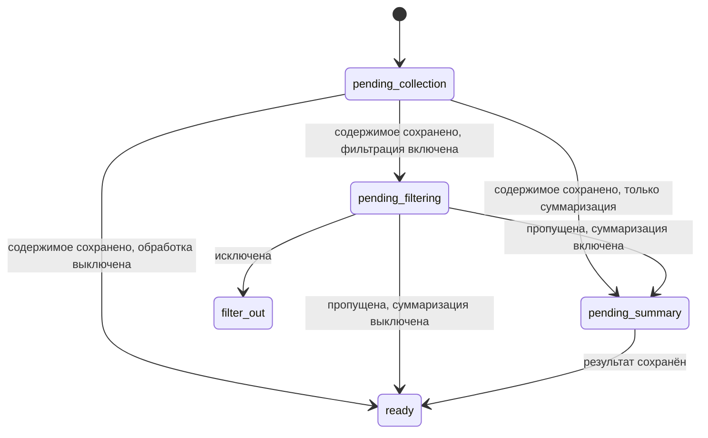

# Публикация

## Согласованная модель

`Publication` — единая сущность пайплайна для поста, статьи, видео или записи RSS / Atom.
Telegram-альбом считаем одной публикацией.

Публикация может принадлежать фиду. Публикация также может существовать без фида:
например, статья Telegraph, на которую ссылается пост.
Это один тип сущности для всех перечисленных видов содержания.

Ссылка на статью остаётся в содержимом поста. При отображении поста подтягивается
содержимое связанной публикации. Несколько публикаций могут ссылаться на одну статью.
Карточка — представление публикации в UI.

Автоматическое раскрытие ограничено основной статьёй RSS-записи и Telegraph-ссылками
из Telegram-поста. Ссылки внутри полученных статей рекурсивно не загружаются;
другие ссылки остаются ссылками. Наличие `PublicationLink` само по себе не запускает
произвольный рекурсивный обход.

Для загрузки статей платформ `telegraph` и `other_web` без фида используется
зарегистрированный `web_adapter`, получающий внешний ключ и URL статьи.
Фиктивный фид не создаётся.

Статья без собственного фида после успешного сбора переходит в `ready`: отдельные
фильтрация и суммаризация ей не назначаются. Её текст используется при обработке
исходного поста или RSS-записи, результаты сохраняются у них. Собственная обработка
статьи появляется при принадлежности фиду с соответствующими настройками.

Связь фидов и публикаций — многие ко многим. Одна публикация может быть
обнаружена через несколько фидов. См. [общую схему сущностей](entities.md).

## Текущий эскиз полей

Согласованы поля `platform`, `external_id`, `content`, `filtered_content`,
`summarized_content` и управление обработкой
через статус. Остальные поля и конкретные типы в эскизе предложены;
для заголовка и даты принято: отсутствующий `title = ""`, неизвестный
`published_at = null`; `discovered_at` всегда заполнен временем обнаружения в Око.
`Platform` — enum, а не отдельная таблица. Сохраняем специфичность платформ:
`telegram`, `youtube`, `telegraph`, `instagram`, `twitter`, `other_web`, `rss`.
Наличие значения в проектируемом enum не означает, что адаптер уже реализован.
Запись RSS / Atom — самостоятельная публикация с платформой `rss`. Статья,
на которую она ссылается, — другая публикация со своей платформой и идентичностью.
Способ доступа к Telegram также не входит в этот enum.
Поле `platform` обозначает платформу публикации.
Согласованные значения `PublicationStatus` и переходы описаны ниже.

## Содержимое

`content` хранит JSON общего формата с возможностью добавлять специфичные поля.
Общая структура — упорядоченные `blocks` и расширения `extra`;
см. [формат содержимого](content-format.md). Изображения, видео и вложения хранятся отдельно;
содержимое ссылается на их ID.
Колонка `media_ids` хранит список ID медиа публикации. Ссылки внутри `content`
задают их расположение и роль; список позволяет получить все медиа без разбора JSON.

Готовность содержимого определяется статусом. `content = null` не используется
для обозначения незагруженного содержимого. Начальные значения `content`,
`filtered_content` и `summarized_content` — `{}`, `media_ids` — `[]`, статус —
`pending_collection`. Пустой JSON не является признаком готовности или ошибки.
При изменении входа устаревший результат соответствующей обработки очищается до `{}`.

## Результаты обработки

В целевой модели хранится только последнее состояние публикации, без истории версий.
Пока обновление скачивается, прежнее содержимое доступно. После успешного получения
новое содержимое заменяет старое атомарно; старые результаты фильтрации и суммаризации
убираются, для нового состояния ожидаются новые результаты.
Это относится к изменившемуся входу соответствующей обработки. Если вход остался
прежним, актуальный результат сохраняется; смена временного URL файла сама по себе
не инвалидирует результат. Для YouTube-тезисов используется вход из субтитров.
Уже открытая вкладка может удерживать прежний показ в памяти до переключения.
После перезагрузки доступно только последнее сохранённое состояние.

Новый текст можно сохранить до завершения загрузки его медиа. Содержимое ссылается
на новые файлы в состоянии ожидания, без подстановки прежнего изображения под новый
текст. При миграции накопленная история остаётся в резервной копии старого хранилища;
в новую рабочую базу переносится последнее состояние и актуальные результаты.

Результаты остаются в самой сущности `Publication`:

- `filtered_content` — результат фильтрации.
- `summarized_content` — результат суммаризации.

Оба поля имеют тип `JSON`; согласованные структуры описаны в
[формате содержимого](content-format.md). Фильтрация и суммаризация настраиваются для отдельных фидов
и не обязательны для каждой публикации. Настройки находятся в `Feed.filter_config`
и `Feed.summary_config` (JSON с включённостью, промптом и настройками обработчика);
при начале прохода выбранный набор фиксируется. Перенос результатов или состояний
этих этапов в `FeedPublication` не принят.

Для общей публикации при разных настройках фидов принимается первый успешный
актуальный результат обработки, второй отбрасывается. Требование одинаковых
настроек не принято. Настройки одного победившего фида закрепляются на весь
проход обработки: фильтрация и суммаризация используют один набор правил.
Отдельные результаты на каждый фид не вводятся.
Объединение существующих экземпляров остаётся отдельным шагом миграции.
Временные повторы и защита от поздних ответов согласованы в [Job](jobs.md).
Постоянная ошибка останавливает Job до ручного повтора после исправления;
причина показывается пользователю, статус публикации сохраняет незавершённый этап.
Подтверждённое отсутствие входа обрабатывается без вызова модели, как описано ниже.

## Статусы и переходы

Ручного восстановления после фильтрации нет. Исходник остаётся доступен для чтения.
При ручной регенерации с неизменным входом принятые актуальные тезисы сохраняются
до успешной замены; неудачная попытка их не удаляет. Выполнение задания отделено
от готовности сохранённого результата.

`processing_metadata` хранится в `Publication` и фиксируется атомарно вместе
с результатами обработки. Секции `filter` и `summary` содержат подписи входа
и настроек, обработчик, модель, время завершения и параметры фактического запуска.
Изменение модели и параметров для будущих запусков само по себе не обесценивает
готовый результат. Поздний ответ проверяется на соответствие актуальному входу.

Обычная суммаризация использует отфильтрованное содержимое при включённом фильтре,
иначе исходное. YouTube-тезисы используют исходные субтитры; фильтрация управляет
допуском, но не сокращает вход субтитров. `filter_out` не суммаризируется.

Для RSS вход обработки составляется из текста связанной статьи с заголовком
и контекстом RSS-записи. Результаты сохраняются у RSS-публикации; настройки
задаёт её фид. Статья остаётся самостоятельной публикацией.

Если статья пока недоступна, обрабатываем имеющийся RSS-анонс с явной отметкой
неполноты. Загрузка статьи продолжается независимо. После её получения изменившийся
вход вызывает повторную фильтрацию и суммаризацию RSS-публикации.

Для Telegram-поста вход включает его текст и текст связанной Telegraph-статьи
с явным различением происхождения. Результаты сохраняются у Telegram-публикации
по настройкам её фида. Пока статья недоступна, обрабатываем доступный текст поста;
после догрузки статьи пересчитываем результат по изменившемуся входу.
Без доступного текстового входа модель не вызывается. Если отсутствие входа
подтверждено, этап завершается с пустым результатом и причиной в
`processing_metadata`; пустые тезисы — `{"points": [], "extra": {}}`.
Появление входа при обновлении вызывает пересчёт. Неудавшееся получение текста
или субтитров не означает их отсутствия и не подменяется пустым результатом.

| Статус | Значение |
|---|---|
| `pending_collection` | Публикация обнаружена, нужно собрать содержимое |
| `pending_filtering` | Содержимое сохранено, нужна настроенная фильтрация |
| `filter_out` | Публикация исключена фильтром; обработка завершена без суммаризации |
| `pending_summary` | Нужна настроенная суммаризация |
| `ready` | Все необходимые этапы выполнены |

Сбор заполняет `content`, фильтрация — `filtered_content`, суммаризация —
`summarized_content`. Переход после успешного этапа происходит после сохранения
его результата. Выключенные этапы пропускаются.

`ready` означает завершение всех необходимых этапов, включая случай, когда
требовался только сбор. `filter_out` завершает этот путь без суммаризации.
Схема показывает основной успешный путь. Выполнение и повторы описаны в [Job](jobs.md),
инвалидация при обновлении содержимого — выше. Полную таблицу переходов при изменении
настроек ещё предстоит завершить; подтверждённое отсутствие входа завершает
этап без вызова модели, с пустым результатом и причиной.

## Внешняя идентичность

Пара `(platform, external_id)` — уникальный внешний ключ публикации.
Адаптер возвращает готовый ключ в `ExternalReference`, в том числе для связанных
статей. Око не вычисляет внешний ID повторно: находит или создаёт публикацию по
этому ключу, затем использует её внутренний ID в сохраняемых связях.
`external_id` определяет публикацию во внешнем источнике; `url` позволяет открыть
оригинал. Для некоторых источников внешний ID может совпадать с каноническим URL.
Принадлежность фиду не входит во внешний ключ.

Наличие записи означает, что публикация известна Око. Загружена ли она и какая
обработка ей нужна, определяется статусом.

### Предложенные правила адаптеров

| Источник | `external_id` |
|---|---|
| Telegram: пост канала | Нормализованная ссылка на пост |
| Telegram: альбом канала | Общий ключ альбома ещё предстоит определить |
| YouTube | ID видео |
| Telegraph | Канонический URL статьи |
| Other web | Канонический URL публикации |
| RSS / Atom | Однозначно закодированная пара: URL ленты + `guid` / `id` записи |

Правила внешних ID для Instagram и Twitter пока не определены.

ID записи RSS / Atom ограничивается конкретной лентой. Формат кодирования пары
и правило для записи без `guid` / `id` пока не определены. Записи двух лент,
ссылающиеся на одну статью, остаются отдельными публикациями.

Для Telegram нужно определить нормализацию ссылок и поведение при смене
username. Наличие ссылки не устраняет эту задачу. Аккаунт сбора не должен
менять идентичность публикации канала.
Telegram предоставляет ID сообщения, его диалога и общий `grouped_id` для альбома:
[контракт сообщения](https://core.telegram.org/constructor/message).

У обычных групп Telegram ID одного сообщения может различаться между аккаунтами.
Поэтому при смене аккаунта такой ключ не обеспечивает независимую от аккаунта
идентичность. Обычные группы исключены из текущего пайплайна:
[правила Telegram](https://core.telegram.org/api/updates).

## Пока не определено

- Правила удаления и ограничения связей в `FeedPublication` и `PublicationLink`
  (структура таблиц показана в [схеме сущностей](entities.md)).
- Переходы при изменении настроек.
- Окончательные типы, обязательность полей и формат времени.
- Нормализация внешних ID и URL, поведение при их изменении.
- Получение общего внешнего ключа адаптерами с разными способами доступа.

## Просмотр и повторный сбор

Отдельную память о просмотренных публикациях для запрета повторного сбора не храним;
`viewed_at` не добавляется. Позицию сбора определяет курсор. Повторный обход
старой истории или повторного окна источника может намеренно вернуть ранее
просмотренные и удалённые публикации (решения 72–74). Прежняя гарантия
невозвращения просмотренного отменена. Уникальный внешний ключ предотвращает
дубли существующих записей, но не повторное создание уже удалённой записи.
