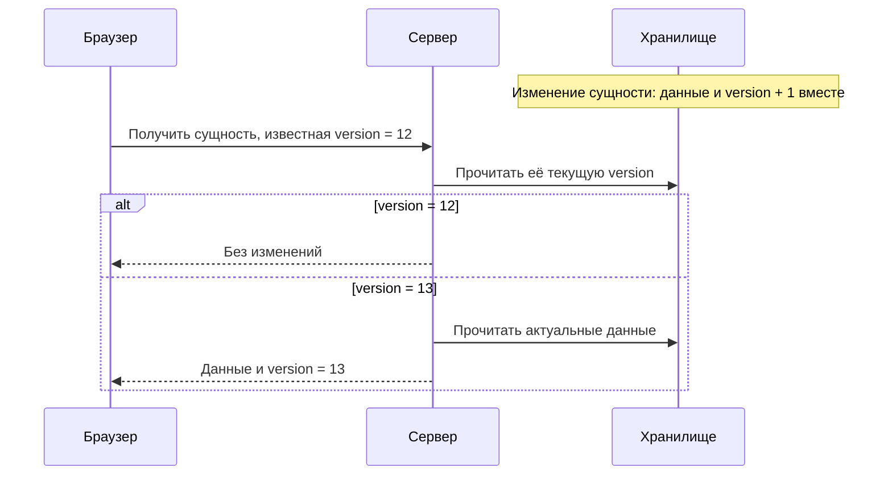

# Архив предложения до сверки с реализованными #56–57

Снимок проектного документа от 2026-10-20. После сверки с HEAD `ad56948`
большая часть этого предложения уже реализована. Это исторический документ,
не действующий план работ. [Текущая сверка](../architecture/reading-updates-design.md).

# Дополнение к #56: выборочное обновление читателя

Статус: проектирование, 2026-10-20. Реализация не разрешена.
Согласованы продуктовые требования и версия каждой сущности с увеличением
на 1 при изменении записью. Детали пакетного протокола ниже предложены для
рассмотрения; wire-контракт ещё не принят и не реализован.
GitHub: https://github.com/tgenman/oko/issues/56

## Границы

Это уточнение задачи #56, а не второй план оптимизации.

| Источник | Ответственность |
| --- | --- |
| [#53](https://github.com/tgenman/oko/issues/53) | Стоимость чтений, пакетный SQL, компактная сборка карточек, ограничение выбранной областью |
| [#54](https://github.com/tgenman/oko/issues/54) | Фоновая работа и согласование только затронутых публикаций |
| [#55](https://github.com/tgenman/oko/issues/55) | Стоимость просмотра, завершения фида/папки, статуса и работы с историей |
| [#56](https://github.com/tgenman/oko/issues/56) и этот документ | Проверка изменений, выборочная доставка, восстановление и допуск ответов |
| [#57](https://github.com/tgenman/oko/issues/57) | Общая приёмка с раздельным измерением серверного и браузерного эффекта |

Порядок и зависимости реализации задают GitHub issues. Здесь не выбираются
индексы, устройство SQL-пакетов, механизмы обработки и новая модель хранения
карточек. Исправление опроса не заменяет устранение фоновых полных обходов.

Согласованные изменения поведения открытого материала вынесены в
[отдельный проект](../architecture/opened-material-updates-design.md). Они не являются скрытой
частью требования #56 «сохранить действующее поведение». Подключение этих
изменений к реализации оформляется отдельно; требования пользователя сохранены.

## Согласованные требования к обновлениям

- Действие запрашивает нужные ему данные: открытие — выбранный материал,
  выбор папки/фида — соответствующий список.
- Один лёгкий запрос проверки на вкладку примерно раз в секунду. Запросы
  проверок не накапливаются параллельно; после ошибки связь восстанавливается
  без автоматического повтора команд записи.
- Без изменений сервер не пересобирает представления и не передаёт их целиком.
- Добавленные и изменённые карточки загружаются пакетно; выход карточки из
  списка определяется по ID. Неизменившиеся карточки повторно не загружаются.
- Статус, дерево со счётчиками и открытый материал обновляются по собственным
  сохранённым версиям. Полные тезисы и результаты фильтрации не передаются
  ради компактного списка; контракт компактного представления должен пройти
  проверку совместимости.
- Успешное действие текущей вкладки отражается после ответа без ожидания
  очередной секунды. Фоновое изменение видно за 1–2 секунды в управляемом
  окружении с доступным сервером.
- Открытие не ждёт завершения опроса. Цель: 95% открытий до 200 мс от клика
  до появления текста при текущем объёме данных и работающем фоне. Это цель,
  а не подтверждённый результат.

## Согласованная основа: версия каждой сущности

У каждой выдаваемой сущности есть собственное сохранённое поле `version`.
При изменении сущности запись её данных и увеличение `version` на 1
происходят вместе. Версия относится к этой сущности, а не ко всей базе.
Сохранение прежних значений без изменения сущности версию не увеличивает.

Фронт передаёт известную ему версию:

| Условие | Ответ |
| --- | --- |
| Версия совпадает | Без изменений, без повторной сборки и передачи данных |
| Версия отличается | Актуальные данные сущности и её текущая версия |
| Фронт ещё не получал сущность | Актуальные данные и версия |
| Сущность больше недоступна | Явный ответ о недоступности |

Нет общего счётчика базы, журнала событий, курсора истории, отдельной сводки
инвалидации или счётчиков в памяти Runtime. Версии сохраняются с данными и
не сбрасываются при обычном перезапуске. Существующие журналы команд и
диагностики сохраняют своё назначение.

Номер изменения сущности API не является номером авторской версии публикации.
Изменение состояния загрузки может увеличить первый, не создавая новую
авторскую версию текста. ETag может представлять `version` отдельного ресурса
в условном GET; он не вычисляется хешированием заново собранного содержимого.

## Пакетная проверка нужных сущностей

Чтобы сохранить один опрос на вкладку раз в секунду, фронт объединяет нужные
сущности и известные версии в один читающий запрос. Для каждой сущности
применяется одно и то же правило сравнения. Ответ содержит данные только
изменившихся сущностей и явные результаты недоступности; неизменившиеся
данные не передаются. Это пакет обычных версионных чтений, без истории событий.

Сервер сравнивает сохранённые версии пакетно средствами чтения из #53.
Он не строит полные материалы для проверки версии. Цена проверки зависит
от числа запрошенных сущностей; постоянная стоимость для произвольного
размера списка не обещается. Размер запроса и допустимый размер пакета входят
в проектирование контракта и замеры. SQL-пакеты здесь повторно не проектируются.

Клик по карточке сразу выполняет отдельное чтение материала и не ждёт опроса.
После собственного успешного действия фронт применяет полученные данные либо
сразу запрашивает затронутые сущности. Межвкладочное сообщение ускоряет чтение;
сервер остаётся источником состояния, команды записи автоматически не повторяются.

## Состав списка и новые сущности

Новая карточка ещё неизвестна фронту, поэтому проверки версий известных
карточек недостаточно. Состав списка также является отдельным версионируемым
ресурсом: выбранная область и её упорядоченные ID. Изменение состава или
порядка увеличивает его собственную версию вместе с соответствующей записью.
Это не общий номер любой записи в базу.

- Состав не изменился — повторно не передаётся.
- Состав изменился — сервер возвращает актуальные ID в нужном порядке.
- Новый ID запрашивается без известной версии; прежний — с имеющейся версией.
- Исчезнувший ID убирается из списка без журнала удалений.
- При наличии изменившегося состава сервер может сразу включить данные новых
  карточек в тот же ответ: фронт передал известные ему ID и версии.

Сортировка и показ скрытых входят в ключ выбранного списка. При смене этих
параметров фронт не использует ответ предыдущего выбора. Исчезновение ID
не означает автоматически «Просмотрено»: возможны скрытие или перенос фида.
Доступность открытого материала определяется отдельным ответом.

У фидов/папок и их состава применяется то же правило. Фронт использует
ссылки на связанные сущности; переименование фида не должно требовать
перезаписи одинакового названия во всех публикациях. Точный состав компактной
карточки и правила версий связанных данных ещё определяются в контракте.

## Что именно версионируется

Версия защищает данные, которые возвращает соответствующий ресурс. Если
тезисы и медиа читаются отдельно, у них свои версии. Нельзя вернуть изменённые
данные с прежней версией или прежние данные с новой версией.

Разделение ресурсов должно соответствовать согласованному API: компактная
карточка, текст, тезисы/результаты фильтрации, описание медиа, фид/папка,
состав списка и статус. Это проект границ чтения, а не требование создать
новую таблицу для каждого ресурса. Полные тезисы не загружаются ради списка.

При изменении связи, например переносе фида, сохраняются изменённая сущность
и версии изменившихся составов. Для производных данных (счётчики, статус,
состав после фильтрации) нужно определить владельца сохраняемого изменения
до реализации; существование одного поля version у публикации их не покрывает.

Данные файлов публикуются через существующие гарантии Store. Увеличение
версии связано с принятием нового состояния, а не записью временного файла.
Для состояний, зависящих от времени, необходимо согласовать явное изменение
сущности владельцем перехода. Само истечение таймера не может незаметно
изменить ответ ресурса при прежней версии. Этот вопрос согласуется с #54,
без нового универсального scheduler и без полного обхода из HTTP-опроса.

## Гонки, ошибки и восстановление

- Фронт сохраняет новую известную версию только вместе с принятыми данными.
  Неуспешное чтение оставляет старую версию: следующий запрос повторяет чтение
  автоматически, без отдельного курсора или подтверждения доставки.
- Если фронт знает 12, а сервер уже перешёл с 13 на 14, возвращаются актуальные
  данные с 14. Промежуточные изменения воспроизводить не требуется.
- Поздний ответ версии 13 не заменяет уже принятую 14. Дополнительно проверяются
  ID, текущий выбор, параметры списка и сессия открытия; отмена запроса не
  заменяет эти проверки.
- Данные и их версия читаются согласованно. Несколько независимых HTTP-чтений
  не объявляются одной транзакцией. Пакет состава и карточек должен исключать
  несовместимую смесь результатов; точная граница определяется в контракте.
- Ошибка обновления не очищает уже показанные данные. При неполном пакете
  сохраняются прежний показ и версии неполученных сущностей.
- Пропущенные опросы и обычный перезапуск не требуют восстановления истории:
  фронт снова отправляет известные версии и получает текущее состояние.
- Восстановление старой базы из backup отличается от обычного перезапуска:
  сброс клиентских версий при такой операции нужно определить отдельно.
  ID удалённых сущностей нельзя переиспользовать с прежней последовательностью
  версий без явного сброса клиентского состояния.
- Heartbeat, BroadcastChannel, остановка и выключенное Око сохраняют
  существующих владельцев. Новое поведение удержанного материала находится
  в отдельном проекте, а не вводится этим протоколом автоматически.

## Совместимость API

Существующие закрытые ответы API v3 нельзя молча менять или сокращать.
Предлагаются добавочные версионные чтения и пакетное чтение компактных
сущностей; точные URL, DTO, лимиты и ошибки ещё не согласованы.

Для отдельного условного GET возможны ETag/If-None-Match и 304; для смешанного
пакета нужен ответ с результатами по сущностям. Не выдавать общий 304, если
хотя бы одна запрошенная сущность изменилась или стала недоступна. Конкретное
HTTP-представление описывается в каноническом OpenAPI и проверяется с SDK.
Старые клиенты сохраняют прежний контракт. Дополнительный транспорт,
отдельный механизм heartbeat и журнал синхронизации не вводятся.

## Приёмка дополнения

Использовать матрицу и ограничения #57; численные SQL-бюджеты принадлежат
#53–#55 и здесь не дублируются. Измерять стоимость нового протокола отдельно
на одинаковой серверной реализации, с теми же данными и нагрузкой.

- Без изменений: сравнение сохранённых версий без сборки полных представлений
  и обхода посторонних сущностей. Ответ не содержит неизменившиеся данные.
- Одна изменённая карточка: данные только этой карточки и её новая версия.
  Неизменившийся состав списка, тексты и медиа не передаются заново.
- Несколько изменений между опросами: конечные состав, порядок и счётчики
  верны; проверены добавление, скрытие, перенос, удаление и возвращение ID.
- Изменение только статуса не вызывает загрузку списка. Изменение посторонней
  области не вызывает чтение карточек текущей области.
- Запись увеличивает версию изменённой сущности вместе с данными; откат
  не оставляет новую версию. Ошибки чтения, поздние ответы, перезапуск и
  потеря связи не теряют обновления и не откатывают показ к старой версии.
- HTTP проверяет данные и стоимость на временной базе; Playwright — реальные
  запросы, видимый результат, фокус и прокрутку. Проверяются новые и старые
  клиенты, генерация API и отсутствие второго транспорта/опроса/heartbeat.
- Замеры открытия выполняются серией на одинаковом стенде до/после, отдельно
  для первого и повторного открытия, с работающим фоном. Фиксируются размер
  выборки, p95, медленные открытия, объём ответов и время от клика до текста.
  Конкретные размер серии и профиль нагрузки определяются до приёмки.

## Что осталось решить

Основа согласована: собственная сохранённая версия каждой сущности и её
увеличение на 1 при изменении записью. Общий счётчик и журнал событий исключены.
До реализации остаются точные границы ресурсов и составов, запись изменений
производных данных и переходов по времени, совместимый wire-контракт,
согласованность пакета и методика приёмки. Новое поведение читателя имеет
отдельные нерешённые вопросы в своём документе.

[Ревью прежней редакции](reading-updates-design-review.md)
сохранено как исторический результат. Тесты реализации и новые замеры при
этой переработке не выполнялись; код и GitHub issues не изменялись.
