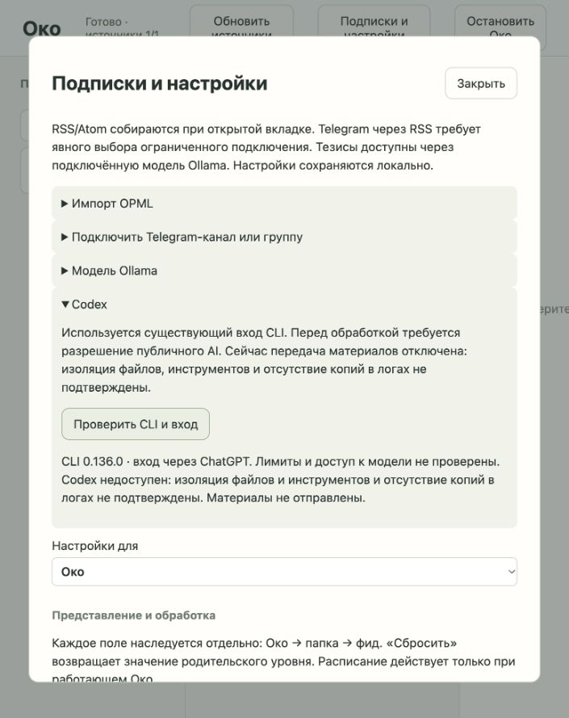

# Codex: первоначальная диагностика и закрытый допуск к обработке

Исторический отчёт. Блокер устранён: [работающие тезисы и текущие ограничения](codex-theses.md).

Проверено 2026-10-08. №07 реализован частично: диагностика CLI/входа и предусмотренный тикетом отказ при неподтверждённой изоляции. Генерация тезисов через Codex не реализована и не прошла приёмку. Ollama не запускался; пользователь разрешил продолжить без завершения его реальной приёмки.

## Что работает

В настройках варианта A есть «Codex» → «Проверить CLI и вход». API возвращает только нормализованные версию, способ входа и причину недоступности. Проверка использует существующую авторизацию; секреты не копируются. Проверяются только локальные команды: --version, exec --help, login status. Лимиты и доступ к модели этим не подтверждаются.

CLI отсутствует, несовместим, выдаёт слишком большой ответ или не завершает команду — причина видна пользователю. Каждый процесс получает отдельную группу, ограничение вывода 16 КиБ и таймаут 5 секунд. Остановка Око отменяет свои проверки и завершает только их группы. Диагностический вывод остаётся в памяти и не возвращается через API.

Выбор Codex наследуется Око → папка → фид. Перед подготовкой входа проверяется разрешение фида: запрещённый публичному AI материал получает явный запрет. Разрешённый получает блокер изоляции. Нет пути запуска inference и fallback; ни текст, ни медиа, ни промпт публикации не передаются CLI. Оригинал остаётся доступен и удаляется по «Просмотрено».

## Реальные проверки

- Установлен Codex CLI 0.136.0; login status сообщил вход через ChatGPT. Квоты и качество модели не проверены.
- Внешний sandbox-exec на macOS действительно запретил cat чтение GLOSSARY.md из репозитория.
- Эксперимент запуска CLI под внешним sandbox с разрешёнными системными чтениями, чтением только auth.json из пользовательского Codex home, записью только в одноразовый каталог и запретом исполнения других программ завершился сигналом 6 (exit -6), без stdout/stderr. Вход был исключительно синтетическим: просьба вернуть OK. Успешного облачного ответа нет; нельзя подтвердить даже стадию, на которой процесс завершился.
- Этот эксперимент не доказывает невозможность иной изоляции. Он не подтвердил пригодность исследованного способа; ослаблять ограничения ради запуска приложение не стало. Профиль не включён в приложение как рабочий адаптер. Исходный временный каталог эксперимента удалён.
- В браузере проверены раскрытие раздела, повторно доступная кнопка после завершения и настоящий нормализованный статус CLI/ChatGPT. Ошибок консоли нет; временный экземпляр остановлен.

--ephemeral документирован как отсутствие сохраняемых session rollout, а sandbox read-only относится к модельным командам и не доказывает запрет чтения посторонних файлов. Это не гарантия отсутствия логов, инструментария или иных копий. Источники: [неинтерактивный режим](https://learn.chatgpt.com/docs/non-interactive-mode), [справка CLI](https://learn.chatgpt.com/docs/developer-commands?surface=cli).

## Граница дальнейшей работы

№07 остаётся integration-blocked. Для открытия обработки нужны проверяемая внешняя изоляция, ограничение инструментов и доступных файлов, отсутствие неконтролируемых копий, а затем синтетическая реальная обработка с проверкой схемы, атрибуции, отмены и очистки. Проверка разрешений на производных и смешанных материалах расширяется будущими задачами. В текущем пути вход — одна публикация.

Критерии 1, 3, 5–7 полного работающего обработчика остаются открыты. Критерий 4 выполнен только в предусмотренной ветви отказа. Это не зелёная приёмка тезисов через Codex.

## Автоматические проверки

API с реальными временными файлами/SQLite и внешним исполняемым CLI-fixture: запрет передачи независимо от разрешения, отсутствие inference-команд, нормализация и отсутствие утечки вывода, отсутствующий CLI, отмена при остановке, ограничение вывода, удаление исходника. tests/test_codex.py: 5 проверок. Полный набор: 74 passed, 24.47 секунды. Mypy strict: 13 модулей без ошибок; node --check и git diff --check чистые. Одно существующее предупреждение Starlette/httpx.

## Standards

Замечаний нет. Изменения соответствуют docs/architecture/reader-work.md: Runtime владеет отменой и допуском, внешняя проверка ожидается вне блокировки, поздний ответ проверяется по эпохе и состоянию. SQL политики остаётся в Store. Проверка CLI ограничивает время и вывод, создаёт отдельную группу процессов и очищает только её. Существенных архитектурных запахов не обнаружено.

## Spec

Конкретных дефектов реализации отказа и расширения scope не обнаружено. Доставка частичная; integration-blocked соответствует состоянию.

Открыты: подключение реального адаптера к общему контракту; доступ к модели/квотам; доказанная изоляция; получение валидируемых тезисов; реальные ошибки лимитов, отмена и очистка копий генерации; разрешённый синтетический интеграционный пример. Законченный путь получения тезисов не реализован.

Предусмотренная критерием 4 ветвь недоступности с конкретной причиной реализована: текст публикации не готовится и не передаётся CLI. Разрешение проверяется перед подготовкой входа для текущего случая одной публикации; смешанные производные относятся к последующим задачам.

Итог: Standards — 0 замечаний; Spec — 0 дефектов этой частичной реализации, полный пользовательский сценарий остаётся открытым. Оснований закрывать №07 нет.
