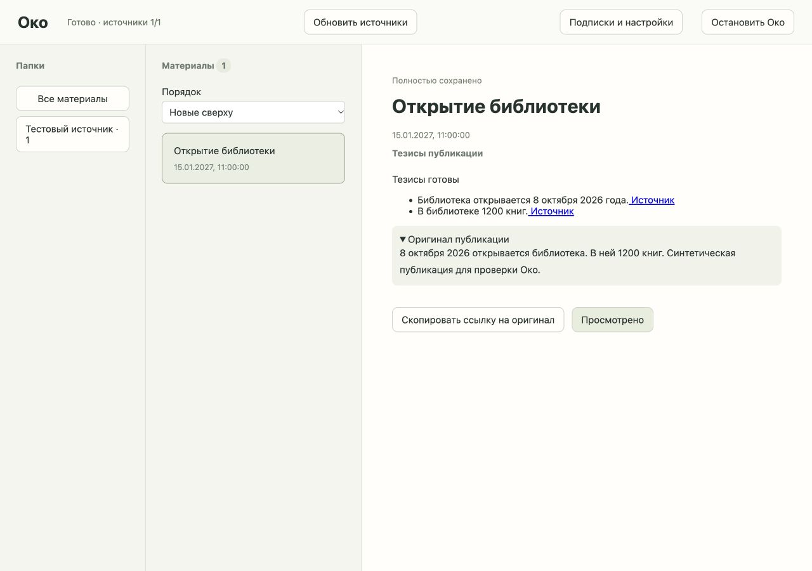

# Тезисы через настоящий Codex

2026-10-08. Продолжение №07 после [первоначального отказа](https://github.com/tgenman/oko/blob/365e2b38f86d6e2bedccbb40b14c615b6f069455/docs/verification/codex-admission.md). Ollama не запускался; его реальная приёмка остаётся открытой по указанию пользователя.

## Результат

Настоящий CLI с существующим входом ChatGPT вернул тезисы по синтетической публикации через API Око. Вход: «8 октября 2026 открывается библиотека. В ней 1200 книг». Результат: два тезиса с этими фактами и точной ссылкой https://example.org/oko-check. Настройки и промпт прошли через общий контракт. Готовые тезисы и оригинал удалены по «Просмотрено», временный staging пуст.

Браузерная проверка реального результата в desktop-варианте A: тезисы, ссылки, раскрываемый оригинал, просмотр и очистка UI, остановка. Ошибок консоли нет. Проверочный экземпляр остановлен; временные каталоги удалены.

## Исправление запуска

Быстрый воспроизводимый цикл был --version внутри внешнего sandbox: exit -6, пустые stdout/stderr. Лог ядра показал запрет file-read-data для самого каталога /. Разрешение только literal / исправило запуск; это не рекурсивное разрешение корневой файловой системы. Другой первоначальный сбой был связан с наследованием cwd репозитория до обработки -C: процесс теперь стартует прямо во временном каталоге.

Для HTTP-клиента потребовались системные ICU/timezone и два системных plist. Инициализация требует стандартный installation_id в существующем Codex home: разрешены чтение и запись только этого служебного UUID. Auth.json читается на прежнем месте, не копируется и не изменяется. HOME/CODEX_HOME не переназначаются, глобальный config не меняется.

## Техническая граница

Поддерживается macOS и конкретный проверенный бинарник CLI 0.136.0:
SHA-256 2c056bf3bd3a0ba04cdaa6d1db84c81974e6785f5fd72deaa2a3fcdcfb573d10.
Другая сборка или недоступный sandbox остаются закрытыми. Предварительная проверка проверяет профиль на --version, текущий вход, пригодность CLI и свежие лимиты через account/rateLimits/read отдельного изолированного app-server. Он получает только initialize/initialized/account/rateLimits/read, без создания thread/turn и без входа публикаций. Неизвестный или исчерпанный лимит запрещает передачу текста. Проверяются все возвращённые окна наиболее ограничительным образом; credits не считаются разрешением продолжать при исчерпании. На реальном аккаунте предварительная проверка вернула limits_checked=true и допускающее окно. Доступ к модели подтверждён следующим настоящим turn; остаток квоты не резервируется и может измениться между проверкой и запросом.

Внешний sandbox применяется ко всему дочернему CLI, не только его модельным командам. Он закрывает чтение за пределами системного набора, бинарника, auth/installation_id и каталога задания; запись — за пределами каталога задания, /dev/null и installation_id. Запуск остальных программ запрещён и наследуется дочерними процессами. Дополнительно отключены shell/unified_exec, MCP-конфигурация, приложения/плагины, память, hooks, агенты, браузер/computer use, image generation, view_image, code mode и web search. --ignore-user-config и --ignore-rules не дают подхватить пользовательские инструменты.

Реальный профиль отдельно проверен против закрытого синтетического файла: cat завершился с кодом 1, canary не прочитан. Проверка запуска посторонней программы дочерним shell также завершилась кодом 1. Синтетический источник с инструкцией прочитать закрытый canary-файл прошёл настоящий интегрированный Codex; ответ содержал только два факта о библиотеке, canary не появился. Эти проверки дополняют OS-ограничения; один удачный adversarial-пример не является универсальной гарантией модели.

## Копии и жизненный цикл

Промпт и точный набор исходных ID/версий передаются через stdin, не argv или файл. stdout/stderr читаются в памяти с ограничением 2 МБ каждого; сырые ответы и ошибки не сохраняются/не показываются. Задание использует --ephemeral и JSON Schema, принимает только завершённый turn с успешным exit; схема и атрибуция дополнительно проверяются Око. Попытка инструментальной работы отклоняется. Ошибка, лимит, авторизация и отмена дают фиксированную причину без fallback.

Допуск сейчас требует существующий вход ChatGPT: CLI с API key диагностируется, но без проверяемых лимитов подписки генерация не открывается.

CLI требует SQLite runtime, включая logs DB. Простое запрещение создания logs_2.sqlite ломает инициализацию. RUST_LOG=off отключает записи: после настоящего turn таблица logs содержала 0 строк. Файлы SQL/WAL были просканированы на входной canary и ссылку ответа — копий не найдено; session rollout отсутствовали. Приложение проверяет пустоту logs и отклоняет неожиданные файлы. Все runtime-файлы лежат под staging конкретного материала и удаляются после завершения/ошибки/отмены. После аварии их удаляет существующее восстановление Store.

Реальная отмена после инициализации дочернего CLI: «Просмотрено» заняло 0,009 с; дочерний PID исчез, контент и staging удалены. Проверка выявила незабранный CancelledError из gather; группа ожиданий теперь явно дожидается в cleanup. Повтор исходной проверки: 0,007 с, 1 собственный дочерний процесс завершён, предупреждения нет. После добавления квот проверка повторена. Регрессия с 10 МБ диагностического вывода выявила зависание wait при приостановленном pipe: после убийства группы буферы теперь дочитываются через communicate, только затем завершается cleanup; API-проверка проходит без зависания. Чужие сессии не затрагиваются. Уже принятый облачный запрос локальная отмена не удаляет у провайдера.

Проверки UI и backend относятся к одному материалу; смешанные сводки и изменения исходников расширят эту границу в своих тикетах. Настоящее исчерпание квоты намеренно не провоцировалось; классификатор ошибок предусмотрен, это не нагрузочная приёмка аккаунта.

Источники конфигурации: [CLI](https://learn.chatgpt.com/docs/developer-commands?surface=cli), [одноразовый режим](https://learn.chatgpt.com/docs/non-interactive-mode), [конфигурация log_dir/sqlite_home](https://learn.chatgpt.com/docs/config-file/config-reference). Отдельный платный API не требуется.

## Проверки

14 API-проверок Codex с реальными временными SQLite/файлами и подменой внешнего сервиса/CLI: запрет публичного AI до любого вызова, реальный контракт/промпт и удаление, неизвестная атрибуция, поздний ответ после смены разрешения и просмотра, сохранение результата после рестарта, диагностика, отсутствие CLI, отмена проверки, ограничение вывода (включая поток 10 МБ), конкретная причина отсутствия авторизации, неизвестная/исчерпанная квота без передачи источников. Подмены не являются доказательством настоящего подключения; оно проверено отдельно выше.

Финальный полный набор: 83 passed за 27,93 с. Mypy strict: 13 модулей без ошибок; node --check и git diff --check чистые. Существующее предупреждение Starlette/httpx не относится к изменению. Оба пункта первоначального ревью исправлены.

## Standards

0 замечаний. Проверка квоты остаётся в принадлежащем адаптеру процессном контуре, ограничивает время и размер ответа, передаёт только инициализацию и quota RPC, завершает и очищает свою группу. Runtime сохраняет допуск и публикацию. Исправленный порядок отмены устраняет зависание pipe, SQLite явно закрывается до удаления каталога. Нарушений документированной архитектуры и существенных архитектурных запахов нет.

## Spec

P2 исправлен: отсутствующий или неизвестный вход возвращает конкретную причину авторизации, проверенную через API материала. Предварительная квота проверяется изолированно без публикаций, thread и turn. Неизвестное/исчерпанное окно закрывает передачу. Общий контракт, разрешения, валидируемый результат, удаление и защита от поздней публикации реализованы. Реальные проверки подтверждают ограниченный синтетический сценарий, не универсальное качество модели или доступность будущей квоты. Ollama не изменялся. Оставшихся конкретных дефектов и расширения scope нет.

Итог: Standards — 0 замечаний; Spec — 0 открытых замечаний.

