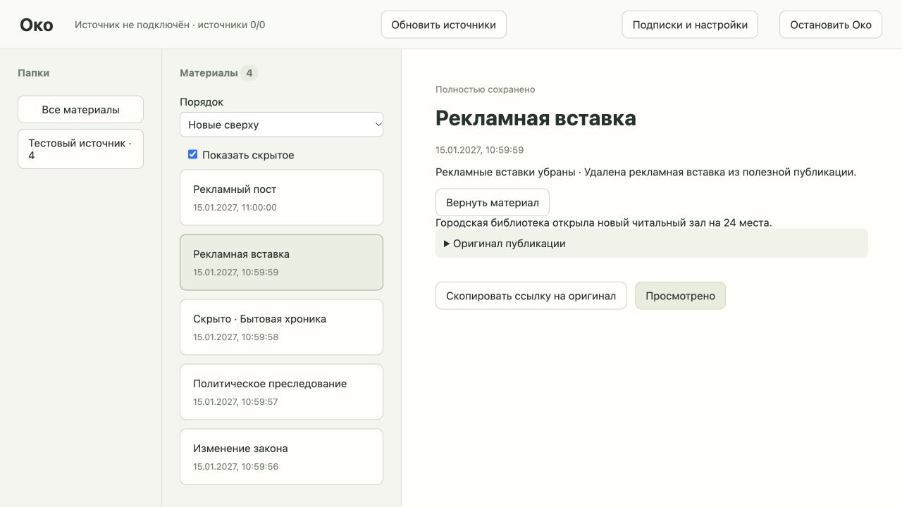
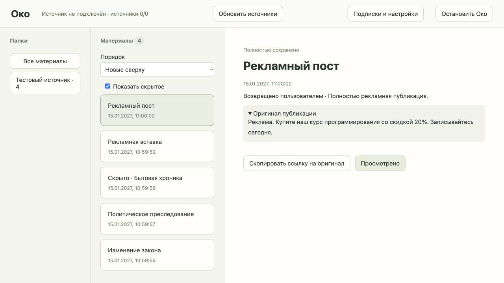

# Фильтрация и возврат скрытого — тикет 09

2026-10-09. Основание: `.scratch/oko-implementation/issues/09-content-filters.md`, A08/A17/A18/A19/A26/A28.

## Поведение

Непустой эффективный `prompt_filters` включает фильтрацию для Око, папки или фида; пустое значение выключает её на выбранном уровне. Правила наследуются по существующему порядку Око → папка → фид. Политические исключения не включаются глобально автоматически.

Общий `ProcessingRequest` получил операцию `filter`; llama.cpp и изолированный Codex возвращают строгую схему `hidden`, `reason`, `removed`. Вставки — точные фрагменты исходного текста. Отсутствующая цитата, удаление всего текста вместо скрытия, противоречивое решение или отсутствие причины отвергаются. Текст не переписывается моделью. Разрешение публичного AI, проверки подключения/квоты, лимиты, одна активная AI-операция, отмена и отсутствие fallback сохранены.

`Filters` хранит решения и причины в `content/<id>/1/filter.md`. В SQLite остаются только подписи входов и отметки возврата по хешу версии. Результат публикуется после атомарного перемещения файла и завершения задания. Осиротевший файл после падения не принимается. Отсутствующий файл требует повторной генерации.

До завершения фильтрации оригинал остаётся видимым с ожиданием/ошибкой. Готовое скрытое исключено из списка и счётчиков. `show_hidden=true` даёт полный набор для проверки и будущих сводок. «Вернуть материал» сохраняет оригинальное представление для той же версии, включая повторную обработку после смены правил и перезапуск; новая версия проверяется заново. Возврат доступен также для ошибочно удалённой вставки.

Тезисы ждут фильтра и получают очищенный текст; скрытое не суммаризируется. После возврата тезисы строятся по оригиналу. Оригинал и медиа остаются до просмотра, монтаж не добавлен. «Просмотрено» удаляет исходник, результат, причины, медиа и отметки исправления. Поздний ответ не возвращает контент.

API: `GET /api/cards?show_hidden=true`, `POST /api/materials/{id}/filter/restore`, `POST /api/materials/{id}/filter/retry`; материал содержит `filter` и `display_text`, а `text` остаётся оригиналом.

## Проверки через HTTP

`tests/test_filters.py`: оригинал и очищенный текст, скрытое и счётчики, устойчивый возврат, тезисы после очистки, запрет публичного AI, невалидная цитата, отмена с устойчивым к отмене внешним ответом, удаление и перезапуск, потерянный файл, новая версия после исправления, сохранность/удаление медиа, настоящий выход процесса после перемещения файла, общий контракт Codex. Внешние системы подменены, SQLite и файлы настоящие временные.

Первый сценарий воспроизвёл отсутствие фильтрации до реализации. Промежуточная ошибка теста ожидала готовность до завершения всех заданий; ожидание исправлено на наблюдаемую готовность всех результатов.

## Проверка качества настоящих обработчиков

Все примеры синтетические, без личных публикаций или аккаунтов источников. Один и тот же промпт:

> Скрывай полностью рекламные посты. Из смешанных публикаций убирай только рекламные вставки. Скрывай бытовую уголовную хронику, например драки соседей. Исключения: не скрывай политические преследования и изменения законодательства.

| Исходный текст | Ожидание | Настоящий Codex |
| --- | --- | --- |
| Реклама. Купите наш курс программирования со скидкой 20%. Записывайтесь сегодня. | Скрыть пост | Скрыт, причина: полностью рекламная публикация |
| Городская библиотека открыла новый читальный зал на 24 места. Реклама: купите наш курс со скидкой 20%. | Удалить только второе предложение | Точная рекламная цитата удалена; факт и число 24 сохранены |
| В районе полиция задержала мужчину за бытовую драку с соседом. | Скрыть бытовую хронику | Скрыта с причиной |
| Оппозиционный активист арестован за участие в антивоенном митинге. Правозащитники называют дело политическим преследованием. | Сохранить исключение | Сохранено без изменений |
| Парламент принял изменения законодательства о выборах: срок регистрации кандидатов увеличен до 30 дней. | Сохранить исключение | Сохранено без изменений |

Codex CLI 0.136.0: существующий вход ChatGPT, изоляция и свежая квота перед передачей проверены (начальная использованная доля окна 27%). Временный фид явно разрешал публичный AI. Все пять результатов получены через API Око за 33,26 с; это измерение одного прогона, не обещание скорости. Модель CLI используется согласно существующей конфигурации, без изменения пользовательских настроек. Пять простых примеров не доказывают качество на произвольном корпусе.

**Qwen3.5-0.8B Q8_0 в Llama.app не прошла смысловую проверку.** Сервер `http://localhost:9931`, выбранный ID `ggml-org/Qwen3.5-0.8B-GGUF:Q8_0`, подтверждённый локальный GGUF и build `b11429-d81235049`. Модель была выгружена по idle; для проверки явно пробуждена в уже работающем сервере. Проверка Око не включает autoload и сама не запускает сервер.

В первом прогоне пропущены рекламная вставка и бытовая хроника. Уточнение инструкции с примерами вызвало копирование отсутствующей цитаты — валидатор отверг ответ. В финальной инструкции без примеров модель дала противоречивые ответы и ошибочно скрыла политическое преследование. Отдельный эксперимент с включённым рассуждением на двух материалах закончился `finish_reason=length` без готового JSON. Режим рассуждения в коде не изменён. Эта модель подходит для ранее проверенных коротких тезисов, но её нельзя считать прошедшей приёмку фильтрации. Для локальной фильтрации требуется отдельно проверить более способную модель; модель не скачивалась и скрытого перехода на Codex не было. Codex выбран явно только для второго временного прогона.

## UI A

Браузер проверен с настоящими результатами Codex: три видимых карточки; включение «Показать скрытое» показывает пять, счётчик остаётся три. Рекламный пост раскрывает причину и действие возврата. После «Вернуть материал» счётчик папки/материалов становится четыре, статус — «Возвращено пользователем», оригинал видим. Смешанная публикация показывает очищенный текст; раскрытие оригинала показывает сохранённую рекламную вставку.

Тестовый сервер без внешнего источника показывает «Источник не подключён»; результаты настоящей генерации уже сохранены. Использованы собственные временные серверы/хранилище; рабочие настройки и пользовательские вкладки не изменены.

## Финальные проверки

- `tests/test_filters.py`: 8 passed; `tests/test_codex.py`: 14 passed.
- Полный набор один раз после изменений: **104 passed, 34,19 с**; только существующее предупреждение Starlette/httpx.
- `mypy oko`: 16 файлов, без ошибок; `node --check oko/web/app.js`, `git diff --check`: без ошибок.
- Созданные тестовые серверы остановлены, вкладка закрыта, временное хранилище удалено. Llama.app и пользовательские вкладки остаются под управлением пользователя; Ollama не запускалась.
