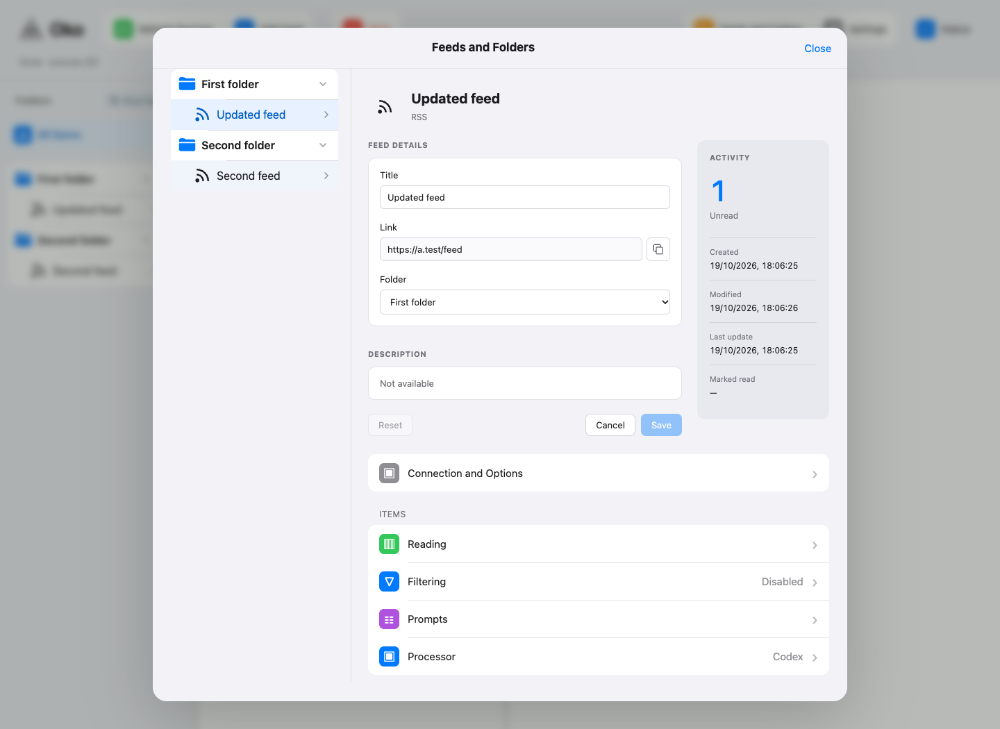
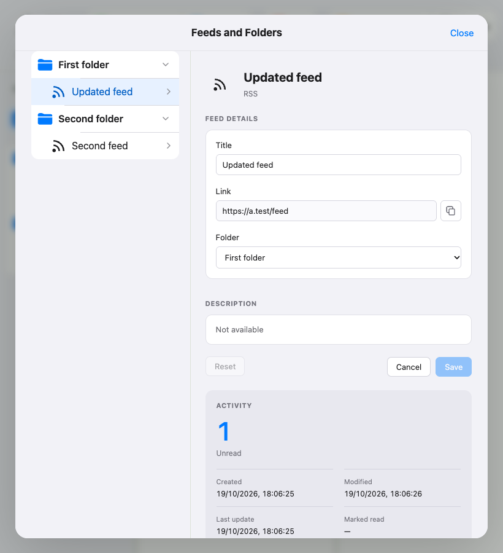

# Настройки фида B — проверка 2026-10-19

Реализован выбранный вариант B в существующем редакторе: Title/Folder сохраняются
одним PATCH; Link и дополнительные адреса только копируются маленькой кнопкой.
Description слева, Activity справа; при узком редакторе Activity перемещается вниз.
Прежние параметры, наследование и черновики других страниц сохраняются.

Старые неизвестные даты отображаются как «—». Last update записывается только после
допущенного успешного discovery; Marked read — после фактического «Просмотрено».
Unread включает скрытые, незагруженные и недоступные публикации. Описание внешнего
источника может быть недоступно: оно не подменяется описанием публикации.

## Результаты

Полный изолированный `check all --in-place --compact --browser-workers 2`:

- Python: 517 passed; отдельный HTTP-набор: 9 passed.
- Инструменты: 135 passed.
- Контракты, типизация, syntax, lint, сборка, entrypoint и diff: успешно.
- Browser: 165 passed, 6 failed, 2 ранее отключённых сценария skipped.

После исправлений выполнен целевой повтор восьми браузерных файлов — все 38
сценариев passed, включая все шесть ошибок полного прогона. Проверены также
холодная загрузка/отказ/повтор, сохранение фокуса и черновиков, поздние ответы,
блокировка двойного сохранения, Reset после ошибки Title, Cancel, clipboard отказ,
несколько/отсутствие адресов, локальное переименование и перенос с сохранением ID.
Полный all после целевого повтора не повторялся; успех относится к выбранным файлам.

Независимое ревью завершено без оставшихся замечаний. Скриншоты 1440×1050 и 820×900
из финального проверочного дерева просмотрены. Источники, аккаунты и обработчики
в тестах синтетические; пользовательский экземпляр не перезапускался.

База: `ddaf565b873dc2de6e6091efc99da9f3648a7dbb`.
Финальное проверенное дерево: `267a2c2e6d7ca55299bfa6cf772eeb8fccace818`.
Прежние/параллельные изменения других задач исключены из проверочной копии.
Рабочий checkout после проверки также успешно собран.

Подробные результаты ранних неуспешных запусков, команды и JSON receipts:
[локальный отчёт](../../.scratch/feed-settings/verification.md).
[Спецификация](../../.scratch/feed-settings/spec.md).
Прототип сохранён в [архиве](../agents/prototype-archive.md).

