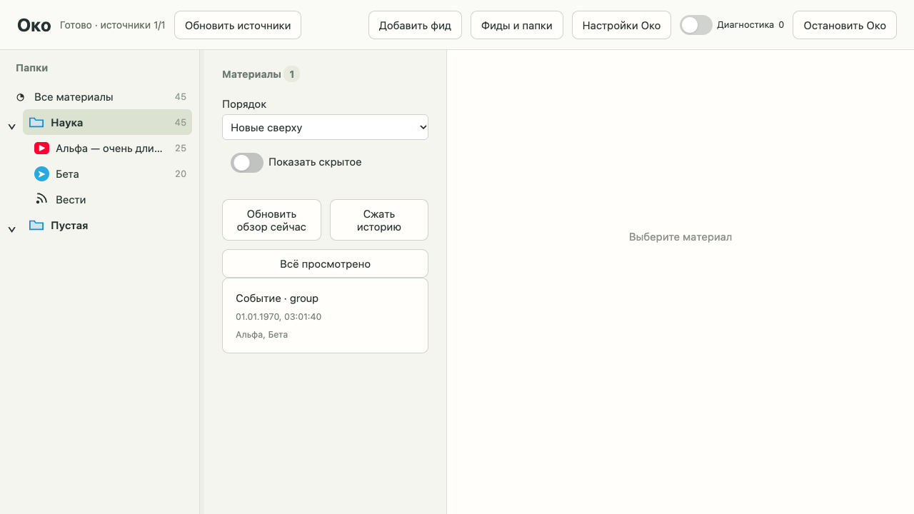

# Дерево папок и фидов: проверка реализации

Дата: 2026-10-13.

Спецификация: [дерево чтения](../../.scratch/feed-sidebar/spec.md). Интеграционная ветка: `codex/feed-sidebar`. База ревью — `884ef01`; проверенный код — `7d3b5ed`. Ранее готовые изменения субтитров и диагностики сохранены отдельно в базовом коммите и не входят в diff дерева чтения.

## Результат

Реализованы компактное дерево папок/фидов с локальными иконками, выбор области чтения, счётчики исходных публикаций, сохранение раскрытия и ширины, клавиатурные действия, предупреждения с переходом в диагностику и двойной клик в настройки. Справка возможностей источника находится в настройках фида. Папки и фиды без материалов остаются видимыми.

Выбор фида включает целиком события и обзоры с его исходниками. Подсчёт исключает скрытые и включает незагруженные публикации; закреплённая принадлежность обзора сохраняется после перемещения фида. Фильтр `feed` и навигация доступны через авторизованный HTTP interface. Новых внешних запросов и миграций нет.

## Фактические проверки

- Серверный TDD: отсутствующая навигация сначала дала красный сценарий, затем проверены навигация, группы, скрытые, незагруженные и закреплённые обзоры. Затронутый набор — 26 сценариев; после исправлений дополнительно 18 сценариев событий и навигации.
- Браузерный TDD: 6 новых сценариев дерева — выбор, раскрытие, сохранение локальных предпочтений, перемещение/удаление, поздние ответы, ширина мышью/клавиатурой, фокус/прокрутка, предупреждение, настройки, групповые источники и отказ локального сохранения.
- Настоящий HTTP граф JavaScript сначала выявил 404 нового модуля; маршрут добавлен, сценарий прошёл.
- Первый полный прогон выявил прежнее ожидание 2 карточек в счётчике события. Оно заменено на 3 исходные публикации согласно спецификации; отдельная проверка числа карточек сохранена.
- Финальная команда `./scripts/check all` с существующими Node/Playwright и Python зависимостями: синтаксис PASS; браузер **48/48** (56.84 s); diff PASS; Python **273/273** (112.63 s); строгий mypy **36 файлов**; CLI PASS. Всего **171.74 s**, exit 0.
- Spec review — 0 замечаний. Standards review — одно P3 про общий заголовок авторизации в тестах; исправлено импортом существующего помощника, повторное ревью — 0 открытых замечаний.
- Скриншот настольного интерфейса визуально проверен: строки компактные, названия обрезаются, локальные иконки различимы, счётчики справа. Проверки также покрывают изменение ширины и её сохранение.

## Ограничения и завершение

Скриншот и все автоматические сценарии используют синтетические подписки и материалы. Личные источники, Telegram и настоящий обработчик не вызывались. Пользовательский экземпляр Око не перезапускался. Для применения серверных изменений требуется перезапуск Око, для обновления JavaScript — перезагрузка страницы.

Все три задачи выполнены и объединены в интеграционной ветке. Worktrees исполнителей удалены. PR и внешняя публикация не создавались; трекер закрывает работу локальным статусом `done`.

