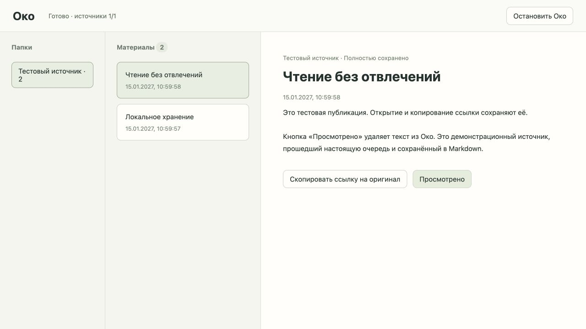

# Первый путь читателя — проверка 2026-10-08

Настоящий локальный Python-сервер, временное хранилище `/tmp/oko-browser-first-path`, синтетический адаптер. Личные аккаунты и реальные источники не использованы.

В Codex In-app Browser:

- После heartbeat появились три сохранённых материала, индикатор «Готово · источники 1/1».
- Открытие первого материала сохранило счётчик 3.
- Кнопка копирования показала «Ссылка скопирована», просмотр не изменился. Инструмент чтения браузерного буфера не вернул текст; точное содержимое системного буфера отдельно не подтверждено.
- Во второй вкладке открыт тот же материал. «Просмотрено» в первой убрало материал из обеих вкладок, очистило текст, счётчик стал 2.
- Закрытие первой вкладки сохранило работоспособность второй: другой материал успешно открылся.
- После закрытия последней вкладки сервер завершился с кодом 0 в пределах 21 секунды (6 секунд lease + 15 секунд grace).

API и процессные проверки дополнительно покрывают идемпотентный просмотр, отсутствие возвращения при повторном обнаружении, поздний ответ после просмотра, аварии до фиксации обнаружения / после перемещения файла / после фиксации просмотра, видимую ошибку удаления с повтором, повреждённую базу без сброса, запрет посторонних Origin/Host и анонимного API, отсутствие постоянного кэша, управляемое истечение связи после сна, единственный экземпляр и явную остановку.
