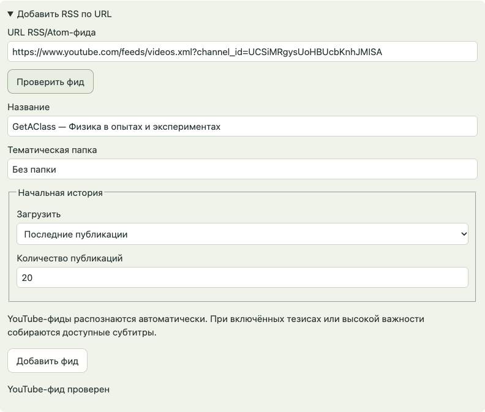
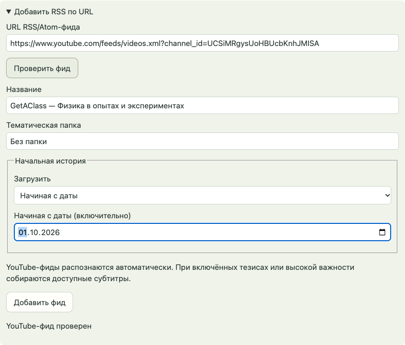

# Начальная загрузка истории — итоговая проверка

Дата: 2026-10-12. Интеграционная ветка: `codex/initial-history`. Исходная база: `c5dcd90`.

## Результат

Все шесть задач выполнены. Формы RSS/Atom, YouTube и Telegram предлагают последние N публикаций (по умолчанию 20) либо включительную начальную дату в часовом поясе пользователя. Выбор сохраняется до сбора; новые публикации собираются отдельно от начальной истории. Прогресс, исходы материалов и пауза переживают перезапуск. Готовность тезисов не задерживает историю.

В настройках фида доступны пауза/продолжение, количество сохранённых и неполных материалов, ожидание повторной попытки и окончательная недоступность. Ошибка отдельного материала не блокирует остальные. Ошибка архива Telegram не блокирует сбор новых сообщений. Повторное подключение сохраняет существующий фид; импортированные Telegram-фиды можно подключить к собственному клиенту. Старые курсоры и правила OPML сохранены, прежняя редактируемая глубина заменена информацией о фактической границе.

RSS/YouTube используют текущее окно фида: недостаток количества и неподтверждённая полнота периода видны пользователю. Публикации без даты явно помечены. Telegram-альбом считается одной публикацией; служебные действия не расходуют количество постов, но их ID сохраняются в проверке безопасного прочтения.

## Ограничение Telegram

API не предоставляет атомарный снимок истории. В режиме количества сначала порциями сохраняется список выбранных ID, затем загружается содержимое. Во время подбора показано соответствующее состояние; итоговая доступность не объявляется преждевременно. После завершения списка удалённые выбранные публикации не заменяются другими. Публикацию, исчезнувшую до получения её ID во время самого подбора, восстановить невозможно; ограничение явно показано в интерфейсе и описано в спецификации. Сбор новых сообщений и восстановление подбора после перезапуска работают независимо.

## Проверки

- Полный Python-набор: **257 passed**, 110.99 секунды. Единственное предупреждение — существующая депрекация Starlette/httpx.
- Полный браузерный набор: **26 passed**, 26.40 секунды; реальные HTML/JavaScript и отдельный профиль Chrome на временном локальном сервере.
- Mypy: **36 модулей**, без ошибок.
- Проверка синтаксиса всех шести браузерных модулей, `python -m oko --help` и `git diff --check` прошли.
- Проверены фиксация количества, включительная московская полночь, неизвестные даты, ограниченное окно, альбомы и темы форума, перезапуск с 7 из 20, пауза до первого обращения, отдельные новые поступления, ошибки/повторы/удаление, сменившееся окно источника, старые курсоры и повторное подключение.
- Дополнительные регрессии: ошибка архива с продолжающимся live-сбором и восстановлением; удаление выбранного ID без подмены; отсутствие ложного недостатка истории во время подбора; безопасная граница прочитанного со служебными ID.

Проверки запускались с временными хранилищами и управляемыми внешними ответами. Личные подписки, пользовательские Telegram-аккаунты и реальные модели не использовались. Работающее пользовательское приложение не перезапускалось.

## Ревью

Сравнение: `git diff c5dcd90...HEAD`. Две независимые оси:

- **Standards:** после исправлений замечаний нет. Транзакция паузы принадлежит Store, сборка Telegram-публикаций общая, тестовые помощники вынесены в support.
- **Spec:** после исправлений блокеров нет. Подтверждены независимый live-сбор при ошибке архива, неизменность завершённого списка ID, достоверная доступность, восстановление подключения импортированных фидов и отображение старой границы.

Первый полный прогон обнаружил регрессию подключения импортированных Telegram-фидов; она исправлена. Старые ожидания отказа при повторном подключении изменены на согласованное открытие существующего фида, а намеренное переподключение проверяется с явным `feed_id`. Финальный полный прогон зелёный.

## Вид формы

Скриншоты сняты с окончательных файлов приложения и синтетическим ответом проверки фида. Указанный адрес использован для иллюстрации; реальная подписка не создавалась.

## Связанные документы

- [Спецификация](../../.scratch/initial-history/spec.md)
- [Задачи и зависимости](../../.scratch/initial-history/README.md)
- [Согласованное проектирование](../../.scratch/initial-history/design.md)

Для использования изменений перезапустите Око. Локальные коммиты сохранены на интеграционной ветке; внешняя публикация не выполнялась.
