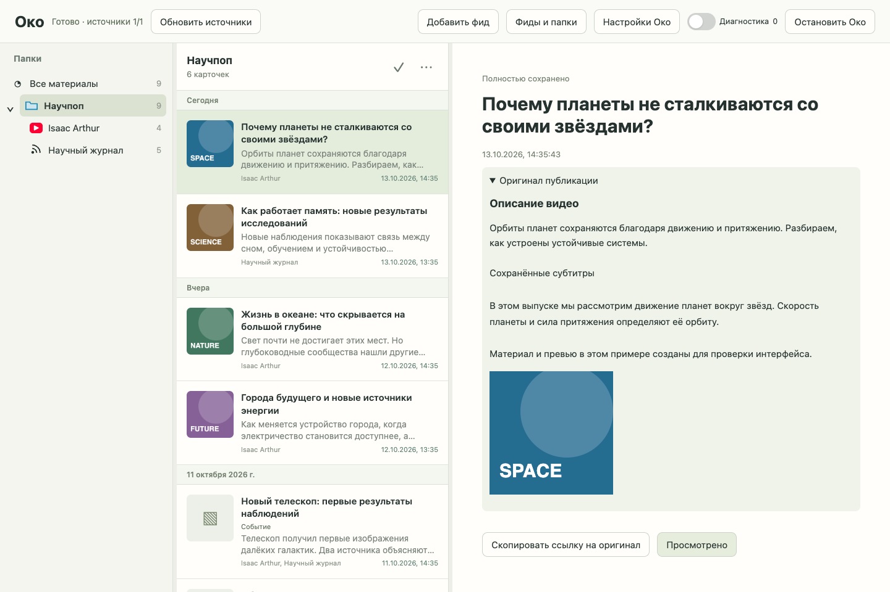
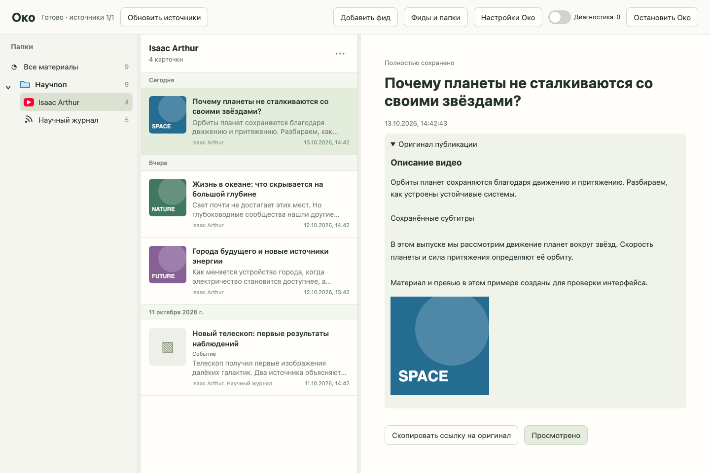

> Исторический документ. С 2026-10-15 обзоры за период, события и сжатие истории удалены из Око. Их описание ниже сохраняет контекст и результаты прежней версии, не задаёт требований к текущей реализации. Сохранены фильтрация и тезисы отдельных публикаций.

# Проверка списка материалов

2026-10-13. Спецификация: [список материалов](../../.scratch/material-list/spec.md).
Ветка: `codex/material-list`. База ревью: `572622a2112f1ac482b54152f9efc0f16f6ade38`. Реализация: `75f93bf`, исправления ревью: `7ea4c29`.

## Результат

Единый компактный список для папки, фида и всех материалов: локальные превью/значки, заголовок и краткий текст, источники, даты, закреплённая шапка, счётчик карточек и меню. Сохраняются сортировка и ширина; прокрутка запоминается по областям в текущем сеансе. Клавиатура отделяет фокус от открытия; просмотр удаляет строку без автоматического открытия следующей.

Описание YouTube сохраняется отдельно от субтитров из обычного Atom, доступно после перезапуска и в предыдущих версиях. Описание ранее собранного видео добавляется в доступном окне фида без повторного запроса полученных субтитров. Список получает ограниченный plain-text `snippet`, не загружает полные материалы ради строк и не запрашивает внешние превью.

## Фактические проверки

| Запуск | Результат |
| --- | --- |
| Первый `check all` | Python 286 passed; mypy 36 файлов; HTTP, синтаксис, diff и CLI passed. Браузер: 52 passed, 4 failed; общий exit 1, 271.45 s. Этот запуск не считается успешным полным прогоном. |
| `check ui` после исправлений | 57/57 браузерных сценариев; HTTP 1 passed, синтаксис и diff passed; exit 0, 57.74 s. |
| Итоговый `node --test tests/browser/test_material_list.cjs` | 10/10 passed, 9.69 s. После последней правки метки загрузки и уточнения тестовых данных скрытой карточки. |
| Финальный запуск файлов material-list, opened-material и reading-tree | 24/24 passed, 12.66 s. После уточнения тестового транспорта групп: участие фида определяется исходниками группы, а не её служебным `feed_id`. |
| Итоговый `check syntax http diff` | Все три набора passed; HTTP 1 passed, exit 0, 1.17 s. |
| Git pre-commit | Staged синтаксис и whitespace passed для обоих коммитов кода. |
| Визуальный запуск | Настоящий Chrome, 1440×960, синтетические материалы и локальные сгенерированные превью. Снимки папки и фида проверены; page errors: 0. |

Python, типы и CLI после успешного результата не менялись. Финальный запуск повторяет 24 затронутых браузерных сценария, включая все 10 нового списка; остальные 34 подтверждены предшествующим успешным UI-прогоном. Всего подтверждены 58 разных браузерных сценариев, а не сумма повторных запусков.

Дополнительно исполнитель данных проверил 77 затронутых Python-сценариев. Два сценария восстановления первоначально потребовали выхода из sandbox для временного localhost-сервера; повторный запуск прошёл.

## Что обнаружили и исправили

- TDD-проверки обнаружили отсутствующие строки, показ описания, сдвиг списка при вставке нового материала, отсутствие обновления превью новой версии и отсутствие отдельной метки для `complete=false`. Проверки сначала падали, затем проходили после реализации.
- Независимые Spec и Standards обнаружили обращение к неопределённому `source` в показе предыдущих версий. Исправлено, добавлен сценарий текущего и предыдущего описания с отдельными субтитрами.
- Первый полный браузерный прогон также выявил потерю доступного префикса типа «Обзор» и отмены открытия при потере связи. Оба поведения восстановлены; существующие проверки прошли.
- Возможное дублирование правила выбора превью устранено локальной функцией `previewPath`.
- Повторное независимое ревью обоих направлений: 0 нерешённых замечаний.
- При финальной проверке снимка уточнён тестовый транспорт групп, чтобы он совпадал с уже правильной production-фильтрацией. Снимки повторены; Spec-проверка уточнения не выявила замечаний.

## Снимки

Примеры содержат вымышленные материалы и сгенерированные локальные картинки, а не личные подписки.

Папка:

Фид:

## Ограничения и применение

Личные RSS/Telegram-источники, реальный YouTube и настоящие обработчики при проверке не использовались. Сохранение описания проверено синтетическим Atom через HTTP interface читателя. Для старых видео вне доступного окна Atom описание не запрашивается отдельно; остаются сохранённые субтитры или отсутствие краткого текста.

Пользовательский экземпляр Око не перезапускался. Для применения серверной части нужен перезапуск Око, для браузерной — обновление страницы. Публикация и push не выполнялись; локальный трекер закрывается без PR.

Предшествующие изменения development guardrails сохранены в рабочем дереве и не включены в коммиты этой задачи.
