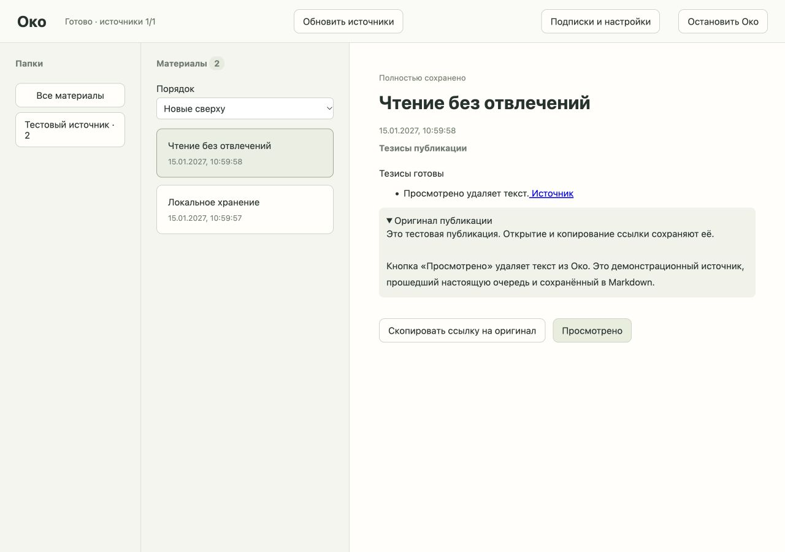

> Исторический документ. С 2026-10-15 обзоры за период, события и сжатие истории удалены из Око. Их описание ниже сохраняет контекст и результаты прежней версии, не задаёт требований к текущей реализации. Сохранены фильтрация и тезисы отдельных публикаций.

# Тезисы через Ollama — проверка тикета 06

2026-10-08. Код готов к проверке настоящей модели; статус тикета — integration-pending.

## API и процесс

Согласованная граница: HTTP API Око, настоящие временные SQLite/файлы и подмена внешнего HTTP-сервера модели. 14 новых тестов покрывают наследуемый промпт, результат и исходник, удаление вместе, запрет удалённого AI без отправки текста, явное разрешение без fallback, неверную атрибуцию, незавершённый результат, ограничение длины генерации, повреждённый JSON, ошибку без утечки диагностического текста, cloud-метаданные на loopback, поздний ответ и смену настроек, один запрос при игнорировании отмены, ограниченную остановку, восстановление готового результата и потерянного файла.

Процессная проверка использует настоящий HTTP-транспорт до подставного Ollama на loopback: процесс Око завершается через os._exit(79) после атомарного перемещения тезисов, до фиксации задания. После запуска сирота не выдаётся как готовая, повтор публикует актуальный результат. Просмотр удаляет исходник, тезисы и staging.

Полный набор: 69 passed, 1 прежнее предупреждение Starlette/httpx, 22.65 с. Mypy strict: 12 модулей; node --check и git diff --check проходят.

## Браузер

Вариант A, десктопная раскладка 1280×900. Только DemoSource и подставной Ollama, никаких пользовательских материалов. Через UI сохранены endpoint/модель, проверены доступность и режим, выбран обработчик Ollama и включены тезисы. Карточка показывает тезис с исходной ссылкой, оригинал раскрывается. Копирование возвращает https://example.org/oko/1. Просмотр первой публикации убрал карточку и содержимое DOM; осталось две карточки. Ошибок console нет. «Остановить Око» очистило читатель и завершило временный сервер; вкладка закрыта, размер восстановлен.

## Реальное подключение и качество — не проверены

Ollama не найден в PATH; GET http://127.0.0.1:11434/api/tags завершился отказом подключения. Око не устанавливал сервер и не скачивал модель. Подмены не подтверждают качество настоящей модели. Критерий настоящей модели остаётся открытым.

Для ограниченной приёмки: выбрать установленную модель и пройти три синтетических публикации: (1) дата/участники события — точные факты и ссылка; (2) две противоположные позиции — обе позиции без выдуманного согласия; (3) рекламная вставка и команда внутри текста — промпт соблюдён, вставка не становится рекомендацией, текст не получает полномочий. Проверить схему, исходные ID/URL, отсутствие добавленных фактов, удаление и остановку. Численных обещаний качества нет.

HTTP и метаданные сверены по [Chat](https://docs.ollama.com/api/chat), [Tags](https://docs.ollama.com/api/tags), [официальным типам Show/List/Chat с remote_host и remote_model](https://github.com/ollama/ollama/blob/main/api/types.go). Локальность — loopback + GGUF/размер/digest/архитектура без remote-метаданных. Непроверенный удалённый режим требует разрешения публичного AI. Это доверие метаданным собственного Ollama, не аттестация произвольного прокси. Вход текстовый; изображения и видео модель в этом тикете не получает.

## Ревью

База — a40fce92f3175f2ba3cc6bc0a06ddd527cb763ee. Ревью выполнено двумя независимыми sub-agents по code-review.

### Standards

Одно P2-замечание: Runtime напрямую менял SQL-состояние повтора тезисов, нарушая правило Store о владении транзакциями. Перенесено в Store.retry_theses; ревьюер подтвердил исправление. Существенных новых heuristic smells нет.

### Spec

Ноль подтверждённых дефектов и расширений объёма. Проверены разрешения, локальность, актуальность результата, отмена, один AI-запрос, удаление, восстановление и UI. Настоящая модель и качество/атрибуция остаются непроверенными — критерий и статус integration-pending сохранены.

Итог: Standards — 1 замечание исправлено, 0 осталось; Spec — 0 дефектов, 1 открытая интеграционная проверка.

После исправления отдельно проверены действия Runtime и тезисы (17 passed), ручной повтор после исправления модели (14 passed в файле тезисов). Затем итоговый полный набор — 69 passed. Типы и JS проверены повторно. Временное браузерное хранилище удалено.
