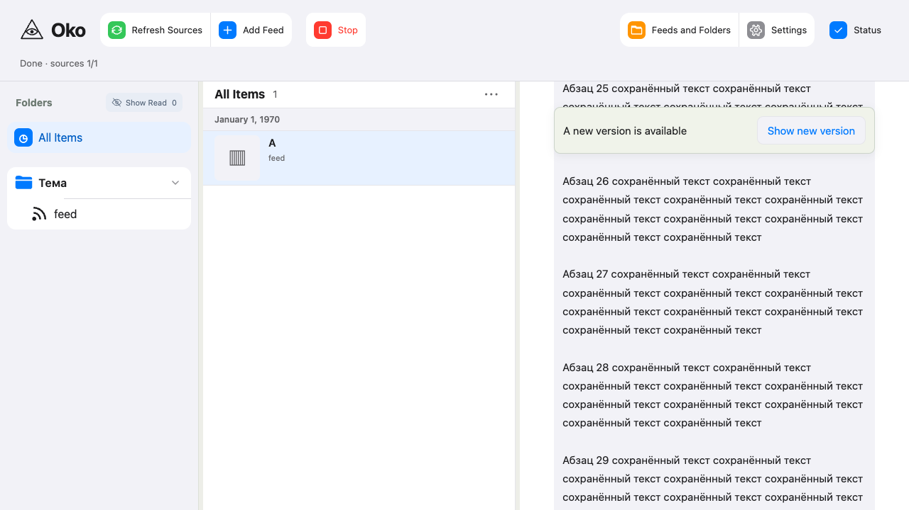
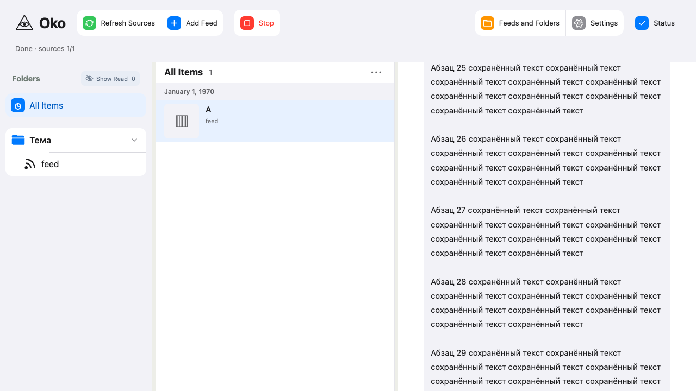

# Открытый материал: UI и полный прогон

2026-10-20. Разрешение пользователя: «ок, а теперь полный прогон и еще поменяй UI».

## Реализованное поведение

- Новая ревизия текста, новый текст/описание или заголовок предлагаются кнопкой
  `Show new version`. Кнопка остаётся доступной при прокрутке.
- До нажатия показанные текст, фильтр, тезисы и медиа остаются вместе.
  Части другой ревизии или другого storage не подмешиваются, в том числе при
  совпавших номерах ревизий. Кнопка применяет уже полученные части.
- Тезисы, фильтрация и медиа показанной ревизии обновляются отдельно. Неизменные
  blob URL и media DOM сохраняются: догрузка картинки не останавливает видео.
- При обновлении удерживается видимый абзац оригинала, отфильтрованного текста
  или описания; при удалении абзаца — ближайший совпавший, при полном
  переписывании — относительная позиция.
- Исчезновение карточки, просмотр во второй вкладке, удаление выбранного фида
  и временная потеря связи сохраняют загруженное. Серверное удаление не
  откладывается. После удаления недоступны догрузка и действия обработки.
- Незавершённое первоначальное открытие отменяется при просмотре/потере связи.
  Явный выбор другой области/материала или Stop завершают показ. При завершении
  blob освобождаются; перезагрузка не восстанавливает копию.
- При разрыве связи pending медиа отменяются, после восстановления догружаются.
  При смене storage незавершённые медиа/предыдущие версии отклоняются по epoch;
  новый storage применяется кнопкой. Исторический API или генерация тезисов
  для старой версии не добавлялись.

API-контракт и серверные сокращения чтений сохранены. Архитектура:
[открытый материал](../architecture/opened-material.md).

## Проверяемое дерево

База: `ad56948e228056adb9df66b3d9665bd1ee1cd01b`.
Снимок до UI: `/tmp/oko-ui-update-start`.
Объединённая подготовка SQL+UI: `/tmp/oko-sql-ui-ready-04`.
Проверочная копия: `/tmp/oko-sql-ui-check-04`.
Дерево: `589d770c4eef1be89a5459593e7224ba71b8e295`.

Прежние правки README, development.md, reading-coordination.md,
reader-appearance.css и shell.tsx не менялись и не включались в копию.
На момент этого прогона настоящий Git index сохранён; коммит, публикация
и обновление рабочего экземпляра ещё не выполнялись. Проверки используют
временные хранилища, синтетические источники
и модель; личные подписки не запускались.

## Проверки

Итоговый `./scripts/check all --in-place --compact` — **PASS**, exit 0,
203.90 секунды. Все 13 групп прошли; checkout guard не обнаружил изменений.
619 Python/HTTP (610 + 9), 135 инструментальных тестов, 189 браузерных
(185 функциональных + 4 профиля latency), 2 штатных пропуска.
Типизация приложения/браузера/инструментов, контракт, syntax, lint,
сборка, entrypoint и diff также PASS.

Полный [report.json](opened-material-updates-data/full-report.json).
Исходный запуск:
`/tmp/oko-sql-ui-check-04/.scratch/check-runs/20261020T171217Z-422922db`.

SQL при открытии: **7 SELECT, 0 записей**, максимум одно чтение каждого файла
на 104/400 материалах как без обработки, так и с фильтром, тезисами, медиа
и двумя версиями. Неизменившийся пакет проверен существующим тестом:
не более 2 SQL, ни открытия, ни stat файлов содержимого, ни записей в БД.
Сырые измерения: [400 с обработкой](opened-material-updates-data/open-400-True.json).

320 браузерных открытий (40 первых + 40 повторных в четырёх профилях),
тот же синтетический стенд, что в предыдущей оптимизации. Все p95 <200 мс.

| Материалов | Фон | p95 первое, мс | p95 повторное, мс |
| --- | --- | ---: | ---: |
| 104 | idle | 18.1 | 18.2 |
| 104 | обработка | 18.5 | 18.3 |
| 400 | idle | 27.2 | 34.7 |
| 400 | обработка | 26.1 | 33.5 |

[Сырые серии](opened-material-updates-data/latency.json).
Небольшие различия с прошлым прогоном не доказывают ускорение от UI-изменений.

Предыдущий полный прогон
`/tmp/oko-sql-ui-check-03/.scratch/check-runs/20261020T170835Z-06e27ba5`
завершился с одним устаревшим ожиданием в `test_folder_actions.ts`: после
завершения папки тест требовал убрать открытый текст. Остальные результаты:
610 Python, 9 HTTP, 135 tools прошли; браузер: 184 passed, 1 failed, 2 skipped.
Ожидание заменено на сохранение текста; итоговый полный прогон повторён
целиком и прошёл. [Первый полный report](opened-material-updates-data/first-full-report.json)
сохранён отдельно, его результат не заменён успешным ограниченным повтором.

Целевые итерации выявили и устранили скачок из-за второго владельца scroll
в Media effect, отсутствие абзацев в фильтрованном тексте, автоматическое
очищение при fallback дерева, допуск медиа после reset и отсутствие
возобновления после disconnect. В тесте reset исправлена подмена транспорта:
адаптер устанавливается до загрузки приложения, поскольку клиент сохраняет
ссылку на fetch. В относительном fallback переписаны все абзацы фикстуры,
включая последний, иначе правильно срабатывал поиск ближайшего совпадения.
Первый целевой запуск остановился до сценариев из-за устаревших assets;
следующие запуски использовали новую сборку.

Независимый reviewer проверил асинхронность, владение состоянием и ресурсами,
совместимость ревизий и исправления замечаний. Открытых замечаний нет.

## Скриншоты

Сняты Playwright, просмотрены после выполнения сценария. На обоих снимках
абзац 25 остаётся в той же позиции, хотя выше вставлены восемь абзацев.

## Ограничения

Это локальный синтетический стенд. Рабочий Docker-выпуск не обновлялся.
Ранее выявленная нестабильность профиля с 20 Chrome-вкладками не объявляется
устранённой этим UI-изменением; исторические измерения сохранены в
[отчёте сокращения чтений](material-read-shortening.md).
