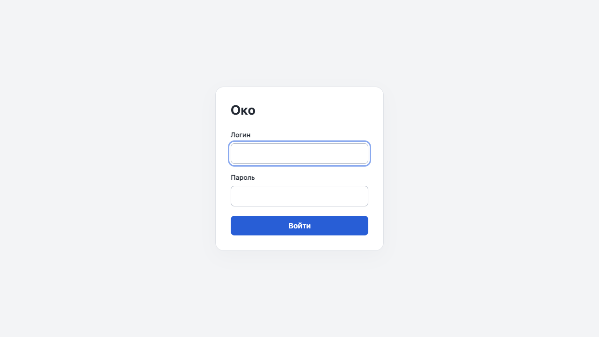
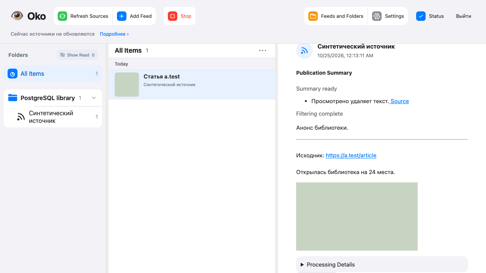

# PostgreSQL reader verification — 2026-10-25

Implementation of [#127](https://github.com/tgenman/oko/issues/127), following
[the foundation PR #134](https://github.com/tgenman/oko/pull/134).
All database, source, model and account data below are synthetic. No working
reader installation or personal source was used.

## Implemented boundary

- Native PostgreSQL schema: 43 original tables, derived membership work, 25
  indexes, the reading membership view and 145 native projection triggers.
- Separate, atomic release migrations; immutable version/name/checksum ledger;
  reader startup verifies compatibility and never installs PostgreSQL DDL.
- A schema-scoped shared reader lease excludes migrations while the reader is
  live. A separate exclusive lease prevents two Stores recovering one schema.
- Shared row/cursor and transaction boundary, bound query parameters, explicit
  null-safe comparisons, conflict policies and JSON scalar functions.
- Reader credentials come from a private regular file. The reader role can read
  and mutate application data but cannot create schema or write migration history.
- Publication text/results stay SQL data, as in the current SQLite backend;
  publication media stay files. This corrects the earlier plan's description of
  all collected content as files and preserves current product storage behavior.

## Executed targeted scenarios

Actual PostgreSQL 18, with a separate disposable schema for each case:

- Whole-release DDL/ledger rollback, idempotent migration and reconnection;
  modified, pending, missing and newer schema history rejection; concurrent
  migration exclusion and read-only verification.
- Atomic publication of state/jobs to an independent reader; nested failure
  poisoning, pre-commit projection failure, discarded callbacks and close rollback.
- One Store owner across different data roots; migration blocked by a live reader;
  incompatible schema produces an explicit HTTP storage failure, never SQLite.
- RSS verification and feed/folder settings over HTTP, repeated collection
  without duplicates, text/media delivery, reader version protocol, restart and
  explicit Viewed. Injected file-cleanup failure remains recoverable by replay.
- One YouTube publication shared by two feeds; deleting its primary feed keeps
  the publication and PNG for the remaining feed; Viewed removes the media.
- Filter result and job completion commit/rollback together; summary after
  restart; terminal/source-wait preservation; rejection of late old success/error;
  hidden-material folder completion; captured execution choice recovery; ADR-0001
  keeps completed results when future model/reasoning/Fast choices change.
- Real CLI uses the private DSN file, preserves data on restart and creates no
  SQLite file. A group/world-readable credential file is rejected before launch.
- Playwright logs in, creates an RSS feed through the UI, renders its image,
  filters/summarizes it, restarts the reader with its remembered session, marks
  it Viewed and logs out. No browser page errors; screenshots inspected.

Strict mypy and browser TypeScript checks passed. Independent review found one
startup error-handling omission (`SchemaMismatch`), fixed and verified with an
HTTP regression case. Follow-up review accepted the schema/instance leases.
The first isolated full-project run (`3434cd08`, based on `f9b1a5af`) passed
contracts, static checks, build, HTTP, entrypoint, 264 tool tests, 113 Node tests
and 225 Playwright tests (3 skipped). Python had 942 passes and two failures:

- Worker imported database exception types directly. Classify integrity failures
  through Store instead; the three layer-boundary tests pass.
- An existing Telegraph test captured root-only theses before its linked article
  first completed. Independent baseline reproduction with a 30 ms first-response
  delay produced the same failure; the two revision hashes exactly matched
  without/with the complete child. Wait for both ready theses and the initial
  article text before recording the baseline. Keep the unchanged-revision
  assertion after 503, and retain the controlled delay to exercise the race.

The unchanged-code repeat of all four Telegraph variants passed before the
stabilization. This does not turn the original full run into a pass. The final
Python evidence after the fixes: the entire Python suite passed **944 tests,
0 skipped**, with strict mypy and contract checks also passing. This includes
33 real-PostgreSQL scenarios, including the nested Playwright and CLI cases.
The earlier successful UI/tool/Node groups remain separate evidence; GitHub CI
is required before merging the final release.

## Limits

These are synthetic storage and product tests, not a production load benchmark.
The cloud VM, TLS, host Codex helper, backups, monitoring and deployment are
separate subsequent tickets. Historical SQLite-only reports do not prove this
PostgreSQL implementation.
