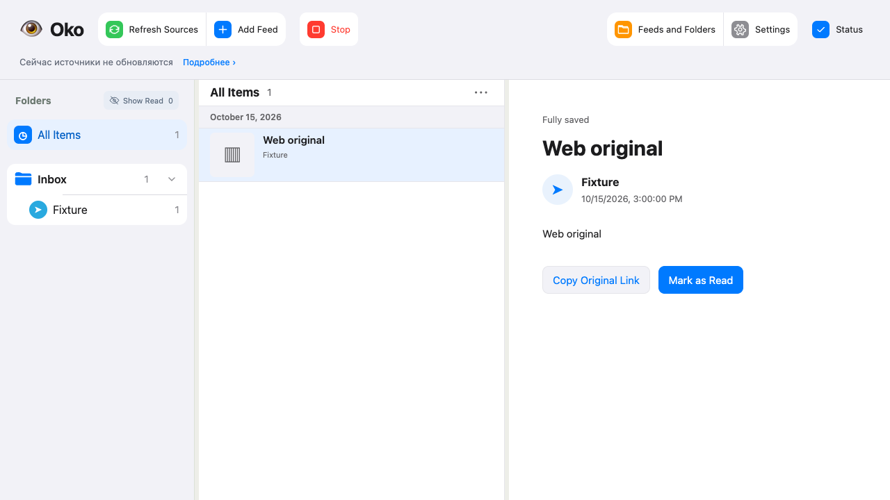
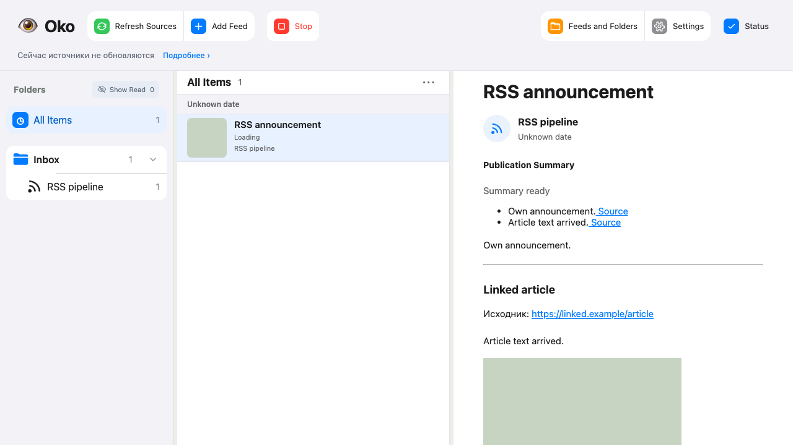

# Итоговая проверка пайплайна #90–#98

## Объём

Реализация в PR #99, #101–#108; родитель #89. Этот отчёт относится к коду,
синтетическим источникам/моделям, временным SQLite и локальным файлам.
Личные подписки, Telegram-аккаунты и рабочая установка не использовались.

#98 завершает офлайн-перенос RSS и действующих источников, включает новый путь
для пустого CLI-хранилища, удаляет постоянную файловую проекцию целевой Publication
и отменённые функции UI/API. Группы Telegram сохраняют прежний путь.
Проверяемый перенос и выпуск — [инструкция](../development/publication-migration.md).

## Матрица 21 критериев #89

Номера соответствуют порядку приёмки спецификации. Это указатели на исполняемые
проверки, а не перечень предполагаемой будущей работы. Они входят в общий прогон.

| № | Проверяемое поведение | Доказательство |
|---|---|---|
| 1 | Первый Telegram Web API и сохранение остальных источников | `test_publication_adapter.py`, `test_telegram_web.py`, `test_youtube_publications.py`, `test_telegram_client_publications.py` |
| 2 | Повтор страницы, транзакционный курсор, падение и рестарт | `test_discovery_transaction_survives_process_death`, `test_discovery_interruption_keeps_album_identity_and_files_recover`, повтор страниц в `test_publication_adapter.py` |
| 3 | Включённая начальная позиция, N−1, пробелы, альбомы, пустота, недобор, верхняя граница | `test_publication_adapter.py`, `test_telegram_client_adapter.py`, `test_rss_adapter.py` |
| 4 | Новые публикации после окна; отдельная история не ломает регулярный курсор | `test_telegram_window_is_inclusive_chronological_and_fixed`, `test_count_selects_fixed_latest_set_and_new_arrivals_do_not_consume_count`, `test_telegram_web.py` |
| 5 | Повреждённый сосед и ошибка страницы различаются с концом | `test_broken_record_preserves_other_posts_and_known_key_for_fetch`, `test_failed_page_can_retry_same_window_without_admitting_new_posts`, `test_malformed_record_keeps_its_key_and_does_not_drop_healthy_peers` |
| 6 | RSS-content без fetch; запись и статья раздельны | `test_rss_ready_excerpt_without_article_url_is_saved_without_a_fetch`, `test_rss_article_is_fetched_separately_and_does_not_become_a_feed_card` |
| 7 | Текст при ошибке файла; субтитры обрабатываются без обложки | `test_edited_text_is_readable_while_new_photo_download_is_held`, `test_youtube_publications.py`, `test_processing_does_not_wait_for_the_media_lane` |
| 8 | Locator сохраняет ID ресурса; замена получает новый; старые байты недоступны | `test_refreshed_signature_keeps_the_media_id_and_existing_bytes`, `test_changed_resource_refreshes_description_before_downloading_new_bytes` |
| 9 | Файл раньше ready, crash boundaries и активная очистка | `test_process_death_at_media_acceptance_never_exposes_uncommitted_bytes`, `test_cleanup_between_move_and_commit_keeps_the_admitted_final_file` |
| 10 | Durable backoff, source-wait, постоянная ошибка | `test_one_file_failure_keeps_other_files_and_backoff_survives_restart`, `test_media_source_wait_survives_restart_and_does_not_pause_another_host`, `test_permanent_file_failure_waits_for_manual_retry` |
| 11 | Нет двойного захвата; отозванные поколения не принимаются | `test_refresh_does_not_cancel_or_duplicate_running_collection`, `test_replacement_starts_while_cancel_resistant_old_media_is_still_waiting`, `test_rule_change_rejects_late_filter_and_uses_one_new_feed_snapshot` |
| 12 | Независимые этапы, выключенные правила, filter_out | `test_feed_rules_are_saved_and_disabled_stages_are_skipped`, `test_hidden_has_empty_blocks_original_and_no_restore_or_summary` |
| 13 | Подтверждённый no_input; недоступный вход не выдаётся за пустой; появление пересчитывает | `test_confirmed_empty_input_completes_without_model`, `test_unavailable_input_waits_without_model_and_processes_when_retrieved` |
| 14 | Статья обновляет корень; неизменный вход и YouTube cover сохраняют результат | `test_article_arrival_reprocesses_root_and_keeps_actual_source_references`, `test_results_have_atomic_metadata_and_media_change_preserves_processing`, `test_youtube_metadata_refresh_keeps_caption_file_and_accepted_processing` |
| 15 | Один набор настроек, один принятый результат, public_ai | `test_rule_change_rejects_late_filter_and_uses_one_new_feed_snapshot`, `test_shared_publication_respects_all_source_permissions_and_uses_one_result`, `test_permission_revoked_during_check_does_not_transfer_canonical_source` |
| 16 | Точные удаления, происхождение, неизвестный источник тезисов | `test_invalid_model_output_does_not_become_a_result`, `test_filter_uses_article_with_context_but_only_changes_roots_derived_content` |
| 17 | Неудачная регенерация сохраняет актуальное; новый вход очищает | `test_failed_regeneration_retains_only_current_results_across_restart` |
| 18 | Просмотр/удаление/смена доступа отменяют работу; общие зависимости остаются | `test_viewed_cancels_a_media_job_and_rejects_its_late_file`, `test_switch_rejects_late_native_file_and_keeps_new_web_content`, `test_shared_article_survives_one_root_then_disappears_after_the_last_link`, `test_shared_media_download_continues_after_its_original_feed_is_deleted` |
| 19 | После удаления повторный обход возвращает публикацию без tombstone | `test_explicit_rss_replay_can_collect_a_previously_read_record_again`, `test_viewed_native_publication_can_be_collected_again_from_explicit_history`, `test_migration_removes_old_viewed_tombstones_but_keeps_backup` |
| 20 | Настройки, последнее состояние, доступные файлы, проверенный backup | `test_publication_migration.py`, `test_final_publication_migration.py`, native и shared migration scenarios |
| 21 | Нет Restore/версий/date в UI/API; receipt, читатель и lifetime сохранены | `test_final_pipeline.ts`, `test_current_contract_has_no_restore_or_previous_version_operations`, `test_new_telegram_connection_rejects_date_selection`, `test_cli_requires_offline_copy_before_opening_populated_legacy_store`, HTTP/процессные/lifetime наборы |

Названия файлов Python ищутся в tests/reader, tests/collection, tests/reviews и
 tests/lifecycle; браузер — tests/browser. Общие пути Source остаются для групп и
проверок исторического хранения; целевой CLI не активирует заполненную старую базу.

## Фактические запуски и исправления

Первый полный `./scripts/check all --compact`, `0ca4055`, tree
`37dddb377edee2baf333b3ad7f2a8ff9e28f44fc`, report `20261023T153624Z-d9528120`:
221.07 s, exit 1. Python 861 PASS / 71 FAIL; browser FAIL. Падения включали
ожидания удалённых версий/Restore/date, пустую синтетическую YouTube history,
экспорт удалённого version-route, чтение и медиа. Это не успешный полный прогон.

Второй полный, tree `24388ae4010bf5a5bbb7c46aeba4d701afaac3ca`, report
`20261023T154658Z-19f5e5ad`: 151.12 s, exit 1. Python 915 PASS / 10 FAIL;
contracts, tooling-types, syntax, lint, types, build, HTTP, entrypoint, tools PASS.
Браузер NOT RUN из-за TS: удалённая проверка версии захватила общие video/png
fixtures; они возвращены. Diff ругался на пустые строки EOF. Python исправления:
последние исторические ожидания, лишний SELECT при чтении provenance,
недетерминированный счётчик setup-history и отмена synthetic captions при настройке.

Независимый Spec review нашёл загрузку статей у явно отключённого RSS и неверный
input_hash summary после фильтра YouTube. Исправления проверены HTTP и сохранённым
хешем исходных субтитров. Standards review нашёл purge viewed групп из-за adapter=''
и импорт fixture между сценариями. Исправлено: recognized adapter set, сохранение
legacy group history, setup вынесен в tests/support/publication_pipeline.py.
Оба независимых ревью после исправлений: 0 открытых находок; Spec дополнительно
проверил 6 сценариев на отдельной копии f0eaed3.

Ограниченные запуски: migration + YouTube history 21 PASS (12.04 s);
SQL/read/legacy сценарии 55 PASS / 1 FAIL (27.83 s), затем исправлена проверка
порядка вызовов setup; targeted metadata/dependency 2 PASS (3.14 s).
Первый browser repeat `20261023T155728Z-e2e50e13`: 36 PASS, exit 1, включая
таймауты запуска fixture host. Повтор основных настоящих HTTP-сценариев
`20261023T170535Z-c95825ca`: 3 PASS / 1 FAIL (17.61 s); RSS/Telegram статьи и
новый читатель прошли, переключение доступа ожидало старый материал до завершения
сбора. Проверка ждёт свежий серверный текст и заново открывает карточку.

Итоговый общий прогон и ограниченный повтор после test-only правки: записываются
ниже по завершении; предыдущие частичные успехи не подменяют их результат.

## Визуальная проверка и пределы

Playwright, настоящий HTTP, временные данные. Снимок последнего состояния просмотрен:
Restore, история версий и выбор даты отсутствуют. Связанные статьи и файлы проверены
через тот же читатель; снимки сохранены рядом с отчётом.

Docker Desktop, запуск рабочего выпуска, личный Telegram и миграция пользовательской
базы здесь не проверялись. Рабочая установка не переключалась; её release SHA
не проверен. Возврат после новых записей требует отдельного решения и сохранения
нового состояния, а не автоматического восстановления backup.
