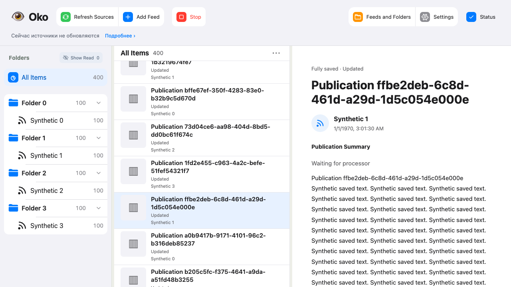

# Удаление прежнего пути хранения и сбора — 2026-10-23

Разрешение: удалить весь legacy и его тесты; поддержку групп Telegram убрать до отдельной задачи пагинации. База изменения: `9ae1b5053a6716ac8e426b0fb7070bf76c9b92f5`. Рабочая установка, резервная копия и retired-data не изменялись.

## Результат

- Каналы Telegram через web/account, RSS, Web/Telegraph и YouTube используют Publication, JSON, общие адаптеры и независимые MediaFile Jobs.
- Удалены Markdown/version/result хранение, Restore, старые подписи и schema upgraders, офлайн-миграторы, синхронная загрузка файлов, парсер inline-статей Telegram и поддержка групп/форумов/тем.
- В производственном контракте Material больше нет Image/Attachment с bytes. Байтовые удобства двух синтетических fixtures находятся только в tests/support/source.py.
- Старая неперенесённая база отклоняется до записи. Исторический перенос при необходимости выполняется прежним выпуском 9ae1b50 по сохранённой инструкции.
- Удалены тесты старых миграций, восстановления файловых результатов, aggregate/schema upgrades, форумов и прежнего запрета автоматических повторов. Смешанные test_rss, test_rss_history, test_source_results и test_source_revisions сохранены и переведены на действующий контракт. Отрицательные проверки запрета старых HTTP-операций сохранены.
- Проверки актуальных сценариев сохранены: отмена и поздние ответы, падения процесса, повторы, чтение каналов, AI-разрешения, происхождение результатов, общие публикации, файлы, настройки, HTTP и браузер.

## Найденные и исправленные регрессии

Ручной refresh после падения снимает обычный срок повтора; внешние ограничения сохраняются. Потерянный файл снова допускается даже после done Job. Явный reload принимает метаданные до перепроверки готовых файлов; поворот signed locator того же ресурса сохраняет ID и байты. Неудачная перепроверка не уничтожает пригодный файл. Изменение текста доступно до завершения медиа.

Ограничение Telegram-поста сохраняет его собственную копию и связи со статьями. Связанная статья обновляет читательскую проекцию и обработку корня. Разбиение того же фрагмента предпросмотра на другие текстовые блоки не считается авторской правкой.

Окно RSS не теряет исходные ID из-за несортированных дат. Порядок YouTube без дат сохраняется между порциями, при расширении истории и новых загрузках; добавлены сценарии на 100 публикаций. Формат курсора остаётся внутри адаптера, Store получает отдельно вычисленный порядок внешних ключей.

Cron не пересогласует готовые к выполнению Jobs каждые полсекунды. Изменение содержимого ставит processing_dirty в принимающей транзакции; reconcile отменяет устаревшие Jobs. Подтверждённо пустой вход проверяется также перед выполнением принятой Job, поэтому падение между постановкой Job и no_input не отправляет пустой вход модели.

## Фактическая проверка

Итоговый `./scripts/check all --compact` на неизменяемом снимке `99715258fbb00cc8191da28d6cf84a331b33a9e2`: **PASS**, 160.35 секунды.

| Набор | Результат |
|---|---|
| Python: функциональные проверки | 829 PASS |
| Python: инструменты разработки | 162 PASS |
| Python: HTTP/поставка | 9 PASS |
| Playwright/браузер | 334 PASS, 2 SKIP |
| Типы Python/TypeScript, контракты, lint, сборка, entrypoint, diff | PASS |

Всего собирается 1000 Python-тестов. Два браузерных пропуска существовали до этой задачи и оставлены по просьбе пользователя от 2026-10-15: closing/keepalive и coexistence/BFCache.

Ранее полные прогоны падали; ограниченные повторы не выдавались за полный успех. Последние промежуточные all5 и all6 оставляли соответственно пять и одно падение Python, плюс бюджет задержки чтения. После исправлений выполнен новый полный all7, указанный выше. Исходные логи находятся в изолированном checkout, `.scratch/check-runs/20261023T204011Z-cd3f6e05/`.

[Компактный отчёт](remove-legacy/check-summary.json). [Измерения задержки](remove-legacy/latency-400-active.json): 400 сохранённых публикаций с активной обработкой, 40 первых и 40 повторных открытий; P95 27.5/27 мс при исходном пороге 200 мс. Проверено изображение Playwright:

Независимое ревью проверило запрос/спецификацию и корректность реализации. Замечания о границе RSS, многостраничном порядке YouTube и восстановлении пустого входа закрыты; заключительный focused re-review — без открытых замечаний.

Ограничения: использованы только синтетические источники и модели, временные SQLite и файлы. Личные подписки, Telegram-аккаунт, настоящий AI и рабочая установка в этой очистке не проверялись и не изменялись. Публикации или слияния cleanup в GitHub не выполнялись.
