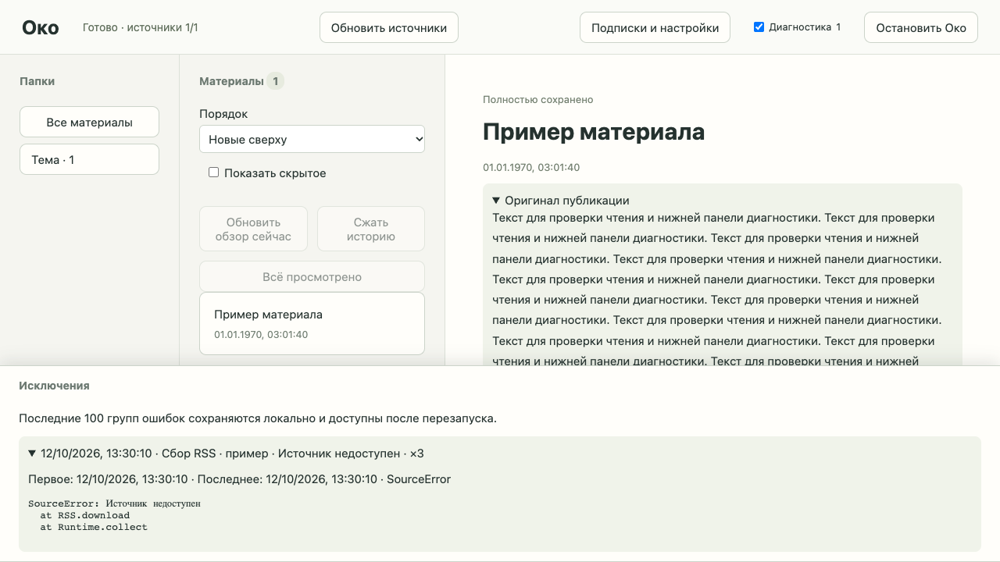

# Проверка добавления RSS по URL и диагностики

2026-10-12. Основание: [согласованная спецификация](../../.scratch/rss-debug/spec.md), [задачи](../../.scratch/rss-debug/README.md).

## Добавление подписки

Пройден путь URL → проверка RSS/Atom и названия → выбор/создание папки → явное сохранение. Проверка не создаёт подписку или папку; сервер отклоняет сохранение без проверочного результата либо с другим URL. Проверены изменение URL, запоздалый ответ и остановка во время проверки, отсутствие названия и ручной ввод, ошибки XML/HTML/сети/таймаута, повторная попытка и восстановление после перезапуска.

Повторное добавление открывает существующую подписку. Два одновременных HTTP-запроса создают одну идентичность; название, папка и настройки сохраняются. Собственный YouTube-фид из формы использует действующий сборщик; субтитры следуют текущим настройкам. Импорт OPML и обычные RSS со ссылками на видео сохраняют прежнее поведение.

## Диагностика

Проверены ошибки HTTP API, включая обработанные ошибки и валидацию, браузера, сборщиков и обработки; исходный traceback YouTube-процесса получен через настоящий локальный worker с подменой внешнего SDK. Ошибки разных фидов разделены. Повтор объединяется со счётчиком, первая/последняя дата и последние 100 групп сохраняются после перезапуска. Один сбой через несколько обработчиков не считается повторно; повторное использование объекта исключения в новом запросе считается новым возникновением.

Отмена работы и проверок обработчиков не создаёт ошибки. Обычное отсутствие ещё не созданного результата обзора не загрязняет журнал. Сбой диска оставляет читатель работоспособным и показывает несохранённое состояние; после восстановления запись сохраняется.

При недоступном сервере браузер показывает ожидающие доставки ошибки и объединяет повторы. Стабильный поток вкладки и возрастающий номер доставки дают идемпотентное подтверждение; старая доставка не увеличивает счётчик после 300 возникновений в другой вкладке и перезапуска. Размер квитанций не растёт с числом повторов в одном потоке.

Нижняя панель сохраняет выбранный материал и scrollTop области чтения; раскрытый traceback сохраняет своё состояние при опросе. Токен сессии, Basic/Bearer и полностью заключённые в кавычки пароли/ключи (включая пробелы и экранированные кавычки) скрываются до показа и сохранения. Значения переменных стека не собираются.

## Проверки и ревью

- HTTP-приёмка и регрессии проходят через публичный API, настоящие временные SQLite/файлы и подмены внешних систем.
- Браузерные сценарии используют настоящие HTML/JavaScript в отдельном headless Chrome и подменяемый сетевой транспорт; скриншот содержит только синтетические данные.
- Завершающий полный Python-прогон после всех исправлений: 221 passed. Предупреждение Starlette о будущем httpx2 существовало до изменений.
- Полный браузерный набор после исправлений: 18 passed.
- Mypy: Success, 35 source files. Проверки синтаксиса JavaScript и git diff --check прошли.
- Standards: замечание о полном скрытии паролей исправлено; повторное ревью без блокеров.
- Spec: скрытие учётных данных, отмена проверок обработчика и идемпотентность старых доставок исправлены; повторное ревью без блокеров.

## Реальная сеть

Отдельно загружен указанный пользователем публичный фид https://www.youtube.com/feeds/videos.xml?channel_id=UCYO_jab_esuFRV4b17AJtAw через действующий RSS downloader: название 3Blue1Brown, 26240 байт, MIME text/xml. Настоящая подписка не создавалась. Это подтверждает доступность и разбор фида на момент проверки; реальные субтитры и AI-обработка в этой проверке не запускались и не считаются подтверждёнными.
