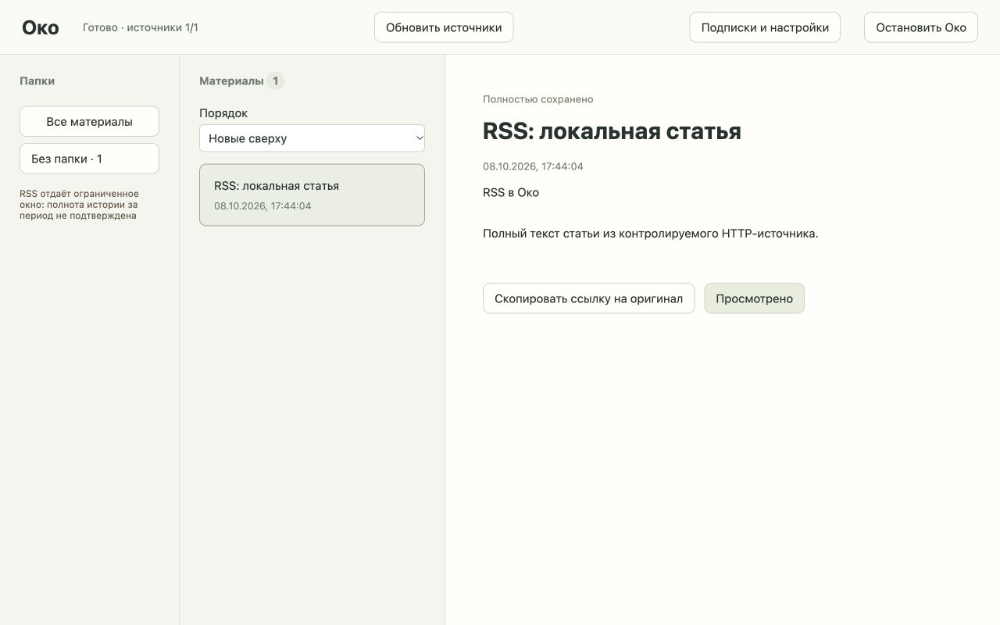

# Тикет 03: RSS/Atom

2026-10-08. База изменений: `47b31e2d777b5cdd46cca5f5d729d6fcbf35b854`.

## API с контролируемым HTTP

11 новых проверок в `tests/test_rss.py` используют настоящий временный Store/SQLite и HTTP-границу httpx.MockTransport. Покрыты полная статья и изображения, неполный анонс и повтор, RSS/Atom, первоначальный период и запоздавшие записи после перезапуска, независимые ошибки 401/429/503, повтор GUID с разными ссылками, нормализация URL, Atom XHTML/xml:base, восстановление после сбоя между записью файлов и фиксацией, поздний ответ после просмотра и отзыв ограниченного RSS-подключения. Содержимое источников не записывается в диагностические исключения.

Трассирующий тест статьи сначала падал: `create_app` не принимал `rss_enabled`. Отдельные red → green циклы нормализации порта и Atom XHTML выявили дубли и потерю xml:base/изображений; исправления подтвердились через API. Остальные сценарии проверяют реализованные вертикальные срезы.

Итоговый запуск: `.venv/bin/pytest -q` — 35 passed, 1 существующее предупреждение Starlette/httpx, 14.07 с. `.venv/bin/mypy oko` — 7 файлов, без ошибок. `node --check oko/web/app.js` — без ошибок. Lock-файл обновлён, httpx переведён в runtime-зависимости без смены версии.

## Реальное подключение

Отдельная ограниченная проверка: [Python Blog RSS](https://blog.python.org/feeds/posts/default?alt=rss), настоящий HTTP без подмен. Обёртка ограничивала обнаруженный набор одной статьёй, период 365 дней; чтение и удаление выполнялись через API Око. Результат: 1 карточка, `full=true`, 5561 символ текста, 0 изображений в этой статье, после просмотра каталог материала удалён. Всё хранилось в автоматически удаляемой временной папке. Это проверка одного публичного фида, не всех подписок и не Telegram-аккаунта.

Контракты форматов сверены с [RSS 2.0](https://www.rssboard.org/rss-specification) и [Atom RFC 4287](https://www.rfc-editor.org/rfc/rfc4287).

## Браузер, вариант A

Настоящий локальный ThreadingHTTPServer отдавал RSS, HTML-статью и PNG; Око запускался обычной командой с RSS-сборщиком в изолированной `/tmp/oko-rss-browser-v2`. Проверены завершение 1/1, выбор материала, полный текст, локальное изображение (декодировано браузером, `naturalWidth=1`), просмотр, нулевой счётчик и обновление без возврата карточки. Изображение фикстуры — 1×1 px. Выявленный запрет blob-картинок CSP исправлен; удалённые изображения не разрешены. Desktop-раскладка проверена при 1280×800.

## Ограничения

Извлечение HTML эвристическое, без JavaScript. Неполная статья доступна для повтора. RSS не предоставляет гарантированной полной истории; предупреждение о конечном окне не маскируется успешным сохранением конкретной статьи. Первоначальная граница периода сохраняется; последующие проходы обрабатывают доступное окно, подавляя известные ID/URL. Версии источника и универсальный HTTP-кэш — отдельные будущие задачи.
