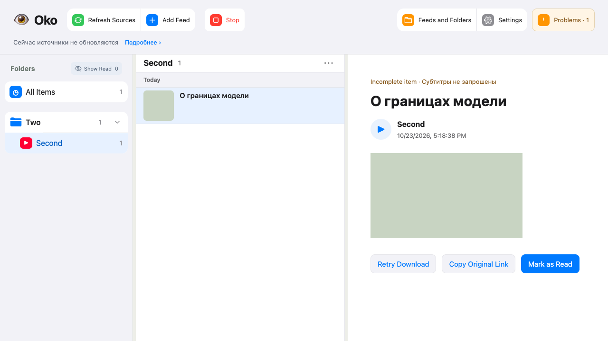
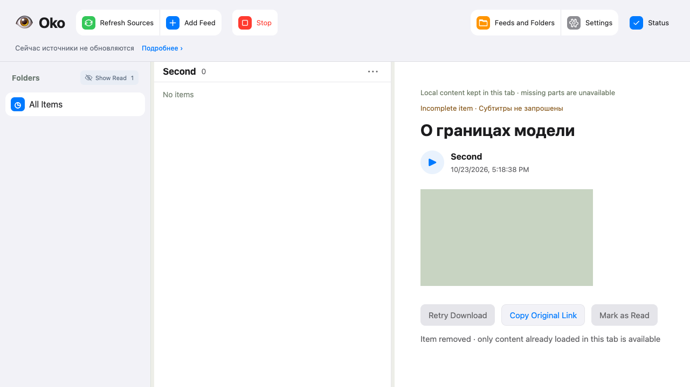

# Проверка общих публикаций — #97

База `e7127f7a0356321be3be82be550d68098571786e`. Только временные SQLite/файлы,
синтетические HTTP/Telegram/YouTube/model providers и Playwright. Личные источники,
аккаунты и рабочая установка не использовались.

## Приёмка

- 9 HTTP-сценариев `test_shared_publications.py` PASS: два фида с одним внешним
  ключом; просмотр везде; удаление первого владельца с сохранением файла; перенос
  выполняемого скачивания; повтор native-истории; отмена окна без пропуска будущих
  постов; запреты публичного AI и один результат; совпадение полного/селективного
  HTTP и порядка; офлайн mapping старых копий; очистка недостижимого цикла.
  Некоторые проверки объединены в один пользовательский сценарий.
- 49 media/native HTTP checks PASS до последних исправлений; 38 shared/linked/
  reader-versions/folder-completion PASS; 24 shared/read-versions/read-cost PASS;
  исходные SQL-бюджеты не ослаблялись. Итоговые shared + initial history: 22 PASS.
- 12 feed-details/actions-cost PASS после исправления идемпотентной даты просмотра
  и ограничения derived refresh затронутыми scopes. Mypy: 114 source files PASS.
- Независимые Standards/Spec: 0 открытых замечаний. Исправлены глобальный пересчёт
  библиотеки, рассогласование primary-owner в полном/селективном HTTP, перенос
  running media job и объединение доказанных старых экземпляров.

## Полные прогоны и повторы

Первый `./scripts/check all --compact`, head `39e454f`, tree
`8d8038c05dce3c46c5e78f3e91b4ca770f6c9efb`, report
`20261023T140548Z-e92e32e8` (207.48 s): 911 Python PASS / 6 FAIL,
333 browser PASS / 1 FAIL / 2 SKIP. Падения включали дату повторного просмотра,
SQL budget и fixture SQLite functions; они исправлены. Два subprocess-сценария
и browser folder-confirmation прошли повтор без ослабления ожиданий.

Второй полный прогон, head `c34045c`, tree
`2837f3a25feb5022d0de98d2a713905e0f3f0dcb`, report
`20261023T141608Z-74c98262` (228.73 s): contracts, tooling-types, syntax, lint,
types, browser-types, build, HTTP, browser, diff и entrypoint PASS.
Лог браузера содержит 334 PASS / 2 SKIP и дополнительный batch 4 PASS.
Python: **920 PASS / 1 FAIL**. Полный прогон целиком не зелёный.

Единственное падение второго прогона — test_pending_deletion_survives_process_death:
проверка содержимого файлов гонялась с удалением transient state.sqlite-journal.
Исходный процессный набор в ограниченном повторе: 8 PASS. Проверка усилена:
после подтверждения очистки синтетический процесс штатно останавливается,
проверяются стабильные файлы. Итоговый повтор указан ниже.

Playwright shared publication + folder context-menu: PASS,
report `20261023T141821Z-78b0833c` (28.00 s). Общая публикация видна через оба фида,
сохраняется после удаления первого и удаляется из списка после просмотра.
Скриншоты просмотрены. Уже открытая копия остаётся только в памяти вкладки.

## Ограничения

Рабочая установка не мигрировалась и не перезапускалась; её release SHA не проверялся.
Объединение старых копий выполняется только офлайн по adapter key и совместимому
текущему содержимому; неоднозначные копии дают blocking conflict. Завершение общего
переноса, удаление временной совместимости и функций по дате/версиям — #98.

Итоговый `test_process.py` после устранения гонки проверки: **8 PASS**, 14.79 s.
Полный прогон после test-only исправления не повторялся; успех этого повтора
относится к процессному набору, а не заменяет результат полного прогона выше.
