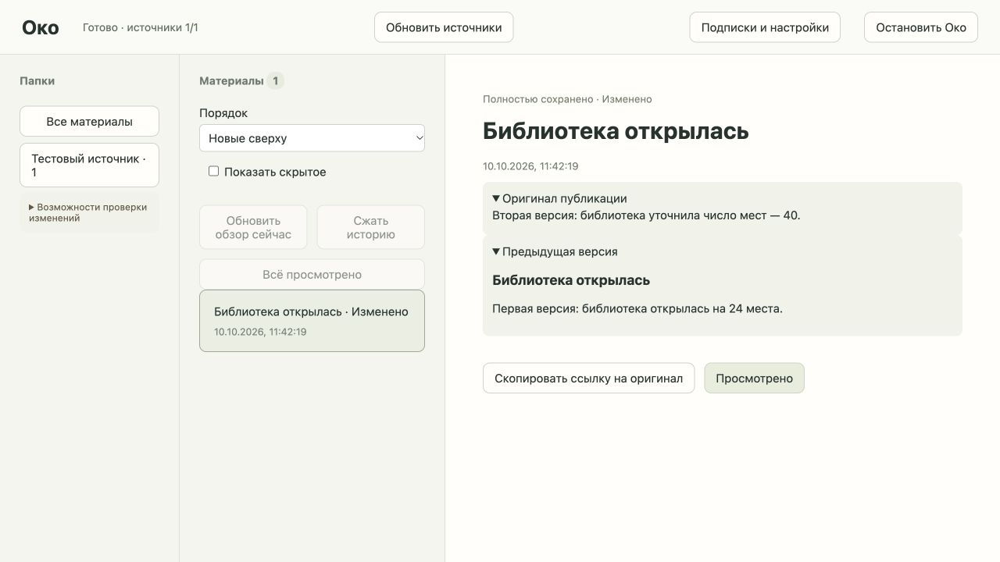

# Правки источников: проверка №13

2026-10-10. База ревью: `989e143a49b260c6596565c9f1361c75bed1746f`. Тикет: `.scratch/oko-implementation/issues/13-source-revisions.md`.

## Поведение и хранение

При повторном сборе сохранённые непросмотренные ID в окне RSS/YouTube перечитываются. Telegram отдельно проверяет известные непросмотренные сообщения после discovery; материалы прежнего RSS-транспорта не отправляются Telegram. Просмотренные ID остаются tombstone и не загружаются.

`oko/storage/versions.py` владеет версиями и их файлами. SQLite хранит только номера, fingerprint содержимого, текущий указатель, видимость версии и признак недоступности в источнике. Fingerprint включает оригинальный Markdown и байты изображений/вложений. Файлы версии неизменяемы после публикации. Текущий указатель публикуется в транзакции Store после перемещения и fsync новой директории. Повтор текущего содержимого не создаёт дополнительной версии. Первичный teaser не выдаётся за предыдущую принятую версию статьи.

После сбоя до фиксации указателя прежняя версия остаётся текущей; сирота не публикуется при восстановлении. Задание повторяет чтение источника. Локальный просмотр удаляет все директории версий, staging и производные представления, включая метаданные версий; пересекающиеся сводки не удаляют другие непросмотренные исходники.

Тезисы и фильтры используют fingerprint актуальной версии. Допуск поздних ответов проверяет сигнатуру и поколение. События пересобираются существующим механизмом сигнатур. Обзор сохраняет замороженные ID, но обновляет их версии и заново проходит стадии по новому содержимому. Во время повторного чтения набор обзора не теряется. Политика публичного AI сохраняется; запрет не компенсируется старым ответом или скрытым fallback.

## API и браузер

Тесты `tests/collection/test_source_revisions.py` проходят через API с временными SQLite/файлами и подменяемыми внешними Source/HTTP/AI. Проверено:

- RSS: правка текста и медиа, предыдущие байты, повтор без копий, перезапуск, удаление всех версий и защита просмотренного ID.
- Обновление тезисов и того же обзора по актуальному тексту без изменения состава ID.
- 404 статьи оставляет полноценно сохранённую локальную копию и не заменяет её анонсом.
- Сбой после перемещения версии: прежний материал доступен; после перезапуска принимается свежая третья версия, а прерванная вторая не выдаётся за предыдущую.
- Telegram: перечитывание известного ID за cursor, удаление всего текста, правка только байтов медиа, сохранение копии недоступного поста.
- Старый ответ AI, который пережил отмену, не публикует тезисы для новой версии.
- YouTube: новое название того же видео, доступ к предыдущему названию; исчезновение из Atom не считается удалением.
- Правка обновляет событие; просмотр изменённого исходника удаляет его версии, сохраняя остальные исходники события.
- После запрета публичного AI новая версия не отправляется внешнему обработчику, старые тезисы недоступны, ошибка ожидания разрешения видна.

Красные проверки перед реализацией: сохранённая RSS-статья не обновлялась; обзор после правки не пересобирался; 404 не сохранял ожидаемое состояние недоступности. Последующие проверки расширяют уже работающие сценарии. Диагностические ошибки фикстур (подключение без heartbeat, чтение текста из краткой карточки, неправильный GET фидов) исправлены без изменения требований.

Браузер проверен через Cua на временном синтетическом Око: карточка «Изменено», актуальный текст, раскрытие «Предыдущая версия» и оригинальный текст. Первый временный сервер успел завершиться без вкладки; повторный запуск увеличивал только grace диагностического сервера. Тестовая вкладка и сервер закрыты, временное хранилище удалено. Личные материалы в браузер не загружались.

## Реальные подключения и ограничения

Два последовательных чтения настоящими адаптерами:

| Источник | Наблюдение | Граница обнаружения |
| --- | --- | --- |
| NASA RSS `https://www.nasa.gov/feed/` | 10 записей за выбранный период, первая статья: 1692 символа, full=true; два чтения совпали | Повтор статей, присутствующих в конечном окне фида. 404/410 означает недоступность, не доказательство причины. Отсутствие записи в окне не означает удаление. |
| TED-Ed YouTube `UCsooa4yRKGN_zEE8iknghZA` | 2 записи за период, `h6CmKF-mN2U`: название и одно превью совпали при повторе | Название, субтитры по включённому режиму и превью видео в Atom. Удаление и правки вне окна не определяются. В этой проверке субтитры не запрашивались; реальная интеграция субтитров принята отдельно в `youtube-updates.md`. |
| Публичный Telegram `@telegram/151` | 756 символов, одно вложение, два чтения совпали | Известные непросмотренные ID проверяются прямым `messages` и загрузкой медиа. Исчезновение может означать удаление или потерю доступа. Неполный ранее сохранённый альбом не считается доказательством удаления всех сообщений. |

Это проверка повторного чтения реальных источников, а не наблюдение фактической правки автором. Управляемые изменения и удаление имитировались только на внешних тестовых границах. Настоящие личные сообщения не изменялись, отметки прочитанного не отправлялись, AI не вызывался. Ollama и общая локальная модель не запускались.

Первый Telegram-вызов отказал из-за занятой сессии. По прямому запросу пользователя `codex mcp remove telegram` удалил глобальную запись MCP; TOML проверен, оставшийся процесс остановлен. Собственный Telethon-клиент после освобождения сессии успешно выполнил повторное чтение. Авторизация и исходный файл окружения клиента сохранены.

## Регрессии и проверки

Старый тест повторного discovery уточнён: непросмотренные ID теперь разрешено перечитывать, просмотренный по-прежнему запрещён. Проверка прерывания Telegram-download проверяет завершение прежнего процесса и отсутствие частично скачанных байтов: очередь подтверждений прочтения может легитимно запустить новый worker и создать пустой spool. Инъекция внешней потери медиа ищет файл в принятой директории версии, а не предполагает фиксированный номер `1`.

Первый полный запуск в sandbox: 178 passed, 13 failed. 12 ошибок связаны с запретом loopback/запуска тестового сервера, одна — с прежним ожиданием отсутствия повторного чтения любых ID. Проверки повторяются с разрешённым loopback после уточнения этого ожидания.

Повторный полный прогон с loopback до ревью: **191 passed in 78.86s**. mypy: 31 source files; `node --check oko/web/app.js` и `git diff --check` прошли.

## Ревью

Standards относительно базы: 0 документированных нарушений и 0 actionable smells. Spec нашёл P2: сбой download при неизменных Telegram-тексте и байтах создавал ложную историю. Добавлена API-регрессия: она была красной на смене fingerprint неизменного поста. Исправление сохраняет принятую полную копию и показывает retry/error. Правка текста с неполным новым скачиванием остаётся новой версией.

Версии различают fingerprint сохранённого файла и сравнение содержимого без операционных полей full/reason/captions. Уточнение полноты при совпадающем содержимом не появляется как предыдущая авторская правка. Повторная ошибка при совпадающем содержимом не подменяет принятую полную копию. RSS сохраняет ранее скачанное изображение при ошибке его повторной загрузки, YouTube сохраняет прежнее превью; ошибка повторного получения уже принятых субтитров не заменяет их пустым текстом.

После исправления 10 API-сценариев версий и 29 проверок версий/RSS/YouTube прошли; mypy снова чистый. Полный прогон повторяется из-за изменения поведения после ревью.

Полный прогон после первого исправления: **192 passed in 77.26s**. Повторное Standards review: 0 открытых findings. Повторный Spec review подтвердил закрытие ошибки download и обнаружил второй P2: выключение тезисов YouTube при следующем сборе стирало сохранённый transcript из актуальной версии. API-регрессия available → theses=false → collect была красной на пустом тексте. Исправление сохраняет полученные субтитры без нового вызова captions; выключенный режим по-прежнему не запускает тезисы. Декларации возможностей источника остаются видимыми также во время ошибочного сбора.
