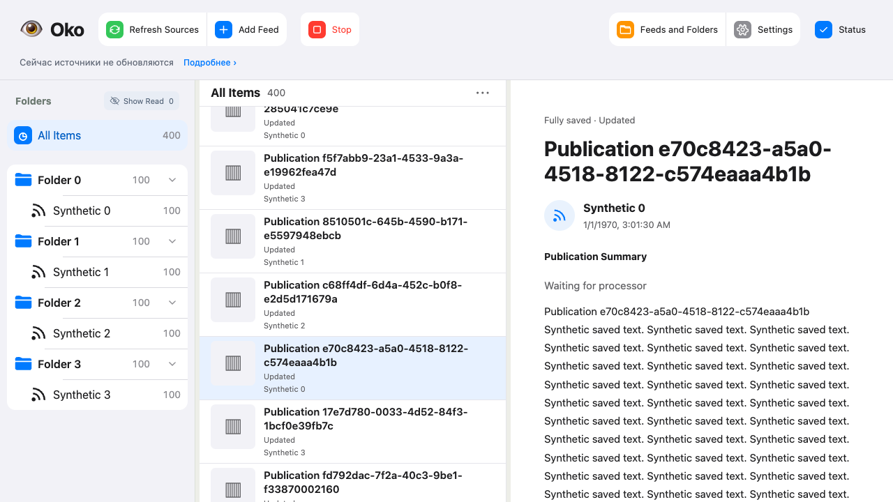

# SQL после перехода на Publication — 2026-10-24

База: cleanup `dcd5318669b68d533f87eb8597c5944284630b2d`, удаление прежнего пути описано в [предыдущем отчёте](remove-legacy.md). Цель: закончить миграцию и устранить замедление SQL без новых сущностей и параметров.

## Причины и исправления

- Навигация читала фильтры каждой публикации, а метаданные и статус — настройки, историю и привязки каждого фида отдельными запросами. Использованы существующие счётчики видимости и пакетные чтения с теми же правилами наследования. Общие публикации считаются один раз.
- Готовность источников многократно обходила общую очередь. Теперь это один запрос с индексом полного состава фида, включая ожидающие удаления просмотренные публикации.
- Выбор Jobs сканировал чужие медиа и JSON, а план зависимостей перемножал корневые публикации и отдельные статьи. Кандидаты выбираются индексированными ветвями UNION; зависимости обходятся root → link → article. Для pending Jobs добавлен индекс `(kind,item,next,id)`. Очерёдность и проверки допуска сохранены.
- Поиск неполных публикаций для каждой строки перебирал общую очередь файлов. Вложенный EXISTS ограничивает поиск файлами этой Publication. Готовые заголовки не декодируются; неиспользуемые названия affected-объектов не загружаются.
- Сохранение одного материала запускало глобальную отмену сиротских MediaFile Jobs. Удалённые собственные файлы отменяются в принимающей транзакции; общий поиск сирот выполняет периодическая очистка. Отдельный проход субтитров получает только YouTube-фиды.

## Измерения

| Сценарий | До | После |
|---|---:|---:|
| Навигация, 184 синтетических фида / 1472 публикации | 2949 SQL | 11 SQL |
| Статус, та же библиотека без ошибок | 1491 SQL | 27 SQL |
| Готовность 184 фидов, копия рабочей базы | 4 785 900 VM / 213 мс | 19 100 VM / 0,9 мс |
| Поиск неполных материалов, копия базы | около 2,2 млн VM | 19 100 VM |
| Пустой общий проход, копия очереди 184 фидов | около 934 тыс. VM / 18,6 мс | 40 400 VM / 1,1 мс |
| Медиа одного фида при росте чужой библиотеки 26 → 1500 публикаций | 3500 → 68 400 VM | 2800 → 2800 VM |

VM — число инструкций SQLite, измеренное progress handler с шагом 100. Времена ориентировочные и зависят от нагрузки машины. Рабочая база менялась сборщиком между отдельными копиями; сравнение этих времён не является тестом на побайтово одинаковом снимке. Детерминированные регрессионные проверки используют синтетические базы и границы роста работы SQL.

[Исходные обезличенные измерения](sql-performance-20261024/). На последней временной копии рабочей базы HTTP навигации занимал 20–32 мс, статуса 40–56 мс. Фоновая работа была выключена, медиа не копировались, настоящий транспорт запрещён. Это не замер работающего контейнера.

Проверки red/green воспроизвели N+1, рост стоимости чужой очереди, глобальную отмену сирот и квадратичные соединения. Для связанных статей 26 → 400 корней с одной статьёй у каждого давали 5900 → 1 135 800 VM до исправления. Для ожидающих файлов рост 36 → 410 публикаций давал 27 400 → 1 923 000 VM. Семантические проверки проверяют также результат, отмену, историю и прямые связи.

## Фактические проверки

Первый полный SQL-прогон прошёл. Второй упал в браузерном сценарии Retry первоначальной загрузки настроек; отдельный повтор всего `test_feed_details.ts` прошёл, production UI не менялся. Третий полный прогон выявил регрессию плана нового индекса в проверке выбранного фида. Порядок индекса и запрос кандидатов исправлены. Неудачные промежуточные планы не поставляются.

После последних исправлений: 63 целевых проверки статусов/навигации/истории/связей PASS; затем 39 проверок диспетчеризации/истории/связей PASS. Независимые focused reviews: открытых замечаний нет, включая последнюю фиксацию порядка соединения.

Итоговый `./scripts/check all --compact` на неизменяемом снимке `59c88757f3d496621ff8d09d77d4e8d058165932`: **PASS**, 166,76 секунды. 842 функциональных Python + 162 инструментальных + 9 HTTP = **1013 Python PASS**. Браузер: **334 PASS, 2 прежних SKIP** по просьбе пользователя от 2026-10-15. Типы Python/TypeScript, контракты, lint, сборка, entrypoint и diff PASS.

[Компактный отчёт](sql-performance-20261024/check-summary.json). [Задержка чтения 400 публикаций при активной обработке](sql-performance-20261024/latency-400-active.json): P95 первого/повторного открытия 46,6/25,5 мс при сохранённом пороге 200 мс. Снимок Playwright просмотрен:

## Рабочая установка

Обновление и проверка установленного выпуска фиксируются отдельно после завершения операции. GitHub push/PR/merge этой очистки и SQL-правок не выполнялись.
