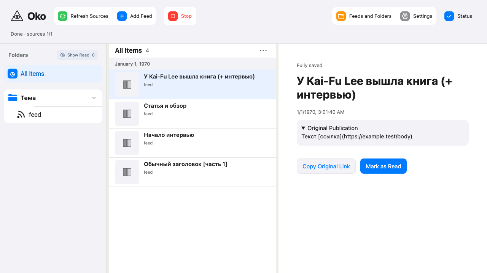

# Стоимость чтения: #53

Проверено 20 октября 2026, база `3981fdf`, реализация `68ebc2d` с исправлениями
ревью `d3269d4`. Это результаты синтетического стенда, не личной базы.

## HTTP и стоимость

Четыре YouTube-фида по 26/100 публикаций, без субтитров, с синтетическим описанием.
Для изоляции фон выключен; SQL trace учитывает только контекст конкретного HTTP
запроса. Файлы/SQLite временные. Все измеренные ответы — HTTP 200.

| Сценарий | Было, 104 | Стало, 104 | Было, 400 | Стало, 400 |
| --- | ---: | ---: | ---: | ---: |
| Навигация | 1288 | 249 | 4840 | 841 |
| Список одного фида | 1703 | 273 | 6439 | 1013 |
| Все карточки | 6695 | 1083 | 25639 | 4043 |
| Открытие одного материала | 92 | 22 | 92 | 22 |

При 20 фидах по 5 публикаций открытие также стоит 22 SQL (раньше 172).
Добавление посторонних публикаций с 26 до 100 в каждом из трёх остальных фидов
не увеличивает SQL выбранной папки. Её 26 файлов original.md читаются по одному
разу. Следующее HTTP-чтение видит изменённую настройку originals; кеш между
запросами отсутствует. Две проверки waiting в открытом материале соответствуют
разным операциям filter/theses и не повторяются.

Регрессионные бюджеты: навигация `<80+2N`, список `<50+11N` для одного фида и
`<80+11N` для всей библиотеки, материал `<35`, где N — число публикаций выбранной
области. Это синтетические бюджеты, а не обещание постоянной стоимости для
материалов с другим составом версий/результатов.

## Индекс и миграция

Временная база: 20000 записей, из них 100 непросмотренных. Запрос упорядоченного
списка использует покрывающий частичный индекс items_unviewed_order. SQLite VM:
61113 инструкций без индекса → 409 с индексом. Одна отметка viewed по PK:
34 инструкции без индекса → 46 с индексом. Время диска не подменяется числом SQL.
Дважды открытая база прежней схемы без индекса сохраняет 100 записей/порядок;
повторный CREATE INDEX IF NOT EXISTS безопасен. Проверка ограничивает чтение
2000 VM-инструкциями и две записи с транзакцией — 200.

## Проверки и исправления

- До правки новые HTTP-проверки упали: навигация 1288/4840, открытие 92→172.
- `.venv/bin/python -m pytest tests/reader/test_reading_cost.py tests/reader/test_material_list_data.py tests/reader/test_navigation.py -q`:
  после исправлений 14 passed. Проверены описание/субтитры, сортировка/превью,
  скрытые материалы, состав завершения и перезапуск, бюджеты/масштабирование.
- `.venv/bin/python -m mypy oko`: 76 файлов, без ошибок.
- Независимый code-review от базы 3981fdf: Standards — одно замечание о владельце
  превью; Spec — два о повторном waiting и граничном фрагменте. Исправлены в
  d3269d4; оба reviewer повторно подтвердили отсутствие замечаний.
- HTTP-регрессия `aabb` с удаляемым `ab` падает на первом коммите (превью `ab`),
  проходит после исправления (превью пустое, display_text `ab`, исходный текст
  `aabb`). Прежние правила сохранены: два прохода для текста, один для описания.
- Промежуточная правка ревью столкнулась с уже существующим методом publication:
  6 целевых тестов упали. Метод переименован в saved_publication; повторный
  целевой набор полностью прошёл. Первая версия синтетического ответа новой
  регрессии не содержала обязательную причину фильтра — ответ исправлен.

Первый изолированный `./scripts/check all --in-place --compact --base 3981fdf`:
contracts, tooling-types, syntax, lint, types, browser-types, build, http, diff,
entrypoint — PASS; browser — 173 passed / 2 skipped; Python — 554 passed и один
FAIL: `test_subprocess_downloads_have_separate_account_pipes_and_spools`,
ожидание запуска первого синтетического worker истекло. Этот прогон не объявлен
успешным. Ранее запуск в sandbox остановился до тестов на запрете ps, затем
подготовка изолированной копии требовала ссылок на установленные node_modules;
зависимости подключены, прогоны выполнены вне sandbox.

Скриншот браузерного сценария списка и открытия просмотрен: заголовки, выбор,
ссылка исходника, текст и Mark as Read отображаются корректно.

Личные подписки, Telegram-аккаунт и настоящий AI не использовались. Приложение
пользователя не перезапускалось. Изменения фонового согласования, статуса,
завершения и доставки обновлений остаются задачами #54–57.

Повтор после исправлений ревью в той же изолированной копии:
`./scripts/check python types http browser --files tests/browser/test_material_list.ts tests/browser/test_opened_material.ts --compact`
— contracts, types, tooling-types, browser-types и http PASS; полный Python-набор **556 passed**,
включая ранее упавший Telegram-worker; затронутые Playwright **20 passed**.
Неизменённые syntax/lint/build/entrypoint и остальные браузерные
сценарии сохраняют результаты первого прогона. Полный отчёт последнего запуска:
`/tmp/oko-sql-53-check/.scratch/check-runs/20261020T102646Z-22dfdcae/report.json`.
Проверки не добавляли инструментальных изменений; тесты tools в объём не входили.
