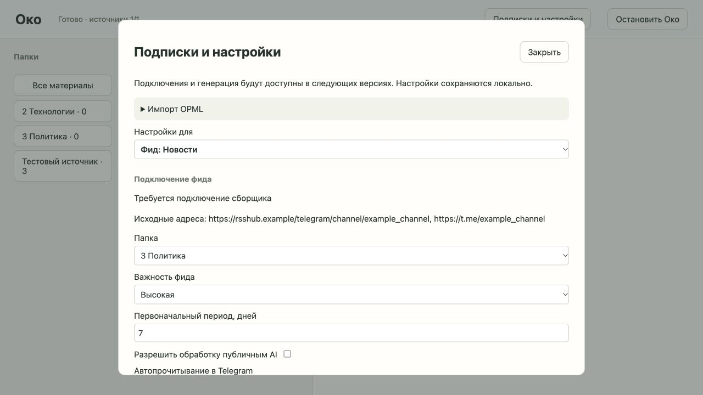

# Подписки и настройки: проверка тикета 02

Дата: 2026-10-08. Граница ревью: `ead8fc7` → реализация тикета 02.

## Автоматические проверки

- `python -m pytest -q`: 24 passed, 12.00s. В том числе девять API-сценариев подписок на временном настоящем хранилище.
- `mypy oko`: нет ошибок в шести файлах.
- `node --check oko/web/app.js`, `git diff --check`: успешно.
- Осталось прежнее предупреждение Starlette: использование httpx TestClient устаревает; это не ошибка приложения или тестов.

Проверены конфликт папок без частичного импорта, повторы адресов и импорта, изменение папки уже известного фида, наследование отдельных полей, сброс, сохранение после перезапуска, разрешения и валидация. Также проверены неизвестные Telegram-маршруты, запрет сущностей XML, не-HTTP адресов, распознавание RSSHub-параметров отображения, числовой порядок папок, буквальный слеш в имени и вложенный путь, сортировки и перенос фида между папками.

Ревью обнаружило глобальную уникальность URL в прежнем хранилище. Исправлено на уникальность в пределах фида. Регрессия подтверждает независимые карточки одинаковой ссылки в разных папках, удаление одной без удаления другой и подавление повторного сбора просмотренного материала. Входное хранилище формата тикета 01 переносится с сохранением текста, ID, отметок просмотра и ожидающего удаления; дальнейший перезапуск также проверен через API.

## Браузер

Настоящий сервер с `--demo`, отдельным `/tmp/oko-subscriptions-browser`, без реальных аккаунтов. Проверен desktop UI A, 1280×800; временный viewport сброшен. Агентские вкладки закрыты, оба тестовых процесса явно остановлены и завершились с кодом 0.

Через UI загружен синтетический `tests/fixtures/subscriptions.opml`. Импорт без выбора папки показал конфликт. После выбора «3 Политика» появился один Telegram-фид и один RSS-фид; повторный импорт их не удвоил. Уровень Око включил тезисы, папка задала промпт, фид унаследовал оба значения. Переопределение промпта на фиде и «Сбросить» вернули промпт папки. Сохранены важность «Высокая», первоначальный период 7 дней и режим чтения после «Просмотрено»; публичный AI и очистка истории остались выключенными. После остановки и нового запуска всё сохранилось.

В читателе проверены новые сверху, старые сверху с обратным порядком трёх карточек, выбор пустой папки с нулевым счётчиком и возвращение ко всем материалам. «Сначала важное» доступно в браузере; различие важности двух фидов проверено API-сценарием.

При первом импорте автоматическая проверка браузерных разрешений завершилась таймаутом во время получения состояния; последующее чтение UI подтвердило уже выполненную загрузку файла. Дальнейшие действия выполнены обычным браузерным управлением без обхода проверки.

## Экспорт пользователя и границы

Локально, только парсером, проверен текущий `News Explorer Export.opml`: 20 папок, 258 записей, 257 уникальных источников (176 Telegram, 67 YouTube, 14 RSS), один конфликт папок. Распознавание параметров отображения проверено по [контракту RSSHub](https://github.com/DIYgod/RSSHub/blob/master/lib/routes/telegram/channel.ts). Экспорт и личные подписки не встроены в тесты и не импортированы в рабочее пользовательское хранилище. Число папок относится к текущему файлу, а не к прежнему описанию экспорта.

Импорт и настройки не подключают реальные источники, не запускают AI или расписания и не отправляют Telegram read acknowledgements. Эти интеграции остаются следующими тикетами. Промпты и конфигурация сохраняются в SQLite; контент публикаций по-прежнему хранится и удаляется через Markdown-путь.
