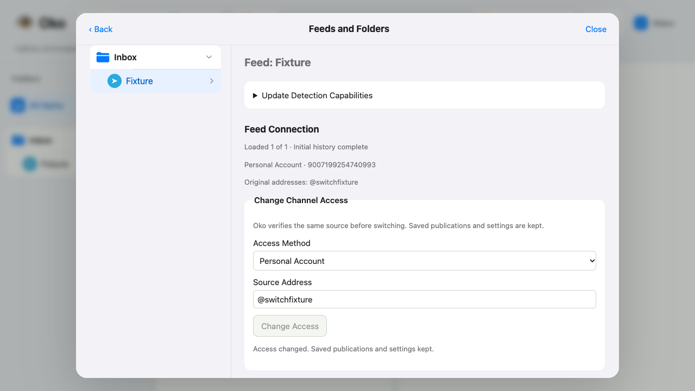
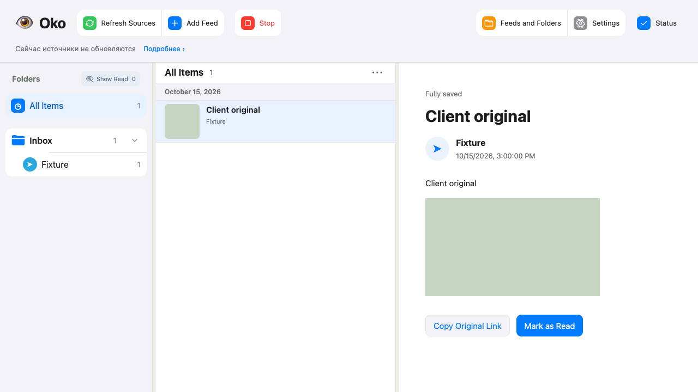

# Проверка Telegram client — #96

База: `7ed331ccac135b57d38a2d7ed58e0ecc3a931ce7`. Проверяется канал
на общей Publication/MediaFile; группы сохраняют прежний путь. Только временные
SQLite/файлы, синтетические Telegram/HTTP/model providers. Личный аккаунт и
рабочая установка не использовались.

## Результаты

- `./scripts/check all --compact`, снимок `c7e2e8a`, tree
  `e1f85b2b03aac737f243115eb0c36159049979f1`, report
  `20261023T134551Z-27142625`: contracts, tooling-types, syntax, lint, mypy,
  browser-types, build, HTTP, diff, entrypoint и 45 tool tests PASS.
  Browser: 331 PASS, 2 FAIL, 2 SKIP; Python: 904 PASS, 6 FAIL.
  Полный прогон целиком не был зелёным.
- Browser failures ожидали старый запрет изменения подключения и инструкцию
  удалить фид. Ожидания приведены к новому согласованному API/интерфейсу.
- Python failures: старое ожидание HTTP 422 заменено на typed 409 для ещё
  не перенесённого фида; проверка YouTube deadline привязана к времени запроса,
  а не более поздним часам опроса; тест медиа теперь ждёт сохранённого doubled
  deadline через HTTP до следующего сдвига часов. Три subprocess/deadline
  сценария прошли в повторе без изменений поведения/таймаутов.
- Повтор пяти затронутых наборов: 67 PASS, 1 FAIL (гонка часов медиа).
  После исправления гонки весь `test_independent_media.py`: **28 PASS**.
- Adapter + native HTTP + offline migration:
  `test_telegram_client_adapter.py`, `test_telegram_client_publications.py`,
  `test_publication_migration.py`: **39 PASS** после исправлений ревью.
  Mypy: **113 source files PASS**.
- Независимые Standards и Spec reviews: замечания закрыты. Проверены настоящая
  последняя публикация после service message (включая отдельную service-only
  страницу), исходные/неизвестные имена медиа, Store-owned transaction и
  adapter-owned opaque locator. Регрессионные тесты проходят.

## Сценарии

HTTP проверяет фиксированное окно, старые → новые публикации, альбомы и рост
альбома, неполный ответ с сохранением копии, один файл в поток, смену ресурса,
сохранение backoff, FloodWait аккаунта после рестарта, независимость web-статьи,
auto-read после собственных/связанных файлов, идентичность при rename,
смену web/client без смены IDs, конфликты и поздние ответы.

Офлайн-перенос сохраняет последние файлы, действительные результаты и встроенные
Telegraph-статьи без сети; противоречивые сохранённые снимки диагностируются.
Группы не переводятся этим шагом. Общая повторная история относится к #97;
завершение переключения всех хранилищ — к #98.

Просмотр скриншотов выявил устаревшую подпись доступа. Регрессия воспроизведена
Playwright (RED), кэш настроек инвалидируется после принятого изменения, форма
перезагружается с guard контекста. Старая открытая публикация остаётся в памяти
до принятия новой версии, как согласовано.

Итоговый Playwright + build + tooling/browser types: **6 PASS**, report
`20261023T135503Z-65ba763c` (17.37 s). Все три сценарных скриншота просмотрены;
подпись подключения теперь соответствует сохранённому доступу.

Полный прогон не повторялся: после исправлений повторены затронутые наборы;
результаты полного и ограниченных повторов приведены отдельно выше.
Рабочая установка не обновлялась, её release SHA не проверялся.
