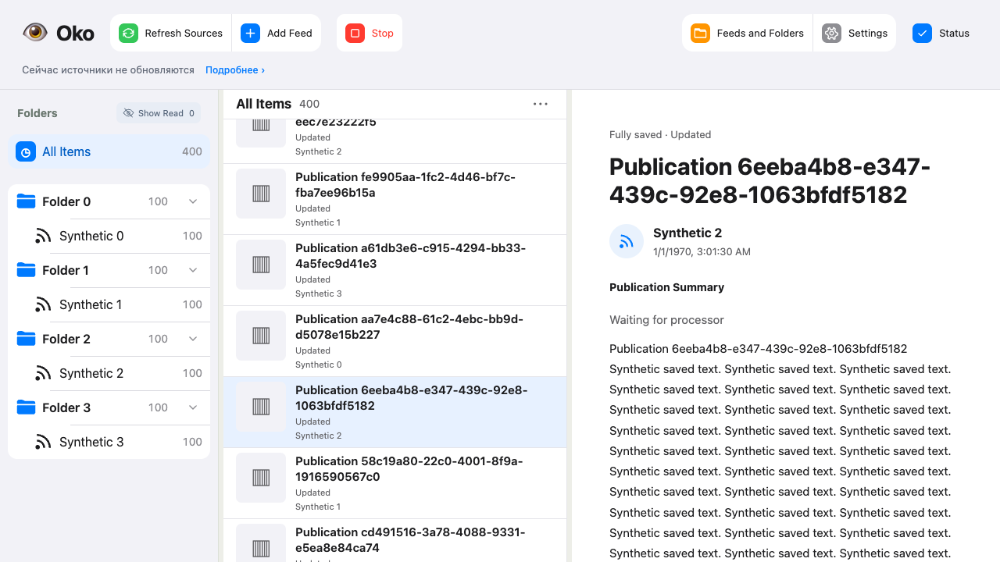

# Объединение тестов и четыре группы — 2026-10-24

База `bcad6657f1660ff1e29381fc14b7daa3561a75a8`. Запрос: убрать дубли и объединить пересечения без потери гарантий, разделить Python/tools/Node/Playwright и измерить каждую группу и весь прогон. Производственный код, зависимости, лимиты, рабочая установка и личные данные не изменялись.

## Что объединено

| Прежние проверки | Сохранённый сценарий и гарантии |
|---|---|
| `test_processing_coordination`: unchanged/restart + originals/theses; `test_publication_processing`: metadata/media | Одна библиотека с двумя готовыми видимыми публикациями и одной скрытой. Успешная генерация при глобальном originals=False; feed override не меняет тезисы и число вызовов. Атомарные метаданные, источник удалённых фрагментов, смена фото без AI-пересчёта, привязка media IDs, более двух cron-проходов, restart и сохранность результатов. |
| Два permission-during-check сценария | Один canonical source: удержанный /props, затем только отзыв public_ai. Нет AI-передачи, результатов, проблем и сохранённых производных. Настройки отображения меняются в другом сценарии, чтобы не подменять причину отмены. |
| Два native album growth сценария | Ручной retry добавляет видео к фото, автоматический collect добавляет текстовую часть. Сохраняются одна карточка/ID, все message IDs, основной текст, оба медиа и completeness. |
| Navigation SQL + status JSON; navigation metadata + status settings/bindings | Два HTTP-сценария вместо четырёх, каждый использует свою неизменную библиотеку для обоих endpoints. Сохранены размеры 4×26/100 публикаций, 4/40 фидов, точные counts, SQL-бюджеты +5/+10 и JSON-бюджет +5. |
| Source readiness + empty dispatch на pending media | Одни независимые временные базы; сохранены результаты ready=1/job=None и оба VM-бюджета +2000 при росте чужой библиотеки 26→400. |
| Три HTTP-отказа групп | Все три исходные пары kind/forum проверены циклом на одном reader; после каждого отказа каталог пуст, код и причина прежние. Adapter-level проверки остаются отдельными. |

Оставшийся hidden-folder completion перенесён целиком в publication processing. Локальный model helper теперь находится в том же файле; импорт сценарного файла из другого сценария удалён. Не объединялись разные worker/SDK, crash, cancellation/late reply, source protocol, history и DOM-границы только из-за похожего названия.

Удалено девять повторных исполнений продуктовых кейсов; добавлены две регрессии: самостоятельный запуск Node без Python-приложения/Chromium и обнаружение мутации checkout, исходящей от Node. Совокупный Python inventory: 1013→1006. Parameter matrices, два исторических browser SKIP и прежние SQL/latency acceptance thresholds сохранены.

## Отчётность

Чистые TypeScript-контракты перемещены в `tests/node`: settings owner109, transport3, fixture contracts1. `check node` запускает 113 кейсов без Chromium/reader. `check browser` — Playwright; ui/all и CI включают оба набора. Все development-файлы и API-generator проверки относятся к tools. 41 development-кейс раньше ошибочно считался Python; исправлена классификация, а не удалено покрытие.

`report.json.test_groups` и `scripts/check-report` показывают counts и duration_seconds для Python (с HTTP), tools, Node, Playwright. JUnit учитывает passed/failure/error/skip, TAP — pass/fail/cancel/skip. Старые отчёты остаются читаемыми; внутренние suite IDs сохранены. Прерванная/неисполненная группа не выдаётся за PASS. Типизация и вспомогательные проверки видны отдельно и включены в Total.

## Замеры

Последовательные полные запуски выполнены командой `./scripts/check all tools --compact` на одной машине, с неизменной параллельностью. Группы выполняются параллельно; их времена не складываются. Python включает отдельно выбранный ранний HTTP-набор, Total включает сборку/типизацию/подготовку. Во время парного before/after другие проверки и benchmark этим исполнителем не запускались. Это одиночные измерения, не доказательство статистически устойчивого процента ускорения.

## Фактические проверки и промежуточные ошибки

Первый исходный all был PASS172.93s, но одновременно выполнялась небольшая целевая проверка runner; он не используется для утверждения ускорения. Первый split full169.35s упал: маленькие snapshot fixtures не содержали tests/node, старый runner assertion зеркалил прежний tool inventory, RSS-проверка считала готовность текста готовностью изображения. Fixtures и inventory property исправлены. RSS ждёт фактические image counts1/2 с прежними assertions через существующее ограниченное ожидание. Целевой build/Python77 PASS; чистый split full163.50s PASS до окончательной классификации ещё16 development-кейсов.

Первый merged target:121 PASS/1 FAIL. Многопостовый Telegram transport не соблюдал before, а settled ожидал одну карточку вместо двух. Повтор processing15 PASS/1 FAIL выявил ошибочный keyword before у текстовой page fixture; использована явная фильтрация по запрошенной границе. Итоговый processing16 PASS. Debug instrumentation удалён. Ревью обнаружило и закрыло причинную неоднозначность permission race; итоговые reviews без открытых замечаний.

Парный before — отдельный чистый clone reporting-only коммита `55af89b809595da3e572749949bd0ebe0deb9deb`: та же классификация четырёх групп, продуктовые сценарии ещё не объединены. Первый полный after175.17s: продуктовые, Node и Playwright PASS; tools203PASS/1FAIL — гонка snapshot fixture. Два добавившихся TS-workers одновременно портили один намеренно изменяемый файл. Владелец мутации теперь задан явно; оба варианта (Node/Playwright) требуют PASS команд и точный checkout FAIL для document.md. Целевые5 PASS, независимое review без замечаний.

Следующий after242.95s: tools205 и Node113 PASS; таймаут существующего процесса single-instance и prepare двух performance-библиотек. Это не превышение p95: библиотеки ещё не были подготовлены. Причина совместных таймаутов не установлена. Изолированные повторы: lifecycle8 PASS14.39s, Playwright performance4 PASS34.31s. Таймауты и acceptance thresholds не увеличивались; сон Mac как причина не подтверждён.

Итоговый повтор того же неизменяемого снимка `2a6512b12512088d51d7f9d886b14f28df9c6643`: **все наборы PASS,219.33s**. Это полный успех после неудачных полных и успешных ограниченных прогонов; успех последних не выдавался за полный.

| Группа | До, кейсов PASS | После, кейсов PASS | До, с | После, с |
|---|---:|---:|---:|---:|
| Python, включая HTTP |810|801|155,38|200,45|
| tools |204|205|141,60|185,42|
| Node |113|113|1,43|1,23|
| Playwright |221|221|142,43|185,00|
| Весь прогон | | |**172,73**|**219,33**|

Playwright также содержит два прежних SKIP. Before включает первую новую регрессию runner; дополнительный mutation-owner case появляется после. Относительно исходного main совокупный Python inventory (включая tools)1013→1006: девять кейсов объединены, два добавлены для нового runner-поведения.

**По последней паре общее время выросло на46,60s (около27%). Ускорение не получено.** Это одиночная пара при неизмеренной фоновой нагрузке ОС; она не устанавливает причинность замедления. Более быстрые промежуточные прогоны не выбраны вместо итогового. [Before](test-suite-cleanup-20261024/before.json), [after](test-suite-cleanup-20261024/after.json), [сравнение](test-suite-cleanup-20261024/comparison.json).

Финальный результат:801 Python +205 tools +113 Node +221 Playwright PASS,2 исторических SKIP. Типы, контракты, lint, сборка, HTTP, diff, entrypoint PASS. Оба независимых ревью завершены без открытых замечаний. Производственный код и версии зависимостей не изменены.

P95 чтения400 публикаций при активной обработке:51,2/49,3ms для первого/повторного открытия при прежнем пороге200ms. Все четыре серии по80кликов выполнены. Скриншот Playwright просмотрен:

Сырые полные результаты сохранены в изолированных checkout `.scratch/check-runs/`; компактные измерения приложены выше. Изменения подготовлены локально в `codex/test-suite-cleanup`; GitHub-публикация и обновление рабочего Око в этом задании не выполнялись.
